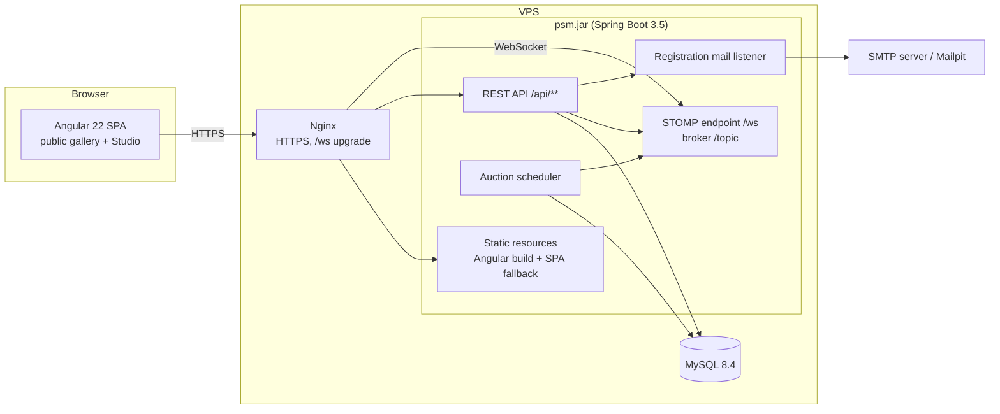
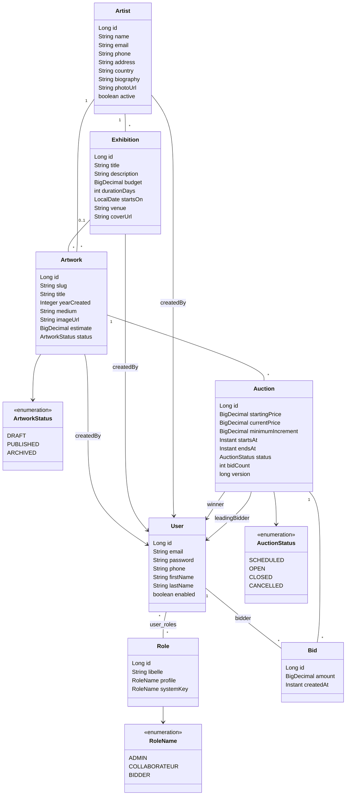
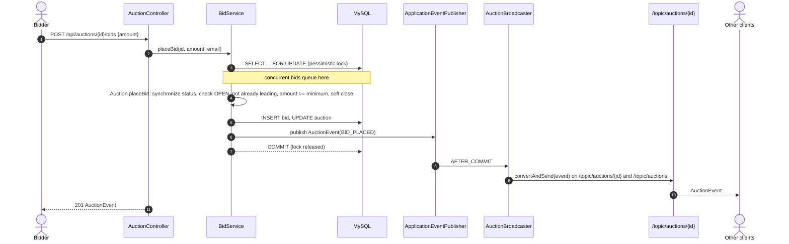
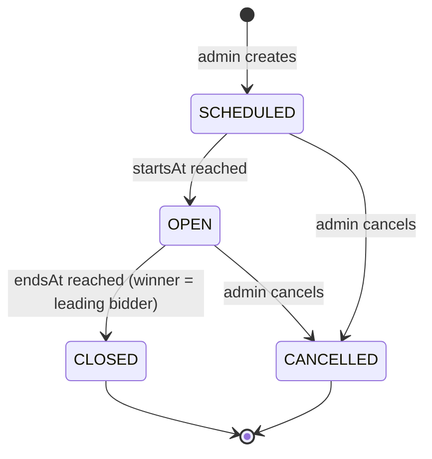

# Architecture

ATELIER is a SmartSoft Solutions product made of one Spring Boot application and one Angular single-page application. In production they ship as one executable jar, `psm.jar`, with the Angular build in `static/`.

## Overview



In development, `ng serve` (port 4200) serves the SPA and proxies `/api` and `/ws` to the backend on port 8080 (`frontend/proxy.conf.json`, `frontend/proxy.docker.json`).

## Backend layout (package by feature)

Base package: `backend/src/main/java/com/sip/psm/`. Each feature owns its entity, repository, service, controller and DTO records.

| Package | Responsibility |
|---|---|
| `auth` | Registration, login, `/api/auth/me`, `UserRegisteredEvent`, `RegistrationMailListener` |
| `mail` | Shared ATELIER HTML/plain-text renderer and SMTP sender; after-commit artist, bid and auction-result notifications. Email links use `PUBLIC_URL`; see [EMAIL.md](EMAIL.md). |
| `user` | `User`, `Role`, `RoleName`, user and role administration (`AdminUserController`, `AdminRoleController`, `UserService`, `RoleService`) |
| `account` | Self-service: profile, password, own bids, won auctions |
| `artist` | Artists (CDC *Client*): public and studio controllers, DTOs with public/private projections |
| `exhibition` | Exhibitions (CDC *Projet*) |
| `artwork` | Artworks, `ArtworkStatus`, slug generation, public and studio controllers |
| `auction` | `Auction`, `Bid`, `BidService`, `AuctionService`, `AuctionLifecycleScheduler`, `AuctionBroadcaster`, DTOs and WebSocket events |
| `studio` | Dashboard aggregates (`StudioOverviewService`, `StudioStatsRepository`) |
| `security` | `JwtService`, `JwtAuthenticationFilter`, `TokenAuthenticator`, `StompAuthChannelInterceptor` |
| `config` | `SecurityConfig`, `WebSocketConfig`, `AtelierProperties` (typed `atelier.*` settings), `AsyncConfig`, `TimeConfig` (injectable `Clock`), `RoleAndAdminInitializer` |
| `common` | `ApiExceptionHandler`, `BusinessRuleException`, `NotFoundException`, `PageResponse`, `AuditedEntity`, `Slugs` |
| `demo` | `DemoDataInitializer` and `DemoCatalog` (loaded when `DEMO_DATA=true`) |
| `web` | `SpaWebConfig`: serves the Angular build and falls back to `index.html` for deep links |

Database schema is owned by Flyway (`backend/src/main/resources/db/migration`: `V1__core_schema.sql`, `V2__artworks_auctions_bids.sql`, `V3__dynamic_roles.sql`); Hibernate runs with `ddl-auto: validate`.

## Domain model



Key rules (database and domain):
- Money uses `BigDecimal` and `DECIMAL(14,2)` columns.
- `bids` has a unique constraint on `(auction_id, amount)`: two bids can never record the same amount.
- An artwork may have at most one scheduled or open auction (`auction_overlap`), and only `PUBLISHED` artworks can be auctioned.
- An exhibition may only contain artworks of its own artist (`exhibition_artist_mismatch`).
- Artists, exhibitions, artworks and auctions carry an optimistic `version`; a stale update returns 409 `stale_update`.

## Security

### Stateless JWT

- `POST /api/auth/login` and `/register` return `{token, expiresAt, user}`. The token is an HMAC-signed JWT (JJWT 0.12) whose lifetime is `JWT_EXPIRATION` (default `PT12H`) and whose key comes from `JWT_SECRET` (at least 32 bytes).
- `JwtAuthenticationFilter` reads `Authorization: Bearer <token>` and populates the security context; sessions are `STATELESS`, CSRF is disabled because no cookie authenticates a request.
- Passwords are stored with BCrypt. A disabled user cannot sign in.
- Unauthenticated calls get a 401 and forbidden calls a 403, both as `application/problem+json` with a `code`.
- CORS allows the origins in `CORS_ORIGINS` on `/api/**`.

### Authorization matrix

Defined in `config/SecurityConfig.java` (first matching rule wins) and tested by `SecurityMatrixIT`.

| Rule | Access |
|---|---|
| `POST /api/auth/register`, `POST /api/auth/login` | everyone |
| `GET /api/artworks/**`, `/api/artists/**`, `/api/exhibitions/**`, `/api/auctions/**` | everyone |
| `POST /api/auctions/*/bids` | `BIDDER` |
| `/api/admin/**`, `/api/studio/auctions/**` | `ADMIN` |
| `GET` and `POST /api/studio/**` | `ADMIN`, `COLLABORATEUR` |
| `PUT` and `DELETE /api/studio/**` | `ADMIN` |
| any other `/api/**` | any authenticated user |
| everything else (static files, `/ws`, `/actuator/health`) | everyone |

### STOMP security

`StompAuthChannelInterceptor` secures the WebSocket channel:
- **CONNECT**: may carry `Authorization: Bearer <token>`. An invalid or expired token is rejected; no token gives an anonymous, read-only connection.
- **SUBSCRIBE**: allowed only on destinations starting with `/topic/auctions`.
- **SEND**: always refused. Bids go through the validated REST endpoint, never through the socket.

## Bid flow



Because the event is broadcast only after commit, clients never see a price that was rolled back. When a rule fails, the transaction rolls back and the client receives a 409 problem (`auction_not_open`, `already_leading`, `bid_too_low`) and no event is sent.

## Auction lifecycle



- `AuctionLifecycleScheduler.advance()` runs every `AUCTION_LIFECYCLE_INTERVAL` (default `PT5S`), finds auctions due for a transition and calls `AuctionService.synchronize(id)` in its own locked transaction; each change is broadcast as `STATUS_CHANGED`.
- `Auction.placeBid` also synchronizes before validating, so a bid placed after `endsAt` is refused even if the scheduler has not run yet.
- **Soft close**: a bid landing within `AUCTION_SOFT_CLOSE` (default `PT60S`) of the end moves `endsAt` to `now + softClose`.
- Terms can be edited only while the auction is live and has no bids; an auction with bids cannot be deleted, only cancelled.

## Frontend structure

Angular 22 with standalone components, zoneless change detection, signals and `OnPush`. Source in `frontend/src/app/`.

```
app/
├── app.ts, app.config.ts, app.routes.ts   Root, providers, routes (lazy loaded)
├── core/                                  Singletons, no UI
│   ├── api/        gallery.api.ts, studio.api.ts, http-params.ts, problem.ts
│   ├── auth/       auth.store.ts, guards.ts, auth.interceptor.ts
│   ├── models/     api.models.ts (TypeScript mirror of the DTOs)
│   ├── realtime/   auction-socket.service.ts
│   └── util/       format.ts, format.pipes.ts
├── shared/                                Reusable building blocks
│   ├── animations/ motion.ts (GSAP), riffle-deck.ts, riffle-formations.ts, flip-transition.service.ts, night-sky.ts
│   ├── components/ artwork-card, auction-status-badge, countdown, section-heading
│   ├── layout/     public-layout, site-header, site-footer, user-menu, brand-mark
│   └── ui/         spartan/ui "hlm" primitives (button, card, dialog, sheet, table, select, ...)
└── features/                              One folder per screen group
    ├── home, gallery, artwork-detail, artists, exhibitions
    ├── auctions (list, room, bid panel, bid history)
    ├── auth (login, register), account, errors
    └── studio (layout, overview, artists, exhibitions, artworks, auctions, users, roles, profile, shared CRUD helpers)
```

- **Two shells**: `PublicLayout` (art-first, cinematic) and `StudioLayout` (clear, Argon-inspired sidebar and ivory content area, under `/studio`).
- **State**: signals only. `AuthStore` holds the session (token in `localStorage` under `atelier.session`, expired sessions ignored at startup) and exposes `isAuthenticated`, `isAdmin`, `isStaff`, `hasRole`.
- **Guards**: `authGuard`, `roleGuard(...roles)`, `guestGuard` (see `core/auth/guards.ts`). `/studio` requires `ADMIN` or `COLLABORATEUR`; Auctions, Users and Roles require `ADMIN`.
- **Interceptor**: `authInterceptor` adds the bearer token to `/api/` calls and logs out on a 401 (except on login/register).
- **Realtime**: `AuctionSocket` keeps one shared STOMP connection to `/ws`, opened by the first subscriber and closed by the last, with automatic re-subscription after reconnects. `auction(id)` and `all()` return observables; `state` is a signal (`idle`, `connecting`, `live`, `reconnecting`).
- **Studio CRUD**: `features/studio/shared/` (`crud-page`, `crud-table`, `form-sheet`, `form-field`, `confirm-dialog`, `pagination`) keeps the artist, exhibition, artwork, auction, user and role pages consistent; Chart.js is wrapped by `chart-canvas.ts`.
- **Styling**: Tailwind CSS 4 with tokens in `src/styles.css` (`midnight`, `cobalt`, `sunflower`, `ivory`, `canvas`, `cypress`, `terracotta`, `ink`; fonts Cormorant Garamond, Manrope, JetBrains Mono).

## Motion system

All animation goes through `shared/animations/motion.ts`, which registers GSAP `ScrollTrigger` and `Flip` once and exports `prefersReducedMotion()`.

- **Riffle deck** (`riffle-deck.ts`, poses in `riffle-formations.ts`): paintings arrive as a pile and riffle open into a ring; while the section is pinned, scrolling gathers them into a pile, stretches them into a corridor and brings one painting forward. Poses are pure functions of the viewport (unit-tested in `riffle-formations.spec.ts`).
- **Flip transition** (`flip-transition.service.ts`): an artwork card captures its image rectangle before navigation and the detail page animates from it.
- **Night sky** (`night-sky.ts`): ambient backdrop for the dark (midnight) sections, with a still version under reduced motion.
- **Reduced motion**: with `prefers-reduced-motion: reduce`, scroll sequences are replaced by a calm, swipeable row and transitions are skipped.

## Error format

Every error is an RFC 9457 `application/problem+json` document with a stable machine-readable `code`, produced by `common/ApiExceptionHandler` (and by `SecurityConfig` for 401/403).

```json
{
  "type": "about:blank",
  "title": "Conflict",
  "status": 409,
  "detail": "The minimum bid is now 550.00",
  "instance": "/api/auctions/12/bids",
  "code": "bid_too_low"
}
```

Validation failures add a `fields` map. The frontend turns them into messages with `core/api/problem.ts` (`problemOf`, `messageOf`). Codes are listed in [API.md](API.md#error-format).

## Editable roles and stable permissions

`Role.libelle` is an editable unique label. `Role.profile` keeps one of the three permission profiles (`ADMIN`, `COLLABORATEUR`, `BIDDER`). V3 adds the non-null profile and nullable unique `system_key`. The initializer finds the three required roles by their system key, so a label change survives restarts and never creates a replacement system role.

`RoleService` owns role CRUD and its integrity checks. Required roles retain their profile and cannot be deleted. Assigned custom roles retain their profile and cannot be deleted until unassigned. Renaming remains available. These rules preserve existing account authority while administrators manage the catalogue.

Users hold actual catalogue rows through `user_roles`. Administration accepts `roleIds` and retains the legacy profile-array contract. Responses expose `roleIds` for selection and deduplicated effective `roles` for security. JWT authorities, server access rules and Angular guards check profiles. A label such as “ADMIN” alone grants no authority. The ADMIN-only `/studio/roles` page manages the catalogue; the Users page loads it dynamically.
