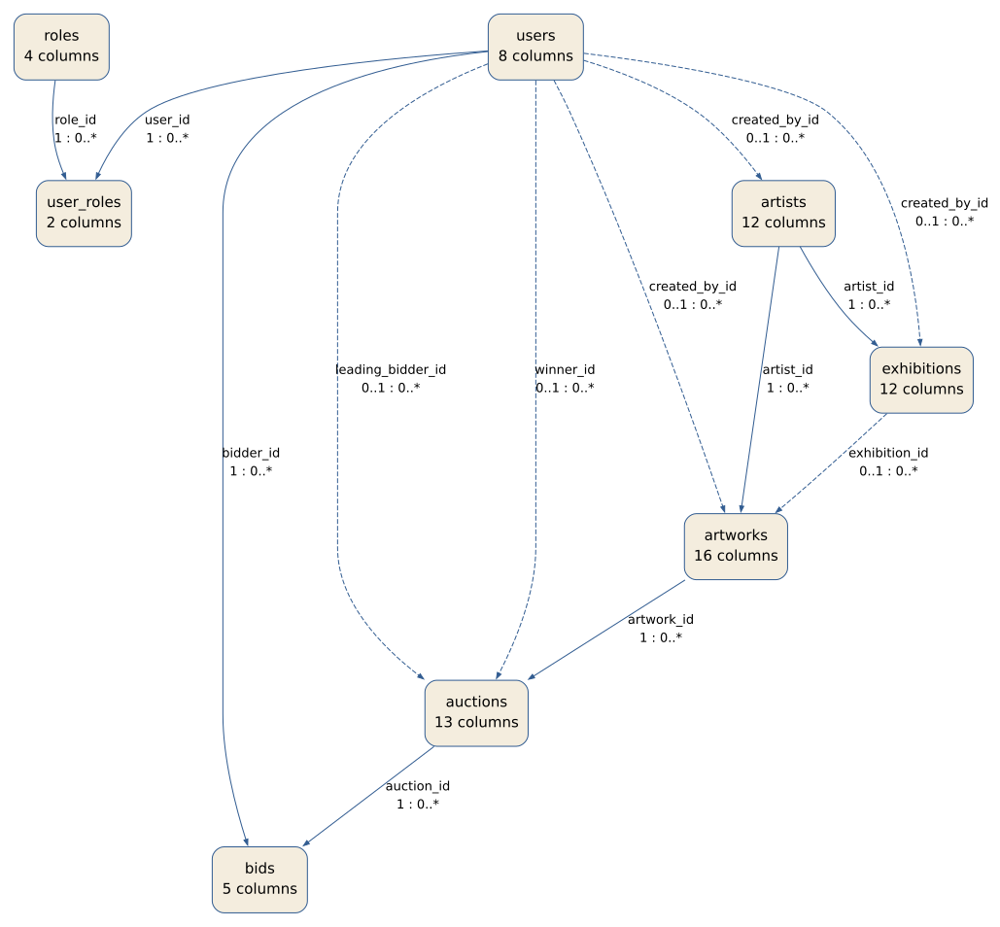

# Database schema and cardinalities

Generated from Flyway V1, V2 and V3 by `python3 docs/database/generate.py`. SQL is authoritative. Full printable reference: [database.pdf](database.pdf); editable source: [database/database.html](database/database.html).



## Required CDC relationships

- **User–Role: many-to-many** through `user_roles`; `User.roles` uses `@ManyToMany`. Composite PK prevents duplicate assignments. DTO/service rules require at least one role; SQL alone permits zero assignments.
- **Client–Projet: one-to-many / many-to-one**, adapted as Artist–Exhibition. `Artist.exhibitions` is `@OneToMany(mappedBy="artist")`; `Exhibition.artist` is `@ManyToOne(optional=false)`. Artist has 0..many exhibitions; each exhibition has exactly 1 artist.
- **No one-to-one** is required or present. An artwork has 0..many historical auctions; live overlap is restricted by the service, not a UNIQUE constraint.

Persistence proof: `DatabaseRelationshipsIT` flushes/clears then reloads both required relationships.

## All foreign keys

| Constraint | Child column | Parent | Parent per child | Children per parent | ON DELETE |
|---|---|---|---|---|---|
| `fk_user_roles_user` | `user_roles.user_id` | `users.id` | 1 required | 0..many | CASCADE |
| `fk_user_roles_role` | `user_roles.role_id` | `roles.id` | 1 required | 0..many | RESTRICT |
| `fk_artists_created_by` | `artists.created_by_id` | `users.id` | 0..1 optional | 0..many | SET NULL |
| `fk_exhibitions_artist` | `exhibitions.artist_id` | `artists.id` | 1 required | 0..many | RESTRICT |
| `fk_exhibitions_created_by` | `exhibitions.created_by_id` | `users.id` | 0..1 optional | 0..many | SET NULL |
| `fk_artworks_artist` | `artworks.artist_id` | `artists.id` | 1 required | 0..many | RESTRICT |
| `fk_artworks_exhibition` | `artworks.exhibition_id` | `exhibitions.id` | 0..1 optional | 0..many | SET NULL |
| `fk_artworks_created_by` | `artworks.created_by_id` | `users.id` | 0..1 optional | 0..many | SET NULL |
| `fk_auctions_artwork` | `auctions.artwork_id` | `artworks.id` | 1 required | 0..many | RESTRICT |
| `fk_auctions_leader` | `auctions.leading_bidder_id` | `users.id` | 0..1 optional | 0..many | RESTRICT |
| `fk_auctions_winner` | `auctions.winner_id` | `users.id` | 0..1 optional | 0..many | RESTRICT |
| `fk_bids_auction` | `bids.auction_id` | `auctions.id` | 1 required | 0..many | CASCADE |
| `fk_bids_bidder` | `bids.bidder_id` | `users.id` | 1 required | 0..many | RESTRICT |

ON UPDATE is unspecified and restrictive for all FKs. Default ON DELETE RESTRICT is distinguished from explicit CASCADE / SET NULL above. Application deletion safeguards can be stricter.

## roles

Editable unique labels are independent from permission profiles ADMIN, COLLABORATEUR and BIDDER. profile is NOT NULL. Nullable unique system_key identifies required roles independently of renamed labels. Multiple custom roles may have NULL system_key. SQL has no CHECK limiting profile membership. ADMIN role CRUD preserves system profiles and blocks deletion or profile changes for assigned custom roles.

| Column | SQL type | Nullable | Default / identity | Key |
|---|---|---|---|---|
| `id` | `BIGINT` | False | `AUTO_INCREMENT` | PK |
| `libelle` | `VARCHAR(32)` | False | `-` | UQ |
| `profile` | `VARCHAR(32)` | False | `-` | - |
| `system_key` | `VARCHAR(32)` | True | `-` | UQ |

Primary key: `(id)`.

```sql
CONSTRAINT uk_roles_libelle UNIQUE (libelle)
CONSTRAINT uk_roles_system_key UNIQUE (system_key)
```

## users

password stores a BCrypt hash, never plaintext. email uniqueness is declared by SQL; case handling depends on database collation and service normalization. SQL does not require a user_roles row. No version column is present on users.

| Column | SQL type | Nullable | Default / identity | Key |
|---|---|---|---|---|
| `id` | `BIGINT` | False | `AUTO_INCREMENT` | PK |
| `first_name` | `VARCHAR(80)` | False | `-` | - |
| `last_name` | `VARCHAR(80)` | False | `-` | - |
| `email` | `VARCHAR(190)` | False | `-` | UQ |
| `password` | `VARCHAR(100)` | False | `-` | - |
| `phone` | `VARCHAR(30)` | True | `-` | - |
| `enabled` | `BOOLEAN` | False | `TRUE` | - |
| `created_at` | `TIMESTAMP(6)` | False | `CURRENT_TIMESTAMP(6)` | - |

Primary key: `(id)`.

```sql
CONSTRAINT uk_users_email UNIQUE (email)
```

## user_roles

No surrogate id and no JPA entity are needed. The composite primary key makes each pair unique. A user deletion cascades to assignments; a referenced role cannot be deleted. Application user-deletion safeguards can be stricter than these SQL actions.

| Column | SQL type | Nullable | Default / identity | Key |
|---|---|---|---|---|
| `user_id` | `BIGINT` | False | `-` | PK + FK |
| `role_id` | `BIGINT` | False | `-` | PK + FK |

Primary key: `(user_id, role_id)`.

```sql
PRIMARY KEY (user_id, role_id)
CONSTRAINT fk_user_roles_user FOREIGN KEY (user_id) REFERENCES users (id) ON DELETE CASCADE
CONSTRAINT fk_user_roles_role FOREIGN KEY (role_id) REFERENCES roles (id)
```

## artists

created_by_id is optional audit attribution, not ownership. Deleting the author via direct SQL nulls the reference. Artist email is not unique. version supports JPA optimistic locking. The inverse exhibitions collection creates no extra column.

| Column | SQL type | Nullable | Default / identity | Key |
|---|---|---|---|---|
| `id` | `BIGINT` | False | `AUTO_INCREMENT` | PK |
| `name` | `VARCHAR(120)` | False | `-` | - |
| `email` | `VARCHAR(190)` | False | `-` | - |
| `phone` | `VARCHAR(30)` | True | `-` | - |
| `address` | `VARCHAR(255)` | True | `-` | - |
| `country` | `VARCHAR(80)` | True | `-` | - |
| `biography` | `VARCHAR(4000)` | True | `-` | - |
| `photo_url` | `VARCHAR(500)` | True | `-` | - |
| `active` | `BOOLEAN` | False | `TRUE` | - |
| `created_by_id` | `BIGINT` | True | `-` | FK |
| `created_at` | `TIMESTAMP(6)` | False | `CURRENT_TIMESTAMP(6)` | - |
| `version` | `BIGINT` | False | `0` | - |

Primary key: `(id)`.

```sql
CONSTRAINT fk_artists_created_by FOREIGN KEY (created_by_id) REFERENCES users (id) ON DELETE SET NULL
```

## exhibitions

artist_id is required. Referenced artists cannot be deleted while exhibitions remain. Deleting a creator nulls the audit link. budget >= 0 and duration_days > 0 are SQL CHECK constraints. All other optional fields may be NULL.

| Column | SQL type | Nullable | Default / identity | Key |
|---|---|---|---|---|
| `id` | `BIGINT` | False | `AUTO_INCREMENT` | PK |
| `title` | `VARCHAR(160)` | False | `-` | - |
| `description` | `VARCHAR(4000)` | True | `-` | - |
| `budget` | `DECIMAL(14, 2)` | False | `-` | - |
| `duration_days` | `INT` | False | `-` | - |
| `starts_on` | `DATE` | True | `-` | - |
| `venue` | `VARCHAR(160)` | True | `-` | - |
| `cover_url` | `VARCHAR(500)` | True | `-` | - |
| `artist_id` | `BIGINT` | False | `-` | FK |
| `created_by_id` | `BIGINT` | True | `-` | FK |
| `created_at` | `TIMESTAMP(6)` | False | `CURRENT_TIMESTAMP(6)` | - |
| `version` | `BIGINT` | False | `0` | - |

Primary key: `(id)`.

```sql
CONSTRAINT fk_exhibitions_artist FOREIGN KEY (artist_id) REFERENCES artists (id)
CONSTRAINT fk_exhibitions_created_by FOREIGN KEY (created_by_id) REFERENCES users (id) ON DELETE SET NULL
CONSTRAINT ck_exhibitions_budget CHECK (budget >= 0)
CONSTRAINT ck_exhibitions_duration CHECK (duration_days > 0)
```

## artworks

artist_id is required and exhibition_id is optional. Deleting an exhibition clears exhibition_id. The service checks that the exhibition and artwork belong to the same artist; no composite FK enforces this across tables. SQL does not CHECK status, estimate or year ranges.

| Column | SQL type | Nullable | Default / identity | Key |
|---|---|---|---|---|
| `id` | `BIGINT` | False | `AUTO_INCREMENT` | PK |
| `slug` | `VARCHAR(180)` | False | `-` | UQ |
| `title` | `VARCHAR(160)` | False | `-` | - |
| `description` | `VARCHAR(4000)` | True | `-` | - |
| `year_created` | `INT` | True | `-` | - |
| `medium` | `VARCHAR(120)` | True | `-` | - |
| `dimensions` | `VARCHAR(80)` | True | `-` | - |
| `image_url` | `VARCHAR(500)` | False | `-` | - |
| `image_credit` | `VARCHAR(255)` | True | `-` | - |
| `estimate` | `DECIMAL(14, 2)` | True | `-` | - |
| `status` | `VARCHAR(16)` | False | `'PUBLISHED'` | - |
| `artist_id` | `BIGINT` | False | `-` | FK |
| `exhibition_id` | `BIGINT` | True | `-` | FK |
| `created_by_id` | `BIGINT` | True | `-` | FK |
| `created_at` | `TIMESTAMP(6)` | False | `CURRENT_TIMESTAMP(6)` | - |
| `version` | `BIGINT` | False | `0` | - |

Primary key: `(id)`.

```sql
CONSTRAINT uk_artworks_slug UNIQUE (slug)
CONSTRAINT fk_artworks_artist FOREIGN KEY (artist_id) REFERENCES artists (id)
CONSTRAINT fk_artworks_exhibition FOREIGN KEY (exhibition_id) REFERENCES exhibitions (id) ON DELETE SET NULL
CONSTRAINT fk_artworks_created_by FOREIGN KEY (created_by_id) REFERENCES users (id) ON DELETE SET NULL
```

## auctions

An artwork may have several auctions over time; artwork_id is indexed, not unique. Leader and winner are independently nullable user references. No SQL constraint requires them to match a bid. Status values, bid-count consistency and live-auction overlap are controlled by application logic.

| Column | SQL type | Nullable | Default / identity | Key |
|---|---|---|---|---|
| `id` | `BIGINT` | False | `AUTO_INCREMENT` | PK |
| `artwork_id` | `BIGINT` | False | `-` | FK |
| `starting_price` | `DECIMAL(14, 2)` | False | `-` | - |
| `current_price` | `DECIMAL(14, 2)` | False | `-` | - |
| `minimum_increment` | `DECIMAL(14, 2)` | False | `-` | - |
| `starts_at` | `TIMESTAMP(6)` | False | `-` | - |
| `ends_at` | `TIMESTAMP(6)` | False | `-` | - |
| `status` | `VARCHAR(16)` | False | `-` | - |
| `bid_count` | `INT` | False | `0` | - |
| `leading_bidder_id` | `BIGINT` | True | `-` | FK |
| `winner_id` | `BIGINT` | True | `-` | FK |
| `created_at` | `TIMESTAMP(6)` | False | `CURRENT_TIMESTAMP(6)` | - |
| `version` | `BIGINT` | False | `0` | - |

Primary key: `(id)`.

```sql
CONSTRAINT fk_auctions_artwork FOREIGN KEY (artwork_id) REFERENCES artworks (id)
CONSTRAINT fk_auctions_leader FOREIGN KEY (leading_bidder_id) REFERENCES users (id)
CONSTRAINT fk_auctions_winner FOREIGN KEY (winner_id) REFERENCES users (id)
CONSTRAINT ck_auctions_prices CHECK (starting_price > 0 AND minimum_increment > 0 AND current_price >= starting_price)
CONSTRAINT ck_auctions_window CHECK (ends_at > starts_at)
```

## bids

Each bid belongs to exactly one auction and one bidder. An auction deletion cascades to bids in SQL, while the application refuses to delete auctions that already have bids. A bidder with retained bids cannot be deleted. created_at has no SQL default and must be supplied.

| Column | SQL type | Nullable | Default / identity | Key |
|---|---|---|---|---|
| `id` | `BIGINT` | False | `AUTO_INCREMENT` | PK |
| `auction_id` | `BIGINT` | False | `-` | FK |
| `bidder_id` | `BIGINT` | False | `-` | FK |
| `amount` | `DECIMAL(14, 2)` | False | `-` | - |
| `created_at` | `TIMESTAMP(6)` | False | `-` | - |

Primary key: `(id)`.

```sql
CONSTRAINT fk_bids_auction FOREIGN KEY (auction_id) REFERENCES auctions (id) ON DELETE CASCADE
CONSTRAINT fk_bids_bidder FOREIGN KEY (bidder_id) REFERENCES users (id)
CONSTRAINT uk_bids_auction_amount UNIQUE (auction_id, amount)
```

## Explicit secondary indexes

| Name | Table | Ordered columns |
|---|---|---|
| `idx_artists_name` | `artists` | `name` |
| `idx_artworks_status` | `artworks` | `status` |
| `idx_auctions_status_ends` | `auctions` | `status, ends_at` |
| `idx_auctions_artwork` | `auctions` | `artwork_id` |
| `idx_bids_bidder` | `bids` | `bidder_id, created_at` |

Primary and unique keys also create indexes. InnoDB creates missing FK supporting indexes. See page 14 of the PDF for expected names and prefix reuse.

Totals: 8 tables; 72 columns; 13 FKs; 5 UNIQUE constraints; 4 CHECK constraints; 5 explicit secondary indexes.
