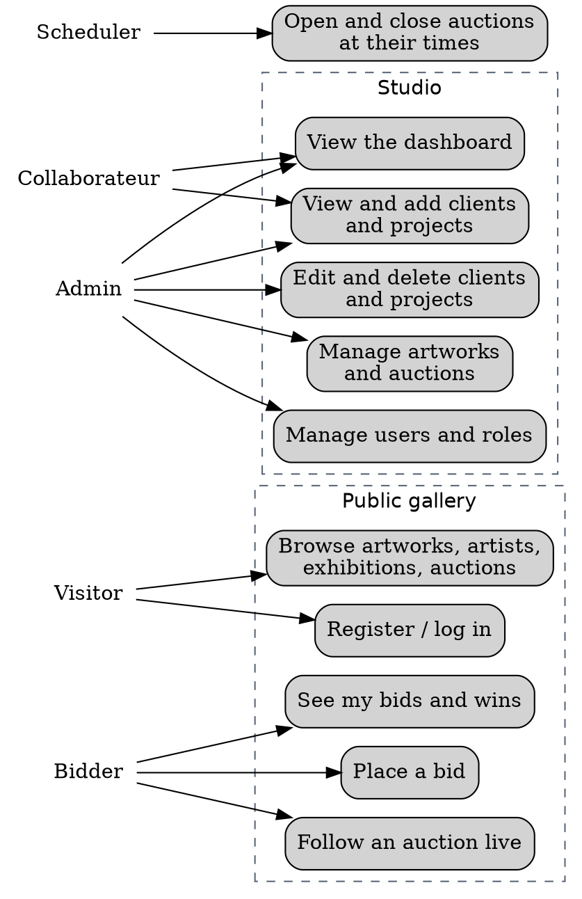
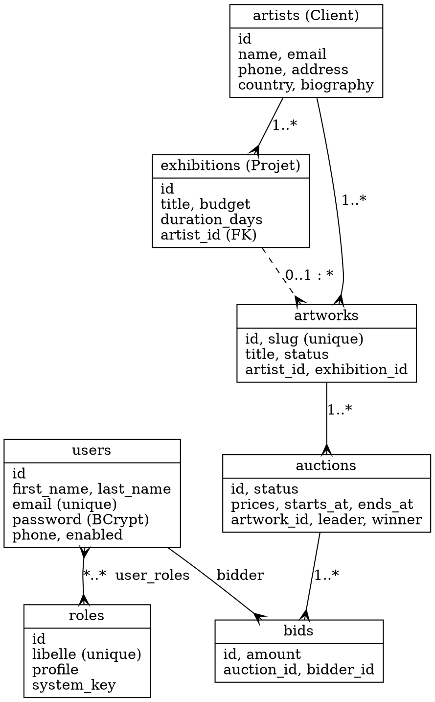
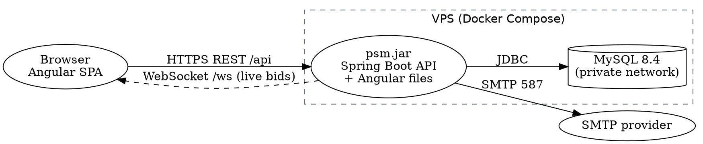

This specification describes what ATELIER must do, who uses it, the rules it applies and the conditions under which the delivery is accepted. It extends the course specification "CDC: Projects Manager" (version 1.0) without removing any of its requirements.

# Purpose of the document

### Why this document exists
The course specification asks for a project manager (PSM) that handles **clients**, their **projects**, **users** and **roles**, secured with JWT, with an Angular interface and a deployment on a VPS. SmartSoft Solutions applies that specification to a concrete business case: a small art gallery that manages the artists it represents, organises exhibitions, publishes its catalogue and sells works through online auctions.

This document fixes the scope of that application, named ATELIER. It is the reference for development, testing and acceptance.

### How the course vocabulary is applied
The course entities keep their attributes and relations. They are renamed to match the gallery's work:

| Course specification | ATELIER | Shown in the interface as |
| --- | --- | --- |
| Client | Artist | Artists, caption "Clients" |
| Projet | Exhibition | Exhibitions, caption "Projets" |
| User, Role | User, Role | Users, Roles |
| Admin, Collaborateur | ADMIN, COLLABORATEUR | Admin, Collaborator |
| PSM application | The Studio (back-office), delivered as `psm.jar` | Studio |

### Reading guide
Requirements are numbered by module (`FR-AUTH-01`, `NFR-SEC-02`…). "Must" means required for acceptance. "Should" means expected but negotiable.

# Context and problem
### The gallery today
A gallery keeps its artists' contact details, exhibition budgets and durations, and its list of works in spreadsheets and email threads. Three problems follow:

- **Scattered information.** There is no single list of clients and projects. Two staff members can edit the same file and overwrite each other.
- **No access control.** Everyone who has the file can change or delete anything, including budgets.
- **Offline sales.** Auctions happen by phone and email. Bidders cannot see the current price, and closing times are handled by hand.

> The gallery needs one place to manage artists and exhibitions safely, and one public place where collectors can see the works and bid.

### What is expected
SmartSoft Solutions builds a web application with two faces:

1. **A public gallery** for visitors and collectors: catalogue, artist pages, exhibitions, and live auctions.
2. **A private Studio** for the gallery staff: management of clients (artists), projects (exhibitions), artworks, auctions, users and roles, with a dashboard.

Both use the same server and the same database, so what the staff publish is visible to the public immediately.

# The product and its utility
### What ATELIER does
- Presents the gallery's artworks, artists and exhibitions on a public website that works on desktop and phone.
- Lets visitors create an account and take part in auctions as **bidders**.
- Runs auctions with a live price: every accepted bid is pushed to all open browsers within a second.
- Closes auctions automatically at their end time and records the winner.
- Gives staff a Studio with lists, search, pagination, forms and a dashboard of key figures.
- Sends emails for account creation, bids, outbid notices and auction results.

### Who benefits and how

| User | Need | What ATELIER gives |
| --- | --- | --- |
| Gallery director (Admin) | Control over data and staff access | Full CRUD, user and role management, dashboard |
| Gallery staff (Collaborateur) | Record new artists and exhibitions | View and add, without the risk of deleting or changing existing records |
| Collector (Bidder) | See works and bid remotely | Live auction room, bid history, account page with bids and wins |
| Visitor | Discover the gallery | Public catalogue, artist and exhibition pages |
| SmartSoft (operator) | Run the system cheaply | One jar, one database, Docker deployment on a single VPS |

### Expected gains
- One source of truth for clients and projects, protected by roles.
- Concurrent edits detected instead of silently overwritten.
- Auctions that run without manual work and stay fair when two bids arrive together.
- A traceable record: who created each artist, exhibition and artwork, and when.

# Actors and roles
### Actors
| Actor | Role code | Authentication |
| --- | --- | --- |
| Visitor | none | Anonymous |
| Bidder | `BIDDER` | Registered account, JWT |
| Collaborateur | `COLLABORATEUR` | Account created by an admin, JWT |
| Admin | `ADMIN` | Bootstrap account or created by an admin, JWT |
| Scheduler | system | Internal, no login |
| Mail server | external | SMTP credentials |

A user can hold several roles (Many-to-Many). An admin can create additional named roles, for example "Curator", each mapped to one of the three permission profiles.

### Use cases

### Permission matrix
| Action | Visitor | Bidder | Collaborateur | Admin |
| --- | --- | --- | --- | --- |
| Read the public catalogue and auctions | yes | yes | yes | yes |
| Register, log in | yes | yes | yes | yes |
| Place a bid | no | **yes** | no | no |
| View and add clients, projects, artworks | no | no | **yes** | yes |
| Edit or delete clients, projects, artworks | no | no | no | **yes** |
| Manage auctions | no | no | no | **yes** |
| Manage users and roles | no | no | no | **yes** |

The server enforces this matrix. The interface hides unavailable actions for comfort only.

# Functional requirements
### Accounts and authentication
| ID | Requirement | Priority |
| --- | --- | --- |
| `FR-AUTH-01` | A visitor registers with first name, last name, email, password (8 to 72 characters) and optional phone. | Must |
| `FR-AUTH-02` | A new account receives the BIDDER role. Staff roles are only given by an admin. | Must |
| `FR-AUTH-03` | After a registration, an email is sent to the gallery admin (course step 5), and a welcome email to the user. | Must |
| `FR-AUTH-04` | Login with email and password returns a signed JWT valid for 12 hours by default. | Must |
| `FR-AUTH-05` | A wrong email and a wrong password produce the same error. | Must |
| `FR-AUTH-06` | A disabled account cannot log in, and its existing token stops working. | Must |
| `FR-AUTH-07` | A signed-in user can edit their profile and change their password (current password required). | Should |

### Clients (artists): course entity Client
| ID | Requirement | Priority |
| --- | --- | --- |
| `FR-CLI-01` | Store name, email, phone, address (course fields), plus country, biography, photo and an active flag. | Must |
| `FR-CLI-02` | List with search by name and pagination. | Must |
| `FR-CLI-03` | Collaborateur and Admin can create; only Admin can update and delete. | Must |
| `FR-CLI-04` | Deleting an artist that still has exhibitions or artworks is refused with a clear message. | Must |
| `FR-CLI-05` | Public pages show name, country, biography and photo, never contact details. | Must |

### Projects (exhibitions): course entity Projet
| ID | Requirement | Priority |
| --- | --- | --- |
| `FR-PRJ-01` | Store title (libellé), budget, duration in days, description and the artist (idClient), plus start date, venue and cover image. | Must |
| `FR-PRJ-02` | Every exhibition belongs to exactly one artist; an artist has any number of exhibitions. | Must |
| `FR-PRJ-03` | Budget is zero or more; duration is at least one day. | Must |
| `FR-PRJ-04` | Same permissions as clients: view and add for Collaborateur, full CRUD for Admin. | Must |
| `FR-PRJ-05` | Public pages hide the budget. | Must |

### Artworks
| ID | Requirement | Priority |
| --- | --- | --- |
| `FR-ART-01` | An artwork has a title, unique URL slug, year, medium, dimensions, image, estimate and a status: DRAFT, PUBLISHED or ARCHIVED. | Must |
| `FR-ART-02` | An artwork belongs to one artist and may be shown in one exhibition of the same artist. | Must |
| `FR-ART-03` | Only PUBLISHED artworks appear in the public gallery. | Must |

### Auctions and bids
| ID | Requirement | Priority |
| --- | --- | --- |
| `FR-AUC-01` | An admin creates an auction for a published artwork with starting price, minimum increment, start and end time. | Must |
| `FR-AUC-02` | Status moves SCHEDULED → OPEN → CLOSED automatically; an admin can cancel. | Must |
| `FR-AUC-03` | One artwork has at most one live auction at a time. | Must |
| `FR-AUC-04` | A bid is accepted only if the auction is open, the bidder is not already leading, and the amount is at least the current price plus the increment (or the starting price for the first bid). | Must |
| `FR-AUC-05` | A bid in the last 60 seconds extends the end by 60 seconds (soft close). | Should |
| `FR-AUC-06` | Every accepted bid and status change is pushed to open browsers without reloading. | Must |
| `FR-AUC-07` | At closing, the leading bidder becomes the winner; the winner and the admin are emailed. | Must |
| `FR-AUC-08` | An auction with bids cannot be deleted, only cancelled. | Must |
| `FR-AUC-09` | Bidders see their bids and wins on their account page. | Should |

### Users and roles
| ID | Requirement | Priority |
| --- | --- | --- |
| `FR-USR-01` | Admin lists, creates, edits, disables and deletes users and assigns one or more roles. | Must |
| `FR-USR-02` | Admin creates, renames and deletes roles. Each role has a label and a permission profile. | Must |
| `FR-USR-03` | The three system roles cannot be deleted. A role still assigned to users cannot be deleted. | Must |
| `FR-USR-04` | The last enabled admin cannot be removed, demoted or disabled, and an admin cannot disable or demote themselves. | Must |
| `FR-USR-05` | A user with bids or created records is disabled instead of deleted. | Must |

### Studio dashboard and interface
| ID | Requirement | Priority |
| --- | --- | --- |
| `FR-UI-01` | A side menu gives access to Clients, Projets, Artworks, Auctions, Users, Roles and Profile, following the Argon dashboard model (course step 8). | Must |
| `FR-UI-02` | The dashboard shows counts, recent activity and charts of bids and auctions. | Should |
| `FR-UI-03` | Routes are protected by guards; a user without the role is sent to a "forbidden" page (course step 9). | Must |
| `FR-UI-04` | An interceptor adds the token to API calls and signs the user out when the token is refused. | Must |
| `FR-UI-05` | Every form shows field errors returned by the server next to the right field. | Must |

# Business rules
The rules below are enforced on the server. Each refusal returns a stable error code that the interface turns into a message.

| Rule | Error code |
| --- | --- |
| An email can be used by only one account | `email_taken` |
| A bid must reach the minimum next bid | `bid_too_low` |
| The leading bidder cannot outbid themselves | `already_leading` |
| Bids are refused when the auction is not open | `auction_not_open` |
| One live auction per artwork | `auction_overlap` |
| Only published artworks can be auctioned | `artwork_not_published` |
| An auction with bids cannot be deleted | `auction_has_bids` |
| An artwork's exhibition must belong to the same artist | `exhibition_artist_mismatch` |
| The end of an auction must be after its start | `invalid_window` |
| A role in use or a system role cannot be deleted | `role_in_use`, `system_role` |
| The last admin cannot be removed or demoted | `last_admin` |
| A user with history is disabled, not deleted | `user_has_activity` |
| A record changed by someone else since it was opened cannot be overwritten | `stale_update` |
| A record still referenced by others cannot be deleted | `integrity_violation` |

> When two collectors bid the same amount at the same moment, exactly one bid is accepted; the other receives the new minimum.

# Data requirements
### Entities and relations
The course diagram (User *..* Role, Client 1..* Projet) is kept, and the gallery chain Artist → Artwork → Auction → Bid is added.

### Data rules
- Amounts are stored as exact decimals (`DECIMAL(14,2)`); times are stored in UTC.
- Passwords are never stored in clear text.
- Each artist, exhibition and artwork records its creator and creation time.
- The schema is versioned: each change is a numbered migration script applied at start-up.
- A deletion never leaves an orphan record: dependent data is protected, detached or removed depending on its meaning.

# Non-functional requirements
### Security
| ID | Requirement |
| --- | --- |
| `NFR-SEC-01` | Stateless authentication with signed JWT (HS256, secret of at least 32 bytes supplied by the environment). |
| `NFR-SEC-02` | Authorisation checked on the server for every request, by URL rule and by method annotation. |
| `NFR-SEC-03` | Passwords hashed with BCrypt. |
| `NFR-SEC-04` | No secret in the source code or the repository; all secrets come from environment variables. |
| `NFR-SEC-05` | In production the database port is not reachable from the internet, and traffic uses HTTPS. |
| `NFR-SEC-06` | The live connection (WebSocket) checks the token and only allows subscribing to auction topics. |

### Reliability and consistency
| ID | Requirement |
| --- | --- |
| `NFR-REL-01` | Every write runs in a transaction; a failed rule leaves no partial data. |
| `NFR-REL-02` | Concurrent edits of the same record are detected (optimistic version check). |
| `NFR-REL-03` | Concurrent bids on one auction are processed one after the other (database row lock). |
| `NFR-REL-04` | Emails and live messages are sent only after the transaction commits. |
| `NFR-REL-05` | A failing mail server never blocks or fails a user action. |
| `NFR-REL-06` | The database can be backed up and restored with standard tools. |

### Performance and usability
| ID | Requirement |
| --- | --- |
| `NFR-PERF-01` | Lists are paginated on the server. |
| `NFR-PERF-02` | A bid reaches other open browsers in under one second on a normal connection. |
| `NFR-UX-01` | Pages work from 390 px (phone) to desktop widths. |
| `NFR-UX-02` | Animations respect the system "reduced motion" setting. |
| `NFR-UX-03` | The interface is in English, with the course terms shown as captions in the Studio. |

### Maintainability and portability
| ID | Requirement |
| --- | --- |
| `NFR-MNT-01` | Code organised by feature and by layer (controller, service, repository, entity, DTO). |
| `NFR-MNT-02` | Automated tests for the backend, the frontend and the API. |
| `NFR-MNT-03` | Every teammate uses the same tool versions, provided by Docker Compose. |
| `NFR-POR-01` | One executable jar, `psm.jar`, contains the API and the Angular application. |
| `NFR-POR-02` | The same build runs locally and on the VPS; only environment variables change. |

# Technical constraints
### Imposed stack
| Layer | Technology | Version |
| --- | --- | --- |
| Backend | Spring Boot (Web, Data JPA, Security, Validation, Mail, WebSocket) | 3.5, Java 17 |
| Build | Maven | wrapper in the repository |
| Database | MySQL | 8.4 |
| Schema migrations | Flyway | managed by Spring Boot |
| Tokens | JJWT | 0.12 |
| Frontend | Angular (standalone components, signals) | 22 |
| API tests | Postman collection, run with Newman | — |
| Packaging | Spring Boot executable jar, Docker image | `psm.jar` |
| Hosting | Linux VPS with Docker Compose | — |

### Target architecture

### Environments
- **Development:** Docker Compose starts MySQL, a test mail server (Mailpit) and both applications with hot reload.
- **Production:** one VPS runs the application container and the MySQL container; HTTPS is provided in front of the application.

# Deliverables and acceptance
### Deliverables
| # | Deliverable | Form |
| --- | --- | --- |
| D1 | Source code (backend, frontend) with history | Git repository |
| D2 | Database schema and migrations | Flyway scripts V1 to V3 |
| D3 | Postman collection | `postman/ATELIER.postman_collection.json` |
| D4 | Executable `psm.jar` with Angular in `static/` | Maven or Docker build |
| D5 | Running deployment on the VPS | Public HTTPS address |
| D6 | Documentation: this specification, the report (compte rendu), the study guide, the database reference, the demo script | PDF and Markdown |

### Acceptance criteria by course step
| Step | Criterion |
| --- | --- |
| 1 | The project builds with Spring Web, Data JPA, DevTools and the MySQL driver. |
| 2 | CRUD endpoints exist for clients, projects, users and roles. |
| 3 | The Postman collection runs with zero failed assertions. |
| 4 | Protected endpoints return 401 without a token and 403 with the wrong role. |
| 5 | A registration triggers an email to the admin address. |
| 6 | Registration and login work from Postman and from the interface. |
| 7 | Client and project endpoints respect the permission matrix. |
| 8 | The Studio menu gives access to Clients, Projets and Users following the Argon model. |
| 9 | Guards block unauthorised routes; the interceptor sends the token. |
| 10 | A collaborateur sees no edit or delete action; an admin sees all of them. |
| 11 | `psm.jar` serves the Angular application and the API from one port. |
| 12 | The application is reachable on the VPS and its main pages and API answer. |

# Out of scope and glossary
### Out of scope
- Payment, invoicing and delivery of sold works. The auction records the winner; settlement happens outside the system.
- Multi-gallery or multi-language support.
- Several server instances (the live message broker runs in memory, inside one application).
- Native mobile applications; the website is responsive instead.

### Glossary
| Term | Meaning |
| --- | --- |
| CDC | Cahier des charges, the course specification this document extends |
| CRUD | Create, read, update, delete |
| JWT | JSON Web Token, a signed token that proves who the caller is |
| DTO | Data transfer object, the JSON shape exchanged with the interface |
| Soft close | Extension of an auction when a bid arrives just before the end |
| Flyway | Tool that applies numbered SQL migration scripts |
| STOMP | Messaging protocol used over the WebSocket connection |
| VPS | Virtual private server, here an AWS EC2 instance |
