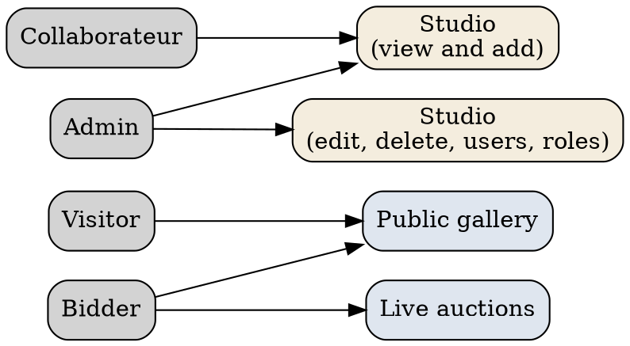
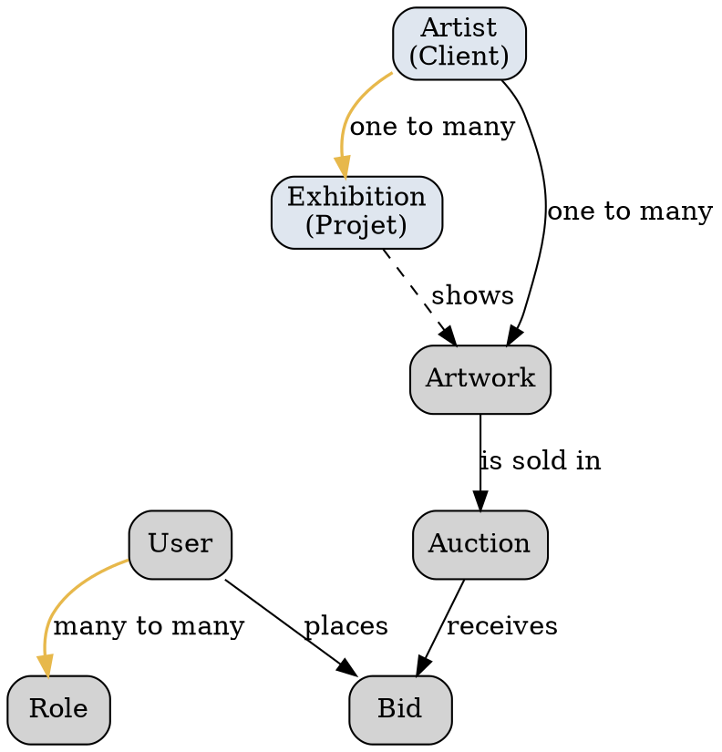
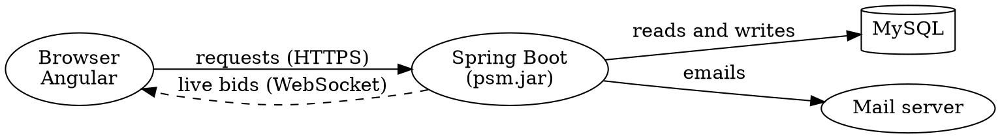
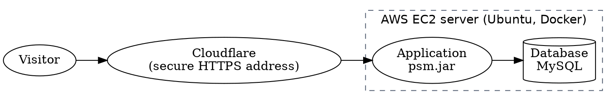

ATELIER is a web application for an art gallery: a public site where collectors discover works and bid in live auctions, and a private Studio where the gallery team manages its artists and exhibitions.

# The idea
An art gallery represents artists, organises their exhibitions and sells their works. Today this is often done with spreadsheets, emails and phone calls: the information is scattered, anyone can change anything, and buyers cannot follow a sale remotely.

ATELIER brings all of this into one application with two sides.

```cards
[{"title":"Public gallery","text":"Visitors browse the artworks, the artists and the exhibitions. Collectors create an account and take part in live auctions from their browser."},
 {"title":"Studio","text":"The gallery team manages its clients (the artists), its projects (the exhibitions), the artworks, the auctions, the users and their roles."}]
```

> One place to manage the gallery safely, and one place where collectors can see the works and bid.

### Link with the course specification
The course asks for a "Projects Manager" that manages **clients**, their **projects**, **users** and **roles**. ATELIER applies it to a gallery:

```cols
### Course
- Client
- Projet
- User and Role
- Admin, Collaborateur
---
### ATELIER
- Artist (shown as "Clients")
- Exhibition (shown as "Projets")
- User and Role
- Admin, Collaborateur, plus Bidder for the auctions
```


# Who uses it
Four kinds of people use ATELIER. Each one sees only what their role allows.

```cards
[{"title":"Visitor","text":"Anyone on the internet. Browses the artworks, artists, exhibitions and auctions. Can create an account."},
 {"title":"Bidder","text":"A collector with an account. Places bids, follows auctions live and sees the bids and wins on the account page."},
 {"title":"Collaborateur","text":"A member of the gallery team. Views and adds artists, exhibitions and artworks. Cannot change or delete them."},
 {"title":"Admin","text":"The gallery manager. Does everything: changes and deletes records, runs auctions, manages users and roles."}]
```

### What each role can do

| Action | Visitor | Bidder | Collaborateur | Admin |
| --- | --- | --- | --- | --- |
| Browse the gallery and auctions | yes | yes | yes | yes |
| Place a bid | | yes | | |
| View and add artists and exhibitions | | | yes | yes |
| Edit and delete artists and exhibitions | | | | yes |
| Manage auctions, users and roles | | | | yes |



# What the application does
### On the public site
- Shows the catalogue of artworks with their artist, year and medium.
- Presents each artist and their exhibitions.
- Lists the auctions: upcoming, open and closed.
- Lets a visitor register; the gallery receives an email for each new account.
- Lets a bidder place a bid. Every open browser sees the new price immediately.
- Closes each auction automatically at its end time and announces the winner by email.


### In the Studio
- A dashboard with the key figures of the gallery.
- Lists with search and pages for artists, exhibitions, artworks and auctions.
- Forms to add and change records, with clear error messages.
- User management: create accounts, give one or more roles, disable an account.
- Role management: create named roles, each linked to a permission level.


### Rules the application protects
- An exhibition always belongs to one artist. An artist who still has exhibitions cannot be deleted.
- A bid must be higher than the current price plus the minimum step.
- When two people bid at the same moment, only one bid wins; the other is told the new minimum.
- If two staff members change the same record, the second one is asked to reload instead of erasing the first change.

# The data
The application stores eight kinds of information. The two links required by the course are highlighted: a user can have several roles, and an artist can have several exhibitions.



```stats
[{"value":"8","label":"Tables"},{"value":"13","label":"Links between tables"},{"value":"4","label":"User roles"},{"value":"4","label":"Auction states: scheduled, open, closed, cancelled"}]
```

# The technology stack
ATELIER is built with the technologies required by the course.

```cards
[{"title":"Angular 22","text":"The interface that runs in the browser: the public site and the Studio."},
 {"title":"Spring Boot 3.5","text":"The server in Java 17: the API, security, auctions, emails and the automatic closing of auctions."},
 {"title":"MySQL 8.4","text":"The database that keeps every artist, exhibition, artwork, auction, bid and user."},
 {"title":"JWT","text":"The signed token that proves who is logged in on every request."},
 {"title":"WebSocket","text":"The live connection that pushes each new bid to every open browser."},
 {"title":"SMTP","text":"The email service used for welcome messages, bids and auction results."},
 {"title":"Docker","text":"Packages the application and the database so they run the same everywhere."},
 {"title":"Postman","text":"The collection that tests every API request and every permission."}]
```



# Deployment
The whole application is delivered as one file, `psm.jar`, which contains both the server and the Angular interface. It runs on a virtual server in the cloud.



| Step | What is done |
| --- | --- |
| 1 | Build `psm.jar` with Angular inside it (course step 11) |
| 2 | Create a cloud server on AWS EC2 and install Docker |
| 3 | Start the database and restore the gallery data |
| 4 | Start the application and check that it answers |
| 5 | Open a secure public address through Cloudflare (course step 12) |

```note
Result
The application is online on AWS. The public pages, the login, the Studio and the API were checked on the live server on 19 November 2026.
```

# Expected deliverables
| Deliverable | Form |
| --- | --- |
| Source code of the server and the interface | Git repository and zip files |
| The executable application | `psm.jar` |
| API tests | Postman collection |
| Online application | AWS server with a public HTTPS address |
| Documents | This cahier des charges, the compte rendu, the study guide and the demo script |
