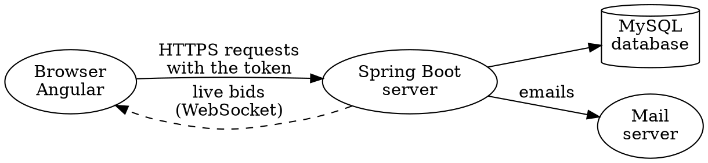
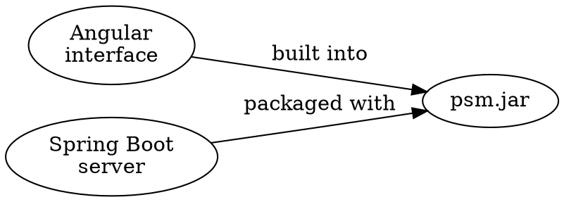
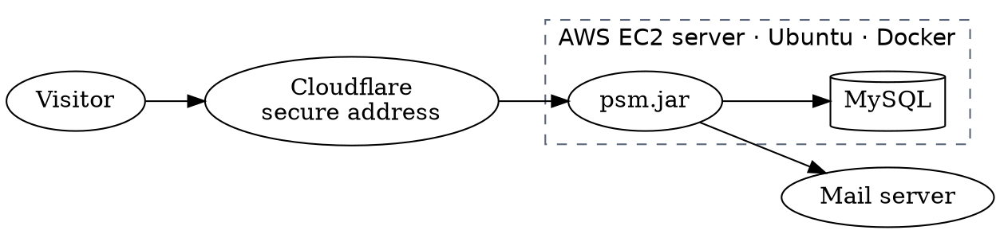

This report presents ATELIER, the application built for the course "Formation FullStack Spring Boot and Angular". It shows the screens, the Studio dashboard, the API tests and the deployment.

# The project
The course asks for a "Projects Manager" that manages clients, their projects, users and roles, with a Spring Boot server, an Angular interface, JWT security and a deployment on a server.

ATELIER applies it to an art gallery. The **clients** are the artists the gallery represents and the **projects** are their exhibitions. To make the application useful to the public as well, it adds a catalogue of artworks and live online auctions.

```cards
[{"title":"For the public","text":"A gallery website: artworks, artists, exhibitions, and auctions where collectors bid live."},
 {"title":"For the gallery team","text":"The Studio: a dashboard and the management of artists, exhibitions, artworks, auctions, users and roles."},
 {"title":"For the course","text":"Every step is covered, from the Spring Boot project to the deployment of psm.jar on an AWS server."}]
```

### The gallery online today
These figures come from the live application on 19 November 2026.

```stats
[{"value":"30","label":"Artworks"},{"value":"7","label":"Artists (clients)"},{"value":"6","label":"Exhibitions (projects)"},{"value":"10","label":"Auctions"}]
```

```donut
{"title":"Auctions by status","labels":["Open","Closed","Cancelled"],"values":[4,4,2]}
```

### The users
| User | What they do |
| --- | --- |
| Visitor | Browses the gallery and creates an account |
| Bidder | Bids in live auctions and follows their bids and wins |
| Collaborateur | Views and adds artists, exhibitions and artworks |
| Admin | Manages everything, including auctions, users and roles |

# The public site
The public site is what visitors and collectors see. It works on a computer and on a phone.


```cols

---

```

```cols

---

```

### Accounts
```cols

---

```

After a registration, the gallery receives an email and the new user receives a welcome email.

# Live auctions
A bidder opens an auction, sees the current price and the minimum next bid, and bids. The new price appears at once in every browser that shows this auction, without reloading the page.

```cols

---

```

```note
How an auction ends
When the end time is reached, the auction closes by itself, the highest bidder becomes the winner, and the winner and the gallery receive an email. A bid in the last minute extends the auction by one minute, so nobody can win by bidding at the last second.
```


```cols

---

```

# The Studio dashboard
The Studio opens on a dashboard that gives the gallery team an overview of its activity. Its layout follows the Argon dashboard model given in the course.


### What the dashboard shows
| Part | What it shows |
| --- | --- |
| Key figures | Artists, exhibitions, bids and users with this week's change, plus artworks, live auctions and total exhibition budget |
| Bid activity | A chart of the daily amount of bids over 7 or 14 days, with the total, the number of bids, the average bid and the busiest day |
| Auctions by status | A ring chart of scheduled, open, closed and cancelled auctions |
| Recent bids | The latest bids: who, on which work, how much, when |
| Top artists | The artists ranked by activity |
| Ending soon | The open auctions that close next |
| Quick actions | Buttons to add an artist, an exhibition, an artwork or an auction |


# Managing the gallery in the Studio
The menu on the left gives access to each part of the gallery. Every list has a search field and pages, and every record is added or changed through a form.


```cols

---

```

### Users and roles
A user can have several roles, and the admin can create new roles, each linked to a permission level.

```cols

---

```


### Each role sees what it may use
```cols

---

```

The server checks every permission again, so hiding a button is never the only protection.

# Testing the API with Postman
The Postman collection tests every request of the API: login, the CRUD of each part, the auctions, the account pages, the public pages, and every permission (who may and who may not do what). Each request checks the answer automatically.

```stats
[{"value":"103","label":"Requests"},{"value":"175","label":"Automatic checks"},{"value":"0","label":"Failures"},{"value":"10","label":"Folders"}]
```

```hbar
{"title":"Automatic checks per folder","labels":["Auth","Clients (artists)","Projects (exhibitions)","Artworks","Auctions","Account","Users","Public gallery","Security","Roles"],"values":[14,13,13,15,20,10,28,14,9,39]}
```


```cols

---

```

```cols

---

```

```cols

---

```


# The technology stack
```cards
[{"title":"Angular 22","text":"The interface in the browser: public site and Studio, with live updates and animations."},
 {"title":"Spring Boot 3.5","text":"The Java 17 server: API, security, auctions, emails and automatic closing of auctions."},
 {"title":"MySQL 8.4","text":"The database: users, roles, artists, exhibitions, artworks, auctions and bids."},
 {"title":"JWT","text":"A signed token sent with each request to prove who is logged in."},
 {"title":"WebSocket","text":"A permanent connection that pushes new bids to every open browser."},
 {"title":"SMTP","text":"Sends the welcome, bid and auction result emails."},
 {"title":"Postman","text":"Tests every API request and every permission."},
 {"title":"Docker","text":"Runs the application and the database the same way on every machine."},
 {"title":"AWS and Cloudflare","text":"The cloud server and the secure public address."}]
```



# Deployment
### One file for everything
The Angular interface is built and placed inside the Spring Boot application. The result is a single file, **psm.jar**, that serves both the pages and the API (course step 11).



### On a cloud server


| Step | What was done |
| --- | --- |
| 1 | Create an AWS EC2 server (Ubuntu) that only accepts administration from our address |
| 2 | Install Docker and copy the application and its settings |
| 3 | Start the database and restore the gallery's data |
| 4 | Start the application and wait until it reports it is ready |
| 5 | Open a secure public address with Cloudflare |


### Checks on the live server
```hbar
{"title":"Checks passed on 19 November 2026","labels":["Pages and links","Server ready","Public data","Protected data refused","Wrong password refused"],"values":[2,1,4,2,1]}
```

All ten checks passed. The public address given by Cloudflare is temporary and changes if the tunnel restarts.

# Results
> ATELIER covers the twelve steps of the course and adds a gallery and live auctions that make it useful beyond the exercise.

| Course step | Done |
| --- | --- |
| 1. Spring Boot project | yes |
| 2. CRUD of the entities | yes |
| 3. Tests with Postman | yes, 103 requests, 0 failures |
| 4. Security with JWT | yes |
| 5. Email to the admin after registration | yes |
| 6. Test login and registration | yes |
| 7. Test clients and projects with security | yes |
| 8. Angular components and menu (Argon model) | yes |
| 9. Guards and interceptor | yes |
| 10. Roles in the interface | yes |
| 11. psm.jar with Angular inside | yes |
| 12. Deployment on a server | yes, AWS |

```chart
{"title":"Automated tests by kind","labels":["Server unit","Server integration","Interface","Postman checks"],"values":[19,151,64,175]}
```

### What could come next
- A permanent web address instead of the temporary one.
- Automatic daily backups of the database.
- Online payment after an auction, which is outside this project.
