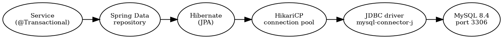
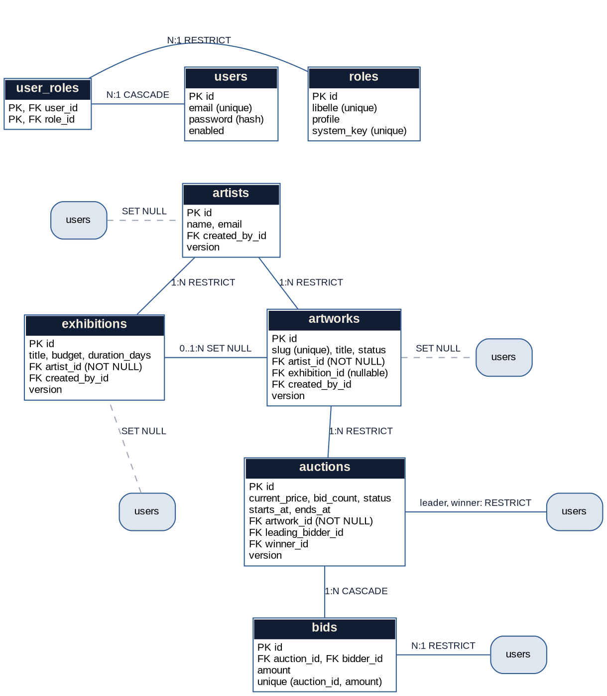

This document describes the ATELIER database: which tables exist, how they relate, what happens when rows are deleted, how Java reaches MySQL and how concurrent writes are kept safe. Every table, column and rule comes from the three Flyway migrations (`V1__core_schema.sql`, `V2__artworks_auctions_bids.sql`, `V3__dynamic_roles.sql`). The screenshots are real outputs from a MySQL 8.4 server running the same schema, stored in `docs/evidence/mysql`.

# Overview
### The database in figures

```stats
[
  {"value": "8", "label": "tables, plus Flyway's own flyway_schema_history"},
  {"value": "13", "label": "foreign keys"},
  {"value": "2 / 4 / 7", "label": "CASCADE / SET NULL / RESTRICT delete rules"},
  {"value": "3", "label": "Flyway migrations, V1 to V3"}
]
```

### The evidence in MySQL


The ninth table is `flyway_schema_history`. MySQL reports the default delete rule as `NO ACTION`; in InnoDB this behaves like RESTRICT, and this document uses RESTRICT for it.

### What the data is
ATELIER stores two kinds of information in one MySQL schema called `atelier`.

- **The course core.** Users and roles (a many-to-many relation) and artists with their exhibitions (a one-to-many relation). These are the entities of the course specification, renamed for the gallery: Client becomes Artist and Projet becomes Exhibition.
- **The gallery extension.** Artworks, auctions and bids. An artist owns artworks, an artwork can be auctioned, an auction receives bids, and bids come from users.

MySQL 8.4 with the InnoDB engine holds everything. InnoDB provides transactions, row-level locks, foreign keys and CHECK constraints, which the rest of this document relies on.

### Vocabulary used in this document

| Word | Meaning | Example in ATELIER |
| --- | --- | --- |
| Table | A list of records of one kind | `artists` |
| Row | One record | one artist |
| Primary key (PK) | The unique identifier of a row | `id BIGINT AUTO_INCREMENT` |
| Foreign key (FK) | A column that points to the primary key of another table | `exhibitions.artist_id` points to `artists.id` |
| Unique constraint | No two rows may share the value | `users.email` |
| CHECK constraint | A rule on column values | `budget >= 0` |
| Index | A structure that speeds up lookups | `idx_artists_name` |
| Cardinality | How many rows on each side of a relation | one artist, many exhibitions |

The foreign key always sits on the "many" side. An artist row cannot hold a list, so `artist_id` is stored in each exhibition, and the artist's list is found by looking up every exhibition that points back to it.

# From Java to MySQL
### The layers
Application code never writes SQL for ordinary reads and writes. A request passes through six layers, each with one job.



| Layer | Job |
| --- | --- |
| Service | Applies business rules and opens the transaction with `@Transactional` |
| Spring Data JPA | Generates the implementation of each repository interface at startup |
| Hibernate | Maps objects to rows and turns operations into SQL |
| HikariCP | Keeps a pool of open connections and lends one to each transaction |
| `mysql-connector-j` | The JDBC driver that speaks MySQL's network protocol |
| MySQL server | Stores the data and enforces constraints |

### The driver
JDBC is Java's standard way to talk to a database; each database supplies a driver. In `pom.xml` the driver has runtime scope: the code never imports it, it is only needed when the application runs.

### Where the database is
The connection settings are in `application.yml` and can be replaced by environment variables, so the same jar runs everywhere.

```yaml
spring:
  datasource:
    url: ${DB_URL:jdbc:mysql://localhost:3306/atelier?serverTimezone=UTC&useUnicode=true&characterEncoding=utf8}
    username: ${DB_USER:atelier}
    password: ${DB_PASSWORD:atelier_dev_password}
```

`${DB_URL:...}` means: use the environment variable `DB_URL` if it exists, otherwise the default after the colon. In the URL, `jdbc:mysql://` selects the driver, then come the host, port 3306, the database name `atelier` and `serverTimezone=UTC`, so times are read and written in UTC.

| Where | `DB_URL` | Why that host |
| --- | --- | --- |
| IDE on a laptop | default, `localhost:3306` | `compose.yaml` publishes MySQL's port 3306 on the machine |
| Development Docker stack | `jdbc:mysql://db:3306/atelier?serverTimezone=UTC` | In Docker Compose each service name is a host name, so `db` reaches the MySQL container |
| Production | `jdbc:mysql://db:3306/${MYSQL_DATABASE}?serverTimezone=UTC` | Same internal network; port 3306 is not published at all |

The MySQL container creates the database and user itself on first start, from `MYSQL_DATABASE`, `MYSQL_USER` and `MYSQL_PASSWORD`. The backend's `DB_USER` and `DB_PASSWORD` must match them.

### The connection pool
Opening a database connection is slow because of the network handshake and login. Spring Boot adds HikariCP automatically through `spring-boot-starter-data-jpa`. It opens a few connections at startup, lends one to each transaction and takes it back after commit or rollback. The project does not override its settings.

### Mapping rules
Annotations tell Hibernate which table and column each Java element uses.

```java
@Entity
@Table(name = "exhibitions")
public class Exhibition extends AuditedEntity {
    @Id
    @GeneratedValue(strategy = GenerationType.IDENTITY)   // MySQL AUTO_INCREMENT
    private Long id;

    @Column(nullable = false, length = 160)
    private String title;

    @Column(nullable = false, precision = 14, scale = 2)  // DECIMAL(14,2)
    private BigDecimal budget;

    @ManyToOne(fetch = FetchType.LAZY, optional = false)
    @JoinColumn(name = "artist_id", nullable = false)     // foreign key column
    private Artist artist;
}
```

Money columns are `DECIMAL(14,2)`, mapped to `BigDecimal`, so amounts are exact. Timestamps are `TIMESTAMP(6)`, with microsecond precision.

# Schema ownership
### Flyway creates the tables, Hibernate only checks them
At startup, before Hibernate, Flyway connects through the same pool, reads or creates the `flyway_schema_history` table and runs, in order, every migration that has not run yet, recording each one. The SQL files are therefore the source of truth for the tables, not the Java classes.

```yaml
spring:
  jpa:
    open-in-view: false
    hibernate:
      ddl-auto: validate        # check the tables, never change them
    properties:
      hibernate.jdbc.time_zone: UTC
  flyway:
    enabled: true
    locations: classpath:db/migration
```

With `ddl-auto: validate`, Hibernate compares each entity with the real table at startup. If a table or column is missing or has an incompatible type, the application refuses to start. This surfaces a mismatch at deployment time instead of in the middle of a request.

### The three migrations

| Version | File | Content |
| --- | --- | --- |
| V1 | `V1__core_schema.sql` | `roles`, `users`, `user_roles`, `artists`, `exhibitions` and the `idx_artists_name` index |
| V2 | `V2__artworks_auctions_bids.sql` | `artworks`, `auctions`, `bids`, their indexes and CHECK constraints |
| V3 | `V3__dynamic_roles.sql` | Adds `roles.profile` and `roles.system_key`; existing role ids and user assignments are kept |

V3 copies the old label into both new columns (`UPDATE roles SET profile = libelle, system_key = libelle`) and then makes `profile` NOT NULL. The upgrade evidence of 2026-11-18, going from schema version 2 to version 3, records that role ids, user assignments and the user count were all preserved.

# Entity-relationship diagram
### Eight tables and thirteen foreign keys
Each box lists the primary key, the foreign keys and the columns that matter for the relations. The small rounded boxes labelled `users` are the same `users` table drawn again next to each table that points to it, so that no line has to cross the page. Dashed lines are `created_by_id` links to the user who added a record. Labels give the cardinality and the delete rule; `0..1:N` marks an optional link.



The two required course relations are User to Role (many-to-many) through `user_roles`, and Artist to Exhibition (one-to-many) through `exhibitions.artist_id`. Around them runs the gallery chain Artist, Artwork, Auction, Bid, with User as bidder, leader, winner and creator.

# Table dictionary
Types and rules are taken from the migrations. "Nullable" means the column accepts NULL; every other column is NOT NULL.

### `users`, `roles` and `user_roles`

| Column | Type and rule |
| --- | --- |
| `users.id` | BIGINT, primary key, auto-increment |
| `first_name`, `last_name` | VARCHAR(80), NOT NULL |
| `email` | VARCHAR(190), NOT NULL, unique (`uk_users_email`) |
| `password` | VARCHAR(100), NOT NULL; holds a password hash, never the password |
| `phone` | VARCHAR(30), nullable |
| `enabled` | BOOLEAN, NOT NULL, default TRUE; false blocks login |
| `created_at` | TIMESTAMP(6), NOT NULL, default current time |
| `roles.id` | BIGINT, primary key, auto-increment |
| `libelle` | VARCHAR(32), NOT NULL, unique (`uk_roles_libelle`); the editable name |
| `profile` | VARCHAR(32), NOT NULL (V3); the permission profile ADMIN, COLLABORATEUR or BIDDER |
| `system_key` | VARCHAR(32), nullable, unique (`uk_roles_system_key`, V3); set only on the three built-in roles |
| `user_roles.user_id` | BIGINT, part of the composite primary key; FK to `users`, ON DELETE CASCADE |
| `user_roles.role_id` | BIGINT, part of the composite primary key; FK to `roles` |

`email` is limited to 190 characters so that its unique index stays within InnoDB's index size limit with the `utf8mb4` character set.

### `artists` and `exhibitions`

| Column | Type and rule |
| --- | --- |
| `artists.id` | BIGINT, primary key, auto-increment |
| `name` | VARCHAR(120), NOT NULL, index `idx_artists_name` |
| `email` | VARCHAR(190), NOT NULL |
| `phone`, `address`, `country` | VARCHAR(30), (255), (80), nullable |
| `biography` | VARCHAR(4000), nullable |
| `photo_url` | VARCHAR(500), nullable |
| `active` | BOOLEAN, NOT NULL, default TRUE |
| `created_by_id` | BIGINT, nullable FK to `users`, ON DELETE SET NULL |
| `created_at`, `version` | TIMESTAMP(6), BIGINT, NOT NULL; version defaults to 0 |
| `exhibitions.id` | BIGINT, primary key, auto-increment |
| `title` | VARCHAR(160), NOT NULL |
| `description` | VARCHAR(4000), nullable |
| `budget` | DECIMAL(14,2), NOT NULL, CHECK `budget >= 0` |
| `duration_days` | INT, NOT NULL, CHECK `duration_days > 0` |
| `starts_on` | DATE, nullable |
| `venue`, `cover_url` | VARCHAR(160), (500), nullable |
| `artist_id` | BIGINT, NOT NULL, FK to `artists`, no ON DELETE clause |
| `created_by_id` | BIGINT, nullable FK to `users`, ON DELETE SET NULL |
| `created_at`, `version` | TIMESTAMP(6), BIGINT, NOT NULL; version defaults to 0 |

### `artworks`

| Column | Type and rule |
| --- | --- |
| `id` | BIGINT, primary key, auto-increment |
| `slug` | VARCHAR(180), NOT NULL, unique (`uk_artworks_slug`); used in public URLs |
| `title` | VARCHAR(160), NOT NULL |
| `description` | VARCHAR(4000), nullable |
| `year_created` | INT, nullable |
| `medium`, `dimensions` | VARCHAR(120), (80), nullable |
| `image_url` | VARCHAR(500), NOT NULL |
| `image_credit` | VARCHAR(255), nullable |
| `estimate` | DECIMAL(14,2), nullable |
| `status` | VARCHAR(16), NOT NULL, default `PUBLISHED`; index `idx_artworks_status`. The application uses DRAFT, PUBLISHED and ARCHIVED |
| `artist_id` | BIGINT, NOT NULL, FK to `artists`, no ON DELETE clause |
| `exhibition_id` | BIGINT, nullable FK to `exhibitions`, ON DELETE SET NULL |
| `created_by_id` | BIGINT, nullable FK to `users`, ON DELETE SET NULL |
| `created_at`, `version` | TIMESTAMP(6), BIGINT, NOT NULL; version defaults to 0 |

### `auctions` and `bids`

| Column | Type and rule |
| --- | --- |
| `auctions.id` | BIGINT, primary key, auto-increment |
| `artwork_id` | BIGINT, NOT NULL, FK to `artworks`; index `idx_auctions_artwork` |
| `starting_price`, `current_price`, `minimum_increment` | DECIMAL(14,2), NOT NULL; CHECK on prices, see below |
| `starts_at`, `ends_at` | TIMESTAMP(6), NOT NULL; CHECK `ends_at > starts_at` |
| `status` | VARCHAR(16), NOT NULL; the application uses SCHEDULED, OPEN, CLOSED, CANCELLED. Index `idx_auctions_status_ends (status, ends_at)` |
| `bid_count` | INT, NOT NULL, default 0 |
| `leading_bidder_id` | BIGINT, nullable FK to `users` |
| `winner_id` | BIGINT, nullable FK to `users` |
| `created_at`, `version` | TIMESTAMP(6), BIGINT, NOT NULL; version defaults to 0 |
| `bids.id` | BIGINT, primary key, auto-increment |
| `auction_id` | BIGINT, NOT NULL, FK to `auctions`, ON DELETE CASCADE |
| `bidder_id` | BIGINT, NOT NULL, FK to `users`; index `idx_bids_bidder (bidder_id, created_at)` |
| `amount` | DECIMAL(14,2), NOT NULL; unique together with `auction_id` (`uk_bids_auction_amount`) |
| `created_at` | TIMESTAMP(6), NOT NULL, no default: the application supplies it |

The price CHECK on `auctions` is `starting_price > 0 AND minimum_increment > 0 AND current_price >= starting_price` (`ck_auctions_prices`).

### Indexes and what they serve
The `DESCRIBE` and `STATISTICS` output below shows the real column types of `users` and `auctions` and every index of `bids`, including the unique pair (`auction_id`, `amount`).


# Relations one by one
### User and Role: many-to-many
A user can hold several roles and a role can belong to several users. A single column cannot express that: `users.role_id` would allow one role per user and `roles.user_id` one user per role. Each pair is therefore a row in the link table `user_roles`, whose composite primary key `(user_id, role_id)` prevents the same pair twice.

```java
@ManyToMany(fetch = FetchType.EAGER)
@JoinTable(name = "user_roles",
        joinColumns = @JoinColumn(name = "user_id"),
        inverseJoinColumns = @JoinColumn(name = "role_id"))
private Set<Role> roles = new HashSet<>();
```

- There is no `UserRoles` entity. Hibernate maintains the link table: adding a role to the `Set` inserts a row, removing it deletes the row.
- A `Set` matches the composite key: a role cannot appear twice for one user.
- The collection is `EAGER` because the security check needs the roles on every request.
- The relation is one-directional. `Role` has no list of users; the count of users per role comes from a repository query.
- Deleting a user cascades to its `user_roles` rows and leaves the roles. Deleting a role that is still assigned is refused by the foreign key; the service checks first and answers 409.
- SQL cannot require that a user has at least one role, because zero rows is valid. That rule is enforced by the service.

### Artist and Exhibition: one-to-many, both directions
Every exhibition belongs to exactly one artist (`artist_id NOT NULL`); an artist has any number of exhibitions. This is the only relation mapped on both sides.

```java
// Exhibition.java: the owning side, it holds the foreign key column
@ManyToOne(fetch = FetchType.LAZY, optional = false)
@JoinColumn(name = "artist_id", nullable = false)
private Artist artist;

// Artist.java: the inverse side, no column, only a view
@OneToMany(mappedBy = "artist", fetch = FetchType.LAZY)
private List<Exhibition> exhibitions = new ArrayList<>();

public List<Exhibition> getExhibitions() {
    return Collections.unmodifiableList(exhibitions);
}
```

The database has one column, `exhibitions.artist_id`, while Java has two references, `exhibition.artist` and `artist.exhibitions`. Hibernate must know which one to write. `@JoinColumn` marks the side that writes the column, and `mappedBy = "artist"` says the other side is only a mirror. To link an exhibition you call `exhibition.setArtist(artist)`; adding to the artist's list would not be saved, which is why its getter returns an unmodifiable list. Loading `artist.getExhibitions()` runs `SELECT ... FROM exhibitions WHERE artist_id = ?`.

Deleting an artist that still has exhibitions is refused by MySQL, and the API answers 409 `integrity_violation`. Deleting an exhibition leaves the artist untouched.

### Artist and Artwork: one-to-many, one direction
Every artwork has exactly one artist (`artist_id NOT NULL`, no ON DELETE clause). Only the artwork knows its artist; `Artist` has no list of artworks, and the code queries the artwork repository by artist when it needs one. Deleting an artist that has artworks is refused.

### Exhibition and Artwork: optional many-to-one
An artwork may be shown in one exhibition or in none, so `artworks.exhibition_id` is nullable and mapped with `@ManyToOne` without `optional = false`. Its rule is ON DELETE SET NULL: deleting an exhibition does not delete its artworks, they stay in the catalogue with no exhibition. The service adds a rule SQL cannot express, that the artwork's exhibition must belong to the same artist (`exhibition_artist_mismatch`).

### Artwork and Auction: one-to-many over time
An artwork can be auctioned several times in its life, for example cancelled and then auctioned again, so this is not one-to-one. The real rule, at most one live auction per artwork at a time, is checked in `AuctionService` (`auction_overlap`), not in SQL. An artwork used by an auction cannot be deleted.

### Auction and Bid, User and Bid
`bids.auction_id` has ON DELETE CASCADE because a bid means nothing without its auction. In practice the service refuses to delete an auction that has bids (`auction_has_bids`); the auction is cancelled instead, so bid history is kept. `bids.bidder_id` has no ON DELETE clause: a user who has bid cannot be deleted (`user_has_activity`), and an admin disables the account instead.

### Leader and winner: two keys to the same table
An auction points to `users` twice, with different meanings.

```sql
leading_bidder_id BIGINT,   -- who is currently highest
winner_id         BIGINT,   -- set when the auction closes
CONSTRAINT fk_auctions_leader FOREIGN KEY (leading_bidder_id) REFERENCES users (id),
CONSTRAINT fk_auctions_winner FOREIGN KEY (winner_id)         REFERENCES users (id)
```

Both are nullable: an auction with no bid has no leader, and one that is not closed has no winner. When an auction closes, `Auction.synchronize()` sets `winner = leadingBidder`.

### createdBy: one shared parent class
Artists, exhibitions and artworks remember which user created them. The three columns `created_by_id`, `created_at` and `version` are declared once, in a mapped superclass.

```java
@MappedSuperclass          // not a table; its fields are copied into each child table
public abstract class AuditedEntity {
    @ManyToOne(fetch = FetchType.LAZY)
    @JoinColumn(name = "created_by_id")
    private User createdBy;

    @Column(name = "created_at", nullable = false, updatable = false)
    private Instant createdAt;

    @Version
    private long version;      // optimistic locking
}
```

`Artist`, `Exhibition` and `Artwork` extend it. If the creating user is deleted, the records stay and `created_by_id` becomes NULL.

### Two mapping styles in the project

| Style | Where | Code |
| --- | --- | --- |
| Bidirectional | Artist and Exhibition | `@ManyToOne` in `Exhibition` and `@OneToMany(mappedBy)` in `Artist` |
| Unidirectional | Artwork to Artist, Auction to Artwork, Bid to Auction, Bid to User | `@ManyToOne` only; the parent's list comes from a repository query |

Unidirectional mapping is simpler and avoids loading large lists by accident. `DatabaseRelationshipsIT` checks both course relations against a real MySQL.

# Delete rules
### All thirteen foreign keys

| # | Constraint | From to | On delete | Reason |
| --- | --- | --- | --- | --- |
| 1 | `fk_user_roles_user` | user_roles to users | CASCADE | Deleting a user drops their role links |
| 2 | `fk_user_roles_role` | user_roles to roles | RESTRICT | A role in use cannot be deleted |
| 3 | `fk_artists_created_by` | artists to users | SET NULL | Keep the artist if the creator leaves |
| 4 | `fk_exhibitions_artist` | exhibitions to artists | RESTRICT | Exhibitions are never lost by deleting an artist |
| 5 | `fk_exhibitions_created_by` | exhibitions to users | SET NULL | Keep the record |
| 6 | `fk_artworks_artist` | artworks to artists | RESTRICT | Every artwork keeps its artist |
| 7 | `fk_artworks_exhibition` | artworks to exhibitions | SET NULL | Close an exhibition, keep the artworks |
| 8 | `fk_artworks_created_by` | artworks to users | SET NULL | Keep the record |
| 9 | `fk_auctions_artwork` | auctions to artworks | RESTRICT | Keep auction history |
| 10 | `fk_auctions_leader` | auctions to users | RESTRICT | Keep history |
| 11 | `fk_auctions_winner` | auctions to users | RESTRICT | Keep history |
| 12 | `fk_bids_auction` | bids to auctions | CASCADE | A bid has no meaning without its auction |
| 13 | `fk_bids_bidder` | bids to users | RESTRICT | Keep history |

```chart
{"title": "Foreign keys by delete rule", "labels": ["CASCADE", "SET NULL", "RESTRICT"], "values": [2, 4, 7], "unit": ""}
```

### How the rule was chosen
- **CASCADE** when the child has no meaning alone: a link row, a bid.
- **SET NULL** when the child must survive and the link is optional: the creator, the exhibition.
- **RESTRICT** when deleting would lose important data: artists, artworks, auction history. A foreign key declared without an ON DELETE clause behaves this way; MySQL's information schema reports it as `NO ACTION`.

### What the application answers
The services check most delete cases before MySQL does, so users receive a clear message and not a raw SQL error. When a check is missed, the foreign key still refuses the delete and the API answers 409 `integrity_violation`.

| Delete requested | Database rule | Application answer |
| --- | --- | --- |
| A role still assigned to users | RESTRICT | 409 `role_in_use` |
| One of the three built-in roles | none | 409 `system_role` |
| An artist with exhibitions or artworks | RESTRICT | 409 `integrity_violation` |
| An artwork used by an auction | RESTRICT | 409 |
| An auction that has bids | CASCADE | 409 `auction_has_bids`; cancel the auction instead |
| A user who has placed bids | RESTRICT | 409 `user_has_activity`; disable the account instead |
| An exhibition with artworks | SET NULL | Allowed; the artworks stay with no exhibition |

### RESTRICT in practice


Deleting an artist that still has an exhibition and artworks fails with ERROR 1451. The constraint named in the error is `fk_artworks_artist`, because this artist has artworks as well as an exhibition. The transaction is rolled back and the artist is still there.

### SET NULL in practice


The test deletes exhibition 2 inside a transaction. Its artworks are not deleted: their `exhibition_id` becomes NULL. `ROLLBACK` then restores the links, so the data is unchanged after the test.

### CASCADE in practice


A temporary user is created with one role link and then deleted. The `user_roles` row disappears with it, without a separate `DELETE`, and the role itself is untouched. `ROLLBACK` leaves no trace of the temporary user.

### Reading the three runs together
- RESTRICT stops the delete and keeps every row, which protects data that matters on its own.
- SET NULL lets the delete go ahead and keeps the child, with the link cleared.
- CASCADE lets the delete go ahead and removes the child too. On `bids`, the service blocks the case that would destroy history.

# Constraints and who guarantees what
### Database and services
The database guarantees what must never be broken, whatever code writes to it. The services add rules that SQL cannot express.

| Guaranteed by MySQL | Guaranteed by the Java services |
| --- | --- |
| Unique email, role name and artwork slug | A user has at least one role |
| Every exhibition, artwork, auction and bid has its parent (NOT NULL and foreign key) | An artwork's exhibition belongs to the same artist |
| No two bids with the same amount on one auction | Only one live auction per artwork |
| Budget at least 0, duration above 0, prices above 0, end after start | Only PUBLISHED artworks can be auctioned |
| Delete rules: CASCADE, SET NULL, RESTRICT | A bid reaches the minimum, the auction is open, the bidder is not already leading |
| | The last enabled admin cannot be removed |

### The constraints at work
Two statements are rejected by MySQL itself. A duplicate bid amount on the same auction fails with ERROR 1062 on `uk_bids_auction_amount`, and a negative exhibition budget fails with ERROR 3819 on `ck_exhibitions_budget`. Both transactions are rolled back.


The unique pair on bids is the last safety net of the bidding rules: even if the service code had a bug, two bids of the same amount could not both be stored.

# Transactions
### What a transaction guarantees
A transaction groups several statements so that they all take effect (`COMMIT`) or none does (`ROLLBACK`). Other sessions never see a half-finished state. In the run below an artist inserted inside a transaction is visible to the session that inserted it; after `ROLLBACK` the second `SELECT` returns no row.


### `@Transactional` in the services
Services mark a method `@Transactional`. Spring wraps the service in a proxy that does the following around each call.

```java
@Transactional
public ArtistResponse create(ArtistRequest request, String actorEmail) {
    Artist artist = new Artist();
    apply(artist, request);
    artist.setCreatedBy(users.requireByEmail(actorEmail));
    artist = artists.save(artist);
    ...
}
```

1. The proxy borrows a connection from HikariCP and starts the transaction (`SET autocommit=0` on the connection).
2. `save()` hands the new object to Hibernate. Because the id comes from AUTO_INCREMENT, Hibernate sends the `INSERT` immediately to obtain the id.
3. When the method returns, the proxy runs `COMMIT`. If an exception escapes, it runs `ROLLBACK` instead.
4. The connection goes back to the pool.

Hibernate uses prepared statements with `?` placeholders, so user input is never read as SQL. This is what protects the application against SQL injection.

### Persistence context, dirty checking and flush
- **Persistence context.** Inside one transaction, asking for the same artist twice returns the same Java object and runs one `SELECT`.
- **Dirty checking.** At commit Hibernate compares each loaded entity with its original state and writes an `UPDATE` for changed fields, even without a call to `save()`. `Auction.placeBid()` changes the price, the leader, the bid count and the end time, and those changes are written this way.
- **Flush.** Flush sends the pending SQL before the commit. The code flushes deliberately when deleting an artist, so that a foreign key refusal happens inside the method and becomes a clean 409, and in the bid flow, so the bid row and auction update reach the database before events are published.
- **Lazy loading.** `Exhibition.artist` is `LAZY`: the real `SELECT` runs only when the field is used, and only while the transaction is open. With `open-in-view: false`, using a lazy field in a controller throws, so services convert entities to response objects inside the transaction.

# Concurrency
### Optimistic locking with `@Version`
Every artist, exhibition, artwork and auction has a `version` column. Hibernate adds `WHERE version = ?` to each update and increments the value. If two people edit the same record, the second save finds the version already changed, matches no row, and the API answers 409 `stale_update`: reload and try again. No lock is held while a person fills in a form, which suits conflicts that are rare.

The run below reproduces what Hibernate sends. The first `UPDATE ... WHERE version = old` matches one row and raises the version to 1. The repeat with the stale version matches zero rows. The transaction is then rolled back and the version returns to 0.


### Pessimistic locking for bids
Bids are short and conflicts between bidders are likely, so the bid flow blocks instead of retrying. `AuctionRepository.findByIdForUpdate` is annotated `@Lock(PESSIMISTIC_WRITE)`, which makes Hibernate issue `SELECT ... FOR UPDATE`. The auction row is locked until the transaction ends, and a second bidder waits.

Example with a current price of 500, a minimum increment of 50, and two bidders who both bid 550:

| Time | Alice's transaction | Bob's transaction |
| --- | --- | --- |
| t1 | `SELECT auction FOR UPDATE`, gets the lock | |
| t2 | | `SELECT auction FOR UPDATE`, waits |
| t3 | `placeBid`: 550 meets the minimum, price becomes 550 | |
| t4 | `INSERT` bid, `UPDATE` auction, `COMMIT`, lock released | |
| t5 | | Gets the lock and reads price 550 |
| t6 | | `placeBid`: 550 is below 600, refused with `bid_too_low` |
| t7 | | `ROLLBACK`, 409 to Bob |

The rules live inside the `Auction` entity (`placeBid`, `synchronize`), so the REST call and the scheduler apply the same logic. `placeBid` first calls `synchronize(now)`, so a bid that arrives after the end time is refused even if the scheduler has not yet closed the auction.

### The two-session test
The screenshot shows the same mechanism with two real MySQL sessions on auction 5. Session 1 locked the row at 21:20:58.299 and held it for five seconds. Session 2 asked one second later; its `SELECT ... FOR UPDATE` returned only at 21:21:03.300, after session 1 rolled back, having waited 3.99 seconds.


# What Hibernate actually sends
### One bid, as MySQL saw it
This is the MySQL general query log of the connection that placed bid 548460.0 on auction 6 through `POST /api/auctions/6/bids`, which answered HTTP 201. The statements are shortened below to their meaning; the full text is in the screenshot and in `docs/evidence/mysql/hibernate-bid-sql.txt`.


### Line by line

| Step | Statement | Meaning |
| --- | --- | --- |
| 1 | `SET autocommit=0` | The transaction begins. Nothing is final until `COMMIT` |
| 2 | `select ... from users ... where upper(email)=upper('...')` | The security layer loads the signed-in user from the token's email, compared without case |
| 3 | `select ... from user_roles join roles ... where user_id=3` | The roles of that user, needed for the permission check |
| 4 | `select ... from auctions ... where id=6 for update` | The pessimistic lock on auction 6. Other bidders now wait |
| 5 | `select ... from users u left join user_roles ... where u.id=4` | A second user row (id 4) is loaded with its roles; it is not the bidder, whose id is 3 |
| 6 | `insert into bids (amount,auction_id,bidder_id,created_at) values (548460.0,6,3,...)` | The new bid. Prepared statement values are shown inline by the query log |
| 7 | `update auctions set ... bid_count=2, current_price=548460.0, leading_bidder_id=3, ..., version=3 ... where id=6 and version=2` | Dirty checking writes the auction. The version check is the optimistic lock, a second safety net behind the pessimistic one |
| 8 | `select ... from artworks where id=6`, then `select ... from artists where id=1` | The artwork and its artist are read to build the response and the notification events |
| 9 | `COMMIT` | The bid and the new auction state become visible together |

Between steps 4 and 9 no other bid on this auction can run. Steps 6 and 7 are written in one transaction, so a failure at any step leaves neither the bid nor the new price.

# Queries and performance
### Indexes

| Index | Table and columns | Serves |
| --- | --- | --- |
| `idx_artists_name` | artists (name) | Search by artist name |
| `idx_artworks_status` | artworks (status) | Public catalogue filtered by status |
| `idx_auctions_status_ends` | auctions (status, ends_at) | The scheduler finding auctions that are due |
| `idx_auctions_artwork` | auctions (artwork_id) | Auctions of one artwork |
| `idx_bids_bidder` | bids (bidder_id, created_at) | "My bids", newest first |
| `uk_bids_auction_amount` | bids (auction_id, amount) | Uniqueness, and reading the bids of one auction by amount |

### Spring Data queries
Repositories offer inherited methods (`findById`), queries derived from the method name (`existsByEmailIgnoreCase`) and hand-written JPQL with `@Query`, which uses class and field names rather than table names. Pagination uses `Pageable`, which adds `LIMIT`, `OFFSET` and a count query, so lists never load a whole table.

### Many relations in one query
Listing 20 auctions and then touching each one's artwork and artist could run 1 + 20 + 20 queries; this is the N+1 problem. `@EntityGraph` fetches everything in one query with joins, following four foreign keys, with `LEFT JOIN` where the key may be NULL.

```java
@EntityGraph(attributePaths = {"artwork", "artwork.artist", "leadingBidder", "winner"})
@Query("select a from Auction a where a.id = :id")
Optional<Auction> findDetailedById(Long id);
```

```sql
SELECT ... FROM auctions a
  JOIN artworks aw   ON aw.id = a.artwork_id
  JOIN artists ar    ON ar.id = aw.artist_id
  LEFT JOIN users lb ON lb.id = a.leading_bidder_id
  LEFT JOIN users w  ON w.id = a.winner_id
WHERE a.id = 12;
```


# Operations
### Backup and restore
Backups are logical dumps made by `deployment/database.sh`, which runs `mysqldump` inside the database container with `--single-transaction`. That option reads a consistent snapshot without locking the tables, so the application keeps running during a backup. Restore feeds the dump back through the same script.

```bash
umask 077
ssh user@host 'cd /opt/atelier && deployment/database.sh backup' \
  | gzip > atelier-$(date +%F).sql.gz

gunzip -c atelier-2026-11-17.sql.gz | ssh user@host 'cd /opt/atelier && deployment/database.sh restore'
```

A rehearsal recorded on 2026-11-18 took a backup of the local demo database (kept privately, outside Git) and restored it into a dedicated temporary MySQL schema. The restored row counts matched the source: 6 users, 6 user_roles, 7 artists, 30 artworks, 10 auctions and 13 bids.

Backups should be scheduled from a trusted machine and copies kept off the server. A raw copy of the volume is also possible, but the database container must be stopped first.

### Upgrades
Schema changes ship as new Flyway files. When a new jar starts, Flyway applies only the migrations not yet recorded in `flyway_schema_history`, then Hibernate validates the result. Existing data is kept. The recorded upgrade from version 2 to version 3 preserved role ids, user role assignments and the user count. A migration that has been applied is never edited; a change is a new `V4__...` file.

### The production volume and network
In production the database runs from the image `mysql:8.4.13` as the `db` service, with the character set `utf8mb4` and the data directory on the named Docker volume `mysql_data` (`atelier-prod_mysql_data` under the project name `atelier-prod`). Replacing or updating the containers keeps the volume; `docker compose down -v` deletes it and must not be used on a live system.

The production compose file publishes no port for `db`. Only the application container, bound to `127.0.0.1`, is reachable from the host, behind the reverse proxy. The backend reaches MySQL at `db:3306` on the internal Docker network, so the database is never exposed to the Internet. Only the development stack publishes port 3306, for the IDE.
