These are study notes for explaining ATELIER from the first click in the browser down to the last row in MySQL. Each chapter starts with the simple idea, then goes deeper. Code snippets are copied from the repository, shortened where needed. Measured figures come from the recorded runs kept in `docs/evidence/`.

Suggested use: read chapters 1 to 4 once, then follow the study order in the last chapter and tick the checklist.

# Explain ATELIER in one minute

### The one-minute version
ATELIER is a digital art gallery with live auctions. Anyone can browse artworks, artists and exhibitions. A registered collector can bid, and every other open browser sees the new price at once. Gallery staff use a back-office called the **Studio** to manage artists, exhibitions, artworks, auctions, users and roles.

It is built with **Spring Boot 3.5 (Java 17)** for the server, **Angular 22** for the browser app and **MySQL 8.4** for the data. The Studio is the "Projects Manager" (PSM) application that the course specification (the CDC) asks for: the CDC's *Clients* became **Artists** and its *Projets* became **Exhibitions**.

In production everything ships as **one executable file, `psm.jar`**. It contains the Spring Boot server and the compiled Angular site inside its `static/` folder, as CDC step 11 requires.

### What the application does
- **Public gallery:** anyone can browse artworks, artists, exhibitions and auctions, with a scroll-animated homepage.
- **Live auctions:** collectors with the role `BIDDER` place bids. Other open browsers see the new price instantly through WebSockets (STOMP).
- **Studio (back-office):** staff manage the data through CRUD tables, charts and KPI cards in an Argon-inspired dashboard.
- **Emails:** registration, bids, outbid notices, auction results and cancellations send branded HTML emails over SMTP.
- **Security:** stateless JWT authentication, BCrypt passwords and a role matrix enforced on the server.

### The actors
| Role | Who | What they can do |
| --- | --- | --- |
| Anonymous | Any visitor | Read public pages, register, log in |
| `BIDDER` | Collector who registered on the site | Everything public, plus place bids, see own bids and won works, edit the profile |
| `COLLABORATEUR` | Staff member created by an admin | Studio: **view and add** artists, exhibitions, artworks (no edit, no delete) |
| `ADMIN` | Gallery administrator | Full CRUD on everything, auctions, users and roles |

The CDC names only Admin and Collaborateur. `BIDDER` is an extension for the auction side and does not replace the two required roles. Two demo accounts are used in the demos: `collector@atelier.demo` (a bidder) and `curator@atelier.demo` (a collaborateur).

### Key numbers to remember
```stats
[{"value":"8","label":"application tables (plus the Flyway history table)"},{"value":"13","label":"foreign keys: 2 CASCADE, 4 SET NULL, 7 RESTRICT"},{"value":"19 + 151","label":"backend unit and integration tests"},{"value":"64","label":"frontend Vitest tests"},{"value":"103 / 175","label":"Postman requests / assertions, 0 failures"},{"value":"10 / 10","label":"remote checks passed on the VPS"}]
```
The application runs on an AWS EC2 `t3.small` (Ubuntu) with Docker Compose, behind a Cloudflare Quick Tunnel. It was deployed on 18 and 19 November 2026. The remote checks are recorded in `docs/evidence/vps-smoke.json`.

### Repository layout
| Folder | Content |
| --- | --- |
| `backend/` | Spring Boot app, Maven `pom.xml`, Flyway migrations, tests |
| `frontend/` | Angular 22 app, Tailwind CSS, spartan/ui components |
| `deployment/` | Production Docker Compose, Nginx config, deploy and database scripts |
| `docs/` | Architecture, API, database, CDC audit, email, test plan, PDFs, evidence |
| `postman/` | Postman collection (103 requests, 175 assertions with Newman) |
| `Dockerfile`, `compose.yaml` | Multi-stage image build and local dev stack (MySQL, Mailpit) |
| `.github/workflows/` | CI: backend tests, frontend tests, image build |

# Architecture: how the parts fit
### The simple picture
ATELIER is a **client-server** application with three tiers. Angular runs in the browser. Spring Boot runs on the server and holds all the logic. MySQL stores the data. In production **one Spring Boot process** serves the Angular files, the REST API and the WebSocket endpoint on a single port.

It is a **modular monolith**: one deployable process holds every feature (auth, catalogue, auctions, email, scheduler), but the code is split by feature with clear boundaries. It is easy to build, test and deploy, and it could be split later if ever needed.

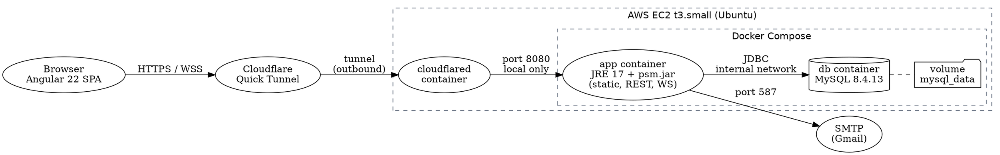

### Three ways the browser talks to the server
| Channel | Protocol | Used for |
| --- | --- | --- |
| Static files | HTTP GET | Downloading the Angular app once (`index.html`, JS, CSS, images) |
| REST API | HTTP + JSON under `/api/**` | Every read and write: login, CRUD, bids |
| WebSocket | STOMP over WS at `/ws` | Live push of new bids and auction status changes |

One rule ties them together: **every write goes through REST**, and the WebSocket only **broadcasts** what REST already committed. Inside the server, background work runs without any browser request: the **auction scheduler** opens and closes auctions on time, and the **mail listeners** send emails on a separate thread pool after each committed transaction.

### Development versus production
| | Development | Production |
| --- | --- | --- |
| Angular | `ng serve` on port 4200 with hot reload | Compiled into `psm.jar` under `static/` |
| API calls | Proxied by `proxy.conf.json` from 4200 to 8080 | Same origin, no proxy |
| Database | MySQL 8.4.13 in `compose.yaml` | MySQL 8.4.13 in `compose.prod.yaml` with a volume |
| Email | Mailpit (catches all mail, inbox on 8025) | Real SMTP (Gmail, port 587) |
| Public access | localhost | Cloudflare tunnel to the local port 8080 |

The key difference: two servers in development (Angular and Spring), **one** in production (the jar serves both).

## Going deeper: two axes inside the backend
The backend code is cut **vertically by feature** (packages) and **horizontally by layer** (inside each package). Everything about auctions lives in `auction/`, so it is found, changed and tested in one place. Dependencies only point downward: Controller, Service, Repository, Entity.

| Layer | Knows about | Never does |
| --- | --- | --- |
| Controller | HTTP: URLs, status codes, `@Valid`, `Principal` | Business rules, SQL |
| Service | Business rules, transactions, events | HTTP details |
| Entity (domain) | Its own rules (`Auction.placeBid`, `synchronize`) | Database access, HTTP |
| Repository | Queries | Business decisions |
| DTO | The JSON shape | Logic (only `from(entity)` mappers) |

ATELIER is richer than plain CRUD: the **auction rules live in the entity itself**. The REST endpoint and the scheduler call the same methods, so they can never disagree.

### Cross-cutting concerns
Some things apply to every feature, so they are written once.

| Concern | Where | Effect |
| --- | --- | --- |
| Every request | Security filter chain | JWT, then roles, then URL rules |
| Every error | `ApiExceptionHandler` | RFC 9457 JSON with a stable `code` |
| Every setting | `application.yml` + env vars | Bound to the validated `AtelierProperties` |
| Every write | `@Transactional` | Commit or rollback |
| Side effects | Events after commit | Async mail and WebSocket push |
| Time | `Clock` bean (`TimeConfig`) | Testable time |

### Threads inside the running process
| Thread(s) | Started by | Job |
| --- | --- | --- |
| Tomcat request threads | each HTTP call | Run the controller, service, repository chain |
| WebSocket and broker threads | Spring messaging | Handle STOMP frames and fan out messages |
| `scheduling-1` | `@EnableScheduling` | `AuctionLifecycleScheduler.advance()` every 5 s |
| `gallery-mail-*` (2 to 4 threads) | `@EnableAsync` + `AsyncConfig` | Send emails without slowing requests |
| Hikari connection pool | Spring Boot | Lend DB connections to transactions |

### Three flows end to end
| Flow | Path |
| --- | --- |
| A. Visitor opens the site | `GET /` goes through Cloudflare to the app. `SpaWebConfig` returns `index.html`. Angular loads, the lazy home page calls `GET /api/artworks` (public), `ArtworkService` reads MySQL, JSON comes back and the riffle animation shows the paintings |
| B. Collector places a bid | `POST /api/auctions/12/bids` with a Bearer token. JWT filter, rule `BIDDER`, `AuctionController`, `BidService` (lock, rules, insert), commit, then WebSocket push and emails. Detailed in chapter 16 |
| C. Time passes | The scheduler (every 5 s) finds OPEN auctions past `endsAt`, closes each in a locked transaction (`winner = leader`), commits, pushes `STATUS_CHANGED` and sends winner and admin emails. No human involved |

### Configuration: one jar, many environments
Nothing environment-specific is hard-coded. Everything comes from environment variables with safe development defaults. Dev reads `.env` through `compose.yaml`; production reads `deployment/.env.prod` (`chmod 600`, never in Git).

| Concern | Variables |
| --- | --- |
| Database | `DB_URL`, `DB_USER`, `DB_PASSWORD` |
| Security | `JWT_SECRET`, `JWT_EXPIRATION`, `CORS_ORIGINS` |
| Bootstrap | `BOOTSTRAP_ADMIN_EMAIL`, `BOOTSTRAP_ADMIN_PASSWORD` |
| Mail | `SMTP_*`, `MAIL_FROM`, `ADMIN_EMAIL`, `PUBLIC_URL` |
| Behaviour | `AUCTION_SOFT_CLOSE`, `AUCTION_LIFECYCLE_INTERVAL`, `DEMO_DATA` |

### Build and delivery
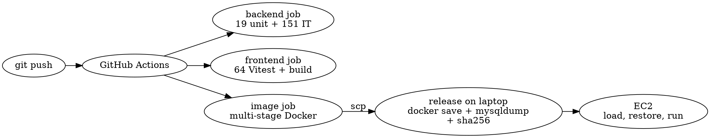
The Postman collection with Newman (103 requests, 175 assertions) runs outside this pipeline.

### Design decisions and their trade-offs
| Decision | Why | Trade-off |
| --- | --- | --- |
| Monolith, one jar | Simple to build, test and deploy; CDC step 11 | Scales as one unit |
| Angular inside the jar | Same origin, no CORS, one port | Frontend and backend are released together |
| Stateless JWT | No session store; works for REST and WebSocket | A token can't be revoked before expiry (mitigated: roles and `enabled` are re-read from the DB on each request) |
| Package by feature | Easy to navigate and extend | Some shared code goes to `common` |
| Flyway + `validate` | Reproducible schema, no surprise changes | Every change needs a new migration file |
| Rules in the `Auction` entity | One source of truth for REST and scheduler | The entity is richer than plain data |
| Pessimistic lock on bids | Correct under simultaneous bids | Bids on the same auction are serialised |
| Events after commit + async mail | Fast responses, no ghost emails | No retry queue; email is best effort |
| In-memory STOMP broker | No extra infrastructure | Works for one server instance only |
| VPS + Docker Compose | Same images as the laptop; WebSocket and MySQL fit naturally | We own patching, backups and uptime |
| Cloudflare Quick Tunnel | HTTPS without opening ports | Temporary URL; a named tunnel and domain are next |

> The architecture in one breath: a browser app talks to one Spring Boot process over REST for actions and STOMP for live updates; that process stores everything in MySQL.

# Spring Boot from zero
Spring Boot is a framework that creates objects for you, wires them together and runs a web server, so you only write business code. Every concept below is shown with real code from ATELIER.

### The entry point
The whole backend starts from one class, `AtelierApplication.java`. The `@SpringBootApplication` annotation turns on three things: component scanning (find classes in `com.sip.psm`), auto-configuration (set up Tomcat, JPA and Security from the dependencies present) and configuration support.

```java
@SpringBootApplication
@ConfigurationPropertiesScan
public class AtelierApplication {
    public static void main(String[] args) {
        SpringApplication.run(AtelierApplication.class, args);
    }
}
```

### What happens when the app starts
When you run `java -jar psm.jar`:

1. The JVM starts the Spring Boot launcher, which calls `main()`.
2. Spring creates the **container** (the `ApplicationContext`), a big map of every object it manages.
3. **Component scanning** looks through `com.sip.psm` for `@Service`, `@RestController`, `@Component`, `@Configuration` and so on.
4. **Auto-configuration** checks which libraries are present: the MySQL driver and JPA give a connection pool and Hibernate, the mail starter gives a `JavaMailSender`, the web starter gives an embedded Tomcat.
5. **Settings are bound and validated.** `application.yml` fills the `AtelierProperties` record. A bad `PUBLIC_URL` or a `JWT_SECRET` shorter than 32 bytes stops the startup immediately ("fail fast").
6. **Beans are created in dependency order.** `JwtService` needs `AtelierProperties` and `Clock`, so those are built first. Spring reads each constructor to know what to inject.
7. **Flyway runs before Hibernate.** It applies any V1, V2 or V3 script not yet run. Then Hibernate *validates* that every `@Entity` matches the tables. A mismatch stops the startup.
8. **`ApplicationRunner`s run.** `RoleAndAdminInitializer` creates the three system roles and the first admin if missing; `DemoDataInitializer` loads the demo gallery when `DEMO_DATA=true`.
9. **Tomcat opens port 8080** and the readiness check turns `UP`.

### IoC, beans and dependency injection
- **Bean:** an object created and managed by Spring. Classes marked `@Component`, `@Service`, `@Repository`, `@RestController` or `@Configuration` become beans. A method annotated `@Bean` also returns a bean.
- **IoC (Inversion of Control):** you never write `new AuthService(...)`. Spring builds the object graph at startup.
- **Dependency injection (DI):** a class lists what it needs in its constructor and Spring passes the matching beans in. ATELIER always uses **constructor injection** (no `@Autowired` on fields), which makes classes testable and fields `final`.

```java
@Service
public class AuthService {
    private final UserRepository users;
    private final PasswordEncoder passwordEncoder;
    private final JwtService jwt;
    private final ApplicationEventPublisher events;

    public AuthService(UserRepository users, RoleRepository roles,
                       PasswordEncoder passwordEncoder, JwtService jwt,
                       ApplicationEventPublisher events) { ... }
}
```
`PasswordEncoder` comes from the `@Bean passwordEncoder()` method in `SecurityConfig` (a `BCryptPasswordEncoder`), and `UserRepository` is generated by Spring Data.

### The layered architecture
Every feature follows the same layers. A request travels down and back up. The code is organised **package by feature** (`artist/`, `auction/`, `user/`), not by layer.

| Layer | Annotation | Job | ATELIER example |
| --- | --- | --- | --- |
| Controller | `@RestController` | Receives HTTP, validates JSON, returns JSON | `StudioArtistController` |
| Service | `@Service` + `@Transactional` | Business rules, transactions, events | `ArtistService` |
| Repository | interface extending `JpaRepository` | Database access, queries | `ArtistRepository` |
| Entity | `@Entity` | Java class mapped to a table | `Artist`, table `artists` |
| DTO | Java `record` | What goes in and out of the API | `ArtistRequest`, `ArtistResponse` |

### Controllers and REST annotations
| Annotation | Meaning |
| --- | --- |
| `@RestController` | Class whose methods return JSON (Jackson converts objects) |
| `@RequestMapping("/api/studio/artists")` | Base URL for the class |
| `@GetMapping`, `@PostMapping`, `@PutMapping`, `@DeleteMapping` | HTTP verb + sub-path |
| `@PathVariable Long id` | Reads `{id}` from the URL |
| `@RequestParam String q` | Reads `?q=` from the query string |
| `@RequestBody` | Converts the JSON body to a Java object |
| `@Valid` | Runs Bean Validation on that object |
| `@ResponseStatus(HttpStatus.CREATED)` | Returns 201 instead of 200 |
| `@PreAuthorize("hasRole('ADMIN')")` | Method-level security check |
| `Principal principal` | The logged-in user (email), injected by Spring Security |
| `Pageable` + `@PageableDefault` | Reads `?page=&size=&sort=` for pagination |

A real controller method, the bid endpoint:

```java
@PostMapping("/{id}/bids")
@ResponseStatus(HttpStatus.CREATED)
public AuctionEvent placeBid(@PathVariable Long id, @Valid @RequestBody PlaceBidRequest request,
                             Principal principal) {
    return bids.placeBid(id, request.amount(), principal.getName());
}
```

### DTOs as records, and validation
Entities are never sent directly to the browser. DTOs are immutable Java `record`s, which also lets the app hide fields: the public `ArtistSummary` has no email or phone, while the Studio's `ArtistResponse` does.

```java
public record RegisterRequest(
    @NotBlank @Size(max = 80) String firstName,
    @NotBlank @Email @Size(max = 190) String email,
    @NotBlank @Size(min = 8, max = 72) String password,
    @Pattern(regexp = "^[+0-9 ().-]*$") String phone) {}
```
If validation fails, Spring throws `MethodArgumentNotValidException` and the global handler returns 400 with a `fields` map (see chapter 4 for all error mappings).

### JPA, Hibernate and Spring Data
- **JPA** is the Java standard for mapping objects to tables. **Hibernate** is the implementation that generates SQL.
- **Spring Data JPA** writes repository implementations for you. Declaring `existsByEmailIgnoreCase(String email)` is enough; Spring derives the SQL from the method name.
- Custom queries use JPQL with `@Query`, for example `ArtistRepository.search(...)`.
- `@EntityGraph` loads related entities in one query to avoid the N+1 problem.
- `ddl-auto: validate`: Hibernate never creates tables. It only checks that entities match the schema that **Flyway** created.
- `open-in-view: false`: the DB session closes at the end of the service, so lazy loading can't silently run SQL in controllers.

### Transactions
`@Transactional` on a service method opens a DB transaction, commits on success and rolls back on any runtime exception. `readOnly = true` is used for reads. `ArtistService` is annotated at class level, so all its methods are transactional.

### Configuration and environment variables
`application.yml` holds every setting with the syntax `${ENV_VAR:default}`. The same jar runs in dev and production; only environment variables change. Custom settings live under `atelier.*` and are bound to a typed, validated record:

```java
@Validated
@ConfigurationProperties(prefix = "atelier")
public record AtelierProperties(Jwt jwt, Cors cors, Mail mail,
        Bootstrap bootstrap, Auction auction, boolean demoData) { ... }
```
If `PUBLIC_URL` is not a valid http(s) URL, the app refuses to start. `JwtService` also refuses to start when `JWT_SECRET` is shorter than 32 bytes.

### Events, async and scheduling
- `ApplicationEventPublisher.publishEvent(...)` decouples work: the service announces "a user registered" and does not know who sends the mail.
- `@TransactionalEventListener(phase = AFTER_COMMIT)` runs a listener only if the transaction succeeded.
- `@EnableAsync` + `@Async("galleryMailExecutor")` runs email sending on a separate thread pool (2 to 4 threads, queue of 200), so HTTP responses are not slowed by SMTP.
- `@EnableScheduling` + `@Scheduled(fixedDelayString = "${atelier.auction.lifecycle-interval}")` runs the auction scheduler every 5 seconds.

### Startup runners and Lombok
`RoleAndAdminInitializer` implements `ApplicationRunner`, so it runs once after startup. It creates the three system roles if missing and the first admin from `BOOTSTRAP_ADMIN_EMAIL` and `BOOTSTRAP_ADMIN_PASSWORD`.

Lombok generates boilerplate at compile time. `@Getter` and `@Setter` on entities create all accessors; `@NoArgsConstructor(access = PROTECTED)` gives JPA the empty constructor it needs while stopping other code from using it.

# Inside the backend: request journey, proxies, layers
The backend lives in `backend/src/main/java/com/sip/psm/`, organised in 14 feature and support packages. Each feature package owns its entity, repository, service, controllers and DTO records.

### Packages
| Package | Responsibility | Key classes |
| --- | --- | --- |
| `auth` | Register, login, current user | `AuthController`, `AuthService`, `RegistrationMailListener`, `UserRegisteredEvent` |
| `security` | JWT creation and verification, request filter, WebSocket guard | `JwtService`, `JwtAuthenticationFilter`, `TokenAuthenticator`, `StompAuthChannelInterceptor` |
| `config` | Security rules, WebSocket, async, typed settings, startup data | `SecurityConfig`, `WebSocketConfig`, `AsyncConfig`, `AtelierProperties`, `TimeConfig`, `RoleAndAdminInitializer` |
| `user` | Users and roles (CDC User, Role) | `User`, `Role`, `RoleName`, `UserService`, `RoleService`, `AdminUserController`, `AdminRoleController` |
| `artist` | Artists (CDC Client) | `Artist`, `ArtistService`, `ArtistController` (public), `StudioArtistController` |
| `exhibition` | Exhibitions (CDC Projet) | `Exhibition`, `ExhibitionService`, public and Studio controllers |
| `artwork` | Artworks, statuses, slugs | `Artwork`, `ArtworkStatus`, `ArtworkService` |
| `auction` | Auctions, bids, scheduler, live broadcast | `Auction`, `Bid`, `BidService`, `AuctionService`, `AuctionLifecycleScheduler`, `AuctionBroadcaster` |
| `account` | Self-service for logged-in users | `AccountController`, `AccountService`, `ProfileService` |
| `mail` | HTML and text email rendering and sending | `GalleryMailSender`, `GalleryMailTemplate`, `GalleryActivityMailListener` |
| `studio` | Dashboard KPIs and charts data | `StudioOverviewService`, `StudioStatsRepository` |
| `common` | Shared building blocks | `ApiExceptionHandler`, `BusinessRuleException`, `NotFoundException`, `PageResponse`, `AuditedEntity`, `Slugs` |
| `web` | Serves Angular from the jar | `SpaWebConfig` |
| `demo` | Optional demo gallery | `DemoDataInitializer`, `DemoCatalog` |

### Public versus Studio controllers
Each catalogue resource has **two controllers**. The public one (`/api/artists`) is read-only and returns a reduced projection. The Studio one (`/api/studio/artists`) is protected and returns everything, including private contact data and the exhibition budget. This split keeps the security rules simple: everything under `/api/studio/**` is staff-only, and everything under the public prefix is a `GET` open to all.

### The journey of one HTTP request
Take `PUT /api/studio/artists/5` sent by an admin. One request is handled by **one Tomcat thread** from start to finish.

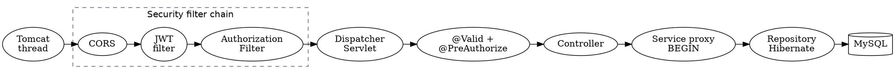
In words:

1. Tomcat gives the request to a thread. The **security filters** run in order: CORS, then our `JwtAuthenticationFilter`, then `AuthorizationFilter` (the URL rules of `SecurityConfig`).
2. `DispatcherServlet` (Spring MVC's front controller) finds the controller method by URL and verb.
3. Jackson turns the JSON body into `ArtistRequest`; `@Valid` runs Bean Validation; the `@PreAuthorize("hasRole('ADMIN')")` proxy checks the role.
4. `StudioArtistController.update(5, request)` calls the service. The service proxy opens a transaction (`BEGIN`).
5. `ArtistRepository.findById(5)` makes Hibernate run a `SELECT`; `apply()` changes the fields; `saveAndFlush()` sends `UPDATE ... WHERE id=5 AND version=3`. Then `COMMIT`.
6. Jackson turns `ArtistResponse` into JSON and `200 OK` goes back up through the filters.

If any step throws, the exception travels back up until `ApiExceptionHandler` turns it into a clean JSON error.

### Example: create an artist
1. Angular sends `POST /api/studio/artists` with JSON and `Authorization: Bearer <jwt>`.
2. `JwtAuthenticationFilter` verifies the token and puts the user and roles into the `SecurityContext`.
3. `SecurityConfig` checks the rule `POST /api/studio/**` is `hasAnyRole(ADMIN, COLLABORATEUR)`.
4. `StudioArtistController.create` receives a validated `ArtistRequest` (`@Valid`) and the `Principal`.
5. `ArtistService.create` (transactional) copies fields onto a new `Artist`, sets `createdBy` to the current user and saves it.
6. The service publishes `ArtistContactCreatedEvent`. After commit, the mail listener sends a welcome email to the artist and a notice to the admin.
7. The controller returns `201 Created` with an `ArtistResponse` JSON.

### Complete REST API map
| Resource | Endpoints | Access |
| --- | --- | --- |
| Auth | `POST /api/auth/register`, `POST /api/auth/login` | Everyone |
| Auth | `GET /api/auth/me` | Logged in |
| Public catalogue | `GET /api/artworks`, `/api/artworks/{slug}`, `/api/artists`, `/api/artists/{id}`, `/api/exhibitions`, `/api/exhibitions/{id}` | Everyone |
| Public auctions | `GET /api/auctions`, `/api/auctions/{id}`, `/api/auctions/{id}/bids` | Everyone |
| Bidding | `POST /api/auctions/{id}/bids` | `BIDDER` |
| Account | `PUT /api/account/profile`, `PUT /api/account/password`, `GET /api/account/bids`, `GET /api/account/wins` | Logged in |
| Studio artists | `GET`, `GET /{id}`, `POST`, `PUT /{id}`, `DELETE /{id}` on `/api/studio/artists` | GET and POST: ADMIN + COLLABORATEUR; PUT and DELETE: ADMIN |
| Studio exhibitions, artworks | the same five on `/api/studio/exhibitions` and `/api/studio/artworks` | same as artists |
| Studio overview | `GET /api/studio/overview` | ADMIN + COLLABORATEUR |
| Studio auctions | `GET`, `POST`, `PUT /{id}`, `POST /{id}/cancel`, `DELETE /{id}` on `/api/studio/auctions` | ADMIN |
| Users | `GET`, `GET /{id}`, `POST`, `PUT /{id}`, `DELETE /{id}`, `PUT /{id}/roles`, `PUT /{id}/status` on `/api/admin/users` | ADMIN |
| Roles | `GET`, `GET /{id}`, `POST`, `PUT /{id}`, `DELETE /{id}` on `/api/admin/roles` | ADMIN |
| Health | `GET /actuator/health`, `/actuator/health/readiness` | Everyone |

## Going deeper: proxies
When Spring creates `ArtistService`, it does not hand out the plain object. Because the class has `@Transactional`, Spring wraps it in a **proxy**, an invisible object in front of the real one:

```
Controller -> [Proxy: open transaction] -> real ArtistService.create() -> [Proxy: commit or rollback]
```
The same trick powers `@PreAuthorize` (a security check before the method) and `@Async` (run on another thread).

**Classic trap:** if a method calls another method *of the same class* (`this.other()`), the call skips the proxy, so its `@Transactional` or `@Async` is ignored. That is one reason the email work lives in separate listener classes and is not called directly.

### JPA and Hibernate under the hood
**The persistence context** is a per-transaction memory of the entities you loaded. Inside one transaction, asking for the same artist twice returns the **same Java object** and runs only one `SELECT`.

**Dirty checking:** at commit, Hibernate compares each loaded entity with its original copy. If a field changed, it writes the `UPDATE` automatically, even without calling `save()`. In ATELIER, `Auction.placeBid()` changes `currentPrice`, `leadingBidder`, `bidCount` and `endsAt`, and those updates are written without any explicit save of the auction.

**Flush** means "send the pending SQL now" instead of waiting for commit. The code calls `flush()` on purpose in two places:
- when **deleting an artist**, so a foreign-key refusal from MySQL happens inside the method and becomes a clean 409;
- in the **bid flow**, so the new bid row and the auction update are sent before the bid events are published.

**Lazy versus eager loading:**
- `Exhibition.artist` is `LAZY`: Hibernate puts a placeholder in that field and the real `SELECT` runs only when you call `exhibition.getArtist().getName()`.
- That only works **while the transaction is open**. With `open-in-view: false`, touching a lazy field in the controller throws. That is intentional: it forces services to load what they need, which is why entities are turned into DTOs *inside* the service.
- `User.roles` is `EAGER` because the security check needs the roles on every request.

**The N+1 problem and `@EntityGraph`:** listing 20 auctions and then touching each one's artwork and artist could run 1 + 20 + 20 queries. `AuctionRepository.search` uses `@EntityGraph(attributePaths = {"artwork", "artwork.artist", "leadingBidder", "winner"})`, which fetches all of it in **one query with joins**.

**Optimistic locking (`@Version`):** every update runs `UPDATE ... SET version = 4 WHERE id = 5 AND version = 3`. If someone else saved first, the version is already 4, zero rows match, Hibernate throws and the user gets **409 `stale_update`**. No database lock is held while a person fills in a form, so use it when conflicts are rare. The screenshot shows it directly in MySQL.


### Transactions in MySQL
Every service method that writes runs inside a transaction: it either commits fully or rolls back fully. The capture shows the idea at the SQL level: a row inserted inside a transaction is visible to its own session, and after `ROLLBACK` it is gone.


### Business rules worth knowing
Every rule failure throws `BusinessRuleException(code, message)`, which becomes HTTP 409 with that `code`.

| Area | Code | Rule |
| --- | --- | --- |
| Registration | `email_taken` | One account per email (case-insensitive) |
| Users | `self_demotion`, `self_disable`, `cannot_delete_self` | An admin can't remove their own admin role, disable or delete themselves |
| Users | `last_admin` | At least one enabled admin must remain |
| Users | `user_has_activity` | A user with bids or created records can't be deleted (disable instead) |
| Account | `wrong_password`, `password_too_short` | Password change checks the current one |
| Roles | `system_role` | ADMIN, COLLABORATEUR, BIDDER system roles can't be deleted or change profile |
| Roles | `role_in_use` | An assigned role can't be deleted or change profile |
| Roles | `role_name_taken`, `unknown_role` | Names are unique; IDs must exist |
| Artworks | `exhibition_artist_mismatch` | An artwork can only be in an exhibition of its own artist |
| Auctions | `artwork_not_published` | Only `PUBLISHED` artworks can be auctioned |
| Auctions | `auction_overlap` | Max one scheduled or open auction per artwork |
| Auctions | `invalid_window` | End must be after start |
| Auctions | `auction_locked`, `artwork_change` | Terms are editable only before the first bid; the artwork can't change |
| Auctions | `auction_has_bids`, `auction_finished` | Auctions with bids are cancelled, not deleted; only live ones can be cancelled |
| Bids | `auction_not_open`, `already_leading`, `bid_too_low` | Auction must be OPEN, you can't outbid yourself, amount at least the minimum next bid |
| Any | `stale_update` | Optimistic lock: someone else saved first |
| Any | `integrity_violation` | A DB foreign key refused the delete (for example an artist with exhibitions) |

### Errors: the full mapping
`ApiExceptionHandler` is a `@RestControllerAdvice`: one class catches exceptions from every controller and returns a standard RFC 9457 `ProblemDetail` JSON with a stable `code`.

| Thrown by | Example | Becomes |
| --- | --- | --- |
| A rule in a service or entity | `BusinessRuleException("bid_too_low", ...)` | 409 + that code |
| Missing record | `NotFoundException` | 404 `not_found` |
| `@Valid` failure | `MethodArgumentNotValidException` | 400 `validation_failed` + `fields` map |
| Wrong email or password | `BadCredentialsException`, `DisabledException` | 401 `invalid_credentials` |
| MySQL foreign key or unique refusal | `DataIntegrityViolationException` | 409 `integrity_violation` |
| `@Version` conflict | `ObjectOptimisticLockingFailureException` | 409 `stale_update` |
| No or bad token on a protected URL | Spring Security entry point | 401 `authentication_required` |
| Wrong role | `AccessDeniedException` / access-denied handler | 403 `forbidden` |

Every runtime exception inside `@Transactional` causes a **rollback**, so a failed rule never leaves half-saved data.

### Tests
| Suite | Tool | Count | Examples |
| --- | --- | --- | --- |
| Backend unit | JUnit 5 | 19 | `AuctionTest`, `GalleryMailTemplateTest` |
| Backend integration | Spring Boot Test + Testcontainers (real MySQL 8.4) | 151 | `AuthIT`, `SecurityMatrixIT` (84 role cases), `ConcurrentBiddingIT`, `DatabaseRelationshipsIT` |
| Frontend | Vitest | 64 | guards, interceptor, auth store, riffle formations |
| API | Postman + Newman | 103 requests, 175 assertions | `postman/ATELIER.postman_collection.json` |

Unit tests (`*Test`) run with Maven Surefire; integration tests (`*IT`) run with Maven Failsafe, each against a throwaway MySQL Docker container.

> Spring builds every object at startup and wraps them in proxies that add transactions, security and async. Each request runs on one thread that carries the user's identity.

# From Java to MySQL and to Angular
The backend sits between Angular and MySQL. This chapter follows each connection from the lowest level up.

### Part A: Spring Boot to MySQL
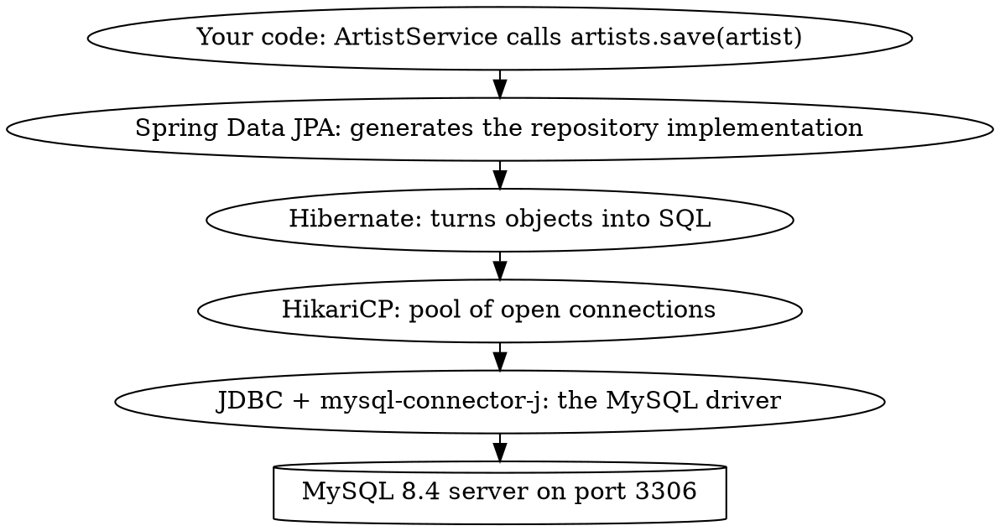
Each layer has one job.

**1. The driver.** **JDBC** is Java's standard way to talk to any database; each database supplies a **driver** that speaks its network protocol. In `pom.xml`, `mysql-connector-j` has `scope runtime`: it is only needed when running and our code never imports it.

**2. Where the database is.** `application.yml`:

```yaml
spring:
  datasource:
    url: ${DB_URL:jdbc:mysql://localhost:3306/atelier?serverTimezone=UTC&useUnicode=true&characterEncoding=utf8}
    username: ${DB_USER:atelier}
    password: ${DB_PASSWORD:atelier_dev_password}
```
| Part of the URL | Meaning |
| --- | --- |
| `jdbc:mysql://` | Use the MySQL driver |
| `localhost` or `db` | The host name |
| `3306` | MySQL's port |
| `/atelier` | The database (schema) name |
| `?serverTimezone=UTC` | Store and read times in UTC |

`${DB_URL:...}` means "use the environment variable `DB_URL` if it exists, else this default". The **same jar** works everywhere:

| Where | `DB_URL` | Why that host |
| --- | --- | --- |
| IDE on a laptop | default `localhost:3306` | `compose.yaml` publishes MySQL's port on the machine |
| Dev Docker stack | `jdbc:mysql://db:3306/atelier` | Inside Docker Compose, each **service name is a hostname**, so `db` reaches the MySQL container |
| Production on EC2 | `jdbc:mysql://db:3306/${MYSQL_DATABASE}` | Same: Docker's internal network, with port 3306 never exposed outside |

The MySQL container creates the database and user itself on first start, from `MYSQL_DATABASE`, `MYSQL_USER` and `MYSQL_PASSWORD`. That is why the backend's `DB_USER` and `DB_PASSWORD` must match those values.

**3. The connection pool.** Opening a database connection is slow (network handshake plus login). Spring Boot automatically adds **HikariCP**, which opens a few connections at startup (10 by default), keeps them open and **lends** one to each transaction, taking it back after commit or rollback. It comes with `spring-boot-starter-data-jpa` and needs no configuration.

**4. Flyway creates the tables.** At startup, before Hibernate, Flyway connects through the same pool, creates or reads `flyway_schema_history`, then runs any of `V1__core_schema.sql`, `V2__...`, `V3__...` that has not run yet, in order. **The SQL files are the source of truth for the tables**, not the Java classes.

**5. Hibernate maps classes to tables.**

```yaml
spring:
  jpa:
    open-in-view: false
    hibernate:
      ddl-auto: validate          # only CHECK the tables, never change them
    properties:
      hibernate.jdbc.time_zone: UTC
```
```java
@Entity                                 // this class is a table
@Table(name = "exhibitions")
public class Exhibition extends AuditedEntity {
    @Id                                 // primary key
    @GeneratedValue(strategy = GenerationType.IDENTITY)   // MySQL AUTO_INCREMENT
    private Long id;

    @Column(nullable = false, precision = 14, scale = 2)  // DECIMAL(14,2)
    private BigDecimal budget;

    @ManyToOne(fetch = FetchType.LAZY, optional = false)
    @JoinColumn(name = "artist_id", nullable = false)     // foreign key column
    private Artist artist;
}
```
At startup Hibernate checks that the table `exhibitions` exists with compatible columns. If anything is missing the app refuses to start, which is better than crashing later in production.

**6. Spring Data writes the repository.** You write only an interface; Spring generates the class at startup. `JpaRepository` gives `save`, `findById`, `findAll`, `delete`, `count` and paging for free.

```java
public interface ArtistRepository extends JpaRepository<Artist, Long> {
    boolean existsByCreatedById(Long userId);           // derived from the method name

    @Query("select a from Artist a where ... lower(a.name) like ...")
    Page<Artist> search(String query, boolean activeOnly, Pageable pageable);  // custom JPQL
}
```
| Way | Example | SQL comes from |
| --- | --- | --- |
| Inherited method | `artists.findById(5)` | Built in |
| Derived from the method name | `users.existsByEmailIgnoreCase(email)` | Spring reads the name |
| `@Query` in JPQL | `ArtistRepository.search(...)` | You write it, using **class and field names**, not table names |

**7. What happens on `save()`.**

```java
@Transactional
public ArtistResponse create(ArtistRequest request, String actorEmail) {
    Artist artist = new Artist();
    apply(artist, request);
    artist.setCreatedBy(users.requireByEmail(actorEmail));
    artist = artists.save(artist);
    ...
}
```
1. The `@Transactional` proxy borrows a connection from Hikari and runs `BEGIN`.
2. `save()` hands the new object to Hibernate. Because the ID comes from AUTO_INCREMENT, Hibernate sends the `INSERT INTO artists (...) VALUES (?, ?, ...)` right away to get the new ID back.
3. The method returns and the proxy runs `COMMIT`. On an exception it runs `ROLLBACK` instead.
4. The connection goes back to the pool.

Hibernate always uses **prepared statements** (`?` placeholders), so user input can never be read as SQL. That is what protects against SQL injection.


### Part B: Spring Boot to Angular
The two never share code. They communicate with **HTTP + JSON** and with **WebSocket**, and they agree on a shape, a "contract".

**1. The contract: Java records and TypeScript interfaces.** Backend (`ArtistDtos.java`):

```java
public record ArtistResponse(Long id, String name, String email, String phone, String address,
        String country, String biography, String photoUrl, boolean active,
        String createdBy, Instant createdAt, long version) { ... }
```
Frontend (`core/models/api.models.ts`):

```ts
export interface Artist extends ArtistSummary {   // id, name, country, biography, photoUrl
  email: string;
  phone?: string;
  address?: string;
  active: boolean;
  createdBy?: string;
  createdAt: string;   // Instant becomes an ISO string
  version: number;
}
```
**Jackson** turns the Java record into JSON and Angular reads that JSON as this interface. Field names must match exactly. Two settings in `application.yml` shape the JSON: `default-property-inclusion: non_null` leaves `null` fields out (so some TypeScript fields are optional, `phone?`), and `write-dates-as-timestamps: false` sends dates as readable ISO strings. Pagination uses the same contract on both sides: Java `PageResponse<T>(content, page, size, totalElements, totalPages)` and TypeScript `Page<T>` with the same five fields.

**2. The Angular side that calls the API.** `HttpClient` is enabled once in `app.config.ts`. The Studio then uses one **generic CRUD class** for every resource:

```ts
export class CrudResource<T, R> {
  constructor(private readonly http: HttpClient, private readonly baseUrl: string) {}

  list(query = {})      { return this.http.get<Page<T>>(this.baseUrl, { params: toParams(query) }); }
  get(id: number)       { return this.http.get<T>(`${this.baseUrl}/${id}`); }
  create(body: R)       { return this.http.post<T>(this.baseUrl, body); }
  update(id: number, body: R) { return this.http.put<T>(`${this.baseUrl}/${id}`, body); }
  delete(id: number)    { return this.http.delete<void>(`${this.baseUrl}/${id}`); }
}
```
Each method matches one backend controller method:

| Angular | HTTP | Spring |
| --- | --- | --- |
| `studio.artists.list({q, page})` | `GET /api/studio/artists?q=..&page=0` | `StudioArtistController.list(q, pageable)` |
| `studio.artists.get(5)` | `GET /api/studio/artists/5` | `get(@PathVariable id)` |
| `studio.artists.create(form)` | `POST` + JSON body | `create(@Valid @RequestBody ArtistRequest)` |
| `studio.artists.update(5, form)` | `PUT /api/studio/artists/5` | `update(id, request)` |
| `studio.artists.delete(5)` | `DELETE /api/studio/artists/5` | `delete(id)`, answers 204 |

`HttpClient` returns an **Observable**, which does nothing until a component calls `.subscribe(...)`. The component then puts the result into a **signal** and the template re-renders. The public pages use `GalleryApi` the same way.

**3. Every call passes through the interceptor.** It adds the JWT to each `/api/` call, which is what the backend's `JwtAuthenticationFilter` reads. If the backend answers **401**, it logs the user out and goes to `/login` (chapter 7).

**4. How Angular finds the backend: always relative URLs.** The code only says `/api/...`, never `http://localhost:8080/api/...`.

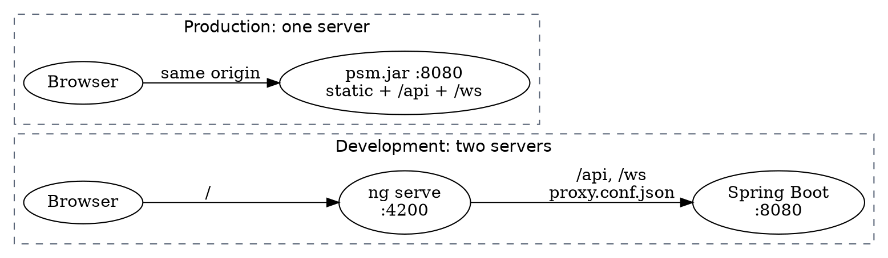
In development, `proxy.conf.json` forwards `/api` to Spring and `/ws` to `ws://` on port 8080 (`proxy.docker.json` points at the backend service in the Docker stack). `CORS_ORIGINS=http://localhost:4200` is also set, in case the browser ever calls 8080 directly. In production, Angular lives in the jar: same origin, no proxy, no CORS problem.

**5. How errors come back.** The backend always answers errors in one shape:

```json
{ "status": 409, "code": "bid_too_low", "detail": "The minimum bid is now 550.00" }
```
`core/api/problem.ts` (`problemOf`, `messageOf`) reads `code`, `detail` and the per-field `fields` map. The form shows "must be a valid email" under the right input, and the auction room shows the minimum bid message.


**6. The live connection.** For auctions Angular also opens a permanent STOMP connection (chapter 8). The JSON shape is the same `AuctionEvent` record on both sides.

### The whole chain in one picture
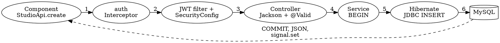
After the commit, the connection returns to the pool, `ArtistResponse` becomes JSON through Jackson, and Angular receives a typed `Artist`, updates a signal and the table re-renders.

# The database and its relations
The database is MySQL 8.4 (InnoDB) with **8 application tables and 13 foreign keys**, created only by 3 Flyway migrations. Hibernate checks the schema at startup (`ddl-auto: validate`) but never changes it. A 9th table, `flyway_schema_history`, is Flyway's own bookkeeping.

### Vocabulary
| Word | Meaning | Example in ATELIER |
| --- | --- | --- |
| Table | A list of records of one kind | `artists` |
| Row | One record | one artist |
| Column | One piece of information | `name`, `email` |
| Primary key (PK) | The unique ID of a row | `id BIGINT AUTO_INCREMENT` |
| Foreign key (FK) | A column that points to a PK in another table | `exhibitions.artist_id` points to `artists.id` |
| Unique constraint | No two rows can share this value | `users.email` |
| CHECK constraint | A rule on values | `budget >= 0` |
| Index | A lookup shortcut that makes searches fast | `idx_artists_name` |
| Cardinality | How many on each side | 1 artist, N exhibitions |

**The golden rule of relations:** the foreign key always sits on the **"many" side**. One artist has many exhibitions, so `artist_id` is stored in `exhibitions`. An artist row cannot hold a list; the list is built by looking up every exhibition that points back to it.

### Flyway: versioned schema
Flyway runs SQL files from `db/migration/` in order, once each, and records them in `flyway_schema_history`. A file is never edited after it has run; a change means a new file.

| Migration | What it creates |
| --- | --- |
| `V1__core_schema.sql` | `roles`, `users`, `user_roles`, `artists`, `exhibitions` (CDC core) |
| `V2__artworks_auctions_bids.sql` | `artworks`, `auctions`, `bids` (gallery extension) |
| `V3__dynamic_roles.sql` | Adds `roles.profile` and `roles.system_key`, copying the old labels so existing IDs and assignments survive |

### The map
The simplified diagram shows the 8 tables and the delete rule on each key. The "created by" keys (artists, exhibitions, artworks to users, all SET NULL) are left out to keep it readable.

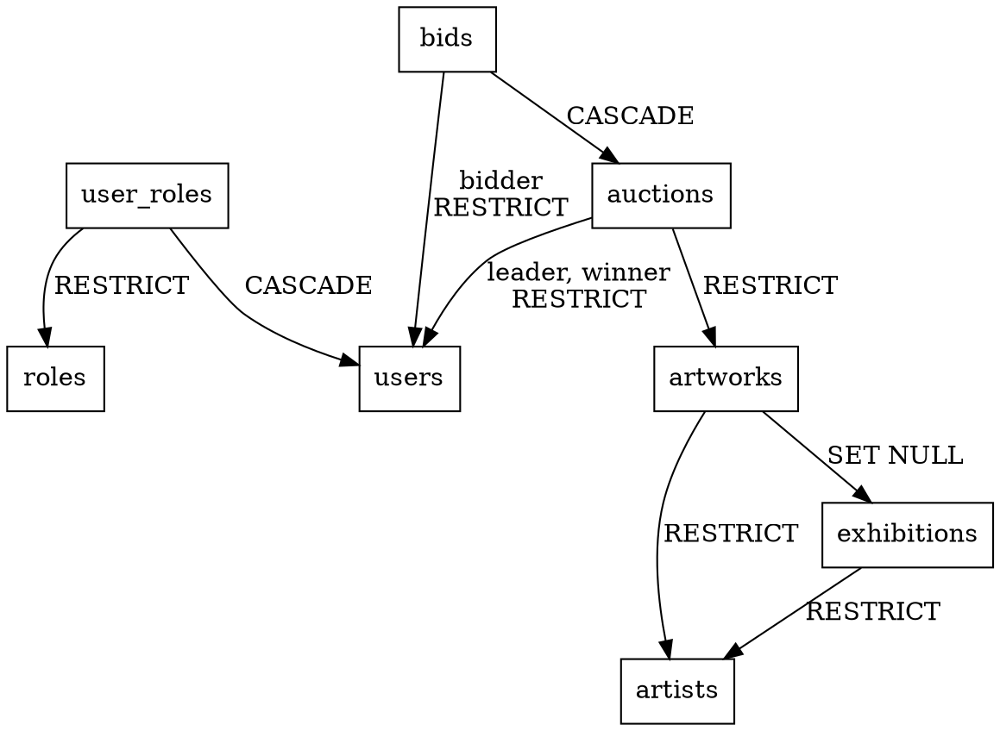
An arrow means "has a foreign key to". The top part is the CDC model: users and roles joined by `user_roles`, and artists owning exhibitions. The rest is the gallery extension: each auction belongs to one artwork and collects many bids.


### The tables
| Table | CDC equivalent | Main columns | Notes |
| --- | --- | --- | --- |
| `users` | User | `id`, `first_name`, `last_name`, `email` (unique), `password` (BCrypt), `phone`, `enabled`, `created_at` | `nom` is `last_name`, `prénom` is `first_name`, `tel` is `phone` |
| `roles` | Role | `id`, `libelle` (unique), `profile`, `system_key` (unique, nullable) | `libelle` is the editable label; `profile` is the real permission |
| `user_roles` | User-Role link | `user_id`, `role_id` (composite PK) | Join table of the many-to-many |
| `artists` | Client | `id`, `name`, `email`, `phone`, `address`, `country`, `biography`, `photo_url`, `active`, `created_by_id`, `version` | Index `idx_artists_name` |
| `exhibitions` | Projet | `id`, `title`, `description`, `budget` DECIMAL(14,2), `duration_days`, `starts_on`, `venue`, `cover_url`, `artist_id`, `version` | CHECK `budget >= 0`, `duration_days > 0` |
| `artworks` | extension | `id`, `slug` (unique), `title`, `image_url`, `estimate`, `status`, `artist_id`, `exhibition_id` | Status `DRAFT`, `PUBLISHED`, `ARCHIVED` |
| `auctions` | extension | `artwork_id`, `starting_price`, `current_price`, `minimum_increment`, `starts_at`, `ends_at`, `status`, `bid_count`, `leading_bidder_id`, `winner_id`, `version` | CHECK prices > 0, `current_price >= starting_price`, `ends_at > starts_at`; index `(status, ends_at)` for the scheduler |
| `bids` | extension | `auction_id`, `bidder_id`, `amount`, `created_at` | UNIQUE (`auction_id`, `amount`); index `(bidder_id, created_at)` |

Details worth remembering:
- `users.email` is 190 characters: `utf8mb4` uses up to 4 bytes per character, and 190 x 4 stays under the index size limit, so the unique index fits.
- `users.password` holds a **BCrypt hash** (60 characters, column of 100), never the real password.
- Auction statuses are `SCHEDULED`, `OPEN`, `CLOSED`, `CANCELLED`.

Example `roles` rows, showing why label and profile are separate:

| id | libelle | profile | system_key |
| --- | --- | --- | --- |
| 1 | ADMIN | ADMIN | ADMIN |
| 2 | COLLABORATEUR | COLLABORATEUR | COLLABORATEUR |
| 3 | BIDDER | BIDDER | BIDDER |
| 4 | Curator | COLLABORATEUR | NULL (custom role made by an admin) |


### Every relation explained
| Relation | Type | JPA mapping | FK and delete rule |
| --- | --- | --- | --- |
| User and Role | **Many-to-Many** (CDC) | `User.roles`: `@ManyToMany(fetch = EAGER)` + `@JoinTable(name = "user_roles")` | `user_id` CASCADE; `role_id` RESTRICT (can't delete an assigned role) |
| Artist 1 to N Exhibition | **One-to-Many / Many-to-One** (CDC Client-Projet) | `Exhibition.artist`: `@ManyToOne(optional = false)` + `@JoinColumn("artist_id")`; `Artist.exhibitions`: `@OneToMany(mappedBy = "artist")` | `artist_id NOT NULL`, RESTRICT: an artist with exhibitions can't be deleted (409) |
| Artist 1 to N Artwork | One-to-Many | `Artwork.artist`: `@ManyToOne(optional = false)` | RESTRICT |
| Exhibition 0..1 to N Artwork | Optional Many-to-One | `Artwork.exhibition`: `@ManyToOne` (nullable) | SET NULL: deleting an exhibition detaches its artworks |
| Artwork 1 to N Auction | One-to-Many (history) | `Auction.artwork`: `@ManyToOne(optional = false)` | RESTRICT |
| Auction 1 to N Bid | One-to-Many | `Bid.auction`: `@ManyToOne(optional = false)` | CASCADE (only reached when the auction has no bids) |
| User 1 to N Bid | One-to-Many | `Bid.bidder`: `@ManyToOne(optional = false)` | RESTRICT |
| Auction to User (leader, winner) | Two optional Many-to-One | `Auction.leadingBidder`, `Auction.winner` | RESTRICT |
| Artist, Exhibition, Artwork to User (createdBy) | Optional Many-to-One | in `AuditedEntity` (`@MappedSuperclass`) | SET NULL: deleting a user keeps the records |

Total: 2 CASCADE, 4 SET NULL, 7 RESTRICT, which makes 13 foreign keys. The CDC has no one-to-one relation and none is used.

## Going deeper: the two CDC relations
### Relation 1: User and Role (Many-to-Many)
A user can have several roles and a role can belong to several users. **Why a third table:** a column holds only one value. `users.role_id` would allow one role per user, `roles.user_id` one user per role. So each *pair* is a row in `user_roles`:

| user_id | role_id | meaning |
| --- | --- | --- |
| 1 | 1 | user 1 is ADMIN |
| 2 | 2 | user 2 is COLLABORATEUR |
| 2 | 4 | user 2 is also Curator |
| 3 | 3 | user 3 is BIDDER |

```sql
CREATE TABLE user_roles (
    user_id BIGINT NOT NULL,
    role_id BIGINT NOT NULL,
    PRIMARY KEY (user_id, role_id),        -- same pair can't appear twice
    CONSTRAINT fk_user_roles_user FOREIGN KEY (user_id) REFERENCES users (id) ON DELETE CASCADE,
    CONSTRAINT fk_user_roles_role FOREIGN KEY (role_id) REFERENCES roles (id)
);
```
```java
@ManyToMany(fetch = FetchType.EAGER)
@JoinTable(name = "user_roles",
        joinColumns = @JoinColumn(name = "user_id"),          // points to me (User)
        inverseJoinColumns = @JoinColumn(name = "role_id"))   // points to the other side (Role)
private Set<Role> roles = new HashSet<>();
```
- There is **no `UserRoles` class**. Hibernate manages the link table: add a role to the `Set` and it inserts a row, remove it and it deletes the row.
- It is a `Set`, not a `List`, so a role can't appear twice for one user, matching the composite PK.
- It is `EAGER` because the security check needs the roles on every request.
- It is **one-directional**: `Role` has no list of users. When the app needs the count it asks `users.countByRoleId(id)`.
- **Delete a user:** CASCADE removes the `user_roles` rows, the roles stay. **Delete an assigned role:** RESTRICT, so `RoleService` returns 409 `role_in_use` (system roles: `system_role`).
- SQL alone does not guarantee that a user has *at least one* role (zero rows are allowed); the service enforces it through request validation.

### Relation 2: Artist and Exhibitions (One-to-Many)
An artist can have many exhibitions, and every exhibition belongs to **exactly one** artist.

```sql
artist_id BIGINT NOT NULL,
CONSTRAINT fk_exhibitions_artist FOREIGN KEY (artist_id) REFERENCES artists (id)
```
`NOT NULL` means an exhibition can't exist without an artist; no `ON DELETE` clause means RESTRICT. In Java the relation is mapped in both directions.

`Exhibition.java`, the **owning side** (it holds the FK column):
```java
@ManyToOne(fetch = FetchType.LAZY, optional = false)
@JoinColumn(name = "artist_id", nullable = false)
private Artist artist;
```
`Artist.java`, the **inverse side** (no column, just a view):
```java
@OneToMany(mappedBy = "artist", fetch = FetchType.LAZY)
private List<Exhibition> exhibitions = new ArrayList<>();

public List<Exhibition> getExhibitions() {
    return Collections.unmodifiableList(exhibitions);   // read-only
}
```
**Owning versus inverse side.** The database has only *one* column, `exhibitions.artist_id`, while Java has *two* references, `exhibition.artist` and `artist.exhibitions`. Hibernate must know which one to trust when writing. `@JoinColumn` marks the side that **writes** the column. `mappedBy = "artist"` means "the field named `artist` on the other side owns this; I am only a mirror". So to link an exhibition you call `exhibition.setArtist(artist)`; adding to `artist.exhibitions` would not be saved, which is why the getter returns an unmodifiable list.

**On delete:** deleting an artist who has exhibitions is refused by MySQL, and the API returns 409 `integrity_violation`. Deleting an exhibition is fine, the artist stays. `DatabaseRelationshipsIT` tests both CDC relations against a real MySQL. The capture below shows the refusal in the database itself.


### The other relations in short
- **Artist to Artworks:** FK `artist_id NOT NULL`, RESTRICT. One-directional: `Artist` has no `artworks` list, the code queries the artwork repository by `artistId`.
- **Exhibition to Artworks:** an artwork *may* be shown in one exhibition. `exhibition_id` is nullable with `ON DELETE SET NULL`, and in Java `@ManyToOne` without `optional = false`. Deleting an exhibition keeps its paintings, just "not in an exhibition". SQL can't say "two foreign keys must agree", so the service checks that the exhibition belongs to the same artist (`exhibition_artist_mismatch`).
- **Artwork to Auctions:** one-to-many over time, since an artwork can be auctioned again after a cancellation. It is not one-to-one: the real rule is "at most **one live** auction at a time", checked in `AuctionService` (`auction_overlap`). An artwork used by an auction can't be deleted (409).
- **Auction to Bids:** FK `auction_id` with CASCADE and `UNIQUE (auction_id, amount)`. In practice the service refuses to delete an auction that has bids (`auction_has_bids`); you cancel it instead, so bid history is preserved.
- **User to Bids:** RESTRICT. A user who has bid can't be deleted (`user_has_activity`); the admin disables the account instead.
- **Auction to User, twice:** `leading_bidder_id` (who is highest now) and `winner_id` (set when the auction closes). Both nullable. The same two tables can be linked more than once with different meanings. `Auction.synchronize()` sets `winner = leadingBidder` on close.
- **createdBy:** artists, exhibitions and artworks remember which staff user created them, through a shared parent class:

```java
@MappedSuperclass                       // not a table itself; its fields are copied into each child table
public abstract class AuditedEntity {
    @ManyToOne(fetch = FetchType.LAZY)
    @JoinColumn(name = "created_by_id")
    private User createdBy;

    @Column(name = "created_at", nullable = false, updatable = false)
    private Instant createdAt;

    @Version
    private long version;               // optimistic locking
}
```
If that staff user is deleted, the records stay and `created_by_id` becomes NULL.

```cols

---

```

### All 13 foreign keys at a glance
| # | FK | From to | On delete | Why |
| --- | --- | --- | --- | --- |
| 1 | `fk_user_roles_user` | user_roles to users | **CASCADE** | Delete the user, drop their links |
| 2 | `fk_user_roles_role` | user_roles to roles | RESTRICT | Can't delete a role in use |
| 3 | `fk_artists_created_by` | artists to users | **SET NULL** | Keep the artist if the staff user leaves |
| 4 | `fk_exhibitions_artist` | exhibitions to artists | RESTRICT | Never lose projects by deleting a client |
| 5 | `fk_exhibitions_created_by` | exhibitions to users | **SET NULL** | Keep records |
| 6 | `fk_artworks_artist` | artworks to artists | RESTRICT | Every work keeps its artist |
| 7 | `fk_artworks_exhibition` | artworks to exhibitions | **SET NULL** | Close a show, keep the paintings |
| 8 | `fk_artworks_created_by` | artworks to users | **SET NULL** | Keep records |
| 9 | `fk_auctions_artwork` | auctions to artworks | RESTRICT | Keep auction history |
| 10 | `fk_auctions_leader` | auctions to users | RESTRICT | Keep history |
| 11 | `fk_auctions_winner` | auctions to users | RESTRICT | Keep history |
| 12 | `fk_bids_auction` | bids to auctions | **CASCADE** | Bids mean nothing without their auction |
| 13 | `fk_bids_bidder` | bids to users | RESTRICT | Keep history |

How to choose a rule (a good jury answer): **CASCADE** when the child has no meaning alone (a link row, a bid). **SET NULL** when the child should survive but the link is optional (the creator, the exhibition). **RESTRICT** when deleting would lose important data (clients, artworks, history).

### Mapping styles, fetch types and one query
| Style | Where | Code |
| --- | --- | --- |
| Bidirectional (both sides know) | Artist and Exhibition (the CDC relation) | `@ManyToOne` in Exhibition + `@OneToMany(mappedBy)` in Artist |
| Unidirectional (only the child knows) | Artwork to Artist, Auction to Artwork, Bid to Auction and User | Only `@ManyToOne`; the parent's list comes from a repository query |

Unidirectional is simpler and avoids loading big lists by accident. The CDC relation was made bidirectional to show the full JPA mapping, and `DatabaseRelationshipsIT` checks both directions after a reload.

- `LAZY` (the default choice here): related data loads only when accessed, to avoid loading the whole database.
- `EAGER` on `User.roles`: the roles are needed on every authenticated request.
- `@EntityGraph` loads exactly the needed relations in one SQL query. "Show auction 12 with its artwork, artist, leader and winner":

```java
@EntityGraph(attributePaths = {"artwork", "artwork.artist", "leadingBidder", "winner"})
@Query("select a from Auction a where a.id = :id")
Optional<Auction> findDetailedById(Long id);
```
```sql
SELECT ... FROM auctions a
  JOIN artworks aw   ON aw.id = a.artwork_id
  JOIN artists ar    ON ar.id = aw.artist_id
  LEFT JOIN users lb ON lb.id = a.leading_bidder_id   -- LEFT because it may be NULL
  LEFT JOIN users w  ON w.id = a.winner_id
WHERE a.id = 12;
```
The relations are *what the data means*; the joins are *how you read them back*.

### Integrity: database versus service
Some rules are guaranteed by MySQL and can never be broken; others by Java services. Knowing which is which is a classic jury question.

| Guaranteed by the database | Guaranteed by the service layer |
| --- | --- |
| Unique emails, role labels, artwork slugs | A user has at least one role (validated request) |
| Every exhibition, artwork, auction and bid has its parent (NOT NULL + FK) | An artwork and its exhibition share the same artist |
| Unique bid amount per auction | Max one live auction per artwork; only PUBLISHED artworks can be auctioned |
| Budget >= 0, duration > 0, prices > 0, end after start (CHECK) | Status transitions, bid increments, auction OPEN, not already leading |
| Foreign keys and delete rules | Last enabled admin protection |


### Money, time and concurrency
- **Money:** `BigDecimal` in Java and `DECIMAL(14,2)` in SQL, never `double` (no rounding errors).
- **Time:** `Instant` in UTC, `TIMESTAMP(6)` (microseconds), `hibernate.jdbc.time_zone: UTC`. A `Clock` bean is injected so tests can control time. `@PrePersist` fills `created_at` before the first insert.
- **Optimistic locking:** the `version` column is incremented on every update; a stale write raises 409 `stale_update`.
- **Pessimistic locking:** `SELECT ... FOR UPDATE` on the auction row while a bid is placed (chapter 8).

> Eight tables, thirteen foreign keys. The CDC core is User and Role through `user_roles`, and Artist to Exhibition through a NOT NULL `artist_id`; around it runs the chain Artist, Artwork, Auction, Bid.

# Security: JWT and the filter chain
ATELIER uses **stateless JWT authentication**: the server keeps no session. Every request carries a signed token, and the server re-checks the token and the user's roles on each call.

### Authentication versus authorization
- **Authentication** answers "who are you?". Login checks email and password and returns a JWT.
- **Authorization** answers "what may you do?". `SecurityConfig` and `@PreAuthorize` compare the user's roles with the rule for the URL.

### What a JWT is
A JSON Web Token is three Base64URL parts joined by dots: `header.payload.signature`.

| Part | ATELIER content |
| --- | --- |
| Header | `{"alg": "HS256"}` (HMAC with SHA-256) |
| Payload (claims) | `sub` = user email, `iat` = issued at, `exp` = expiry (12 h by default) |
| Signature | HMAC-SHA256 of header and payload with the secret key `JWT_SECRET` |

The payload is **readable by anyone** (it is encoded, not encrypted), so it holds no password and no roles. What makes it trustworthy is the signature: changing one character of the payload breaks it, and only the server knows the secret. Roles are read from the database on every request, so removing a role or disabling a user takes effect immediately.

### The login sequence
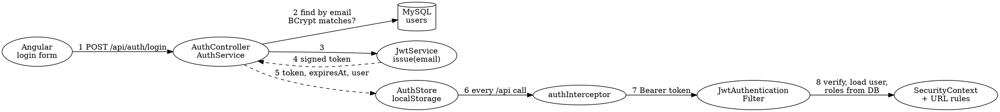
The token is created once at login; then the interceptor attaches it to every `/api/` call. The filter never blocks a request itself: it either sets the user in the security context or leaves the request anonymous, and the URL rules decide the result.


### The security classes
| Class | Role in the chain |
| --- | --- |
| `SecurityConfig` | Declares the `SecurityFilterChain`: stateless sessions, CSRF off, CORS on, URL rules, 401 and 403 JSON handlers, and inserts the JWT filter |
| `JwtService` | `issue(email)` builds and signs a token with JJWT; `verify(token)` checks signature and expiry and returns the email or empty |
| `JwtAuthenticationFilter` | A `OncePerRequestFilter` (the "middleware") that runs before Spring's login filter on every `/api/` request |
| `TokenAuthenticator` | Shared logic: strip `Bearer `, verify the JWT, load the user, refuse disabled users, map roles to authorities |
| `StompAuthChannelInterceptor` | The same checks for WebSocket STOMP frames |
| `PasswordEncoder` (BCrypt) | Hashes passwords on register; `matches()` checks them on login |

### Issuing the token
```java
public IssuedToken issue(String email) {
    Instant now = clock.instant();
    Instant expiresAt = now.plus(settings.expiration());   // PT12H
    String token = Jwts.builder()
            .subject(email)
            .issuedAt(Date.from(now))
            .expiration(Date.from(expiresAt))
            .signWith(key)                                 // HMAC key from JWT_SECRET
            .compact();
    return new IssuedToken(token, expiresAt);
}
```
`AuthService.login` finds the user by email, checks `passwordEncoder.matches(raw, hash)`, refuses disabled accounts and returns `{token, expiresAt, user}`. A wrong email and a wrong password give the same 401 `invalid_credentials`, so attackers can't discover which emails exist.

### The filter: the request middleware
```java
@Component
public class JwtAuthenticationFilter extends OncePerRequestFilter {
    protected void doFilterInternal(HttpServletRequest request,
            HttpServletResponse response, FilterChain chain) {
        if (SecurityContextHolder.getContext().getAuthentication() == null) {
            authenticator.authenticate(request.getHeader("Authorization"))
                .ifPresent(auth -> SecurityContextHolder.getContext()
                                       .setAuthentication(auth));
        }
        chain.doFilter(request, response);   // always continue
    }
    protected boolean shouldNotFilter(HttpServletRequest request) {
        return !request.getRequestURI().startsWith("/api/");
    }
}
```
Important detail: the filter **never blocks** a request. With no token or a bad token it leaves the user anonymous. The URL rules that come later decide whether anonymous is allowed (a public `GET`) or not (401). Keeping the two jobs apart, "who is calling" and "what may they do", is a standard Spring Security design.

`TokenAuthenticator` converts a valid token to a Spring `Authentication`:

```java
return jwt.verify(header.substring(7))           // email or empty
        .flatMap(users::findByEmailIgnoreCase)    // load user from DB
        .filter(User::isEnabled)                  // disabled = rejected
        .map(user -> authenticated(user.getEmail(), null,
              roles mapped to "ROLE_ADMIN", "ROLE_BIDDER"...));
```
`RoleName.authority()` adds the `ROLE_` prefix that Spring expects for `hasRole("ADMIN")`.

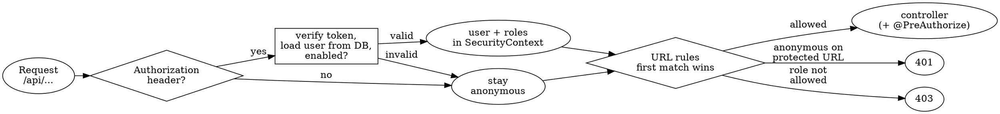

### The filter chain configuration
```java
http.csrf(disable)                                  // no cookies -> no CSRF risk
    .cors(withDefaults())                           // origins from CORS_ORIGINS
    .sessionManagement(STATELESS)                   // no HttpSession
    .authorizeHttpRequests(auth -> auth
        .requestMatchers(OPTIONS, "/**").permitAll()
        .requestMatchers(POST, "/api/auth/register", "/api/auth/login").permitAll()
        .requestMatchers(GET, "/api/artworks/**", "/api/artists/**",
                         "/api/exhibitions/**", "/api/auctions/**").permitAll()
        .requestMatchers(POST, "/api/auctions/*/bids").hasRole("BIDDER")
        .requestMatchers("/api/admin/**", "/api/studio/auctions/**").hasRole("ADMIN")
        .requestMatchers(GET,  "/api/studio/**").hasAnyRole("ADMIN", "COLLABORATEUR")
        .requestMatchers(POST, "/api/studio/**").hasAnyRole("ADMIN", "COLLABORATEUR")
        .requestMatchers(PUT,  "/api/studio/**").hasRole("ADMIN")
        .requestMatchers(DELETE, "/api/studio/**").hasRole("ADMIN")
        .requestMatchers("/api/**").authenticated()
        .anyRequest().permitAll())
    .addFilterBefore(jwtFilter, UsernamePasswordAuthenticationFilter.class);
```
Rules are checked **top to bottom and the first match wins**. That is why `/api/studio/auctions/**` (ADMIN) sits before the general `GET /api/studio/**` rule. `anyRequest().permitAll()` covers the Angular files, `/ws` and `/actuator/health`.

**Defence in depth:** controllers also carry `@PreAuthorize` (enabled by `@EnableMethodSecurity`), so even if a URL rule were wrong, the method would still refuse. Two locks on the same door.

**`SecurityContextHolder` is thread-local.** Each Tomcat thread has its own "who is logged in" box. Our filter fills it and every later step on the same thread can read it: `@PreAuthorize`, the URL rules and the `Principal` injected into controllers. When the request ends the box is cleared. Because sessions are `STATELESS`, nothing is remembered between requests.

### 401 versus 403
| Status | Meaning | Who produces it |
| --- | --- | --- |
| 401 `authentication_required` | No valid token on a protected URL | `authenticationEntryPoint` in `SecurityConfig` |
| 401 `invalid_credentials` | Wrong email or password at login | `ApiExceptionHandler` |
| 403 `forbidden` | Valid token, but the role is not allowed | `accessDeniedHandler` in `SecurityConfig` |

```cols

---

```

### Permission matrix
| Operation | Anonymous | BIDDER | COLLABORATEUR | ADMIN |
| --- | --- | --- | --- | --- |
| Public reads | yes | yes | yes | yes |
| Register, login | yes | yes | yes | yes |
| Place a bid | no | **yes** | no | no |
| Studio: view clients and projets | no | no | yes | yes |
| Studio: add clients and projets | no | no | yes | yes |
| Studio: edit, delete | no | no | no | yes |
| Auctions management | no | no | no | yes |
| Users and roles | no | no | no | yes |
| Own account, `/api/auth/me` | no | yes | yes | yes |

This matrix is tested by `SecurityMatrixIT` with 84 cases.

### Roles: label versus profile
A role row has an editable `libelle` (display name) and a fixed `profile` (`ADMIN`, `COLLABORATEUR` or `BIDDER`). **Security checks only the profile**, turned into an authority such as `ROLE_ADMIN`. An admin can create a role named "Curator" with the `COLLABORATEUR` profile and assign it to users; renaming it never changes anyone's rights. The three system roles (`system_key` not null) can't be deleted.

### Passwords with BCrypt
BCrypt is a slow, salted hash. The same password gives a different hash each time (a random salt is stored inside the hash), and it is deliberately slow to make brute force expensive. The database only stores the hash in `users.password`.

### Securing the WebSocket
`StompAuthChannelInterceptor.preSend` checks every STOMP frame:
- **CONNECT:** if an `Authorization: Bearer` header is present it must be valid or the connection is rejected. No header means an anonymous read-only connection.
- **SUBSCRIBE:** only destinations starting with `/topic/auctions` are allowed.
- **SEND:** always refused. Bids must go through `POST /api/auctions/{id}/bids`, where validation, locking and roles apply.

### The Angular side of auth
| Piece | File | What it does |
| --- | --- | --- |
| `AuthStore` | `core/auth/auth.store.ts` | Holds the session in a signal; saves `{token, expiresAt, user}` in `localStorage` under `atelier.session`; ignores an expired session at startup; exposes `isAuthenticated`, `isAdmin`, `isStaff`, `isBidder`, `hasRole()` |
| `authInterceptor` | `core/auth/auth.interceptor.ts` | Adds `Authorization: Bearer <token>` to every `/api/` call; on a 401 (except login and register) logs out and redirects to `/login?returnUrl=...` |
| `authGuard` | `core/auth/guards.ts` | Route requires login, else redirect to `/login` |
| `roleGuard(...roles)` | `core/auth/guards.ts` | Route requires a role, else `/forbidden` |
| `guestGuard` | `core/auth/guards.ts` | Keeps logged-in users off `/login` and `/register` |

The interceptor itself:

```ts
const token = auth.token();
const isApi = request.url.startsWith('/api/');
const authorized =
  token && isApi ? request.clone({ setHeaders: { Authorization: `Bearer ${token}` } }) : request;
```
The frontend guards are **user-experience only**. A user can edit JavaScript in the browser, so the backend is the real security boundary.

```cols

---

```

### CORS and CSRF in one minute
- **CORS:** browsers block a page from calling another origin unless the server allows it. `CORS_ORIGINS` lists allowed origins on `/api/**`, with methods `GET, POST, PUT, DELETE, OPTIONS` and headers `Authorization, Content-Type`. In production Angular and the API share one origin, so CORS barely matters.
- **CSRF:** an attack that abuses cookies a browser sends automatically. ATELIER authenticates with a header the browser never adds by itself, so CSRF protection is safely disabled.

### Defence in depth: eight layers
| Layer | Mechanism |
| --- | --- |
| 1 Network | EC2 firewall: only SSH 22 from the admin IP; app bound to the local interface; DB never published |
| 2 Transport | HTTPS and WSS via Cloudflare; SMTP via STARTTLS |
| 3 Identity | BCrypt passwords; JWT HS256 signed with `JWT_SECRET` (at least 32 bytes), 12 h expiry |
| 4 URL rules | `SecurityConfig`: first-match rules per path and HTTP verb |
| 5 Methods | `@PreAuthorize` on controller methods |
| 6 Business | Service checks (last admin, self-demotion, role in use) |
| 7 Database | Foreign keys, UNIQUE, CHECK, NOT NULL |
| 8 UI | Angular guards and hidden buttons (comfort only, not security) |

If one layer has a mistake, the next one still protects.

# Auctions, locking and real time
The auction is the most technical part of the backend. Its rules live **inside the entity** (`Auction.placeBid`, `Auction.synchronize`), so the REST endpoint and the scheduler apply exactly the same logic.

### The rules
- **Minimum next bid:** the starting price if there are no bids, else `currentPrice + minimumIncrement`.
- **Soft close:** a bid in the last 60 seconds (`AUCTION_SOFT_CLOSE`) pushes `endsAt` to now + 60 s, so last-second sniping is useless.
- **Lifecycle:** `SCHEDULED`, then `OPEN`, then `CLOSED` (or `CANCELLED`). Closing sets `winner = leadingBidder`.
- **Unique constraint:** `UNIQUE(auction_id, amount)` on `bids` is the final safety net.
- **Optimistic version:** `@Version long version` on auctions, artists, exhibitions and artworks detects concurrent edits in the Studio.
- `placeBid` calls `synchronize(now)` first. If the end time has passed but the scheduler has not run yet, the bid is still refused.
- The `Clock` is injected instead of calling `Instant.now()`, so tests can freeze or move time.

The core of the rules, from `Auction.placeBid`:

```java
synchronize(now);
if (status != AuctionStatus.OPEN) {
    throw new BusinessRuleException("auction_not_open", "This auction is not accepting bids");
}
if (leadingBidder != null && Objects.equals(leadingBidder.getId(), bidder.getId())) {
    throw new BusinessRuleException("already_leading", "You already hold the highest bid");
}
BigDecimal minimum = minimumNextBid();
if (amount.compareTo(minimum) < 0) {
    throw new BusinessRuleException("bid_too_low", "The minimum bid is now " + minimum.toPlainString());
}
currentPrice = amount;
leadingBidder = bidder;
bidCount++;
Instant softCloseLimit = now.plus(softClose);
if (endsAt.isBefore(softCloseLimit)) {
    endsAt = softCloseLimit;
}
```

### Two bidders at the same millisecond
**Pessimistic lock:** `BidService` loads the auction with `findByIdForUpdate`, a `@Lock(PESSIMISTIC_WRITE)` query that becomes `SELECT ... FOR UPDATE`. Bids are fast and conflicts are likely, so here you **block** instead of retrying (the opposite of the optimistic lock used for Studio edits).

```java
@Lock(LockModeType.PESSIMISTIC_WRITE)
@Query("select a from Auction a where a.id = :id")
Optional<Auction> findByIdForUpdate(@Param("id") Long id);
```
Setup: the current price is 500, the minimum increment is 50, and Alice and Bob both bid 550.

| Time | Alice's transaction | Bob's transaction |
| --- | --- | --- |
| t1 | `SELECT auction FOR UPDATE`: gets the lock | |
| t2 | | `SELECT auction FOR UPDATE`: **waits** |
| t3 | `placeBid`: 550 is at least 550, price becomes 550 | |
| t4 | `INSERT` bid, `UPDATE` auction, `COMMIT`: lock released | |
| t5 | | gets the lock, reads price 550 |
| t6 | | `placeBid`: 550 is below 600, refused with `bid_too_low` |
| t7 | | `ROLLBACK`, 409 to Bob |


### The bid sequence, with lock and after-commit events
```dot
digraph {
  rankdir=LR; nodesep=0.2; ranksep=0.3;
  a[label="Angular\nPOST /bids"]; f[label="JWT filter\nrule BIDDER"]; c[label="Auction\nController"];
  subgraph cluster_tx { label="BidService.placeBid  (one transaction)"; style="dashed"; color="#5b6678"; fontname="Helvetica";
    l[label="1 SELECT\nFOR UPDATE"]; r[label="2 Auction.placeBid\nrules + soft close"]; i[label="3 INSERT bid\nflush"]; e[label="4 publish\n2 events (parked)"]; m[label="5 COMMIT"]; }
  w[label="AuctionBroadcaster\n/topic/auctions/id"]; ml[label="mail listener\nasync thread"]; br[label="every open\nbrowser"]; em[label="bidder +\nprevious leader"];
  a -> f -> c -> l -> r -> i -> e -> m;
  m -> w [label="after commit"]; m -> ml [label="after commit"]; w -> br; ml -> em;
}
```

### Events: why "after commit" and "async" together
`BidService.placeBid` calls `events.publishEvent(...)` twice: once with the `AuctionEvent`, once with the `BidAcceptedEvent`. Nothing is sent yet, because the listeners are `@TransactionalEventListener` and Spring **parks** the events until the transaction ends:

- **COMMIT succeeds:** `AuctionBroadcaster` pushes the new price over WebSocket and the mail listener queues the emails.
- **ROLLBACK:** the events are thrown away. No email, no fake price on screens.

```java
@TransactionalEventListener(phase = TransactionPhase.AFTER_COMMIT)
public void onAuctionEvent(AuctionEvent event) {
    messaging.convertAndSend(TOPIC + "/" + event.auction().id(), event);
    messaging.convertAndSend(TOPIC, event);
}
```
Then `@Async("galleryMailExecutor")` moves the email work onto a separate pool (2 to 4 threads, queue of 200). The HTTP thread returns at once and the user never waits for Gmail. `GalleryMailSender` catches errors **per recipient**, so a failed customer email still lets the admin email go out.

The services announce what happened instead of calling mail or WebSocket code directly. This is **loose coupling**: `BidService` does not know emails exist, and adding a new reaction means adding a listener, not changing the service.

| Service call | Event | Listener | Result |
| --- | --- | --- | --- |
| `AuthService.register` | `UserRegisteredEvent` | `RegistrationMailListener` | SMTP |
| `ArtistService.create` | `ArtistContactCreatedEvent` | `GalleryActivityMailListener` | SMTP |
| `BidService.placeBid` | `AuctionEvent` | `AuctionBroadcaster` | `/topic/auctions/{id}` |
| `BidService.placeBid` | `BidAcceptedEvent` | `GalleryActivityMailListener` | bidder and outbid emails |
| `AuctionService` / scheduler | `AuctionResultEvent` | `GalleryActivityMailListener` | winner and admin emails |

### WebSocket and STOMP
- **WebSocket** keeps a permanent two-way connection between browser and server, instead of one HTTP request per update.
- **STOMP** is a small messaging protocol on top of WebSocket, with commands `CONNECT`, `SUBSCRIBE`, `SEND`, `MESSAGE`.
- `WebSocketConfig` (`@EnableWebSocketMessageBroker`) opens the endpoint `/ws` and enables a simple in-memory broker on `/topic`.

Step by step:
1. The browser opens `ws://.../ws`. It is an HTTP request that **upgrades** into a permanent connection.
2. It sends a STOMP `CONNECT` frame, optionally with a Bearer token. `StompAuthChannelInterceptor` checks it.
3. It sends `SUBSCRIBE /topic/auctions/12`. The interceptor only allows destinations under `/topic/auctions`.
4. Spring's **simple broker** (in memory) keeps the list "these sessions want topic 12".
5. After a bid commits, `convertAndSend("/topic/auctions/12", event)` turns the event into JSON and the broker sends it to every subscriber. The messages are `AuctionEvent`s of type `BID_PLACED`, `STATUS_CHANGED` or `UPDATED`.
6. `SEND` frames from clients are refused, so a bid can never skip validation and locking.

Limit to know: the broker is in memory, so it works for **one server instance**. Several instances would need an external broker such as RabbitMQ.

### The scheduler
`@Scheduled(fixedDelayString = "${atelier.auction.lifecycle-interval}")` runs `advance()` 5 s **after the previous run finishes** (`fixedDelay`, not `fixedRate`, so runs never overlap). Each run:

1. One query finds the IDs that are due: SCHEDULED auctions past their start, or OPEN auctions past their end.
2. Each ID goes through `AuctionService.synchronize(id)` in **its own locked transaction**, so a failure on one auction does not block the others. The error is logged and the loop continues.
3. When the status changes, the WebSocket gets a `STATUS_CHANGED` event; a closed or cancelled auction also gets an `AuctionResultEvent`, which sends the winner and admin emails. Nothing is sent again on later runs, because there is no new change.

### The Angular live room
`AuctionSocket` keeps **one shared STOMP connection** for the whole app:

```ts
const client = new Client({
  brokerURL: `${scheme}://${location.host}/ws`,   // ws:// or wss://
  connectHeaders: token ? { Authorization: `Bearer ${token}` } : {},
  reconnectDelay: 3000,
  heartbeatIncoming: 10000,
  heartbeatOutgoing: 10000,
  onConnect: () => { /* re-subscribe every open topic */ },
});
```
- `auction(id)` returns an Observable of `/topic/auctions/{id}` events; `all()` returns `/topic/auctions`.
- The connection opens with the first subscriber and closes with the last one (reference counting).
- After a network drop it reconnects every 3 s and re-subscribes. A `state` signal (`idle`, `connecting`, `live`, `reconnecting`) drives the "Live" badge.
- `AuctionRoomPage` updates its `auction` and `bids` signals on each event; the price animates to the new value and a soft-close extension is highlighted.
- Placing a bid calls `POST /api/auctions/{id}/bids` over HTTP. The confirmation for everyone comes back through the socket.

```cols

---

```


# Email with SMTP
ATELIER sends branded HTML and plain-text emails through SMTP, **asynchronously and only after the database transaction commits**. This covers CDC step 5 ("after a registration, send an email to the admin") and extends it to artists, bids and auction results.

### SMTP basics
- **SMTP** (Simple Mail Transfer Protocol) is how applications hand an email to a mail server, which then delivers it.
- **Port 587 and STARTTLS:** the connection starts in plain text, then upgrades to TLS encryption. This is what Gmail uses for apps (`SMTP_TLS=true`).
- **Authentication:** the app logs in with `SMTP_USER` and `SMTP_PASSWORD`. For Gmail this is an **app password**, not the normal account password.
- **Mailpit:** a fake SMTP server for development (port 1025, web inbox on 8025). It catches all mail so nothing reaches real inboxes.

### Configuration
`spring-boot-starter-mail` auto-creates a `JavaMailSender` bean from `spring.mail.*` in `application.yml`:

| Variable | Dev (Mailpit) | Production (Gmail) |
| --- | --- | --- |
| `SMTP_HOST` | `mailpit` | `smtp.gmail.com` |
| `SMTP_PORT` | `1025` | `587` |
| `SMTP_AUTH` | `false` | `true` |
| `SMTP_TLS` | `false` | `true` (STARTTLS) |
| `SMTP_USER`, `SMTP_PASSWORD` | empty | sender account and app password (secret) |
| `MAIL_FROM` | a `noreply@` address | the authenticated sender address |
| `ADMIN_EMAIL` | admin inbox for notices | admin inbox for notices |
| `PUBLIC_URL` | `http://localhost:4200` | the public site URL used in email links |

Timeouts are 5 s (connect) and 10 s (read and write), so a slow mail server can't block threads for long.

### How a registration email is sent
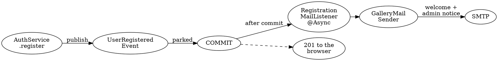
1. `AuthService.register` saves the user and calls `events.publishEvent(new UserRegisteredEvent(id, name, email))`.
2. The transaction commits. If it failed, no email is sent.
3. `RegistrationMailListener.onUserRegistered` is annotated `@TransactionalEventListener` (default phase AFTER_COMMIT) and `@Async("galleryMailExecutor")`, so it runs on a mail thread.
4. It sends two messages through `GalleryMailSender`: a welcome to the new user and a "New account" notice to `ADMIN_EMAIL` with a link to `/studio/users`.
5. The HTTP response has already returned 201; the user never waits for SMTP.

### The mail classes
| Class | Job |
| --- | --- |
| `GalleryMailTemplate` | Loads `resources/mail/gallery.html`, fills the slots (title, greeting, paragraphs, details, button), HTML-escapes values, builds the link as `PUBLIC_URL` + action path, and also produces a plain-text version |
| `GalleryMailSender` | Builds a multipart MIME message with `MimeMessageHelper`: From "ATELIER Gallery", subject `[ATELIER] ...`, HTML + text, and the *Oleanders* painting attached inline (`cid:atelier-gallery-art`) |
| `RegistrationMailListener` | User registered or created by admin: user welcome + admin notice |
| `GalleryActivityMailListener` | Artist contact created, bid accepted, auction result |
| `AsyncConfig` | Thread pool `galleryMailExecutor`: 2 core threads, max 4, queue 200, waits up to 20 s on shutdown |

### Every email the app sends
| Event | Recipient | Message |
| --- | --- | --- |
| Public registration | New user + admin | Welcome / New account |
| Admin creates an enabled user | That user + admin | Welcome / New account |
| Artist created, or email changed | Artist + admin | Contact welcome / notice |
| Bid accepted | Bidder | Bid confirmation |
| Bid accepted | Previous leader | Outbid notice |
| Auction closed with a winner | Winner + admin | Congratulations / result |
| Auction closed, no bids | Admin | No-bids result |
| Auction cancelled | Admin + current leader | Cancellation |

```cols

---

```

### Failure handling
`GalleryMailSender.send` catches `MailException` and `MessagingException` per recipient. A failure is logged (without credentials or addresses) and **does not roll back** the registration or auction. A failed user email never stops the admin email. Trade-off: there is no retry queue (outbox), so delivery is best effort.

In tests, Mailpit captured 17 multipart messages from the production image, and Gmail accepted 5 controlled messages.

# Angular and the animations
The frontend is an Angular 22 single-page application (SPA) using **standalone components, signals, zoneless change detection and `OnPush`**. The browser downloads it once; after that, only JSON travels between Angular and Spring Boot.

### Angular fundamentals used here
| Concept | What it means | In ATELIER |
| --- | --- | --- |
| Component | A TypeScript class + HTML template + CSS = one piece of UI | `LoginPage`, `ArtworkCard`, `StudioUsersPage` |
| Standalone | Components declare their own `imports`; no `NgModule` | Every component |
| Signal | A reactive value: `signal()`, read with `value()`, updated with `.set()`; `computed()` derives from other signals | `AuthStore.session`, `auction`, `bids`, `scene` |
| Zoneless + OnPush | Angular re-renders only when a signal or input changes, not after every browser event | All components use `ChangeDetectionStrategy.OnPush` |
| Service | A singleton class shared by components, created by DI | `AuthStore`, `AuctionSocket`, `GalleryApi`, `StudioApi` |
| `inject()` | Function-style dependency injection | `private readonly http = inject(HttpClient)` |
| Router + lazy loading | URL to component; `loadComponent: () => import(...)` downloads a page only when visited | `app.routes.ts`, `studio.routes.ts` |
| Guard | Function that allows or blocks a route | `authGuard`, `roleGuard`, `guestGuard` |
| Interceptor | Function that modifies every HTTP request and response | `authInterceptor` |
| Directive | Adds behaviour to an existing element | `atReveal` (fade in on scroll) |
| Pipe | Formats a value in a template | `format.pipes.ts` (money, dates) |
| RxJS Observable | A stream of values over time | HTTP calls, WebSocket events |
| Reactive forms | Form state and validation in TypeScript | login, register, Studio form sheets |

### Bootstrapping
`main.ts` calls `bootstrapApplication(App, appConfig)`. `app.config.ts` registers the global providers:

```ts
export const appConfig: ApplicationConfig = {
  providers: [
    provideBrowserGlobalErrorListeners(),
    provideHttpClient(withFetch(), withInterceptors([authInterceptor])),
    provideRouter(routes, withComponentInputBinding(),
      withInMemoryScrolling({ scrollPositionRestoration: 'top' })),
  ],
};
```
`withComponentInputBinding()` lets a route parameter like `:slug` arrive directly as a component `input()`.

### Folder structure and data flow
The three folders follow a dependency rule: `features` use `shared`, which uses `core`. Features never import each other.

| Folder | Content |
| --- | --- |
| `core/api/` | `gallery.api.ts` (public calls), `studio.api.ts` (Studio calls), `problem.ts` (turns RFC 9457 errors into messages) |
| `core/auth/` | `auth.store.ts`, `auth.interceptor.ts`, `guards.ts` |
| `core/models/` | `api.models.ts`: TypeScript interfaces mirroring the Java DTOs |
| `core/realtime/` | `auction-socket.service.ts`: the STOMP client |
| `shared/animations/` | GSAP motion system |
| `shared/components/` | `artwork-card`, `auction-status-badge`, `countdown`, `section-heading` |
| `shared/layout/` | `public-layout`, `site-header`, `site-footer`, `user-menu` |
| `shared/ui/` | spartan/ui "hlm" primitives: button, card, dialog, sheet, table, select, tabs, toaster |
| `features/` | One folder per screen: home, gallery, artwork-detail, artists, exhibitions, auctions, auth, account, errors, studio |

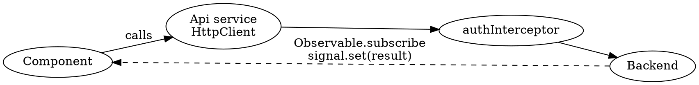
**State management:** there is no extra library such as NgRx. **Signals** do the job: the global session lives in `AuthStore` (`user`, `token`, `isAdmin`, `isStaff`) and page state lives in each component (`auction`, `bids`, `error`). **Lazy loading:** each route loads its page with `loadComponent`, so a visitor to the homepage never downloads the Studio code.

### Routes and the two shells
| URL | Page | Guard |
| --- | --- | --- |
| `/` | Home with the riffle animation | none |
| `/artworks`, `/artworks/:slug` | Gallery and artwork detail | none |
| `/artists`, `/artists/:id`, `/exhibitions` | Public catalogue | none |
| `/auctions`, `/auctions/:id` | Auction list and live auction room | none |
| `/login`, `/register` | Auth pages | `guestGuard` |
| `/account` | My bids, won works, profile | `authGuard` |
| `/studio` | Overview dashboard | `roleGuard('ADMIN','COLLABORATEUR')` |
| `/studio/artists`, `/exhibitions`, `/artworks`, `/profile` | Studio CRUD (Clients, Projets) | inherited |
| `/studio/auctions`, `/users`, `/roles` | Admin pages | `roleGuard('ADMIN')` |
| `/forbidden`, `**` | Error pages | none |

The public pages use `PublicLayout` (cinematic, dark midnight sections). The Studio uses `StudioLayout` (sidebar and ivory content, inspired by Argon Dashboard). The sidebar shows "Artists" captioned **Clients** and "Exhibitions" captioned **Projets**, matching the CDC menu.


### Studio CRUD building blocks
`features/studio/shared/` keeps all six CRUD pages identical in behaviour:
- `crud-page` and `crud-table`: list, search, sort, actions column.
- `form-sheet` + `form-field` + `form-errors`: a side panel with a reactive form; server `fields` errors are shown under each input.
- `confirm-dialog`: "Are you sure?" before delete.
- `pagination`: uses the backend `PageResponse` (page, size, total).
- `chart-canvas`: a Chart.js wrapper (line, bar, doughnut) used on the overview page.

The templates hide edit and delete buttons when `auth.isAdmin()` is false, so a Collaborateur only sees view and add.

```cols

---

```

### The animation system (GSAP)
All motion goes through `shared/animations/motion.ts`, which registers GSAP's `ScrollTrigger` and `Flip` plugins once and exports `prefersReducedMotion()`.

| Animation | File | How it works |
| --- | --- | --- |
| **Riffle deck** (home) | `riffle-deck.ts` + `riffle-formations.ts` | Up to 20 paintings fall in as a pile, then riffle open into a 3D ring. The section is **pinned** with ScrollTrigger; scrolling scrubs a timeline through 4 formations: ring, pile, corridor, featured painting |
| Formations | `riffle-formations.ts` | Pure functions: `formation(name, index, count, viewport)` returns x, y, z, rotations, scale, opacity. No DOM, so they are unit-tested |
| Flip transition | `flip-transition.service.ts` | Clicking an artwork card records its image rectangle; the detail page plays a FLIP animation so the painting grows from the card to its new place |
| Reveal | `reveal.directive.ts` | `atReveal` uses an `IntersectionObserver` to add `is-visible` when an element enters the viewport; CSS does the fade-up |
| Night sky | `night-sky.ts` | Two blurred colour blooms (cobalt and sunflower), vignette and grain drifting with pure CSS keyframes behind dark sections |
| Countdown, price | `countdown.ts`, auction room | Live time left and animated price on new bids |

**How the riffle timeline is built:**
1. `afterNextRender` waits for the DOM, then `gsap.matchMedia` runs the choreography only if the user accepts motion.
2. **Opening:** cards are set to the "pile" pose 120 px lower and invisible, then tween up (0.8 s, `power3.out`, staggered), then to the "ring" pose (1.4 s, `expo.inOut`). Scroll keys are held during this 1.5 s.
3. **Scroll timeline:** `scrollTrigger: { pin: true, scrub: 1, end: +=2.6 x viewport height, snap: 'labels' }`. Each formation is a labelled step; snapping settles on the nearest one. `onUpdate` fills a progress bar and updates the `scene` signal for the caption.
4. **Ambient:** an endless `yoyo` tween makes the arrangement "breathe"; `gsap.quickTo` makes a museum label follow the pointer and tilts the plane toward the mouse.
5. **Cleanup:** `media.revert()` on destroy kills every tween and ScrollTrigger.

**FLIP** means First, Last, Invert, Play: measure the start rectangle, measure the end rectangle, move the element back with transforms so it looks like the start, then animate the transforms to zero (0.9 s, `power3.inOut`).

**Accessibility:** with `prefers-reduced-motion: reduce`, the riffle is replaced by a calm swipeable row, the Flip is skipped and the night sky stays still.

```cols

---

```

### Styling and URLs
- **Tailwind CSS 4** utility classes, with design tokens in `styles.css` under `@theme`: `midnight #101d35`, `cobalt #315c91`, `sunflower #e7b84b`, `ivory #f4edde`, `canvas`, `cypress`, `terracotta`, `ink`.
- Fonts: **Cormorant Garamond** (serif titles), **Manrope** (body), **JetBrains Mono** (numbers), self-hosted via Fontsource.
- **spartan/ui** gives accessible, unstyled "brain" primitives styled with Tailwind "helm" (`hlm`) classes. Icons: **Lucide** through `@ng-icons`.
- In development, `ng serve` runs on port 4200 and `proxy.conf.json` forwards `/api` and `/ws` to Spring on 8080. In production everything is on one origin, so the code always uses relative URLs like `/api/auth/login`.

# Libraries
Every dependency has a job. The backend list comes from `backend/pom.xml` (Spring Boot parent 3.5.16, Java 17) and the frontend list from `frontend/package.json`.

### Backend (Maven)
| Library | Why it is used |
| --- | --- |
| `spring-boot-starter-web` | REST controllers, Jackson JSON, embedded Tomcat server (CDC step 1) |
| `spring-boot-starter-data-jpa` | JPA + Hibernate + Spring Data repositories (CDC step 1) |
| `mysql-connector-j` | JDBC driver for MySQL (CDC step 1) |
| `spring-boot-devtools` | Auto-restart during development; excluded from production (CDC step 1) |
| `spring-boot-starter-security` | Filter chain, authorization rules, BCrypt (CDC step 4) |
| `jjwt-api`, `jjwt-impl`, `jjwt-jackson` 0.12.6 | Create, sign and verify JWTs (CDC step 4) |
| `spring-boot-starter-validation` | `@NotBlank`, `@Email`, `@Size` on DTOs |
| `spring-boot-starter-mail` | `JavaMailSender` for SMTP (CDC step 5) |
| `spring-boot-starter-websocket` | STOMP over WebSocket for live bids |
| `spring-boot-starter-actuator` | `/actuator/health` and readiness probes for Docker and deployment |
| `flyway-core`, `flyway-mysql` | Versioned database migrations |
| `lombok` | Generates getters, setters, constructors |
| `spring-boot-configuration-processor` | Metadata and autocomplete for `atelier.*` properties |
| `spring-boot-starter-test`, `spring-security-test` | JUnit 5, AssertJ, Mockito, MockMvc, `@WithMockUser` |
| `testcontainers` (`junit-jupiter`, `mysql`), `spring-boot-testcontainers` | Starts a real MySQL 8.4 in Docker for integration tests |
| `maven-failsafe-plugin` | Runs `*IT` integration tests |
| `spring-boot-maven-plugin` | Packages the executable `psm.jar` |
| `frontend-maven-plugin` (profile `with-frontend`) | Installs Node, runs `npm ci` and `npm run build`, so Maven alone can produce the full jar |

### Frontend (npm)
| Library | Why it is used |
| --- | --- |
| `@angular/core`, `common`, `router`, `forms`, `platform-browser` 22 | The framework: components, DI, routing, reactive forms |
| `@angular/cdk` | Overlays, focus management, accessibility helpers used by dialogs and menus |
| `rxjs` 7.8 | Observables for HTTP and WebSocket streams |
| `@stomp/stompjs` 7 | STOMP client over native WebSocket for live auctions |
| `gsap` 3 (+ ScrollTrigger, Flip) | All animations: riffle deck, scroll pinning, FLIP transitions |
| `chart.js` 4.5 | Studio charts (line, bar, doughnut) |
| `luxon` | Dates, time zones, countdowns |
| `@spartan-ng/brain` + `shared/ui` (hlm) | Accessible UI primitives (dialog, sheet, select, tabs, table) styled with Tailwind |
| `class-variance-authority`, `clsx`, `tailwind-merge` | Build component class variants and merge Tailwind classes cleanly |
| `tailwindcss` 4 + `@tailwindcss/postcss` | Utility-first CSS and design tokens |
| `tw-animate-css` | Small enter and exit CSS animations for dialogs and sheets |
| `@ng-icons/core` + `@ng-icons/lucide` | Lucide icon set |
| `@fontsource/cormorant-garamond`, `@fontsource-variable/manrope`, `@fontsource/jetbrains-mono` | Self-hosted fonts |
| `@angular/build`, `@angular/cli` | Build and dev server (`ng serve`, `ng build`) |
| `vitest` + `jsdom` | Unit tests |
| `prettier` | Code formatting |
| `typescript` 6 | Typed JavaScript |

### Infrastructure and tooling
| Tool | Use |
| --- | --- |
| Docker + multi-stage `Dockerfile` | Stage 1 Node 22 builds Angular; stage 2 JDK 17 copies it to `static/` and runs `mvnw package`; stage 3 JRE 17 runs `psm.jar` as a non-root user with a health check |
| Docker Compose | `compose.yaml` (dev: MySQL 8.4.13 + Mailpit), `deployment/compose.prod.yaml` (prod: app + MySQL + volume) |
| MySQL 8.4.13 | Database, `utf8mb4` |
| Mailpit | Local SMTP catcher with a web inbox |
| Postman + Newman | API test collection, runnable from the command line |
| GitHub Actions | CI: backend tests (Testcontainers), frontend tests and build, production image build |
| Nginx config (prepared) | HTTPS reverse proxy with WebSocket upgrade, in `deployment/nginx/atelier.conf` |
| AWS EC2 + Cloudflare Tunnel | The live deployment (chapter 14) |

# Building psm.jar
CDC step 11 asks for one file, `psm.jar`, that contains the Spring Boot backend **and** the compiled Angular frontend in its `static/` folder. ATELIER produces it, and it is what makes the deployment simple: one artifact, one process, one port.

### What a jar is
- A **jar** (Java ARchive) is a ZIP file of compiled Java classes and resources.
- Spring Boot builds an executable **fat jar**: your code, all 79 libraries (Spring, Hibernate, the MySQL driver, JJWT) and an embedded Tomcat server, in one file. You run it with `java -jar psm.jar`; no separate Tomcat installation is needed.
- The name comes from `<finalName>psm</finalName>` in `backend/pom.xml`.

### What is inside the delivered psm.jar
This was checked on the real `psm.jar` (68 MB) in the project folder:

| Path in the jar | Content |
| --- | --- |
| `META-INF/MANIFEST.MF` | `Main-Class: org.springframework.boot.loader.launch.JarLauncher`, `Start-Class: com.sip.psm.AtelierApplication`, Spring Boot 3.5.16, JDK 17 |
| `org/springframework/boot/loader/` | The Spring Boot launcher that reads the nested jars |
| `BOOT-INF/classes/com/sip/psm/` | Our compiled Java code |
| `BOOT-INF/classes/application.yml` | Configuration with `${ENV_VAR:default}` placeholders |
| `BOOT-INF/classes/db/migration/` | Flyway SQL files V1, V2, V3 |
| `BOOT-INF/classes/mail/` | Email HTML template and the inline painting |
| `BOOT-INF/classes/demo/` | Demo catalogue JSON |
| `BOOT-INF/classes/static/` | **The Angular build: 148 files** (`index.html`, JS bundles, CSS, fonts, artwork images) |
| `BOOT-INF/lib/` | 79 dependency jars |
| `BOOT-INF/layers.idx` | Layer index so Docker can cache libraries separately from code |

How the launcher works: `java -jar` runs `JarLauncher` (the `Main-Class`), which builds a classpath from `BOOT-INF/classes` and `BOOT-INF/lib`, then calls `main()` in `AtelierApplication` (the `Start-Class`).

### Two ways to build it
**Way 1: Maven with the `with-frontend` profile.** Maven alone builds Angular and the jar:

```bash
cd backend
./mvnw -Pwith-frontend -DskipTests package
# result: backend/target/psm.jar
```
The profile uses `frontend-maven-plugin` to install Node 22.23.2, run `npm ci` and `npm run build`, then `maven-resources-plugin` copies `frontend/dist/atelier/browser/` into `static/` before `spring-boot-maven-plugin` packages the jar.

**Way 2: the multi-stage `Dockerfile`** (used for the deployment):

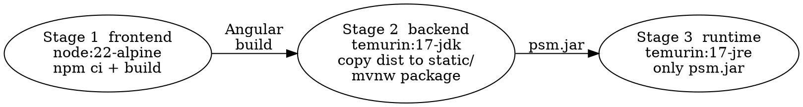
| Stage | Base image | What it does |
| --- | --- | --- |
| 1 `frontend` | `node:22.23.2-alpine` | `npm ci`, then `npm run build -- --configuration production` |
| 2 `backend` | `eclipse-temurin:17-jdk` | Downloads Maven dependencies, copies `src`, copies the Angular build into `src/main/resources/static/`, runs `./mvnw -DskipTests package` |
| 3 `runtime` | `eclipse-temurin:17-jre` | Copies only `psm.jar`, creates a non-root `atelier` user, sets `JAVA_OPTS=-XX:MaxRAMPercentage=75`, adds a `HEALTHCHECK` on `/actuator/health/readiness`, starts `java -jar /app/psm.jar` |

The final image contains no Node, no Maven and no source code: only a JRE and the jar. It is smaller and safer.

### How Spring serves Angular from the jar
Spring Boot automatically serves anything in `classpath:/static/` as web files. `SpaWebConfig` adds one rule: if a requested path is not a real file, is not `/api/` and not `/ws`, and has no file extension, it returns `index.html`.

| Request | Answer |
| --- | --- |
| `/main-ABC123.js` | The real JS file from `static/` |
| `/api/artworks` | The REST controller (JSON) |
| `/studio/users` (refresh) | `index.html`, then the Angular router shows the Users page |
| `/missing.png` | 404 (it has an extension, so no fallback) |

This is what lets a deep link like `/artworks/oleanders` survive a browser refresh.

### Why this helps the deployment
- **One artifact to ship:** the server only needs Java 17 (or Docker). No Nginx is required to serve the frontend and no separate Node server.
- **Same origin:** the site and the API share one URL and port, so there are no CORS problems and relative URLs just work.
- **Build once, run anywhere:** the jar built and tested on the laptop is what runs on EC2. We shipped the Docker image that wraps it, so nothing was compiled on the 2 GiB server.
- **Configured by environment:** the same jar runs in dev, test and production; only the environment variables change (`DB_URL`, `JWT_SECRET`, `SMTP_*`, `PUBLIC_URL`).
- **Self-checking:** the Actuator readiness endpoint lets Docker and Compose know when the app is ready.
- **Easy rollback:** each image tag is an immutable version; switching `ATELIER_VERSION` back restores the previous release.

### Running the jar directly (without Docker)
```bash
export DB_URL='jdbc:mysql://localhost:3306/atelier?serverTimezone=UTC'
export DB_USER=atelier DB_PASSWORD=... JWT_SECRET=...   # at least 32 bytes
export PUBLIC_URL=http://localhost:8080 CORS_ORIGINS=http://localhost:8080
java -jar psm.jar
# open http://localhost:8080: Angular site; /api/... is the REST API
```
Check that Angular is inside: `unzip -l psm.jar | grep static/index.html`.

# Testing the API with Postman
The CDC asks to test the APIs in Postman (step 3). ATELIER ships a full collection, `postman/ATELIER.postman_collection.json`, with **103 requests and 175 assertions**, all passing when run with Newman.

```stats
[{"value":"103","label":"requests"},{"value":"175","label":"assertions"},{"value":"0","label":"failures"},{"value":"10","label":"folders"}]
```

### Postman vocabulary
| Term | Meaning |
| --- | --- |
| Collection | A saved set of requests, organised in folders |
| Variable `{{name}}` | A placeholder replaced at run time, for example `{{baseUrl}}/api/auth/login` |
| Collection variables | Shared values: `baseUrl`, demo emails, and values saved during the run (`adminToken`, `artistId`) |
| Auth tab | Per request: `noauth` or `Bearer Token` with `{{curatorToken}}` |
| Tests script | JavaScript run after the response, with `pm.test(...)` and `pm.expect(...)` |
| Collection Runner | Runs every request in order and shows pass or fail |
| **Newman** | Postman's command-line runner, so the same collection runs in a terminal or CI |

### How requests are chained
The first folder logs in three demo users and **saves their tokens** in variables. Later requests reuse them, which is how the Angular interceptor behaves.

```javascript
// Tests tab of "Login as administrator"
pm.test("Status is 200", function () {
    pm.response.to.have.status(200);
});
pm.test("Admin token and id saved", function () {
    var json = pm.response.json();
    pm.collectionVariables.set("adminToken", json.token);
    pm.collectionVariables.set("adminId", json.user.id);
    pm.expect(json.user.roles).to.include("ADMIN");
});
```
A "Create artist" request then saves `artistId`, and the next requests use `/api/studio/artists/{{artistId}}`. The run creates its own data and deletes it at the end.

### The 10 folders
| Folder | Requests | What it proves |
| --- | --- | --- |
| 0 Auth | 7 | Login as admin, curator (Collaborateur), bidder; wrong password 401; register; duplicate email 409; `/me` |
| 1 Clients (Artists) | 8 | Curator lists, creates, reads; admin updates and deletes; **Collaborateur update and delete give 403** |
| 2 Projets (Exhibitions) | 8 | Same CRUD and role checks; **an artist with an exhibition can't be deleted (409)**, the One-to-Many FK |
| 3 Artworks | 9 | CRUD, role checks, an artwork used by an auction can't be deleted (409) |
| 4 Auctions | 10 | Create auction, overlap refused, place bid, already leading refused, bid history, cancel |
| 5 Account | 6 | My bids and wins, profile update, wrong current password 409, password change and restore |
| 6 Users (admin) | 15 | Full user CRUD, role assignment, enable and disable, self-demotion and self-delete refused, Collaborateur can't create users |
| 7 Public gallery | 7 | Anonymous reads; unknown slug 404 |
| 8 Security checks | 7 | Anonymous 401, bidder in Studio 403, admin bidding 403, curator on auctions 403 |
| 9 Roles (admin CRUD) | 26 | Create, read, rename, delete roles; assigned role protected; system role protected; a custom role grants Collaborateur rights by ID |


### How to run it
Prerequisite: the backend running with `DEMO_DATA=true` (the dev Docker stack does it) and the bootstrap admin of `.env.example`.

**In Postman:** Import, select the JSON file, check the `baseUrl` variable (`http://localhost:8080`), Run collection, keep the order.

**With Newman:**
```bash
npx newman run postman/ATELIER.postman_collection.json \
  --env-var baseUrl=http://localhost:8080
```
The run was recorded as screenshots and an HTML report.

```cols

---

```

### How Postman maps to the CDC
| CDC step | Postman proof |
| --- | --- |
| 3. Test the APIs | Every endpoint of every resource is called with assertions |
| 6. Test login and registration | Folder 0 |
| 7. Test Client and Projet under security | Folders 1, 2 and 8: 401 without token, 403 for the wrong role, 200, 201 or 204 for the right one |
| 10. Respect roles | Collaborateur can view and add but gets 403 on update and delete |

Postman tests the running API from the outside, like a real client. The Java integration tests (`SecurityMatrixIT`, `AuthIT`) test the same rules from inside with a real MySQL. Both layers agree.

# Deployment on the VPS
On 18 and 19 November 2026 ATELIER was deployed to an AWS EC2 Ubuntu server with Docker Compose and published over HTTPS through a Cloudflare Quick Tunnel. The readiness endpoint returned `{"status":"UP"}`, and the remote smoke test passed 10 checks out of 10.

### Key concepts
- **VPS** (Virtual Private Server): a real Linux machine in the cloud that you administer (OS, firewall, Docker, backups). EC2 is AWS's VPS; this is IaaS (Infrastructure as a Service).
- **Docker image:** an immutable package of the app and its runtime. **Container:** a running instance of an image.
- **Docker Compose:** starts several containers together from one YAML file (`app` + `db`).
- **Docker volume:** storage that survives container recreation; it holds the MySQL data (`mysql_data`).
- **Tunnel:** `cloudflared` opens an *outbound* connection from EC2 to Cloudflare, which gives a public HTTPS URL. No inbound port (8080, 3306) needs to be opened.

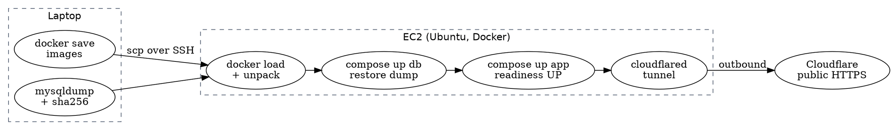
Nothing is compiled on the small server. The laptop ships finished images and a database dump; EC2 only loads, restores and runs them. The public URL comes from the tunnel and is written back into `PUBLIC_URL`.

### The server
| Setting | Value |
| --- | --- |
| Region | eu-north-1 (Stockholm) |
| Instance | `atelier-vps`, `t3.small`, 2 GiB RAM + 2 GiB swap |
| OS | Ubuntu 26.04.1 LTS amd64 |
| Disk | about 20 GiB |
| Login | user `ubuntu` with a private `.pem` SSH key |
| Firewall (Security Group) | SSH port 22 only, restricted to the workstation IPv4 /32 |
| Software | Docker 29.1.3, Docker Compose 2.40.3 |
| Release | Git commit `8b8d033`, image `smartsoft/atelier:mail-design-20261118` |

### Step by step
**Step 1: package on the laptop.** The image was already built and tested locally, so it was exported instead of rebuilt on a 2 GiB server.

```bash
git archive --format=tar.gz --output="$RELEASE/atelier-source.tar.gz" HEAD
sudo docker image save "$IMAGE" mysql:8.4.13 | gzip -1 > "$RELEASE/atelier-images.tar.gz"
install -m 600 deployment/.env.prod "$RELEASE/.env.prod"
```
Source was about 26 MB and images about 425 MB compressed. `docker save` exports images, not containers or data.

**Step 2: export the database.** A logical backup (SQL `CREATE` and `INSERT`) of the local audit database:

```bash
sudo docker exec atelier-audit-db sh -c 'MYSQL_PWD="$MYSQL_PASSWORD" exec mysqldump \
  -u"$MYSQL_USER" --single-transaction --no-tablespaces --set-gtid-purged=OFF \
  "$MYSQL_DATABASE"' | gzip -1 > "$RELEASE/atelier-audit-preliminary.sql.gz"
sha256sum atelier-*.tar.gz atelier-*.sql.gz > SHA256SUMS
```
`--single-transaction` gives a consistent InnoDB snapshot without locking. The dump held 7 artists, 30 artworks, 10 auctions, 13 bids, 6 exhibitions, 6 users, 3 roles, 6 user_roles and 3 Flyway history rows.

**Step 3: create the EC2 instance and connect over SSH.**

```bash
chmod 400 "$KEY"
ssh -i "$KEY" -o IdentitiesOnly=yes ubuntu@<EC2_PUBLIC_IP> 'hostname; free -h; df -h /'
```
Lesson learned: SSH first timed out because the Security Group allowed only an IPv6 range while the laptop used IPv4. Setting the rule to "My IP" (IPv4 /32) fixed it.

**Step 4: install Docker and swap on the server.**

```bash
sudo apt-get install -y docker.io docker-compose-v2
sudo systemctl enable --now docker
sudo fallocate -l 2G /swapfile && sudo chmod 600 /swapfile
sudo mkswap /swapfile && sudo swapon /swapfile
echo '/swapfile none swap sw 0 0' | sudo tee -a /etc/fstab
```
Swap protects against out-of-memory crashes during spikes on 2 GiB of RAM.

**Step 5: transfer the release securely.**

```bash
scp -i "$KEY" atelier-images.tar.gz atelier-source.tar.gz \
  atelier-audit-preliminary.sql.gz SHA256SUMS .env.prod "${SERVER}:atelier-stage/"
ssh -i "$KEY" "$SERVER" 'cd ~/atelier-stage && chmod 600 .env.prod && sha256sum -c SHA256SUMS'
```
Lesson learned: `"$SERVER:atelier-stage/"` was expanded wrongly by the shell; `"${SERVER}:atelier-stage/"` fixes the variable boundary. The checksum verifies nothing was corrupted.

**Step 6: unpack and load the images.**

```bash
sudo mkdir -p /opt/atelier && sudo chown ubuntu:ubuntu /opt/atelier
tar -xzf ~/atelier-stage/atelier-source.tar.gz -C /opt/atelier
install -m 600 ~/atelier-stage/.env.prod /opt/atelier/deployment/.env.prod
gzip -dc ~/atelier-stage/atelier-images.tar.gz | sudo docker image load
```

**Step 7: start MySQL first, then restore the dump.**

```bash
sudo docker compose -f deployment/compose.prod.yaml --env-file deployment/.env.prod \
  up -d --no-build --pull never --wait db
gzip -dc ~/atelier-stage/atelier-audit-preliminary.sql.gz | sudo docker compose \
  -f deployment/compose.prod.yaml --env-file deployment/.env.prod exec -T db \
  sh -c 'MYSQL_PWD="$MYSQL_ROOT_PASSWORD" exec mysql -uroot "$MYSQL_DATABASE"'
```
The first start of the MySQL container creates the database and user from the environment. The restore goes into that fresh database; a count check confirmed 30 artworks and 6 users. Because `flyway_schema_history` came with the dump, Flyway sees V1 to V3 as applied and does nothing.

**Step 8: start the application.**

```bash
sudo docker compose -f deployment/compose.prod.yaml --env-file deployment/.env.prod \
  up -d --no-build --pull never --wait app
curl -fsS http://127.0.0.1:8080/actuator/health/readiness   # {"status":"UP"}
```
`depends_on: condition: service_healthy` makes the app wait for MySQL's health check. The port is bound to the local interface only, and 3306 is never published.

**Step 9: publish with Cloudflare.**

```bash
sudo docker run -d --name atelier-cloudflare --restart unless-stopped \
  --network host cloudflare/cloudflared:latest \
  tunnel --no-autoupdate --url http://127.0.0.1:8080
sudo docker logs atelier-cloudflare --tail 60    # shows the public HTTPS URL
```
A first version protected access with an email one-time PIN (`--allowed-mail`); it was then replaced by an open Quick Tunnel for the public demo.

**Step 10: align `PUBLIC_URL`.** The tunnel URL feeds email links and CORS, so after each new tunnel URL:

```bash
sudo sed -i "s|^PUBLIC_URL=.*|PUBLIC_URL=$PUBLIC_URL|" deployment/.env.prod
sudo docker compose -f deployment/compose.prod.yaml --env-file deployment/.env.prod \
  up -d --no-build --pull never --force-recreate --wait app
```


### Production configuration (names only, no values)
| Group | Variables |
| --- | --- |
| Database | `MYSQL_DATABASE`, `MYSQL_USER`, `MYSQL_PASSWORD`, `MYSQL_ROOT_PASSWORD`, `DB_URL` |
| Identity | `JWT_SECRET`, `BOOTSTRAP_ADMIN_EMAIL`, `BOOTSTRAP_ADMIN_PASSWORD`, `ADMIN_EMAIL` |
| Release | `ATELIER_VERSION`, `APP_PORT`, `DEMO_DATA`, `PUBLIC_URL`, `CORS_ORIGINS` |
| Email | `MAIL_FROM`, `SMTP_HOST`, `SMTP_PORT`, `SMTP_USER`, `SMTP_PASSWORD`, `SMTP_AUTH`, `SMTP_TLS` |

`compose.prod.yaml` uses `${VAR:?Set VAR}` for required secrets, so Compose refuses to start if one is missing. `.env.prod` is `chmod 600` and never committed.

### Day-2 operations
| Task | Command (inside `/opt/atelier`) |
| --- | --- |
| Status | `sudo docker compose -f deployment/compose.prod.yaml --env-file deployment/.env.prod ps` |
| Health | `curl -fsS http://127.0.0.1:8080/actuator/health/readiness` |
| Logs | `sudo docker logs --tail 100 atelier-prod-app-1` (also `-db-1`, `atelier-cloudflare`) |
| System | `free -h && df -h / && sudo docker system df` |
| Restart app | the same Compose command with `restart app` |
| Backup DB | `mysqldump --single-transaction` piped to `gzip` into `~/atelier-backup-<date>.sql.gz` |

**New release:** test locally, tag the image (for example with the Git SHA), back up MySQL, `docker save`, `scp`, `docker image load`, change `ATELIER_VERSION` in `.env.prod`, recreate only `app`, then smoke-test. **Rollback** means putting back the previous `ATELIER_VERSION` and recreating.

**Never** run `docker compose down -v`: `-v` deletes the MySQL volume.

### Why a VPS and not Vercel or Render?
| Topic | AWS EC2 VPS | Render | Vercel |
| --- | --- | --- | --- |
| Unit deployed | Full VM with Compose, app and MySQL | Web service from Git or Docker | Frontend + serverless functions |
| Long-running Spring Boot | Natural fit | Natural fit | Not the model |
| MySQL | Self-hosted in a Docker volume | External MySQL needed (managed DB is PostgreSQL) | External DB needed |
| Live WebSocket auctions | Persistent server | Supported | Functions beta, time-limited |
| OS control | Full (SSH, apt) | Low | Very low |
| Responsibility | Highest (patches, backups) | Medium | Lowest |

The VPS runs the **same two images as on the laptop with no refactoring**, which keeps the WebSocket server and MySQL intact. The cost is that we own security, backups and uptime.

### Troubleshooting
| Symptom | Likely cause | First check |
| --- | --- | --- |
| SSH timeout | Security Group IP, wrong public IP | Inbound rule is My IP, IPv4 /32 |
| `Permission denied (publickey)` | Wrong key, user or permissions | `chmod 400 KEY`, user `ubuntu` |
| App unhealthy or 502 | JVM memory, DB not ready | `docker logs atelier-prod-app-1` |
| Public link changed | Quick Tunnel restarted | Tunnel logs, update `PUBLIC_URL` |
| Home works, a deep link fails | SPA fallback, guard, JS error, API path | Browser DevTools Console and Network |
| Emails not arriving | SMTP auth, egress, sender rights | App logs, test from the server |
| WebSocket disconnected | Origin, proxy, idle limits | Browser WS frames, server logs |

### Hardening roadmap
- Replace the Quick Tunnel by a named Cloudflare Tunnel on a stable domain.
- Keep SSH restricted; consider key rotation and AWS SSM Session Manager.
- Change imported demo and admin passwords before wider exposure (`DEMO_DATA=false` stops seeding but does not remove existing accounts).
- Daily encrypted backups off the instance, with tested restores.
- Memory, CPU and disk alerts, log retention, an OS update policy, AWS billing alarms.

# How it matches the CDC
All 12 numbered CDC steps ("Projects Manager", course *Formation FullStack Spring Boot and Angular*) are implemented, with two declared adaptations: **Client becomes Artist** and **Projet becomes Exhibition**, and an Argon-inspired UI rebuilt for Angular 22. The art gallery and auctions are extensions on top.

### Vocabulary map
| CDC term | ATELIER | UI label |
| --- | --- | --- |
| PSM / Projects Manager | The Studio; artifact `psm.jar` | Studio |
| Client | `Artist` | Artists (caption "Clients") |
| Projet | `Exhibition` | Exhibitions (caption "Projets") |
| libellé (projet) | `title` | Title |
| durée | `durationDays` | Duration (days) |
| idClient | `artist_id` / `artistId` | Artist |
| nom, prénom, tel, adresse | `lastName`, `firstName`, `phone`, `address` | Last name, First name, Phone, Address |
| Admin, Collaborateur | `ADMIN`, `COLLABORATEUR` | Admin, Collaborator |

### Entities and relations
| CDC requirement | Implementation |
| --- | --- |
| User (id, email, password, tel, nom, prénom) | `users` table + `User` entity; password stored as BCrypt hash |
| Role (id, libellé) | `roles` table + `Role` entity with editable `libelle` and fixed `profile`; full admin CRUD |
| User *..* Role (Many-to-Many) | `@ManyToMany` + join table `user_roles` (composite PK) |
| Client (id, nom, tel, email, adresse) | `artists` table + `Artist` entity (plus country, biography, photo, active) |
| Projet (id, libellé, budget, durée, description, idClient) | `exhibitions` table + `Exhibition` entity (plus start date, venue, cover) |
| Client 1..* Projet (One-to-Many) | `Exhibition.artist` `@ManyToOne(optional=false)` + `Artist.exhibitions` `@OneToMany(mappedBy)`; FK `artist_id NOT NULL` |

### Step-by-step traceability
| # | CDC step | How ATELIER does it | Proof |
| --- | --- | --- | --- |
| 1 | Spring Boot project with Web, Data JPA, DevTools, MySQL Driver | Spring Boot 3.5.16, all four dependencies plus Security, Validation, Mail, WebSocket, Actuator, Flyway, JJWT | `backend/pom.xml` |
| 2 | CRUD for entities | Controller, Service, Repository per feature; full CRUD for artists, exhibitions, users, roles | `StudioArtistController`, `StudioExhibitionController`, `AdminUserController`, `AdminRoleController` |
| 3 | Test APIs with Postman | Collection covering every endpoint and role; Newman: 103 requests, 175 assertions, 0 failures | `postman/ATELIER.postman_collection.json` |
| 4 | Security layer + JWT | Stateless Spring Security, `JwtAuthenticationFilter`, `JwtService` (HS256, 12 h), BCrypt | `SecurityConfig`, `security/` package, `AuthIT`, `SecurityMatrixIT` |
| 5 | Email the admin after registration | `UserRegisteredEvent`, then `RegistrationMailListener` (async, after commit), admin and user emails | `AuthIT`, Mailpit and Gmail checks |
| 6 | Test login and registration | 10 `AuthIT` tests + Postman | `AuthIT.java` |
| 7 | Test Client and Projet under security | 84-case role matrix test | `SecurityMatrixIT`, `CatalogFlowIT` |
| 8 | Angular components and menu for Clients, Projets, Users (Argon mockup) | Studio sidebar: Artists (Clients), Exhibitions (Projets), Artworks, Auctions, Users, Roles; Argon-style dashboard rebuilt in Tailwind | `features/studio/` |
| 9 | Guard + interceptor | `authGuard`, `roleGuard`, `guestGuard`; `authInterceptor` adds the Bearer token and handles 401 | `core/auth/`, Vitest specs |
| 10 | Respect roles in the app | `AuthStore.isAdmin()` and `isStaff()` hide menu entries and edit and delete buttons; the backend enforces the same | Studio templates + `SecurityConfig` |
| 11 | Build `psm.jar` with Angular in `static/` | Multi-stage `Dockerfile` or `mvnw -Pwith-frontend package`; `SpaWebConfig` handles deep links | `Dockerfile`, `pom.xml`, `SpaWebConfig` |
| 12 | Deploy to a VPS | AWS EC2 `t3.small`, Docker Compose, MySQL volume, Cloudflare HTTPS tunnel; readiness `UP` and 10 of 10 remote checks | chapter 14, `docs/evidence/vps-smoke.json` |

### Role permissions versus the CDC
The CDC says: Admin does every CRUD on clients and projects; Collaborateur may only view and add.

| Operation on Client or Projet | ADMIN | COLLABORATEUR |
| --- | --- | --- |
| Consult | yes | yes |
| Add | yes | yes |
| Modify | yes | no (403) |
| Delete | yes | no (403) |

### Adaptations to state clearly at the defence
1. **Vocabulary:** Client is Artist, Projet is Exhibition. Every CDC field exists under its new name.
2. **Argon dashboard:** the original targets Angular 14, Bootstrap 4 and ng-bootstrap 12, which does not compile on Angular 22. The layout (gradient header, KPI cards, charts, tables, profile) was rebuilt with Tailwind and spartan/ui; no template code is copied.
3. **Extra role `BIDDER`:** added for collectors; it does not replace Admin or Collaborateur.
4. **Deployment scope:** the 10 remote checks cover the Angular page and a deep link, the readiness probe, the public APIs, and refused calls (Studio and admin without a token, a wrong password). They do not include a live bid over the tunnel or a registration email with the final URL, which stay as manual demos.

### Extensions beyond the CDC
Artworks with statuses and slugs; live auctions with a lifecycle scheduler; real-time bidding over STOMP; pessimistic locking and soft close; collector account area; GSAP riffle homepage; Studio KPIs and charts; Flyway migrations; RFC 9457 errors; demo data; Testcontainers; GitHub Actions CI; Vitest; branded HTML emails for 8 business events.

| CDC part | Architectural piece |
| --- | --- |
| Part 1 Spring: entities, CRUD, Postman, JWT, email, tests | Backend layers, `security/`, `mail/`, Flyway schema, Postman collection, integration tests |
| Part 2 Angular: components, menu, guard, interceptor, roles | `features/studio/`, `StudioLayout` menu, `core/auth/` |
| Part 3 Deployment: `psm.jar` with Angular in `static/`, VPS | Multi-stage Dockerfile or Maven profile, `SpaWebConfig`, EC2 + Compose + tunnel |

# Trace one action: place a bid, end to end
This chapter replays everything on one concrete action: a collector with the role `BIDDER` places a bid on an open auction. Follow the files in order.

### The path in twelve steps
| # | Where | File | What happens |
| --- | --- | --- | --- |
| 1 | Browser | `features/auctions/bid-panel.ts` | The form asks for confirmation ("Confirm your bid"), then calls the API |
| 2 | Angular service | `core/api/gallery.api.ts` | `placeBid(id, amount)` sends `POST /api/auctions/{id}/bids` with `{ amount }` |
| 3 | Interceptor | `core/auth/auth.interceptor.ts` | Adds `Authorization: Bearer <token>` because the URL starts with `/api/` |
| 4 | Same origin | `SpaWebConfig` | In production no proxy: the request reaches the jar directly; the SPA fallback skips `/api/` |
| 5 | Filter | `JwtAuthenticationFilter`, `TokenAuthenticator` | Token verified, user loaded from MySQL, roles turned into `ROLE_BIDDER` |
| 6 | URL rule | `SecurityConfig` | `POST /api/auctions/*/bids` needs `hasRole("BIDDER")` (an admin gets 403) |
| 7 | Controller | `AuctionController.placeBid` | Jackson builds `PlaceBidRequest`, `@Valid` checks it, `Principal` gives the email |
| 8 | Service | `BidService.placeBid` (`@Transactional`) | `findByIdForUpdate` takes the row lock |
| 9 | Entity | `Auction.placeBid` | Status OPEN? Not already leading? Amount at least the minimum? Soft close |
| 10 | Persistence | `bids.save`, `auctions.flush` | `INSERT` into `bids`; the auction changes are written (dirty checking); two events are published and parked |
| 11 | Commit | Spring transaction | `COMMIT` releases the lock; the unique `(auction_id, amount)` is the last safety net |
| 12 | After commit | `AuctionBroadcaster`, mail listener | WebSocket push to every viewer; async emails to the bidder and to the previous leader; the bidder receives `201` |

### What the code looks like at the centre
```java
@Transactional
public AuctionEvent placeBid(Long auctionId, BigDecimal amount, String bidderEmail) {
    User bidder = users.requireByEmail(bidderEmail);
    Auction auction = auctions.findByIdForUpdate(auctionId)
            .orElseThrow(() -> new NotFoundException("Auction", auctionId));
    Instant now = clock.instant();
    BidAcceptedEvent.Recipient previousLeader = recipient(auction.getLeadingBidder());
    Bid bid = bids.save(auction.placeBid(bidder, amount, now, softClose));
    auctions.flush();
    AuctionEvent event = new AuctionEvent(AuctionEventType.BID_PLACED, AuctionView.from(auction),
            BidView.from(bid), now);
    events.publishEvent(event);
    events.publishEvent(new BidAcceptedEvent(...));
    return event;
}
```

### What can go wrong, and what the user sees
| Situation | Raised by | Response | What Angular shows |
| --- | --- | --- | --- |
| No token or expired token | Security entry point | 401 `authentication_required` | The interceptor logs out and goes to `/login?returnUrl=...` |
| Staff account tries to bid | URL rule | 403 `forbidden` | "Staff accounts cannot bid" (the panel hides the form) |
| Amount below the minimum | `Auction.placeBid` | 409 `bid_too_low` | "The minimum bid is now ..." |
| Already the highest bidder | `Auction.placeBid` | 409 `already_leading` | "You already hold the highest bid" |
| Auction not open (ended) | `Auction.placeBid` after `synchronize` | 409 `auction_not_open` | The room reloads and shows the final status |
| Invalid JSON amount | `@Valid` | 400 `validation_failed` | Field error |
| MySQL fails after the lock | Rollback | 500, nothing saved | No event, no email, no price change |

### What every other viewer sees
The socket is separate from the HTTP call. After the commit, `AuctionBroadcaster` sends the `AuctionEvent` to `/topic/auctions/{id}` and to `/topic/auctions`. The Angular `AuctionSocket` delivers it to `AuctionRoomPage`, which updates the `auction` and `bids` signals; the price animates and the history gains a row. If the bid fell in the last 60 seconds, the new `endsAt` is highlighted.

> A bid is one REST call, one locked transaction and one commit. Everything the others see or receive happens after that commit.

# Likely jury questions and short answers
Each answer is short on purpose. Try to say it aloud, then open the matching chapter if it is not clear.

### Security
**Why JWT and not sessions?** The server stays stateless: no session store, any instance can verify a token with the secret, and it works the same for REST and WebSocket.

**Where are roles stored, in the token?** No. The token only holds the email (`sub`) and the issue and expiry dates. Roles are loaded from the database on every request, so a role change or a disabled account takes effect immediately.

**What happens if someone modifies the token payload?** The HMAC-SHA256 signature no longer matches, `JwtService.verify` returns empty and the user is treated as anonymous (401 on protected URLs).

**Why is CSRF disabled?** CSRF abuses cookies the browser sends automatically. ATELIER authenticates with an `Authorization` header that the browser never adds by itself.

**Where is the token stored in Angular?** In `localStorage` under `atelier.session`, with its expiry. An expired session is ignored at startup and a 401 logs the user out.

**Are the Angular guards enough for security?** No. They only improve the user experience. The backend `SecurityConfig` and `@PreAuthorize` are the real boundary.

**What is the difference between 401 and 403?** 401: no valid identity on a protected URL. 403: valid identity, but the role is not allowed.

**Why does the login answer the same way for a wrong email and a wrong password?** So an attacker can't discover which emails have an account.

### Database
**How is the Many-to-Many implemented?** `@ManyToMany` on `User.roles` with `@JoinTable(name = "user_roles")`; the table has a composite primary key `(user_id, role_id)`.

**How is the One-to-Many implemented?** `Exhibition` owns the FK with `@ManyToOne(optional=false) @JoinColumn("artist_id")`; `Artist` has `@OneToMany(mappedBy = "artist")`.

**What is the owning side?** The side with `@JoinColumn`, which writes the foreign key. The `mappedBy` side is a read-only mirror.

**What if you delete an artist who has exhibitions?** The FK is RESTRICT, MySQL refuses, and `ApiExceptionHandler` returns 409 `integrity_violation`.

**Why Flyway and `ddl-auto: validate`?** The schema is versioned and reproducible in every environment; Hibernate can't silently change production tables.

**Why `BigDecimal` for money?** `double` has binary rounding errors; `BigDecimal` and `DECIMAL(14,2)` are exact.

**When do you use CASCADE, SET NULL and RESTRICT?** CASCADE when the child means nothing alone, SET NULL when it should survive with an optional link, RESTRICT when deleting would lose important data.

### Auctions, events and email
**Two people bid at the same time: what happens?** `SELECT ... FOR UPDATE` queues them. The second one is re-validated against the new price; if too low it gets 409 `bid_too_low`. A unique `(auction_id, amount)` constraint is the last safety net. `ConcurrentBiddingIT` tests this.

**Why a pessimistic lock for bids and an optimistic one for Studio edits?** Bids conflict often and are quick, so waiting is cheap. Studio edits conflict rarely and take minutes, so no lock is held and a version check catches the rare clash.

**Why broadcast after commit?** So no browser ever shows a price that was rolled back.

**Why can't clients send bids through the WebSocket?** The STOMP interceptor refuses `SEND`, so every bid passes through REST validation, security and locking.

**What is soft close?** A bid in the last 60 seconds extends the end to now + 60 s, which makes last-second sniping pointless.

**What if the SMTP server is down during registration?** The account is still created. The mail runs after commit on a separate thread; the failure is logged, not rolled back. There is no retry queue.

**Why does `@Transactional` sometimes do nothing?** When a method calls another method of the same class, the call skips the Spring proxy.

### Build, deployment and CDC
**How does the jar serve Angular routes like `/studio/users` on refresh?** `SpaWebConfig` returns `index.html` for any non-API, non-file path; the Angular router then shows the page.

**Why Docker Compose on a VPS instead of Vercel?** The app is a long-running Java server with WebSockets and MySQL. A VPS runs the same images as on the laptop with no refactoring.

**Why is port 8080 bound to the local interface?** Only the local Cloudflare tunnel reaches it. Nothing is exposed directly, and MySQL's 3306 is never published.

**What does `PUBLIC_URL` do?** It builds the links in emails and sets the allowed CORS origin. It must match the public tunnel or domain URL.

**Did you copy the Argon template?** No. Argon targets Angular 14 and Bootstrap; we rebuilt its structure (gradient header, KPI cards, charts, tables, profile) in Tailwind for Angular 22.

**Which numbers prove it works?** 19 unit and 151 integration tests on the backend, 64 Vitest tests, Postman 103 requests and 175 assertions with 0 failures, and 10 of 10 remote checks on the VPS.

# A focused study order
### Study checklist
Tick each item once you can explain it out loud without notes.

- [ ] Draw the architecture: browser, Cloudflare, EC2, Spring Boot (static, REST, WS), MySQL, SMTP out
- [ ] Explain IoC, DI and constructor injection with `AuthService`
- [ ] Follow a request through Controller, Service, Repository, Entity
- [ ] Explain what a proxy does for `@Transactional`, and the same-class trap
- [ ] Draw the 8 tables and their 13 foreign keys from memory
- [ ] Explain Many-to-Many (User and Role) and One-to-Many (Artist and Exhibition) in SQL and in JPA
- [ ] Explain owning side versus `mappedBy`, LAZY versus EAGER, and the N+1 problem
- [ ] Explain the JWT structure and the login and filter flow
- [ ] Read the `SecurityConfig` rules and say who can call what
- [ ] Explain 401 versus 403
- [ ] Explain why bids use a pessimistic lock and why the event is sent after commit
- [ ] Explain the registration email path (event, after commit, async, SMTP)
- [ ] Explain guards, interceptor and `AuthStore` signals
- [ ] Explain how the riffle animation uses ScrollTrigger pinning and scrubbing
- [ ] Explain how `psm.jar` contains Angular and how `SpaWebConfig` handles deep links
- [ ] Walk through the 10 deployment steps
- [ ] Map all 12 CDC steps to code

### Suggested order
| Step | Read | Time | Goal |
| --- | --- | --- | --- |
| 1 | Chapters 1 and 2 | 20 min | Say what ATELIER is and draw the architecture |
| 2 | Chapter 3 | 30 min | Explain beans, DI, layers, transactions, events |
| 3 | Chapter 4, then 16 | 40 min | Follow one request and one bid through the code |
| 4 | Chapter 6 | 40 min | Draw the schema and explain the two CDC relations |
| 5 | Chapter 7 | 40 min | Explain JWT, the filter and the role matrix |
| 6 | Chapter 8 | 30 min | Explain the lock, the events and the live room |
| 7 | Chapters 5, 9, 10 | 40 min | Explain the connections, email and Angular |
| 8 | Chapters 12, 13, 14 | 40 min | Explain the jar, the tests and the deployment |
| 9 | Chapters 15 and 17 | 30 min | Map the CDC and rehearse the answers |

### If time is short
Learn these five sentences first.
1. One Spring Boot process serves Angular, the REST API and the WebSocket; MySQL stores the data; the jar holds everything.
2. Roles come from the database on every request; the JWT only proves who you are.
3. The filter identifies, the URL rules decide: 401 means unknown, 403 means not allowed.
4. A bid locks the auction row, applies the rules in the entity, commits, and only then pushes and emails.
5. Flyway owns the schema, Hibernate only validates it, and 13 foreign keys protect the data.
