These are study notes for explaining ATELIER from the first click in the browser down to the last row in MySQL. Each chapter starts with the simple idea, then goes deeper. Code snippets are copied from the repository, shortened where needed. Measured figures come from the recorded runs kept in `docs/evidence/`.

Suggested use: read chapters 1 to 4 once, then follow the study order in the last chapter and tick the checklist.

# Explain ATELIER in one minute

### The one-minute version
ATELIER is a digital art gallery with live auctions. Anyone can browse artworks, artists and exhibitions. A registered collector can bid, and every other open browser sees the new price at once. Gallery staff use a back-office called the **Studio** to manage artists, exhibitions, artworks, auctions, users and roles.

It is built with **Spring Boot 3.5 (Java 17)** for the server, **Angular 22** for the browser app and **MySQL 8.4** for the data. The Studio is the "Projects Manager" (PSM) application that the course specification (the CDC) asks for: the CDC's *Clients* became **Artists** and its *Projets* became **Exhibitions**.

In production everything ships as **one executable file, `psm.jar`**. It contains the Spring Boot server and the compiled Angular site inside its `static/` folder, as CDC step 11 requires.

### What the application does
- **Public gallery:** anyone can browse artworks, artists, exhibitions and auctions, with a scroll-animated homepage.
- **Live auctions:** collectors with the role `BIDDER` place bids. Other open browsers see the new price instantly through WebSockets (STOMP).
- **Studio (back-office):** staff manage the data through CRUD tables, charts and KPI cards in an Argon-inspired dashboard.
- **Emails:** registration, bids, outbid notices, auction results and cancellations send branded HTML emails over SMTP.
- **Security:** stateless JWT authentication, BCrypt passwords and a role matrix enforced on the server.

### The actors
| Role | Who | What they can do |
| --- | --- | --- |
| Anonymous | Any visitor | Read public pages, register, log in |
| `BIDDER` | Collector who registered on the site | Everything public, plus place bids, see own bids and won works, edit the profile |
| `COLLABORATEUR` | Staff member created by an admin | Studio: **view and add** artists, exhibitions, artworks (no edit, no delete) |
| `ADMIN` | Gallery administrator | Full CRUD on everything, auctions, users and roles |

The CDC names only Admin and Collaborateur. `BIDDER` is an extension for the auction side and does not replace the two required roles. Two demo accounts are used in the demos: `collector@atelier.demo` (a bidder) and `curator@atelier.demo` (a collaborateur).

### Key numbers to remember
```stats
[{"value":"8","label":"application tables (plus the Flyway history table)"},{"value":"13","label":"foreign keys: 2 CASCADE, 4 SET NULL, 7 RESTRICT"},{"value":"19 + 151","label":"backend unit and integration tests"},{"value":"64","label":"frontend Vitest tests"},{"value":"103 / 175","label":"Postman requests / assertions, 0 failures"},{"value":"10 / 10","label":"remote checks passed on the VPS"}]
```
The application runs on an AWS EC2 `t3.small` (Ubuntu) with Docker Compose, behind a Cloudflare Quick Tunnel. It was deployed on 18 and 19 November 2026. The remote checks are recorded in `docs/evidence/vps-smoke.json`.

### Repository layout
| Folder | Content |
| --- | --- |
| `backend/` | Spring Boot app, Maven `pom.xml`, Flyway migrations, tests |
| `frontend/` | Angular 22 app, Tailwind CSS, spartan/ui components |
| `deployment/` | Production Docker Compose, Nginx config, deploy and database scripts |
| `docs/` | Architecture, API, database, CDC audit, email, test plan, PDFs, evidence |
| `postman/` | Postman collection (103 requests, 175 assertions with Newman) |
| `Dockerfile`, `compose.yaml` | Multi-stage image build and local dev stack (MySQL, Mailpit) |
| `.github/workflows/` | CI: backend tests, frontend tests, image build |

# Architecture: how the parts fit
### The simple picture
ATELIER is a **client-server** application with three tiers. Angular runs in the browser. Spring Boot runs on the server and holds all the logic. MySQL stores the data. In production **one Spring Boot process** serves the Angular files, the REST API and the WebSocket endpoint on a single port.

It is a **modular monolith**: one deployable process holds every feature (auth, catalogue, auctions, email, scheduler), but the code is split by feature with clear boundaries. It is easy to build, test and deploy, and it could be split later if ever needed.

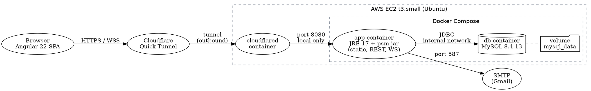

### Three ways the browser talks to the server
| Channel | Protocol | Used for |
| --- | --- | --- |
| Static files | HTTP GET | Downloading the Angular app once (`index.html`, JS, CSS, images) |
| REST API | HTTP + JSON under `/api/**` | Every read and write: login, CRUD, bids |
| WebSocket | STOMP over WS at `/ws` | Live push of new bids and auction status changes |

One rule ties them together: **every write goes through REST**, and the WebSocket only **broadcasts** what REST already committed. Inside the server, background work runs without any browser request: the **auction scheduler** opens and closes auctions on time, and the **mail listeners** send emails on a separate thread pool after each committed transaction.

### Development versus production
| | Development | Production |
| --- | --- | --- |
| Angular | `ng serve` on port 4200 with hot reload | Compiled into `psm.jar` under `static/` |
| API calls | Proxied by `proxy.conf.json` from 4200 to 8080 | Same origin, no proxy |
| Database | MySQL 8.4.13 in `compose.yaml` | MySQL 8.4.13 in `compose.prod.yaml` with a volume |
| Email | Mailpit (catches all mail, inbox on 8025) | Real SMTP (Gmail, port 587) |
| Public access | localhost | Cloudflare tunnel to the local port 8080 |

The key difference: two servers in development (Angular and Spring), **one** in production (the jar serves both).

## Going deeper: two axes inside the backend
The backend code is cut **vertically by feature** (packages) and **horizontally by layer** (inside each package). Everything about auctions lives in `auction/`, so it is found, changed and tested in one place. Dependencies only point downward: Controller, Service, Repository, Entity.

| Layer | Knows about | Never does |
| --- | --- | --- |
| Controller | HTTP: URLs, status codes, `@Valid`, `Principal` | Business rules, SQL |
| Service | Business rules, transactions, events | HTTP details |
| Entity (domain) | Its own rules (`Auction.placeBid`, `synchronize`) | Database access, HTTP |
| Repository | Queries | Business decisions |
| DTO | The JSON shape | Logic (only `from(entity)` mappers) |

ATELIER is richer than plain CRUD: the **auction rules live in the entity itself**. The REST endpoint and the scheduler call the same methods, so they can never disagree.

### Cross-cutting concerns
Some things apply to every feature, so they are written once.

| Concern | Where | Effect |
| --- | --- | --- |
| Every request | Security filter chain | JWT, then roles, then URL rules |
| Every error | `ApiExceptionHandler` | RFC 9457 JSON with a stable `code` |
| Every setting | `application.yml` + env vars | Bound to the validated `AtelierProperties` |
| Every write | `@Transactional` | Commit or rollback |
| Side effects | Events after commit | Async mail and WebSocket push |
| Time | `Clock` bean (`TimeConfig`) | Testable time |

### Threads inside the running process
| Thread(s) | Started by | Job |
| --- | --- | --- |
| Tomcat request threads | each HTTP call | Run the controller, service, repository chain |
| WebSocket and broker threads | Spring messaging | Handle STOMP frames and fan out messages |
| `scheduling-1` | `@EnableScheduling` | `AuctionLifecycleScheduler.advance()` every 5 s |
| `gallery-mail-*` (2 to 4 threads) | `@EnableAsync` + `AsyncConfig` | Send emails without slowing requests |
| Hikari connection pool | Spring Boot | Lend DB connections to transactions |

### Three flows end to end
| Flow | Path |
| --- | --- |
| A. Visitor opens the site | `GET /` goes through Cloudflare to the app. `SpaWebConfig` returns `index.html`. Angular loads, the lazy home page calls `GET /api/artworks` (public), `ArtworkService` reads MySQL, JSON comes back and the riffle animation shows the paintings |
| B. Collector places a bid | `POST /api/auctions/12/bids` with a Bearer token. JWT filter, rule `BIDDER`, `AuctionController`, `BidService` (lock, rules, insert), commit, then WebSocket push and emails. Detailed in chapter 16 |
| C. Time passes | The scheduler (every 5 s) finds OPEN auctions past `endsAt`, closes each in a locked transaction (`winner = leader`), commits, pushes `STATUS_CHANGED` and sends winner and admin emails. No human involved |

### Configuration: one jar, many environments
Nothing environment-specific is hard-coded. Everything comes from environment variables with safe development defaults. Dev reads `.env` through `compose.yaml`; production reads `deployment/.env.prod` (`chmod 600`, never in Git).

| Concern | Variables |
| --- | --- |
| Database | `DB_URL`, `DB_USER`, `DB_PASSWORD` |
| Security | `JWT_SECRET`, `JWT_EXPIRATION`, `CORS_ORIGINS` |
| Bootstrap | `BOOTSTRAP_ADMIN_EMAIL`, `BOOTSTRAP_ADMIN_PASSWORD` |
| Mail | `SMTP_*`, `MAIL_FROM`, `ADMIN_EMAIL`, `PUBLIC_URL` |
| Behaviour | `AUCTION_SOFT_CLOSE`, `AUCTION_LIFECYCLE_INTERVAL`, `DEMO_DATA` |

### Build and delivery
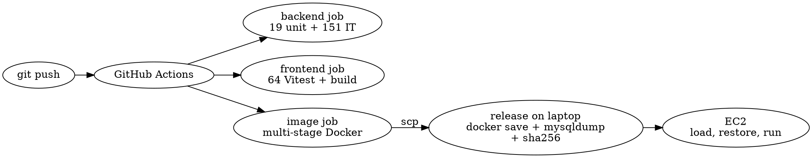
The Postman collection with Newman (103 requests, 175 assertions) runs outside this pipeline.

### Design decisions and their trade-offs
| Decision | Why | Trade-off |
| --- | --- | --- |
| Monolith, one jar | Simple to build, test and deploy; CDC step 11 | Scales as one unit |
| Angular inside the jar | Same origin, no CORS, one port | Frontend and backend are released together |
| Stateless JWT | No session store; works for REST and WebSocket | A token can't be revoked before expiry (mitigated: roles and `enabled` are re-read from the DB on each request) |
| Package by feature | Easy to navigate and extend | Some shared code goes to `common` |
| Flyway + `validate` | Reproducible schema, no surprise changes | Every change needs a new migration file |
| Rules in the `Auction` entity | One source of truth for REST and scheduler | The entity is richer than plain data |
| Pessimistic lock on bids | Correct under simultaneous bids | Bids on the same auction are serialised |
| Events after commit + async mail | Fast responses, no ghost emails | No retry queue; email is best effort |
| In-memory STOMP broker | No extra infrastructure | Works for one server instance only |
| VPS + Docker Compose | Same images as the laptop; WebSocket and MySQL fit naturally | We own patching, backups and uptime |
| Cloudflare Quick Tunnel | HTTPS without opening ports | Temporary URL; a named tunnel and domain are next |

> The architecture in one breath: a browser app talks to one Spring Boot process over REST for actions and STOMP for live updates; that process stores everything in MySQL.

# Spring Boot from zero
Spring Boot is a framework that creates objects for you, wires them together and runs a web server, so you only write business code. Every concept below is shown with real code from ATELIER.

### The entry point
The whole backend starts from one class, `AtelierApplication.java`. The `@SpringBootApplication` annotation turns on three things: component scanning (find classes in `com.sip.psm`), auto-configuration (set up Tomcat, JPA and Security from the dependencies present) and configuration support.

```java
@SpringBootApplication
@ConfigurationPropertiesScan
public class AtelierApplication {
    public static void main(String[] args) {
        SpringApplication.run(AtelierApplication.class, args);
    }
}
```

### What happens when the app starts
When you run `java -jar psm.jar`:

1. The JVM starts the Spring Boot launcher, which calls `main()`.
2. Spring creates the **container** (the `ApplicationContext`), a big map of every object it manages.
3. **Component scanning** looks through `com.sip.psm` for `@Service`, `@RestController`, `@Component`, `@Configuration` and so on.
4. **Auto-configuration** checks which libraries are present: the MySQL driver and JPA give a connection pool and Hibernate, the mail starter gives a `JavaMailSender`, the web starter gives an embedded Tomcat.
5. **Settings are bound and validated.** `application.yml` fills the `AtelierProperties` record. A bad `PUBLIC_URL` or a `JWT_SECRET` shorter than 32 bytes stops the startup immediately ("fail fast").
6. **Beans are created in dependency order.** `JwtService` needs `AtelierProperties` and `Clock`, so those are built first. Spring reads each constructor to know what to inject.
7. **Flyway runs before Hibernate.** It applies any V1, V2 or V3 script not yet run. Then Hibernate *validates* that every `@Entity` matches the tables. A mismatch stops the startup.
8. **`ApplicationRunner`s run.** `RoleAndAdminInitializer` creates the three system roles and the first admin if missing; `DemoDataInitializer` loads the demo gallery when `DEMO_DATA=true`.
9. **Tomcat opens port 8080** and the readiness check turns `UP`.

### IoC, beans and dependency injection
- **Bean:** an object created and managed by Spring. Classes marked `@Component`, `@Service`, `@Repository`, `@RestController` or `@Configuration` become beans. A method annotated `@Bean` also returns a bean.
- **IoC (Inversion of Control):** you never write `new AuthService(...)`. Spring builds the object graph at startup.
- **Dependency injection (DI):** a class lists what it needs in its constructor and Spring passes the matching beans in. ATELIER always uses **constructor injection** (no `@Autowired` on fields), which makes classes testable and fields `final`.

```java
@Service
public class AuthService {
    private final UserRepository users;
    private final PasswordEncoder passwordEncoder;
    private final JwtService jwt;
    private final ApplicationEventPublisher events;

    public AuthService(UserRepository users, RoleRepository roles,
                       PasswordEncoder passwordEncoder, JwtService jwt,
                       ApplicationEventPublisher events) { ... }
}
```
`PasswordEncoder` comes from the `@Bean passwordEncoder()` method in `SecurityConfig` (a `BCryptPasswordEncoder`), and `UserRepository` is generated by Spring Data.

### The layered architecture
Every feature follows the same layers. A request travels down and back up. The code is organised **package by feature** (`artist/`, `auction/`, `user/`), not by layer.

| Layer | Annotation | Job | ATELIER example |
| --- | --- | --- | --- |
| Controller | `@RestController` | Receives HTTP, validates JSON, returns JSON | `StudioArtistController` |
| Service | `@Service` + `@Transactional` | Business rules, transactions, events | `ArtistService` |
| Repository | interface extending `JpaRepository` | Database access, queries | `ArtistRepository` |
| Entity | `@Entity` | Java class mapped to a table | `Artist`, table `artists` |
| DTO | Java `record` | What goes in and out of the API | `ArtistRequest`, `ArtistResponse` |

### Controllers and REST annotations
| Annotation | Meaning |
| --- | --- |
| `@RestController` | Class whose methods return JSON (Jackson converts objects) |
| `@RequestMapping("/api/studio/artists")` | Base URL for the class |
| `@GetMapping`, `@PostMapping`, `@PutMapping`, `@DeleteMapping` | HTTP verb + sub-path |
| `@PathVariable Long id` | Reads `{id}` from the URL |
| `@RequestParam String q` | Reads `?q=` from the query string |
| `@RequestBody` | Converts the JSON body to a Java object |
| `@Valid` | Runs Bean Validation on that object |
| `@ResponseStatus(HttpStatus.CREATED)` | Returns 201 instead of 200 |
| `@PreAuthorize("hasRole('ADMIN')")` | Method-level security check |
| `Principal principal` | The logged-in user (email), injected by Spring Security |
| `Pageable` + `@PageableDefault` | Reads `?page=&size=&sort=` for pagination |

A real controller method, the bid endpoint:

```java
@PostMapping("/{id}/bids")
@ResponseStatus(HttpStatus.CREATED)
public AuctionEvent placeBid(@PathVariable Long id, @Valid @RequestBody PlaceBidRequest request,
                             Principal principal) {
    return bids.placeBid(id, request.amount(), principal.getName());
}
```

### DTOs as records, and validation
Entities are never sent directly to the browser. DTOs are immutable Java `record`s, which also lets the app hide fields: the public `ArtistSummary` has no email or phone, while the Studio's `ArtistResponse` does.

```java
public record RegisterRequest(
    @NotBlank @Size(max = 80) String firstName,
    @NotBlank @Email @Size(max = 190) String email,
    @NotBlank @Size(min = 8, max = 72) String password,
    @Pattern(regexp = "^[+0-9 ().-]*$") String phone) {}
```
If validation fails, Spring throws `MethodArgumentNotValidException` and the global handler returns 400 with a `fields` map (see chapter 4 for all error mappings).

### JPA, Hibernate and Spring Data
- **JPA** is the Java standard for mapping objects to tables. **Hibernate** is the implementation that generates SQL.
- **Spring Data JPA** writes repository implementations for you. Declaring `existsByEmailIgnoreCase(String email)` is enough; Spring derives the SQL from the method name.
- Custom queries use JPQL with `@Query`, for example `ArtistRepository.search(...)`.
- `@EntityGraph` loads related entities in one query to avoid the N+1 problem.
- `ddl-auto: validate`: Hibernate never creates tables. It only checks that entities match the schema that **Flyway** created.
- `open-in-view: false`: the DB session closes at the end of the service, so lazy loading can't silently run SQL in controllers.

### Transactions
`@Transactional` on a service method opens a DB transaction, commits on success and rolls back on any runtime exception. `readOnly = true` is used for reads. `ArtistService` is annotated at class level, so all its methods are transactional.

### Configuration and environment variables
`application.yml` holds every setting with the syntax `${ENV_VAR:default}`. The same jar runs in dev and production; only environment variables change. Custom settings live under `atelier.*` and are bound to a typed, validated record:

```java
@Validated
@ConfigurationProperties(prefix = "atelier")
public record AtelierProperties(Jwt jwt, Cors cors, Mail mail,
        Bootstrap bootstrap, Auction auction, boolean demoData) { ... }
```
If `PUBLIC_URL` is not a valid http(s) URL, the app refuses to start. `JwtService` also refuses to start when `JWT_SECRET` is shorter than 32 bytes.

### Events, async and scheduling
- `ApplicationEventPublisher.publishEvent(...)` decouples work: the service announces "a user registered" and does not know who sends the mail.
- `@TransactionalEventListener(phase = AFTER_COMMIT)` runs a listener only if the transaction succeeded.
- `@EnableAsync` + `@Async("galleryMailExecutor")` runs email sending on a separate thread pool (2 to 4 threads, queue of 200), so HTTP responses are not slowed by SMTP.
- `@EnableScheduling` + `@Scheduled(fixedDelayString = "${atelier.auction.lifecycle-interval}")` runs the auction scheduler every 5 seconds.

### Startup runners and Lombok
`RoleAndAdminInitializer` implements `ApplicationRunner`, so it runs once after startup. It creates the three system roles if missing and the first admin from `BOOTSTRAP_ADMIN_EMAIL` and `BOOTSTRAP_ADMIN_PASSWORD`.

Lombok generates boilerplate at compile time. `@Getter` and `@Setter` on entities create all accessors; `@NoArgsConstructor(access = PROTECTED)` gives JPA the empty constructor it needs while stopping other code from using it.

# Inside the backend: request journey, proxies, layers
The backend lives in `backend/src/main/java/com/sip/psm/`, organised in 14 feature and support packages. Each feature package owns its entity, repository, service, controllers and DTO records.

### Packages
| Package | Responsibility | Key classes |
| --- | --- | --- |
| `auth` | Register, login, current user | `AuthController`, `AuthService`, `RegistrationMailListener`, `UserRegisteredEvent` |
| `security` | JWT creation and verification, request filter, WebSocket guard | `JwtService`, `JwtAuthenticationFilter`, `TokenAuthenticator`, `StompAuthChannelInterceptor` |
| `config` | Security rules, WebSocket, async, typed settings, startup data | `SecurityConfig`, `WebSocketConfig`, `AsyncConfig`, `AtelierProperties`, `TimeConfig`, `RoleAndAdminInitializer` |
| `user` | Users and roles (CDC User, Role) | `User`, `Role`, `RoleName`, `UserService`, `RoleService`, `AdminUserController`, `AdminRoleController` |
| `artist` | Artists (CDC Client) | `Artist`, `ArtistService`, `ArtistController` (public), `StudioArtistController` |
| `exhibition` | Exhibitions (CDC Projet) | `Exhibition`, `ExhibitionService`, public and Studio controllers |
| `artwork` | Artworks, statuses, slugs | `Artwork`, `ArtworkStatus`, `ArtworkService` |
| `auction` | Auctions, bids, scheduler, live broadcast | `Auction`, `Bid`, `BidService`, `AuctionService`, `AuctionLifecycleScheduler`, `AuctionBroadcaster` |
| `account` | Self-service for logged-in users | `AccountController`, `AccountService`, `ProfileService` |
| `mail` | HTML and text email rendering and sending | `GalleryMailSender`, `GalleryMailTemplate`, `GalleryActivityMailListener` |
| `studio` | Dashboard KPIs and charts data | `StudioOverviewService`, `StudioStatsRepository` |
| `common` | Shared building blocks | `ApiExceptionHandler`, `BusinessRuleException`, `NotFoundException`, `PageResponse`, `AuditedEntity`, `Slugs` |
| `web` | Serves Angular from the jar | `SpaWebConfig` |
| `demo` | Optional demo gallery | `DemoDataInitializer`, `DemoCatalog` |

### Public versus Studio controllers
Each catalogue resource has **two controllers**. The public one (`/api/artists`) is read-only and returns a reduced projection. The Studio one (`/api/studio/artists`) is protected and returns everything, including private contact data and the exhibition budget. This split keeps the security rules simple: everything under `/api/studio/**` is staff-only, and everything under the public prefix is a `GET` open to all.

### The journey of one HTTP request
Take `PUT /api/studio/artists/5` sent by an admin. One request is handled by **one Tomcat thread** from start to finish.

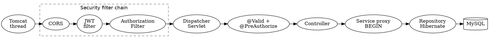
In words:

1. Tomcat gives the request to a thread. The **security filters** run in order: CORS, then our `JwtAuthenticationFilter`, then `AuthorizationFilter` (the URL rules of `SecurityConfig`).
2. `DispatcherServlet` (Spring MVC's front controller) finds the controller method by URL and verb.
3. Jackson turns the JSON body into `ArtistRequest`; `@Valid` runs Bean Validation; the `@PreAuthorize("hasRole('ADMIN')")` proxy checks the role.
4. `StudioArtistController.update(5, request)` calls the service. The service proxy opens a transaction (`BEGIN`).
5. `ArtistRepository.findById(5)` makes Hibernate run a `SELECT`; `apply()` changes the fields; `saveAndFlush()` sends `UPDATE ... WHERE id=5 AND version=3`. Then `COMMIT`.
6. Jackson turns `ArtistResponse` into JSON and `200 OK` goes back up through the filters.

If any step throws, the exception travels back up until `ApiExceptionHandler` turns it into a clean JSON error.

### Example: create an artist
1. Angular sends `POST /api/studio/artists` with JSON and `Authorization: Bearer <jwt>`.
2. `JwtAuthenticationFilter` verifies the token and puts the user and roles into the `SecurityContext`.
3. `SecurityConfig` checks the rule `POST /api/studio/**` is `hasAnyRole(ADMIN, COLLABORATEUR)`.
4. `StudioArtistController.create` receives a validated `ArtistRequest` (`@Valid`) and the `Principal`.
5. `ArtistService.create` (transactional) copies fields onto a new `Artist`, sets `createdBy` to the current user and saves it.
6. The service publishes `ArtistContactCreatedEvent`. After commit, the mail listener sends a welcome email to the artist and a notice to the admin.
7. The controller returns `201 Created` with an `ArtistResponse` JSON.

### Complete REST API map
| Resource | Endpoints | Access |
| --- | --- | --- |
| Auth | `POST /api/auth/register`, `POST /api/auth/login` | Everyone |
| Auth | `GET /api/auth/me` | Logged in |
| Public catalogue | `GET /api/artworks`, `/api/artworks/{slug}`, `/api/artists`, `/api/artists/{id}`, `/api/exhibitions`, `/api/exhibitions/{id}` | Everyone |
| Public auctions | `GET /api/auctions`, `/api/auctions/{id}`, `/api/auctions/{id}/bids` | Everyone |
| Bidding | `POST /api/auctions/{id}/bids` | `BIDDER` |
| Account | `PUT /api/account/profile`, `PUT /api/account/password`, `GET /api/account/bids`, `GET /api/account/wins` | Logged in |
| Studio artists | `GET`, `GET /{id}`, `POST`, `PUT /{id}`, `DELETE /{id}` on `/api/studio/artists` | GET and POST: ADMIN + COLLABORATEUR; PUT and DELETE: ADMIN |
| Studio exhibitions, artworks | the same five on `/api/studio/exhibitions` and `/api/studio/artworks` | same as artists |
| Studio overview | `GET /api/studio/overview` | ADMIN + COLLABORATEUR |
| Studio auctions | `GET`, `POST`, `PUT /{id}`, `POST /{id}/cancel`, `DELETE /{id}` on `/api/studio/auctions` | ADMIN |
| Users | `GET`, `GET /{id}`, `POST`, `PUT /{id}`, `DELETE /{id}`, `PUT /{id}/roles`, `PUT /{id}/status` on `/api/admin/users` | ADMIN |
| Roles | `GET`, `GET /{id}`, `POST`, `PUT /{id}`, `DELETE /{id}` on `/api/admin/roles` | ADMIN |
| Health | `GET /actuator/health`, `/actuator/health/readiness` | Everyone |

## Going deeper: proxies
When Spring creates `ArtistService`, it does not hand out the plain object. Because the class has `@Transactional`, Spring wraps it in a **proxy**, an invisible object in front of the real one:

```
Controller -> [Proxy: open transaction] -> real ArtistService.create() -> [Proxy: commit or rollback]
```
The same trick powers `@PreAuthorize` (a security check before the method) and `@Async` (run on another thread).

**Classic trap:** if a method calls another method *of the same class* (`this.other()`), the call skips the proxy, so its `@Transactional` or `@Async` is ignored. That is one reason the email work lives in separate listener classes and is not called directly.

### JPA and Hibernate under the hood
**The persistence context** is a per-transaction memory of the entities you loaded. Inside one transaction, asking for the same artist twice returns the **same Java object** and runs only one `SELECT`.

**Dirty checking:** at commit, Hibernate compares each loaded entity with its original copy. If a field changed, it writes the `UPDATE` automatically, even without calling `save()`. In ATELIER, `Auction.placeBid()` changes `currentPrice`, `leadingBidder`, `bidCount` and `endsAt`, and those updates are written without any explicit save of the auction.

**Flush** means "send the pending SQL now" instead of waiting for commit. The code calls `flush()` on purpose in two places:
- when **deleting an artist**, so a foreign-key refusal from MySQL happens inside the method and becomes a clean 409;
- in the **bid flow**, so the new bid row and the auction update are sent before the bid events are published.

**Lazy versus eager loading:**
- `Exhibition.artist` is `LAZY`: Hibernate puts a placeholder in that field and the real `SELECT` runs only when you call `exhibition.getArtist().getName()`.
- That only works **while the transaction is open**. With `open-in-view: false`, touching a lazy field in the controller throws. That is intentional: it forces services to load what they need, which is why entities are turned into DTOs *inside* the service.
- `User.roles` is `EAGER` because the security check needs the roles on every request.

**The N+1 problem and `@EntityGraph`:** listing 20 auctions and then touching each one's artwork and artist could run 1 + 20 + 20 queries. `AuctionRepository.search` uses `@EntityGraph(attributePaths = {"artwork", "artwork.artist", "leadingBidder", "winner"})`, which fetches all of it in **one query with joins**.

**Optimistic locking (`@Version`):** every update runs `UPDATE ... SET version = 4 WHERE id = 5 AND version = 3`. If someone else saved first, the version is already 4, zero rows match, Hibernate throws and the user gets **409 `stale_update`**. No database lock is held while a person fills in a form, so use it when conflicts are rare. The screenshot shows it directly in MySQL.


### Transactions in MySQL
Every service method that writes runs inside a transaction: it either commits fully or rolls back fully. The capture shows the idea at the SQL level: a row inserted inside a transaction is visible to its own session, and after `ROLLBACK` it is gone.


### Business rules worth knowing
Every rule failure throws `BusinessRuleException(code, message)`, which becomes HTTP 409 with that `code`.

| Area | Code | Rule |
| --- | --- | --- |
| Registration | `email_taken` | One account per email (case-insensitive) |
| Users | `self_demotion`, `self_disable`, `cannot_delete_self` | An admin can't remove their own admin role, disable or delete themselves |
| Users | `last_admin` | At least one enabled admin must remain |
| Users | `user_has_activity` | A user with bids or created records can't be deleted (disable instead) |
| Account | `wrong_password`, `password_too_short` | Password change checks the current one |
| Roles | `system_role` | ADMIN, COLLABORATEUR, BIDDER system roles can't be deleted or change profile |
| Roles | `role_in_use` | An assigned role can't be deleted or change profile |
| Roles | `role_name_taken`, `unknown_role` | Names are unique; IDs must exist |
| Artworks | `exhibition_artist_mismatch` | An artwork can only be in an exhibition of its own artist |
| Auctions | `artwork_not_published` | Only `PUBLISHED` artworks can be auctioned |
| Auctions | `auction_overlap` | Max one scheduled or open auction per artwork |
| Auctions | `invalid_window` | End must be after start |
| Auctions | `auction_locked`, `artwork_change` | Terms are editable only before the first bid; the artwork can't change |
| Auctions | `auction_has_bids`, `auction_finished` | Auctions with bids are cancelled, not deleted; only live ones can be cancelled |
| Bids | `auction_not_open`, `already_leading`, `bid_too_low` | Auction must be OPEN, you can't outbid yourself, amount at least the minimum next bid |
| Any | `stale_update` | Optimistic lock: someone else saved first |
| Any | `integrity_violation` | A DB foreign key refused the delete (for example an artist with exhibitions) |

### Errors: the full mapping
`ApiExceptionHandler` is a `@RestControllerAdvice`: one class catches exceptions from every controller and returns a standard RFC 9457 `ProblemDetail` JSON with a stable `code`.

| Thrown by | Example | Becomes |
| --- | --- | --- |
| A rule in a service or entity | `BusinessRuleException("bid_too_low", ...)` | 409 + that code |
| Missing record | `NotFoundException` | 404 `not_found` |
| `@Valid` failure | `MethodArgumentNotValidException` | 400 `validation_failed` + `fields` map |
| Wrong email or password | `BadCredentialsException`, `DisabledException` | 401 `invalid_credentials` |
| MySQL foreign key or unique refusal | `DataIntegrityViolationException` | 409 `integrity_violation` |
| `@Version` conflict | `ObjectOptimisticLockingFailureException` | 409 `stale_update` |
| No or bad token on a protected URL | Spring Security entry point | 401 `authentication_required` |
| Wrong role | `AccessDeniedException` / access-denied handler | 403 `forbidden` |

Every runtime exception inside `@Transactional` causes a **rollback**, so a failed rule never leaves half-saved data.

### Tests
| Suite | Tool | Count | Examples |
| --- | --- | --- | --- |
| Backend unit | JUnit 5 | 19 | `AuctionTest`, `GalleryMailTemplateTest` |
| Backend integration | Spring Boot Test + Testcontainers (real MySQL 8.4) | 151 | `AuthIT`, `SecurityMatrixIT` (84 role cases), `ConcurrentBiddingIT`, `DatabaseRelationshipsIT` |
| Frontend | Vitest | 64 | guards, interceptor, auth store, riffle formations |
| API | Postman + Newman | 103 requests, 175 assertions | `postman/ATELIER.postman_collection.json` |

Unit tests (`*Test`) run with Maven Surefire; integration tests (`*IT`) run with Maven Failsafe, each against a throwaway MySQL Docker container.

> Spring builds every object at startup and wraps them in proxies that add transactions, security and async. Each request runs on one thread that carries the user's identity.

# From Java to MySQL and to Angular
The backend sits between Angular and MySQL. This chapter follows each connection from the lowest level up.

### Part A: Spring Boot to MySQL
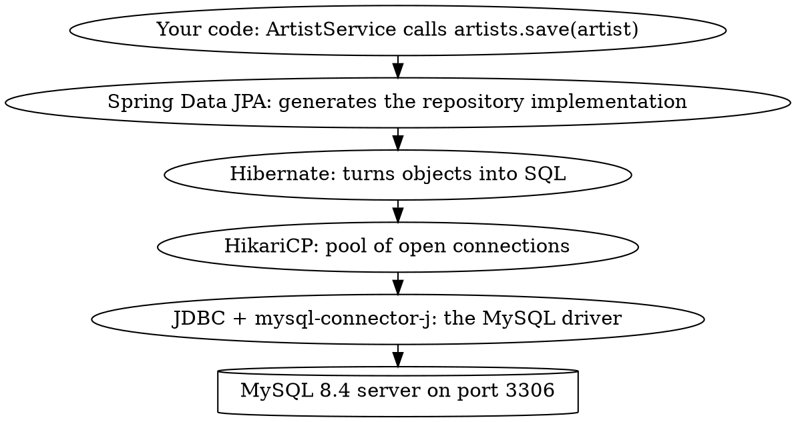
Each layer has one job.

**1. The driver.** **JDBC** is Java's standard way to talk to any database; each database supplies a **driver** that speaks its network protocol. In `pom.xml`, `mysql-connector-j` has `scope runtime`: it is only needed when running and our code never imports it.

**2. Where the database is.** `application.yml`:

```yaml
spring:
  datasource:
    url: ${DB_URL:jdbc:mysql://localhost:3306/atelier?serverTimezone=UTC&useUnicode=true&characterEncoding=utf8}
    username: ${DB_USER:atelier}
    password: ${DB_PASSWORD:atelier_dev_password}
```
| Part of the URL | Meaning |
| --- | --- |
| `jdbc:mysql://` | Use the MySQL driver |
| `localhost` or `db` | The host name |
| `3306` | MySQL's port |
| `/atelier` | The database (schema) name |
| `?serverTimezone=UTC` | Store and read times in UTC |

`${DB_URL:...}` means "use the environment variable `DB_URL` if it exists, else this default". The **same jar** works everywhere:

| Where | `DB_URL` | Why that host |
| --- | --- | --- |
| IDE on a laptop | default `localhost:3306` | `compose.yaml` publishes MySQL's port on the machine |
| Dev Docker stack | `jdbc:mysql://db:3306/atelier` | Inside Docker Compose, each **service name is a hostname**, so `db` reaches the MySQL container |
| Production on EC2 | `jdbc:mysql://db:3306/${MYSQL_DATABASE}` | Same: Docker's internal network, with port 3306 never exposed outside |

The MySQL container creates the database and user itself on first start, from `MYSQL_DATABASE`, `MYSQL_USER` and `MYSQL_PASSWORD`. That is why the backend's `DB_USER` and `DB_PASSWORD` must match those values.

**3. The connection pool.** Opening a database connection is slow (network handshake plus login). Spring Boot automatically adds **HikariCP**, which opens a few connections at startup (10 by default), keeps them open and **lends** one to each transaction, taking it back after commit or rollback. It comes with `spring-boot-starter-data-jpa` and needs no configuration.

**4. Flyway creates the tables.** At startup, before Hibernate, Flyway connects through the same pool, creates or reads `flyway_schema_history`, then runs any of `V1__core_schema.sql`, `V2__...`, `V3__...` that has not run yet, in order. **The SQL files are the source of truth for the tables**, not the Java classes.

**5. Hibernate maps classes to tables.**

```yaml
spring:
  jpa:
    open-in-view: false
    hibernate:
      ddl-auto: validate          # only CHECK the tables, never change them
    properties:
      hibernate.jdbc.time_zone: UTC
```
```java
@Entity                                 // this class is a table
@Table(name = "exhibitions")
public class Exhibition extends AuditedEntity {
    @Id                                 // primary key
    @GeneratedValue(strategy = GenerationType.IDENTITY)   // MySQL AUTO_INCREMENT
    private Long id;

    @Column(nullable = false, precision = 14, scale = 2)  // DECIMAL(14,2)
    private BigDecimal budget;

    @ManyToOne(fetch = FetchType.LAZY, optional = false)
    @JoinColumn(name = "artist_id", nullable = false)     // foreign key column
    private Artist artist;
}
```
At startup Hibernate checks that the table `exhibitions` exists with compatible columns. If anything is missing the app refuses to start, which is better than crashing later in production.

**6. Spring Data writes the repository.** You write only an interface; Spring generates the class at startup. `JpaRepository` gives `save`, `findById`, `findAll`, `delete`, `count` and paging for free.

```java
public interface ArtistRepository extends JpaRepository<Artist, Long> {
    boolean existsByCreatedById(Long userId);           // derived from the method name

    @Query("select a from Artist a where ... lower(a.name) like ...")
    Page<Artist> search(String query, boolean activeOnly, Pageable pageable);  // custom JPQL
}
```
| Way | Example | SQL comes from |
| --- | --- | --- |
| Inherited method | `artists.findById(5)` | Built in |
| Derived from the method name | `users.existsByEmailIgnoreCase(email)` | Spring reads the name |
| `@Query` in JPQL | `ArtistRepository.search(...)` | You write it, using **class and field names**, not table names |

**7. What happens on `save()`.**

```java
@Transactional
public ArtistResponse create(ArtistRequest request, String actorEmail) {
    Artist artist = new Artist();
    apply(artist, request);
    artist.setCreatedBy(users.requireByEmail(actorEmail));
    artist = artists.save(artist);
    ...
}
```
1. The `@Transactional` proxy borrows a connection from Hikari and runs `BEGIN`.
2. `save()` hands the new object to Hibernate. Because the ID comes from AUTO_INCREMENT, Hibernate sends the `INSERT INTO artists (...) VALUES (?, ?, ...)` right away to get the new ID back.
3. The method returns and the proxy runs `COMMIT`. On an exception it runs `ROLLBACK` instead.
4. The connection goes back to the pool.

Hibernate always uses **prepared statements** (`?` placeholders), so user input can never be read as SQL. That is what protects against SQL injection.


### Part B: Spring Boot to Angular
The two never share code. They communicate with **HTTP + JSON** and with **WebSocket**, and they agree on a shape, a "contract".

**1. The contract: Java records and TypeScript interfaces.** Backend (`ArtistDtos.java`):

```java
public record ArtistResponse(Long id, String name, String email, String phone, String address,
        String country, String biography, String photoUrl, boolean active,
        String createdBy, Instant createdAt, long version) { ... }
```
Frontend (`core/models/api.models.ts`):

```ts
export interface Artist extends ArtistSummary {   // id, name, country, biography, photoUrl
  email: string;
  phone?: string;
  address?: string;
  active: boolean;
  createdBy?: string;
  createdAt: string;   // Instant becomes an ISO string
  version: number;
}
```
**Jackson** turns the Java record into JSON and Angular reads that JSON as this interface. Field names must match exactly. Two settings in `application.yml` shape the JSON: `default-property-inclusion: non_null` leaves `null` fields out (so some TypeScript fields are optional, `phone?`), and `write-dates-as-timestamps: false` sends dates as readable ISO strings. Pagination uses the same contract on both sides: Java `PageResponse<T>(content, page, size, totalElements, totalPages)` and TypeScript `Page<T>` with the same five fields.

**2. The Angular side that calls the API.** `HttpClient` is enabled once in `app.config.ts`. The Studio then uses one **generic CRUD class** for every resource:

```ts
export class CrudResource<T, R> {
  constructor(private readonly http: HttpClient, private readonly baseUrl: string) {}

  list(query = {})      { return this.http.get<Page<T>>(this.baseUrl, { params: toParams(query) }); }
  get(id: number)       { return this.http.get<T>(`${this.baseUrl}/${id}`); }
  create(body: R)       { return this.http.post<T>(this.baseUrl, body); }
  update(id: number, body: R) { return this.http.put<T>(`${this.baseUrl}/${id}`, body); }
  delete(id: number)    { return this.http.delete<void>(`${this.baseUrl}/${id}`); }
}
```
Each method matches one backend controller method:

| Angular | HTTP | Spring |
| --- | --- | --- |
| `studio.artists.list({q, page})` | `GET /api/studio/artists?q=..&page=0` | `StudioArtistController.list(q, pageable)` |
| `studio.artists.get(5)` | `GET /api/studio/artists/5` | `get(@PathVariable id)` |
| `studio.artists.create(form)` | `POST` + JSON body | `create(@Valid @RequestBody ArtistRequest)` |
| `studio.artists.update(5, form)` | `PUT /api/studio/artists/5` | `update(id, request)` |
| `studio.artists.delete(5)` | `DELETE /api/studio/artists/5` | `delete(id)`, answers 204 |

`HttpClient` returns an **Observable**, which does nothing until a component calls `.subscribe(...)`. The component then puts the result into a **signal** and the template re-renders. The public pages use `GalleryApi` the same way.

**3. Every call passes through the interceptor.** It adds the JWT to each `/api/` call, which is what the backend's `JwtAuthenticationFilter` reads. If the backend answers **401**, it logs the user out and goes to `/login` (chapter 7).

**4. How Angular finds the backend: always relative URLs.** The code only says `/api/...`, never `http://localhost:8080/api/...`.

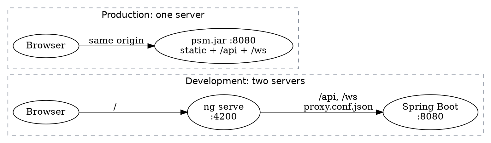
In development, `proxy.conf.json` forwards `/api` to Spring and `/ws` to `ws://` on port 8080 (`proxy.docker.json` points at the backend service in the Docker stack). `CORS_ORIGINS=http://localhost:4200` is also set, in case the browser ever calls 8080 directly. In production, Angular lives in the jar: same origin, no proxy, no CORS problem.

**5. How errors come back.** The backend always answers errors in one shape:

```json
{ "status": 409, "code": "bid_too_low", "detail": "The minimum bid is now 550.00" }
```
`core/api/problem.ts` (`problemOf`, `messageOf`) reads `code`, `detail` and the per-field `fields` map. The form shows "must be a valid email" under the right input, and the auction room shows the minimum bid message.


**6. The live connection.** For auctions Angular also opens a permanent STOMP connection (chapter 8). The JSON shape is the same `AuctionEvent` record on both sides.

### The whole chain in one picture
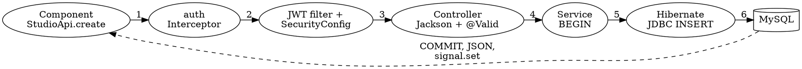
After the commit, the connection returns to the pool, `ArtistResponse` becomes JSON through Jackson, and Angular receives a typed `Artist`, updates a signal and the table re-renders.

# The database and its relations
The database is MySQL 8.4 (InnoDB) with **8 application tables and 13 foreign keys**, created only by 3 Flyway migrations. Hibernate checks the schema at startup (`ddl-auto: validate`) but never changes it. A 9th table, `flyway_schema_history`, is Flyway's own bookkeeping.

### Vocabulary
| Word | Meaning | Example in ATELIER |
| --- | --- | --- |
| Table | A list of records of one kind | `artists` |
| Row | One record | one artist |
| Column | One piece of information | `name`, `email` |
| Primary key (PK) | The unique ID of a row | `id BIGINT AUTO_INCREMENT` |
| Foreign key (FK) | A column that points to a PK in another table | `exhibitions.artist_id` points to `artists.id` |
| Unique constraint | No two rows can share this value | `users.email` |
| CHECK constraint | A rule on values | `budget >= 0` |
| Index | A lookup shortcut that makes searches fast | `idx_artists_name` |
| Cardinality | How many on each side | 1 artist, N exhibitions |

**The golden rule of relations:** the foreign key always sits on the **"many" side**. One artist has many exhibitions, so `artist_id` is stored in `exhibitions`. An artist row cannot hold a list; the list is built by looking up every exhibition that points back to it.

### Flyway: versioned schema
Flyway runs SQL files from `db/migration/` in order, once each, and records them in `flyway_schema_history`. A file is never edited after it has run; a change means a new file.

| Migration | What it creates |
| --- | --- |
| `V1__core_schema.sql` | `roles`, `users`, `user_roles`, `artists`, `exhibitions` (CDC core) |
| `V2__artworks_auctions_bids.sql` | `artworks`, `auctions`, `bids` (gallery extension) |
| `V3__dynamic_roles.sql` | Adds `roles.profile` and `roles.system_key`, copying the old labels so existing IDs and assignments survive |

### The map
The simplified diagram shows the 8 tables and the delete rule on each key. The "created by" keys (artists, exhibitions, artworks to users, all SET NULL) are left out to keep it readable.

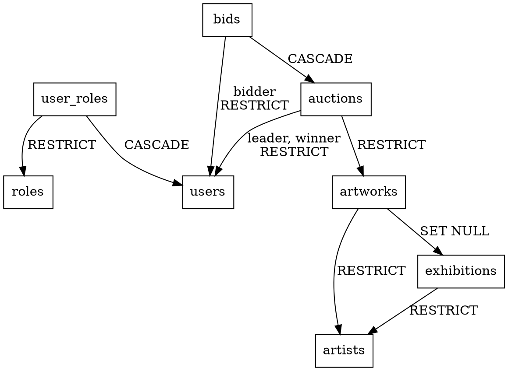
An arrow means "has a foreign key to". The top part is the CDC model: users and roles joined by `user_roles`, and artists owning exhibitions. The rest is the gallery extension: each auction belongs to one artwork and collects many bids.


### The tables
| Table | CDC equivalent | Main columns | Notes |
| --- | --- | --- | --- |
| `users` | User | `id`, `first_name`, `last_name`, `email` (unique), `password` (BCrypt), `phone`, `enabled`, `created_at` | `nom` is `last_name`, `prénom` is `first_name`, `tel` is `phone` |
| `roles` | Role | `id`, `libelle` (unique), `profile`, `system_key` (unique, nullable) | `libelle` is the editable label; `profile` is the real permission |
| `user_roles` | User-Role link | `user_id`, `role_id` (composite PK) | Join table of the many-to-many |
| `artists` | Client | `id`, `name`, `email`, `phone`, `address`, `country`, `biography`, `photo_url`, `active`, `created_by_id`, `version` | Index `idx_artists_name` |
| `exhibitions` | Projet | `id`, `title`, `description`, `budget` DECIMAL(14,2), `duration_days`, `starts_on`, `venue`, `cover_url`, `artist_id`, `version` | CHECK `budget >= 0`, `duration_days > 0` |
| `artworks` | extension | `id`, `slug` (unique), `title`, `image_url`, `estimate`, `status`, `artist_id`, `exhibition_id` | Status `DRAFT`, `PUBLISHED`, `ARCHIVED` |
| `auctions` | extension | `artwork_id`, `starting_price`, `current_price`, `minimum_increment`, `starts_at`, `ends_at`, `status`, `bid_count`, `leading_bidder_id`, `winner_id`, `version` | CHECK prices > 0, `current_price >= starting_price`, `ends_at > starts_at`; index `(status, ends_at)` for the scheduler |
| `bids` | extension | `auction_id`, `bidder_id`, `amount`, `created_at` | UNIQUE (`auction_id`, `amount`); index `(bidder_id, created_at)` |

Details worth remembering:
- `users.email` is 190 characters: `utf8mb4` uses up to 4 bytes per character, and 190 x 4 stays under the index size limit, so the unique index fits.
- `users.password` holds a **BCrypt hash** (60 characters, column of 100), never the real password.
- Auction statuses are `SCHEDULED`, `OPEN`, `CLOSED`, `CANCELLED`.

Example `roles` rows, showing why label and profile are separate:

| id | libelle | profile | system_key |
| --- | --- | --- | --- |
| 1 | ADMIN | ADMIN | ADMIN |
| 2 | COLLABORATEUR | COLLABORATEUR | COLLABORATEUR |
| 3 | BIDDER | BIDDER | BIDDER |
| 4 | Curator | COLLABORATEUR | NULL (custom role made by an admin) |


### Every relation explained
| Relation | Type | JPA mapping | FK and delete rule |
| --- | --- | --- | --- |
| User and Role | **Many-to-Many** (CDC) | `User.roles`: `@ManyToMany(fetch = EAGER)` + `@JoinTable(name = "user_roles")` | `user_id` CASCADE; `role_id` RESTRICT (can't delete an assigned role) |
| Artist 1 to N Exhibition | **One-to-Many / Many-to-One** (CDC Client-Projet) | `Exhibition.artist`: `@ManyToOne(optional = false)` + `@JoinColumn("artist_id")`; `Artist.exhibitions`: `@OneToMany(mappedBy = "artist")` | `artist_id NOT NULL`, RESTRICT: an artist with exhibitions can't be deleted (409) |
| Artist 1 to N Artwork | One-to-Many | `Artwork.artist`: `@ManyToOne(optional = false)` | RESTRICT |
| Exhibition 0..1 to N Artwork | Optional Many-to-One | `Artwork.exhibition`: `@ManyToOne` (nullable) | SET NULL: deleting an exhibition detaches its artworks |
| Artwork 1 to N Auction | One-to-Many (history) | `Auction.artwork`: `@ManyToOne(optional = false)` | RESTRICT |
| Auction 1 to N Bid | One-to-Many | `Bid.auction`: `@ManyToOne(optional = false)` | CASCADE (only reached when the auction has no bids) |
| User 1 to N Bid | One-to-Many | `Bid.bidder`: `@ManyToOne(optional = false)` | RESTRICT |
| Auction to User (leader, winner) | Two optional Many-to-One | `Auction.leadingBidder`, `Auction.winner` | RESTRICT |
| Artist, Exhibition, Artwork to User (createdBy) | Optional Many-to-One | in `AuditedEntity` (`@MappedSuperclass`) | SET NULL: deleting a user keeps the records |

Total: 2 CASCADE, 4 SET NULL, 7 RESTRICT, which makes 13 foreign keys. The CDC has no one-to-one relation and none is used.

## Going deeper: the two CDC relations
### Relation 1: User and Role (Many-to-Many)
A user can have several roles and a role can belong to several users. **Why a third table:** a column holds only one value. `users.role_id` would allow one role per user, `roles.user_id` one user per role. So each *pair* is a row in `user_roles`:

| user_id | role_id | meaning |
| --- | --- | --- |
| 1 | 1 | user 1 is ADMIN |
| 2 | 2 | user 2 is COLLABORATEUR |
| 2 | 4 | user 2 is also Curator |
| 3 | 3 | user 3 is BIDDER |

```sql
CREATE TABLE user_roles (
    user_id BIGINT NOT NULL,
    role_id BIGINT NOT NULL,
    PRIMARY KEY (user_id, role_id),        -- same pair can't appear twice
    CONSTRAINT fk_user_roles_user FOREIGN KEY (user_id) REFERENCES users (id) ON DELETE CASCADE,
    CONSTRAINT fk_user_roles_role FOREIGN KEY (role_id) REFERENCES roles (id)
);
```
```java
@ManyToMany(fetch = FetchType.EAGER)
@JoinTable(name = "user_roles",
        joinColumns = @JoinColumn(name = "user_id"),          // points to me (User)
        inverseJoinColumns = @JoinColumn(name = "role_id"))   // points to the other side (Role)
private Set<Role> roles = new HashSet<>();
```
- There is **no `UserRoles` class**. Hibernate manages the link table: add a role to the `Set` and it inserts a row, remove it and it deletes the row.
- It is a `Set`, not a `List`, so a role can't appear twice for one user, matching the composite PK.
- It is `EAGER` because the security check needs the roles on every request.
- It is **one-directional**: `Role` has no list of users. When the app needs the count it asks `users.countByRoleId(id)`.
- **Delete a user:** CASCADE removes the `user_roles` rows, the roles stay. **Delete an assigned role:** RESTRICT, so `RoleService` returns 409 `role_in_use` (system roles: `system_role`).
- SQL alone does not guarantee that a user has *at least one* role (zero rows are allowed); the service enforces it through request validation.

### Relation 2: Artist and Exhibitions (One-to-Many)
An artist can have many exhibitions, and every exhibition belongs to **exactly one** artist.

```sql
artist_id BIGINT NOT NULL,
CONSTRAINT fk_exhibitions_artist FOREIGN KEY (artist_id) REFERENCES artists (id)
```
`NOT NULL` means an exhibition can't exist without an artist; no `ON DELETE` clause means RESTRICT. In Java the relation is mapped in both directions.

`Exhibition.java`, the **owning side** (it holds the FK column):
```java
@ManyToOne(fetch = FetchType.LAZY, optional = false)
@JoinColumn(name = "artist_id", nullable = false)
private Artist artist;
```
`Artist.java`, the **inverse side** (no column, just a view):
```java
@OneToMany(mappedBy = "artist", fetch = FetchType.LAZY)
private List<Exhibition> exhibitions = new ArrayList<>();

public List<Exhibition> getExhibitions() {
    return Collections.unmodifiableList(exhibitions);   // read-only
}
```
**Owning versus inverse side.** The database has only *one* column, `exhibitions.artist_id`, while Java has *two* references, `exhibition.artist` and `artist.exhibitions`. Hibernate must know which one to trust when writing. `@JoinColumn` marks the side that **writes** the column. `mappedBy = "artist"` means "the field named `artist` on the other side owns this; I am only a mirror". So to link an exhibition you call `exhibition.setArtist(artist)`; adding to `artist.exhibitions` would not be saved, which is why the getter returns an unmodifiable list.

**On delete:** deleting an artist who has exhibitions is refused by MySQL, and the API returns 409 `integrity_violation`. Deleting an exhibition is fine, the artist stays. `DatabaseRelationshipsIT` tests both CDC relations against a real MySQL. The capture below shows the refusal in the database itself.


### The other relations in short
- **Artist to Artworks:** FK `artist_id NOT NULL`, RESTRICT. One-directional: `Artist` has no `artworks` list, the code queries the artwork repository by `artistId`.
- **Exhibition to Artworks:** an artwork *may* be shown in one exhibition. `exhibition_id` is nullable with `ON DELETE SET NULL`, and in Java `@ManyToOne` without `optional = false`. Deleting an exhibition keeps its paintings, just "not in an exhibition". SQL can't say "two foreign keys must agree", so the service checks that the exhibition belongs to the same artist (`exhibition_artist_mismatch`).
- **Artwork to Auctions:** one-to-many over time, since an artwork can be auctioned again after a cancellation. It is not one-to-one: the real rule is "at most **one live** auction at a time", checked in `AuctionService` (`auction_overlap`). An artwork used by an auction can't be deleted (409).
- **Auction to Bids:** FK `auction_id` with CASCADE and `UNIQUE (auction_id, amount)`. In practice the service refuses to delete an auction that has bids (`auction_has_bids`); you cancel it instead, so bid history is preserved.
- **User to Bids:** RESTRICT. A user who has bid can't be deleted (`user_has_activity`); the admin disables the account instead.
- **Auction to User, twice:** `leading_bidder_id` (who is highest now) and `winner_id` (set when the auction closes). Both nullable. The same two tables can be linked more than once with different meanings. `Auction.synchronize()` sets `winner = leadingBidder` on close.
- **createdBy:** artists, exhibitions and artworks remember which staff user created them, through a shared parent class:

```java
@MappedSuperclass                       // not a table itself; its fields are copied into each child table
public abstract class AuditedEntity {
    @ManyToOne(fetch = FetchType.LAZY)
    @JoinColumn(name = "created_by_id")
    private User createdBy;

    @Column(name = "created_at", nullable = false, updatable = false)
    private Instant createdAt;

    @Version
    private long version;               // optimistic locking
}
```
If that staff user is deleted, the records stay and `created_by_id` becomes NULL.

```cols

---

```

### All 13 foreign keys at a glance
| # | FK | From to | On delete | Why |
| --- | --- | --- | --- | --- |
| 1 | `fk_user_roles_user` | user_roles to users | **CASCADE** | Delete the user, drop their links |
| 2 | `fk_user_roles_role` | user_roles to roles | RESTRICT | Can't delete a role in use |
| 3 | `fk_artists_created_by` | artists to users | **SET NULL** | Keep the artist if the staff user leaves |
| 4 | `fk_exhibitions_artist` | exhibitions to artists | RESTRICT | Never lose projects by deleting a client |
| 5 | `fk_exhibitions_created_by` | exhibitions to users | **SET NULL** | Keep records |
| 6 | `fk_artworks_artist` | artworks to artists | RESTRICT | Every work keeps its artist |
| 7 | `fk_artworks_exhibition` | artworks to exhibitions | **SET NULL** | Close a show, keep the paintings |
| 8 | `fk_artworks_created_by` | artworks to users | **SET NULL** | Keep records |
| 9 | `fk_auctions_artwork` | auctions to artworks | RESTRICT | Keep auction history |
| 10 | `fk_auctions_leader` | auctions to users | RESTRICT | Keep history |
| 11 | `fk_auctions_winner` | auctions to users | RESTRICT | Keep history |
| 12 | `fk_bids_auction` | bids to auctions | **CASCADE** | Bids mean nothing without their auction |
| 13 | `fk_bids_bidder` | bids to users | RESTRICT | Keep history |

How to choose a rule (a good jury answer): **CASCADE** when the child has no meaning alone (a link row, a bid). **SET NULL** when the child should survive but the link is optional (the creator, the exhibition). **RESTRICT** when deleting would lose important data (clients, artworks, history).

### Mapping styles, fetch types and one query
| Style | Where | Code |
| --- | --- | --- |
| Bidirectional (both sides know) | Artist and Exhibition (the CDC relation) | `@ManyToOne` in Exhibition + `@OneToMany(mappedBy)` in Artist |
| Unidirectional (only the child knows) | Artwork to Artist, Auction to Artwork, Bid to Auction and User | Only `@ManyToOne`; the parent's list comes from a repository query |

Unidirectional is simpler and avoids loading big lists by accident. The CDC relation was made bidirectional to show the full JPA mapping, and `DatabaseRelationshipsIT` checks both directions after a reload.

- `LAZY` (the default choice here): related data loads only when accessed, to avoid loading the whole database.
- `EAGER` on `User.roles`: the roles are needed on every authenticated request.
- `@EntityGraph` loads exactly the needed relations in one SQL query. "Show auction 12 with its artwork, artist, leader and winner":

```java
@EntityGraph(attributePaths = {"artwork", "artwork.artist", "leadingBidder", "winner"})
@Query("select a from Auction a where a.id = :id")
Optional<Auction> findDetailedById(Long id);
```
```sql
SELECT ... FROM auctions a
  JOIN artworks aw   ON aw.id = a.artwork_id
  JOIN artists ar    ON ar.id = aw.artist_id
  LEFT JOIN users lb ON lb.id = a.leading_bidder_id   -- LEFT because it may be NULL
  LEFT JOIN users w  ON w.id = a.winner_id
WHERE a.id = 12;
```
The relations are *what the data means*; the joins are *how you read them back*.

### Integrity: database versus service
Some rules are guaranteed by MySQL and can never be broken; others by Java services. Knowing which is which is a classic jury question.

| Guaranteed by the database | Guaranteed by the service layer |
| --- | --- |
| Unique emails, role labels, artwork slugs | A user has at least one role (validated request) |
| Every exhibition, artwork, auction and bid has its parent (NOT NULL + FK) | An artwork and its exhibition share the same artist |
| Unique bid amount per auction | Max one live auction per artwork; only PUBLISHED artworks can be auctioned |
| Budget >= 0, duration > 0, prices > 0, end after start (CHECK) | Status transitions, bid increments, auction OPEN, not already leading |
| Foreign keys and delete rules | Last enabled admin protection |


### Money, time and concurrency
- **Money:** `BigDecimal` in Java and `DECIMAL(14,2)` in SQL, never `double` (no rounding errors).
- **Time:** `Instant` in UTC, `TIMESTAMP(6)` (microseconds), `hibernate.jdbc.time_zone: UTC`. A `Clock` bean is injected so tests can control time. `@PrePersist` fills `created_at` before the first insert.
- **Optimistic locking:** the `version` column is incremented on every update; a stale write raises 409 `stale_update`.
- **Pessimistic locking:** `SELECT ... FOR UPDATE` on the auction row while a bid is placed (chapter 8).

> Eight tables, thirteen foreign keys. The CDC core is User and Role through `user_roles`, and Artist to Exhibition through a NOT NULL `artist_id`; around it runs the chain Artist, Artwork, Auction, Bid.

# Security: JWT and the filter chain
ATELIER uses **stateless JWT authentication**: the server keeps no session. Every request carries a signed token, and the server re-checks the token and the user's roles on each call.

### Authentication versus authorization
- **Authentication** answers "who are you?". Login checks email and password and returns a JWT.
- **Authorization** answers "what may you do?". `SecurityConfig` and `@PreAuthorize` compare the user's roles with the rule for the URL.

### What a JWT is
A JSON Web Token is three Base64URL parts joined by dots: `header.payload.signature`.

| Part | ATELIER content |
| --- | --- |
| Header | `{"alg": "HS256"}` (HMAC with SHA-256) |
| Payload (claims) | `sub` = user email, `iat` = issued at, `exp` = expiry (12 h by default) |
| Signature | HMAC-SHA256 of header and payload with the secret key `JWT_SECRET` |

The payload is **readable by anyone** (it is encoded, not encrypted), so it holds no password and no roles. What makes it trustworthy is the signature: changing one character of the payload breaks it, and only the server knows the secret. Roles are read from the database on every request, so removing a role or disabling a user takes effect immediately.

### The login sequence
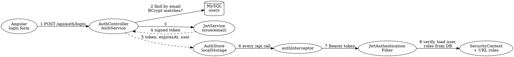
The token is created once at login; then the interceptor attaches it to every `/api/` call. The filter never blocks a request itself: it either sets the user in the security context or leaves the request anonymous, and the URL rules decide the result.


### The security classes
| Class | Role in the chain |
| --- | --- |
| `SecurityConfig` | Declares the `SecurityFilterChain`: stateless sessions, CSRF off, CORS on, URL rules, 401 and 403 JSON handlers, and inserts the JWT filter |
| `JwtService` | `issue(email)` builds and signs a token with JJWT; `verify(token)` checks signature and expiry and returns the email or empty |
| `JwtAuthenticationFilter` | A `OncePerRequestFilter` (the "middleware") that runs before Spring's login filter on every `/api/` request |
| `TokenAuthenticator` | Shared logic: strip `Bearer `, verify the JWT, load the user, refuse disabled users, map roles to authorities |
| `StompAuthChannelInterceptor` | The same checks for WebSocket STOMP frames |
| `PasswordEncoder` (BCrypt) | Hashes passwords on register; `matches()` checks them on login |

### Issuing the token
```java
public IssuedToken issue(String email) {
    Instant now = clock.instant();
    Instant expiresAt = now.plus(settings.expiration());   // PT12H
    String token = Jwts.builder()
            .subject(email)
            .issuedAt(Date.from(now))
            .expiration(Date.from(expiresAt))
            .signWith(key)                                 // HMAC key from JWT_SECRET
            .compact();
    return new IssuedToken(token, expiresAt);
}
```
`AuthService.login` finds the user by email, checks `passwordEncoder.matches(raw, hash)`, refuses disabled accounts and returns `{token, expiresAt, user}`. A wrong email and a wrong password give the same 401 `invalid_credentials`, so attackers can't discover which emails exist.

### The filter: the request middleware
```java
@Component
public class JwtAuthenticationFilter extends OncePerRequestFilter {
    protected void doFilterInternal(HttpServletRequest request,
            HttpServletResponse response, FilterChain chain) {
        if (SecurityContextHolder.getContext().getAuthentication() == null) {
            authenticator.authenticate(request.getHeader("Authorization"))
                .ifPresent(auth -> SecurityContextHolder.getContext()
                                       .setAuthentication(auth));
        }
        chain.doFilter(request, response);   // always continue
    }
    protected boolean shouldNotFilter(HttpServletRequest request) {
        return !request.getRequestURI().startsWith("/api/");
    }
}
```
Important detail: the filter **never blocks** a request. With no token or a bad token it leaves the user anonymous. The URL rules that come later decide whether anonymous is allowed (a public `GET`) or not (401). Keeping the two jobs apart, "who is calling" and "what may they do", is a standard Spring Security design.

`TokenAuthenticator` converts a valid token to a Spring `Authentication`:

```java
return jwt.verify(header.substring(7))           // email or empty
        .flatMap(users::findByEmailIgnoreCase)    // load user from DB
        .filter(User::isEnabled)                  // disabled = rejected
        .map(user -> authenticated(user.getEmail(), null,
              roles mapped to "ROLE_ADMIN", "ROLE_BIDDER"...));
```
`RoleName.authority()` adds the `ROLE_` prefix that Spring expects for `hasRole("ADMIN")`.

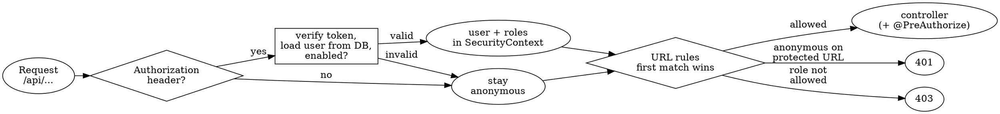

### The filter chain configuration
```java
http.csrf(disable)                                  // no cookies -> no CSRF risk
    .cors(withDefaults())                           // origins from CORS_ORIGINS
    .sessionManagement(STATELESS)                   // no HttpSession
    .authorizeHttpRequests(auth -> auth
        .requestMatchers(OPTIONS, "/**").permitAll()
        .requestMatchers(POST, "/api/auth/register", "/api/auth/login").permitAll()
        .requestMatchers(GET, "/api/artworks/**", "/api/artists/**",
                         "/api/exhibitions/**", "/api/auctions/**").permitAll()
        .requestMatchers(POST, "/api/auctions/*/bids").hasRole("BIDDER")
        .requestMatchers("/api/admin/**", "/api/studio/auctions/**").hasRole("ADMIN")
        .requestMatchers(GET,  "/api/studio/**").hasAnyRole("ADMIN", "COLLABORATEUR")
        .requestMatchers(POST, "/api/studio/**").hasAnyRole("ADMIN", "COLLABORATEUR")
        .requestMatchers(PUT,  "/api/studio/**").hasRole("ADMIN")
        .requestMatchers(DELETE, "/api/studio/**").hasRole("ADMIN")
        .requestMatchers("/api/**").authenticated()
        .anyRequest().permitAll())
    .addFilterBefore(jwtFilter, UsernamePasswordAuthenticationFilter.class);
```
Rules are checked **top to bottom and the first match wins**. That is why `/api/studio/auctions/**` (ADMIN) sits before the general `GET /api/studio/**` rule. `anyRequest().permitAll()` covers the Angular files, `/ws` and `/actuator/health`.

**Defence in depth:** controllers also carry `@PreAuthorize` (enabled by `@EnableMethodSecurity`), so even if a URL rule were wrong, the method would still refuse. Two locks on the same door.

**`SecurityContextHolder` is thread-local.** Each Tomcat thread has its own "who is logged in" box. Our filter fills it and every later step on the same thread can read it: `@PreAuthorize`, the URL rules and the `Principal` injected into controllers. When the request ends the box is cleared. Because sessions are `STATELESS`, nothing is remembered between requests.

### 401 versus 403
| Status | Meaning | Who produces it |
| --- | --- | --- |
| 401 `authentication_required` | No valid token on a protected URL | `authenticationEntryPoint` in `SecurityConfig` |
| 401 `invalid_credentials` | Wrong email or password at login | `ApiExceptionHandler` |
| 403 `forbidden` | Valid token, but the role is not allowed | `accessDeniedHandler` in `SecurityConfig` |

```cols

---

```

### Permission matrix
| Operation | Anonymous | BIDDER | COLLABORATEUR | ADMIN |
| --- | --- | --- | --- | --- |
| Public reads | yes | yes | yes | yes |
| Register, login | yes | yes | yes | yes |
| Place a bid | no | **yes** | no | no |
| Studio: view clients and projets | no | no | yes | yes |
| Studio: add clients and projets | no | no | yes | yes |
| Studio: edit, delete | no | no | no | yes |
| Auctions management | no | no | no | yes |
| Users and roles | no | no | no | yes |
| Own account, `/api/auth/me` | no | yes | yes | yes |

This matrix is tested by `SecurityMatrixIT` with 84 cases.

### Roles: label versus profile
A role row has an editable `libelle` (display name) and a fixed `profile` (`ADMIN`, `COLLABORATEUR` or `BIDDER`). **Security checks only the profile**, turned into an authority such as `ROLE_ADMIN`. An admin can create a role named "Curator" with the `COLLABORATEUR` profile and assign it to users; renaming it never changes anyone's rights. The three system roles (`system_key` not null) can't be deleted.

### Passwords with BCrypt
BCrypt is a slow, salted hash. The same password gives a different hash each time (a random salt is stored inside the hash), and it is deliberately slow to make brute force expensive. The database only stores the hash in `users.password`.

### Securing the WebSocket
`StompAuthChannelInterceptor.preSend` checks every STOMP frame:
- **CONNECT:** if an `Authorization: Bearer` header is present it must be valid or the connection is rejected. No header means an anonymous read-only connection.
- **SUBSCRIBE:** only destinations starting with `/topic/auctions` are allowed.
- **SEND:** always refused. Bids must go through `POST /api/auctions/{id}/bids`, where validation, locking and roles apply.

### The Angular side of auth
| Piece | File | What it does |
| --- | --- | --- |
| `AuthStore` | `core/auth/auth.store.ts` | Holds the session in a signal; saves `{token, expiresAt, user}` in `localStorage` under `atelier.session`; ignores an expired session at startup; exposes `isAuthenticated`, `isAdmin`, `isStaff`, `isBidder`, `hasRole()` |
| `authInterceptor` | `core/auth/auth.interceptor.ts` | Adds `Authorization: Bearer <token>` to every `/api/` call; on a 401 (except login and register) logs out and redirects to `/login?returnUrl=...` |
| `authGuard` | `core/auth/guards.ts` | Route requires login, else redirect to `/login` |
| `roleGuard(...roles)` | `core/auth/guards.ts` | Route requires a role, else `/forbidden` |
| `guestGuard` | `core/auth/guards.ts` | Keeps logged-in users off `/login` and `/register` |

The interceptor itself:

```ts
const token = auth.token();
const isApi = request.url.startsWith('/api/');
const authorized =
  token && isApi ? request.clone({ setHeaders: { Authorization: `Bearer ${token}` } }) : request;
```
The frontend guards are **user-experience only**. A user can edit JavaScript in the browser, so the backend is the real security boundary.

```cols

---

```

### CORS and CSRF in one minute
- **CORS:** browsers block a page from calling another origin unless the server allows it. `CORS_ORIGINS` lists allowed origins on `/api/**`, with methods `GET, POST, PUT, DELETE, OPTIONS` and headers `Authorization, Content-Type`. In production Angular and the API share one origin, so CORS barely matters.
- **CSRF:** an attack that abuses cookies a browser sends automatically. ATELIER authenticates with a header the browser never adds by itself, so CSRF protection is safely disabled.

### Defence in depth: eight layers
| Layer | Mechanism |
| --- | --- |
| 1 Network | EC2 firewall: only SSH 22 from the admin IP; app bound to the local interface; DB never published |
| 2 Transport | HTTPS and WSS via Cloudflare; SMTP via STARTTLS |
| 3 Identity | BCrypt passwords; JWT HS256 signed with `JWT_SECRET` (at least 32 bytes), 12 h expiry |
| 4 URL rules | `SecurityConfig`: first-match rules per path and HTTP verb |
| 5 Methods | `@PreAuthorize` on controller methods |
| 6 Business | Service checks (last admin, self-demotion, role in use) |
| 7 Database | Foreign keys, UNIQUE, CHECK, NOT NULL |
| 8 UI | Angular guards and hidden buttons (comfort only, not security) |

If one layer has a mistake, the next one still protects.

# Auctions, locking and real time
The auction is the most technical part of the backend. Its rules live **inside the entity** (`Auction.placeBid`, `Auction.synchronize`), so the REST endpoint and the scheduler apply exactly the same logic.

### The rules
- **Minimum next bid:** the starting price if there are no bids, else `currentPrice + minimumIncrement`.
- **Soft close:** a bid in the last 60 seconds (`AUCTION_SOFT_CLOSE`) pushes `endsAt` to now + 60 s, so last-second sniping is useless.
- **Lifecycle:** `SCHEDULED`, then `OPEN`, then `CLOSED` (or `CANCELLED`). Closing sets `winner = leadingBidder`.
- **Unique constraint:** `UNIQUE(auction_id, amount)` on `bids` is the final safety net.
- **Optimistic version:** `@Version long version` on auctions, artists, exhibitions and artworks detects concurrent edits in the Studio.
- `placeBid` calls `synchronize(now)` first. If the end time has passed but the scheduler has not run yet, the bid is still refused.
- The `Clock` is injected instead of calling `Instant.now()`, so tests can freeze or move time.

The core of the rules, from `Auction.placeBid`:

```java
synchronize(now);
if (status != AuctionStatus.OPEN) {
    throw new BusinessRuleException("auction_not_open", "This auction is not accepting bids");
}
if (leadingBidder != null && Objects.equals(leadingBidder.getId(), bidder.getId())) {
    throw new BusinessRuleException("already_leading", "You already hold the highest bid");
}
BigDecimal minimum = minimumNextBid();
if (amount.compareTo(minimum) < 0) {
    throw new BusinessRuleException("bid_too_low", "The minimum bid is now " + minimum.toPlainString());
}
currentPrice = amount;
leadingBidder = bidder;
bidCount++;
Instant softCloseLimit = now.plus(softClose);
if (endsAt.isBefore(softCloseLimit)) {
    endsAt = softCloseLimit;
}
```

### Two bidders at the same millisecond
**Pessimistic lock:** `BidService` loads the auction with `findByIdForUpdate`, a `@Lock(PESSIMISTIC_WRITE)` query that becomes `SELECT ... FOR UPDATE`. Bids are fast and conflicts are likely, so here you **block** instead of retrying (the opposite of the optimistic lock used for Studio edits).

```java
@Lock(LockModeType.PESSIMISTIC_WRITE)
@Query("select a from Auction a where a.id = :id")
Optional<Auction> findByIdForUpdate(@Param("id") Long id);
```
Setup: the current price is 500, the minimum increment is 50, and Alice and Bob both bid 550.

| Time | Alice's transaction | Bob's transaction |
| --- | --- | --- |
| t1 | `SELECT auction FOR UPDATE`: gets the lock | |
| t2 | | `SELECT auction FOR UPDATE`: **waits** |
| t3 | `placeBid`: 550 is at least 550, price becomes 550 | |
| t4 | `INSERT` bid, `UPDATE` auction, `COMMIT`: lock released | |
| t5 | | gets the lock, reads price 550 |
| t6 | | `placeBid`: 550 is below 600, refused with `bid_too_low` |
| t7 | | `ROLLBACK`, 409 to Bob |


### The bid sequence, with lock and after-commit events
```dot
digraph {
  rankdir=LR; nodesep=0.2; ranksep=0.3;
  a[label="Angular\nPOST /bids"]; f[label="JWT filter\nrule BIDDER"]; c[label="Auction\nController"];
  subgraph cluster_tx { label="BidService.placeBid  (one transaction)"; style="dashed"; color="#5b6678"; fontname="Helvetica";
    l[label="1 SELECT\nFOR UPDATE"]; r[label="2 Auction.placeBid\nrules + soft close"]; i[label="3 INSERT bid\nflush"]; e[label="4 publish\n2 events (parked)"]; m[label="5 COMMIT"]; }
  w[label="AuctionBroadcaster\n/topic/auctions/id"]; ml[label="mail listener\nasync thread"]; br[label="every open\nbrowser"]; em[label="bidder +\nprevious leader"];
  a -> f -> c -> l -> r -> i -> e -> m;
  m -> w [label="after commit"]; m -> ml [label="after commit"]; w -> br; ml -> em;
}
```

### Events: why "after commit" and "async" together
`BidService.placeBid` calls `events.publishEvent(...)` twice: once with the `AuctionEvent`, once with the `BidAcceptedEvent`. Nothing is sent yet, because the listeners are `@TransactionalEventListener` and Spring **parks** the events until the transaction ends:

- **COMMIT succeeds:** `AuctionBroadcaster` pushes the new price over WebSocket and the mail listener queues the emails.
- **ROLLBACK:** the events are thrown away. No email, no fake price on screens.

```java
@TransactionalEventListener(phase = TransactionPhase.AFTER_COMMIT)
public void onAuctionEvent(AuctionEvent event) {
    messaging.convertAndSend(TOPIC + "/" + event.auction().id(), event);
    messaging.convertAndSend(TOPIC, event);
}
```
Then `@Async("galleryMailExecutor")` moves the email work onto a separate pool (2 to 4 threads, queue of 200). The HTTP thread returns at once and the user never waits for Gmail. `GalleryMailSender` catches errors **per recipient**, so a failed customer email still lets the admin email go out.

The services announce what happened instead of calling mail or WebSocket code directly. This is **loose coupling**: `BidService` does not know emails exist, and adding a new reaction means adding a listener, not changing the service.

| Service call | Event | Listener | Result |
| --- | --- | --- | --- |
| `AuthService.register` | `UserRegisteredEvent` | `RegistrationMailListener` | SMTP |
| `ArtistService.create` | `ArtistContactCreatedEvent` | `GalleryActivityMailListener` | SMTP |
| `BidService.placeBid` | `AuctionEvent` | `AuctionBroadcaster` | `/topic/auctions/{id}` |
| `BidService.placeBid` | `BidAcceptedEvent` | `GalleryActivityMailListener` | bidder and outbid emails |
| `AuctionService` / scheduler | `AuctionResultEvent` | `GalleryActivityMailListener` | winner and admin emails |

### WebSocket and STOMP
- **WebSocket** keeps a permanent two-way connection between browser and server, instead of one HTTP request per update.
- **STOMP** is a small messaging protocol on top of WebSocket, with commands `CONNECT`, `SUBSCRIBE`, `SEND`, `MESSAGE`.
- `WebSocketConfig` (`@EnableWebSocketMessageBroker`) opens the endpoint `/ws` and enables a simple in-memory broker on `/topic`.

Step by step:
1. The browser opens `ws://.../ws`. It is an HTTP request that **upgrades** into a permanent connection.
2. It sends a STOMP `CONNECT` frame, optionally with a Bearer token. `StompAuthChannelInterceptor` checks it.
3. It sends `SUBSCRIBE /topic/auctions/12`. The interceptor only allows destinations under `/topic/auctions`.
4. Spring's **simple broker** (in memory) keeps the list "these sessions want topic 12".
5. After a bid commits, `convertAndSend("/topic/auctions/12", event)` turns the event into JSON and the broker sends it to every subscriber. The messages are `AuctionEvent`s of type `BID_PLACED`, `STATUS_CHANGED` or `UPDATED`.
6. `SEND` frames from clients are refused, so a bid can never skip validation and locking.

Limit to know: the broker is in memory, so it works for **one server instance**. Several instances would need an external broker such as RabbitMQ.

### The scheduler
`@Scheduled(fixedDelayString = "${atelier.auction.lifecycle-interval}")` runs `advance()` 5 s **after the previous run finishes** (`fixedDelay`, not `fixedRate`, so runs never overlap). Each run:

1. One query finds the IDs that are due: SCHEDULED auctions past their start, or OPEN auctions past their end.
2. Each ID goes through `AuctionService.synchronize(id)` in **its own locked transaction**, so a failure on one auction does not block the others. The error is logged and the loop continues.
3. When the status changes, the WebSocket gets a `STATUS_CHANGED` event; a closed or cancelled auction also gets an `AuctionResultEvent`, which sends the winner and admin emails. Nothing is sent again on later runs, because there is no new change.

### The Angular live room
`AuctionSocket` keeps **one shared STOMP connection** for the whole app:

```ts
const client = new Client({
  brokerURL: `${scheme}://${location.host}/ws`,   // ws:// or wss://
  connectHeaders: token ? { Authorization: `Bearer ${token}` } : {},
  reconnectDelay: 3000,
  heartbeatIncoming: 10000,
  heartbeatOutgoing: 10000,
  onConnect: () => { /* re-subscribe every open topic */ },
});
```
- `auction(id)` returns an Observable of `/topic/auctions/{id}` events; `all()` returns `/topic/auctions`.
- The connection opens with the first subscriber and closes with the last one (reference counting).
- After a network drop it reconnects every 3 s and re-subscribes. A `state` signal (`idle`, `connecting`, `live`, `reconnecting`) drives the "Live" badge.
- `AuctionRoomPage` updates its `auction` and `bids` signals on each event; the price animates to the new value and a soft-close extension is highlighted.
- Placing a bid calls `POST /api/auctions/{id}/bids` over HTTP. The confirmation for everyone comes back through the socket.

```cols

---

```


# Email with SMTP
ATELIER sends branded HTML and plain-text emails through SMTP, **asynchronously and only after the database transaction commits**. This covers CDC step 5 ("after a registration, send an email to the admin") and extends it to artists, bids and auction results.

### SMTP basics
- **SMTP** (Simple Mail Transfer Protocol) is how applications hand an email to a mail server, which then delivers it.
- **Port 587 and STARTTLS:** the connection starts in plain text, then upgrades to TLS encryption. This is what Gmail uses for apps (`SMTP_TLS=true`).
- **Authentication:** the app logs in with `SMTP_USER` and `SMTP_PASSWORD`. For Gmail this is an **app password**, not the normal account password.
- **Mailpit:** a fake SMTP server for development (port 1025, web inbox on 8025). It catches all mail so nothing reaches real inboxes.

### Configuration
`spring-boot-starter-mail` auto-creates a `JavaMailSender` bean from `spring.mail.*` in `application.yml`:

| Variable | Dev (Mailpit) | Production (Gmail) |
| --- | --- | --- |
| `SMTP_HOST` | `mailpit` | `smtp.gmail.com` |
| `SMTP_PORT` | `1025` | `587` |
| `SMTP_AUTH` | `false` | `true` |
| `SMTP_TLS` | `false` | `true` (STARTTLS) |
| `SMTP_USER`, `SMTP_PASSWORD` | empty | sender account and app password (secret) |
| `MAIL_FROM` | a `noreply@` address | the authenticated sender address |
| `ADMIN_EMAIL` | admin inbox for notices | admin inbox for notices |
| `PUBLIC_URL` | `http://localhost:4200` | the public site URL used in email links |

Timeouts are 5 s (connect) and 10 s (read and write), so a slow mail server can't block threads for long.

### How a registration email is sent
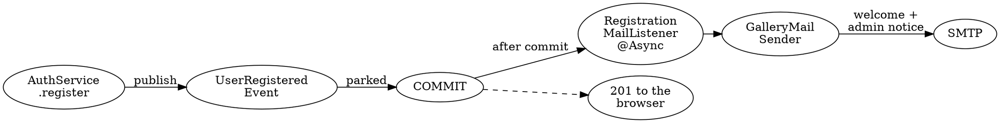
1. `AuthService.register` saves the user and calls `events.publishEvent(new UserRegisteredEvent(id, name, email))`.
2. The transaction commits. If it failed, no email is sent.
3. `RegistrationMailListener.onUserRegistered` is annotated `@TransactionalEventListener` (default phase AFTER_COMMIT) and `@Async("galleryMailExecutor")`, so it runs on a mail thread.
4. It sends two messages through `GalleryMailSender`: a welcome to the new user and a "New account" notice to `ADMIN_EMAIL` with a link to `/studio/users`.
5. The HTTP response has already returned 201; the user never waits for SMTP.

### The mail classes
| Class | Job |
| --- | --- |
| `GalleryMailTemplate` | Loads `resources/mail/gallery.html`, fills the slots (title, greeting, paragraphs, details, button), HTML-escapes values, builds the link as `PUBLIC_URL` + action path, and also produces a plain-text version |
| `GalleryMailSender` | Builds a multipart MIME message with `MimeMessageHelper`: From "ATELIER Gallery", subject `[ATELIER] ...`, HTML + text, and the *Oleanders* painting attached inline (`cid:atelier-gallery-art`) |
| `RegistrationMailListener` | User registered or created by admin: user welcome + admin notice |
| `GalleryActivityMailListener` | Artist contact created, bid accepted, auction result |
| `AsyncConfig` | Thread pool `galleryMailExecutor`: 2 core threads, max 4, queue 200, waits up to 20 s on shutdown |

### Every email the app sends
| Event | Recipient | Message |
| --- | --- | --- |
| Public registration | New user + admin | Welcome / New account |
| Admin creates an enabled user | That user + admin | Welcome / New account |
| Artist created, or email changed | Artist + admin | Contact welcome / notice |
| Bid accepted | Bidder | Bid confirmation |
| Bid accepted | Previous leader | Outbid notice |
| Auction closed with a winner | Winner + admin | Congratulations / result |
| Auction closed, no bids | Admin | No-bids result |
| Auction cancelled | Admin + current leader | Cancellation |

```cols

---

```

### Failure handling
`GalleryMailSender.send` catches `MailException` and `MessagingException` per recipient. A failure is logged (without credentials or addresses) and **does not roll back** the registration or auction. A failed user email never stops the admin email. Trade-off: there is no retry queue (outbox), so delivery is best effort.

In tests, Mailpit captured 17 multipart messages from the production image, and Gmail accepted 5 controlled messages.

# Angular and the animations
The frontend is an Angular 22 single-page application (SPA) using **standalone components, signals, zoneless change detection and `OnPush`**. The browser downloads it once; after that, only JSON travels between Angular and Spring Boot.

### Angular fundamentals used here
| Concept | What it means | In ATELIER |
| --- | --- | --- |
| Component | A TypeScript class + HTML template + CSS = one piece of UI | `LoginPage`, `ArtworkCard`, `StudioUsersPage` |
| Standalone | Components declare their own `imports`; no `NgModule` | Every component |
| Signal | A reactive value: `signal()`, read with `value()`, updated with `.set()`; `computed()` derives from other signals | `AuthStore.session`, `auction`, `bids`, `scene` |
| Zoneless + OnPush | Angular re-renders only when a signal or input changes, not after every browser event | All components use `ChangeDetectionStrategy.OnPush` |
| Service | A singleton class shared by components, created by DI | `AuthStore`, `AuctionSocket`, `GalleryApi`, `StudioApi` |
| `inject()` | Function-style dependency injection | `private readonly http = inject(HttpClient)` |
| Router + lazy loading | URL to component; `loadComponent: () => import(...)` downloads a page only when visited | `app.routes.ts`, `studio.routes.ts` |
| Guard | Function that allows or blocks a route | `authGuard`, `roleGuard`, `guestGuard` |
| Interceptor | Function that modifies every HTTP request and response | `authInterceptor` |
| Directive | Adds behaviour to an existing element | `atReveal` (fade in on scroll) |
| Pipe | Formats a value in a template | `format.pipes.ts` (money, dates) |
| RxJS Observable | A stream of values over time | HTTP calls, WebSocket events |
| Reactive forms | Form state and validation in TypeScript | login, register, Studio form sheets |

### Bootstrapping
`main.ts` calls `bootstrapApplication(App, appConfig)`. `app.config.ts` registers the global providers:

```ts
export const appConfig: ApplicationConfig = {
  providers: [
    provideBrowserGlobalErrorListeners(),
    provideHttpClient(withFetch(), withInterceptors([authInterceptor])),
    provideRouter(routes, withComponentInputBinding(),
      withInMemoryScrolling({ scrollPositionRestoration: 'top' })),
  ],
};
```
`withComponentInputBinding()` lets a route parameter like `:slug` arrive directly as a component `input()`.

### Folder structure and data flow
The three folders follow a dependency rule: `features` use `shared`, which uses `core`. Features never import each other.

| Folder | Content |
| --- | --- |
| `core/api/` | `gallery.api.ts` (public calls), `studio.api.ts` (Studio calls), `problem.ts` (turns RFC 9457 errors into messages) |
| `core/auth/` | `auth.store.ts`, `auth.interceptor.ts`, `guards.ts` |
| `core/models/` | `api.models.ts`: TypeScript interfaces mirroring the Java DTOs |
| `core/realtime/` | `auction-socket.service.ts`: the STOMP client |
| `shared/animations/` | GSAP motion system |
| `shared/components/` | `artwork-card`, `auction-status-badge`, `countdown`, `section-heading` |
| `shared/layout/` | `public-layout`, `site-header`, `site-footer`, `user-menu` |
| `shared/ui/` | spartan/ui "hlm" primitives: button, card, dialog, sheet, table, select, tabs, toaster |
| `features/` | One folder per screen: home, gallery, artwork-detail, artists, exhibitions, auctions, auth, account, errors, studio |

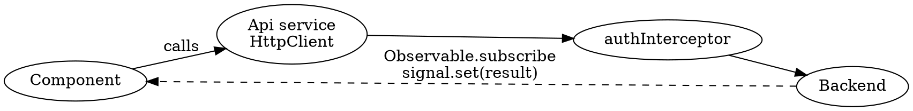
**State management:** there is no extra library such as NgRx. **Signals** do the job: the global session lives in `AuthStore` (`user`, `token`, `isAdmin`, `isStaff`) and page state lives in each component (`auction`, `bids`, `error`). **Lazy loading:** each route loads its page with `loadComponent`, so a visitor to the homepage never downloads the Studio code.

### Routes and the two shells
| URL | Page | Guard |
| --- | --- | --- |
| `/` | Home with the riffle animation | none |
| `/artworks`, `/artworks/:slug` | Gallery and artwork detail | none |
| `/artists`, `/artists/:id`, `/exhibitions` | Public catalogue | none |
| `/auctions`, `/auctions/:id` | Auction list and live auction room | none |
| `/login`, `/register` | Auth pages | `guestGuard` |
| `/account` | My bids, won works, profile | `authGuard` |
| `/studio` | Overview dashboard | `roleGuard('ADMIN','COLLABORATEUR')` |
| `/studio/artists`, `/exhibitions`, `/artworks`, `/profile` | Studio CRUD (Clients, Projets) | inherited |
| `/studio/auctions`, `/users`, `/roles` | Admin pages | `roleGuard('ADMIN')` |
| `/forbidden`, `**` | Error pages | none |

The public pages use `PublicLayout` (cinematic, dark midnight sections). The Studio uses `StudioLayout` (sidebar and ivory content, inspired by Argon Dashboard). The sidebar shows "Artists" captioned **Clients** and "Exhibitions" captioned **Projets**, matching the CDC menu.


### Studio CRUD building blocks
`features/studio/shared/` keeps all six CRUD pages identical in behaviour:
- `crud-page` and `crud-table`: list, search, sort, actions column.
- `form-sheet` + `form-field` + `form-errors`: a side panel with a reactive form; server `fields` errors are shown under each input.
- `confirm-dialog`: "Are you sure?" before delete.
- `pagination`: uses the backend `PageResponse` (page, size, total).
- `chart-canvas`: a Chart.js wrapper (line, bar, doughnut) used on the overview page.

The templates hide edit and delete buttons when `auth.isAdmin()` is false, so a Collaborateur only sees view and add.

```cols

---

```

### The animation system (GSAP)
All motion goes through `shared/animations/motion.ts`, which registers GSAP's `ScrollTrigger` and `Flip` plugins once and exports `prefersReducedMotion()`.

| Animation | File | How it works |
| --- | --- | --- |
| **Riffle deck** (home) | `riffle-deck.ts` + `riffle-formations.ts` | Up to 20 paintings fall in as a pile, then riffle open into a 3D ring. The section is **pinned** with ScrollTrigger; scrolling scrubs a timeline through 4 formations: ring, pile, corridor, featured painting |
| Formations | `riffle-formations.ts` | Pure functions: `formation(name, index, count, viewport)` returns x, y, z, rotations, scale, opacity. No DOM, so they are unit-tested |
| Flip transition | `flip-transition.service.ts` | Clicking an artwork card records its image rectangle; the detail page plays a FLIP animation so the painting grows from the card to its new place |
| Reveal | `reveal.directive.ts` | `atReveal` uses an `IntersectionObserver` to add `is-visible` when an element enters the viewport; CSS does the fade-up |
| Night sky | `night-sky.ts` | Two blurred colour blooms (cobalt and sunflower), vignette and grain drifting with pure CSS keyframes behind dark sections |
| Countdown, price | `countdown.ts`, auction room | Live time left and animated price on new bids |

**How the riffle timeline is built:**
1. `afterNextRender` waits for the DOM, then `gsap.matchMedia` runs the choreography only if the user accepts motion.
2. **Opening:** cards are set to the "pile" pose 120 px lower and invisible, then tween up (0.8 s, `power3.out`, staggered), then to the "ring" pose (1.4 s, `expo.inOut`). Scroll keys are held during this 1.5 s.
3. **Scroll timeline:** `scrollTrigger: { pin: true, scrub: 1, end: +=2.6 x viewport height, snap: 'labels' }`. Each formation is a labelled step; snapping settles on the nearest one. `onUpdate` fills a progress bar and updates the `scene` signal for the caption.
4. **Ambient:** an endless `yoyo` tween makes the arrangement "breathe"; `gsap.quickTo` makes a museum label follow the pointer and tilts the plane toward the mouse.
5. **Cleanup:** `media.revert()` on destroy kills every tween and ScrollTrigger.

**FLIP** means First, Last, Invert, Play: measure the start rectangle, measure the end rectangle, move the element back with transforms so it looks like the start, then animate the transforms to zero (0.9 s, `power3.inOut`).

**Accessibility:** with `prefers-reduced-motion: reduce`, the riffle is replaced by a calm swipeable row, the Flip is skipped and the night sky stays still.

```cols

---

```

### Styling and URLs
- **Tailwind CSS 4** utility classes, with design tokens in `styles.css` under `@theme`: `midnight #101d35`, `cobalt #315c91`, `sunflower #e7b84b`, `ivory #f4edde`, `canvas`, `cypress`, `terracotta`, `ink`.
- Fonts: **Cormorant Garamond** (serif titles), **Manrope** (body), **JetBrains Mono** (numbers), self-hosted via Fontsource.
- **spartan/ui** gives accessible, unstyled "brain" primitives styled with Tailwind "helm" (`hlm`) classes. Icons: **Lucide** through `@ng-icons`.
- In development, `ng serve` runs on port 4200 and `proxy.conf.json` forwards `/api` and `/ws` to Spring on 8080. In production everything is on one origin, so the code always uses relative URLs like `/api/auth/login`.

# Libraries
Every dependency has a job. The backend list comes from `backend/pom.xml` (Spring Boot parent 3.5.16, Java 17) and the frontend list from `frontend/package.json`.

### Backend (Maven)
| Library | Why it is used |
| --- | --- |
| `spring-boot-starter-web` | REST controllers, Jackson JSON, embedded Tomcat server (CDC step 1) |
| `spring-boot-starter-data-jpa` | JPA + Hibernate + Spring Data repositories (CDC step 1) |
| `mysql-connector-j` | JDBC driver for MySQL (CDC step 1) |
| `spring-boot-devtools` | Auto-restart during development; excluded from production (CDC step 1) |
| `spring-boot-starter-security` | Filter chain, authorization rules, BCrypt (CDC step 4) |
| `jjwt-api`, `jjwt-impl`, `jjwt-jackson` 0.12.6 | Create, sign and verify JWTs (CDC step 4) |
| `spring-boot-starter-validation` | `@NotBlank`, `@Email`, `@Size` on DTOs |
| `spring-boot-starter-mail` | `JavaMailSender` for SMTP (CDC step 5) |
| `spring-boot-starter-websocket` | STOMP over WebSocket for live bids |
| `spring-boot-starter-actuator` | `/actuator/health` and readiness probes for Docker and deployment |
| `flyway-core`, `flyway-mysql` | Versioned database migrations |
| `lombok` | Generates getters, setters, constructors |
| `spring-boot-configuration-processor` | Metadata and autocomplete for `atelier.*` properties |
| `spring-boot-starter-test`, `spring-security-test` | JUnit 5, AssertJ, Mockito, MockMvc, `@WithMockUser` |
| `testcontainers` (`junit-jupiter`, `mysql`), `spring-boot-testcontainers` | Starts a real MySQL 8.4 in Docker for integration tests |
| `maven-failsafe-plugin` | Runs `*IT` integration tests |
| `spring-boot-maven-plugin` | Packages the executable `psm.jar` |
| `frontend-maven-plugin` (profile `with-frontend`) | Installs Node, runs `npm ci` and `npm run build`, so Maven alone can produce the full jar |

### Frontend (npm)
| Library | Why it is used |
| --- | --- |
| `@angular/core`, `common`, `router`, `forms`, `platform-browser` 22 | The framework: components, DI, routing, reactive forms |
| `@angular/cdk` | Overlays, focus management, accessibility helpers used by dialogs and menus |
| `rxjs` 7.8 | Observables for HTTP and WebSocket streams |
| `@stomp/stompjs` 7 | STOMP client over native WebSocket for live auctions |
| `gsap` 3 (+ ScrollTrigger, Flip) | All animations: riffle deck, scroll pinning, FLIP transitions |
| `chart.js` 4.5 | Studio charts (line, bar, doughnut) |
| `luxon` | Dates, time zones, countdowns |
| `@spartan-ng/brain` + `shared/ui` (hlm) | Accessible UI primitives (dialog, sheet, select, tabs, table) styled with Tailwind |
| `class-variance-authority`, `clsx`, `tailwind-merge` | Build component class variants and merge Tailwind classes cleanly |
| `tailwindcss` 4 + `@tailwindcss/postcss` | Utility-first CSS and design tokens |
| `tw-animate-css` | Small enter and exit CSS animations for dialogs and sheets |
| `@ng-icons/core` + `@ng-icons/lucide` | Lucide icon set |
| `@fontsource/cormorant-garamond`, `@fontsource-variable/manrope`, `@fontsource/jetbrains-mono` | Self-hosted fonts |
| `@angular/build`, `@angular/cli` | Build and dev server (`ng serve`, `ng build`) |
| `vitest` + `jsdom` | Unit tests |
| `prettier` | Code formatting |
| `typescript` 6 | Typed JavaScript |

### Infrastructure and tooling
| Tool | Use |
| --- | --- |
| Docker + multi-stage `Dockerfile` | Stage 1 Node 22 builds Angular; stage 2 JDK 17 copies it to `static/` and runs `mvnw package`; stage 3 JRE 17 runs `psm.jar` as a non-root user with a health check |
| Docker Compose | `compose.yaml` (dev: MySQL 8.4.13 + Mailpit), `deployment/compose.prod.yaml` (prod: app + MySQL + volume) |
| MySQL 8.4.13 | Database, `utf8mb4` |
| Mailpit | Local SMTP catcher with a web inbox |
| Postman + Newman | API test collection, runnable from the command line |
| GitHub Actions | CI: backend tests (Testcontainers), frontend tests and build, production image build |
| Nginx config (prepared) | HTTPS reverse proxy with WebSocket upgrade, in `deployment/nginx/atelier.conf` |
| AWS EC2 + Cloudflare Tunnel | The live deployment (chapter 14) |

# Building psm.jar
CDC step 11 asks for one file, `psm.jar`, that contains the Spring Boot backend **and** the compiled Angular frontend in its `static/` folder. ATELIER produces it, and it is what makes the deployment simple: one artifact, one process, one port.

### What a jar is
- A **jar** (Java ARchive) is a ZIP file of compiled Java classes and resources.
- Spring Boot builds an executable **fat jar**: your code, all 79 libraries (Spring, Hibernate, the MySQL driver, JJWT) and an embedded Tomcat server, in one file. You run it with `java -jar psm.jar`; no separate Tomcat installation is needed.
- The name comes from `<finalName>psm</finalName>` in `backend/pom.xml`.

### What is inside the delivered psm.jar
This was checked on the real `psm.jar` (68 MB) in the project folder:

| Path in the jar | Content |
| --- | --- |
| `META-INF/MANIFEST.MF` | `Main-Class: org.springframework.boot.loader.launch.JarLauncher`, `Start-Class: com.sip.psm.AtelierApplication`, Spring Boot 3.5.16, JDK 17 |
| `org/springframework/boot/loader/` | The Spring Boot launcher that reads the nested jars |
| `BOOT-INF/classes/com/sip/psm/` | Our compiled Java code |
| `BOOT-INF/classes/application.yml` | Configuration with `${ENV_VAR:default}` placeholders |
| `BOOT-INF/classes/db/migration/` | Flyway SQL files V1, V2, V3 |
| `BOOT-INF/classes/mail/` | Email HTML template and the inline painting |
| `BOOT-INF/classes/demo/` | Demo catalogue JSON |
| `BOOT-INF/classes/static/` | **The Angular build: 148 files** (`index.html`, JS bundles, CSS, fonts, artwork images) |
| `BOOT-INF/lib/` | 79 dependency jars |
| `BOOT-INF/layers.idx` | Layer index so Docker can cache libraries separately from code |

How the launcher works: `java -jar` runs `JarLauncher` (the `Main-Class`), which builds a classpath from `BOOT-INF/classes` and `BOOT-INF/lib`, then calls `main()` in `AtelierApplication` (the `Start-Class`).

### Two ways to build it
**Way 1: Maven with the `with-frontend` profile.** Maven alone builds Angular and the jar:

```bash
cd backend
./mvnw -Pwith-frontend -DskipTests package
# result: backend/target/psm.jar
```
The profile uses `frontend-maven-plugin` to install Node 22.23.2, run `npm ci` and `npm run build`, then `maven-resources-plugin` copies `frontend/dist/atelier/browser/` into `static/` before `spring-boot-maven-plugin` packages the jar.

**Way 2: the multi-stage `Dockerfile`** (used for the deployment):

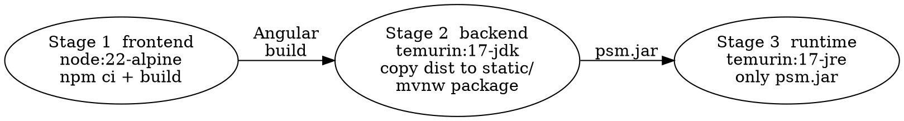
| Stage | Base image | What it does |
| --- | --- | --- |
| 1 `frontend` | `node:22.23.2-alpine` | `npm ci`, then `npm run build -- --configuration production` |
| 2 `backend` | `eclipse-temurin:17-jdk` | Downloads Maven dependencies, copies `src`, copies the Angular build into `src/main/resources/static/`, runs `./mvnw -DskipTests package` |
| 3 `runtime` | `eclipse-temurin:17-jre` | Copies only `psm.jar`, creates a non-root `atelier` user, sets `JAVA_OPTS=-XX:MaxRAMPercentage=75`, adds a `HEALTHCHECK` on `/actuator/health/readiness`, starts `java -jar /app/psm.jar` |

The final image contains no Node, no Maven and no source code: only a JRE and the jar. It is smaller and safer.

### How Spring serves Angular from the jar
Spring Boot automatically serves anything in `classpath:/static/` as web files. `SpaWebConfig` adds one rule: if a requested path is not a real file, is not `/api/` and not `/ws`, and has no file extension, it returns `index.html`.

| Request | Answer |
| --- | --- |
| `/main-ABC123.js` | The real JS file from `static/` |
| `/api/artworks` | The REST controller (JSON) |
| `/studio/users` (refresh) | `index.html`, then the Angular router shows the Users page |
| `/missing.png` | 404 (it has an extension, so no fallback) |

This is what lets a deep link like `/artworks/oleanders` survive a browser refresh.

### Why this helps the deployment
- **One artifact to ship:** the server only needs Java 17 (or Docker). No Nginx is required to serve the frontend and no separate Node server.
- **Same origin:** the site and the API share one URL and port, so there are no CORS problems and relative URLs just work.
- **Build once, run anywhere:** the jar built and tested on the laptop is what runs on EC2. We shipped the Docker image that wraps it, so nothing was compiled on the 2 GiB server.
- **Configured by environment:** the same jar runs in dev, test and production; only the environment variables change (`DB_URL`, `JWT_SECRET`, `SMTP_*`, `PUBLIC_URL`).
- **Self-checking:** the Actuator readiness endpoint lets Docker and Compose know when the app is ready.
- **Easy rollback:** each image tag is an immutable version; switching `ATELIER_VERSION` back restores the previous release.

### Running the jar directly (without Docker)
```bash
export DB_URL='jdbc:mysql://localhost:3306/atelier?serverTimezone=UTC'
export DB_USER=atelier DB_PASSWORD=... JWT_SECRET=...   # at least 32 bytes
export PUBLIC_URL=http://localhost:8080 CORS_ORIGINS=http://localhost:8080
java -jar psm.jar
# open http://localhost:8080: Angular site; /api/... is the REST API
```
Check that Angular is inside: `unzip -l psm.jar | grep static/index.html`.

# Testing the API with Postman
The CDC asks to test the APIs in Postman (step 3). ATELIER ships a full collection, `postman/ATELIER.postman_collection.json`, with **103 requests and 175 assertions**, all passing when run with Newman.

```stats
[{"value":"103","label":"requests"},{"value":"175","label":"assertions"},{"value":"0","label":"failures"},{"value":"10","label":"folders"}]
```

### Postman vocabulary
| Term | Meaning |
| --- | --- |
| Collection | A saved set of requests, organised in folders |
| Variable `{{name}}` | A placeholder replaced at run time, for example `{{baseUrl}}/api/auth/login` |
| Collection variables | Shared values: `baseUrl`, demo emails, and values saved during the run (`adminToken`, `artistId`) |
| Auth tab | Per request: `noauth` or `Bearer Token` with `{{curatorToken}}` |
| Tests script | JavaScript run after the response, with `pm.test(...)` and `pm.expect(...)` |
| Collection Runner | Runs every request in order and shows pass or fail |
| **Newman** | Postman's command-line runner, so the same collection runs in a terminal or CI |

### How requests are chained
The first folder logs in three demo users and **saves their tokens** in variables. Later requests reuse them, which is how the Angular interceptor behaves.

```javascript
// Tests tab of "Login as administrator"
pm.test("Status is 200", function () {
    pm.response.to.have.status(200);
});
pm.test("Admin token and id saved", function () {
    var json = pm.response.json();
    pm.collectionVariables.set("adminToken", json.token);
    pm.collectionVariables.set("adminId", json.user.id);
    pm.expect(json.user.roles).to.include("ADMIN");
});
```
A "Create artist" request then saves `artistId`, and the next requests use `/api/studio/artists/{{artistId}}`. The run creates its own data and deletes it at the end.

### The 10 folders
| Folder | Requests | What it proves |
| --- | --- | --- |
| 0 Auth | 7 | Login as admin, curator (Collaborateur), bidder; wrong password 401; register; duplicate email 409; `/me` |
| 1 Clients (Artists) | 8 | Curator lists, creates, reads; admin updates and deletes; **Collaborateur update and delete give 403** |
| 2 Projets (Exhibitions) | 8 | Same CRUD and role checks; **an artist with an exhibition can't be deleted (409)**, the One-to-Many FK |
| 3 Artworks | 9 | CRUD, role checks, an artwork used by an auction can't be deleted (409) |
| 4 Auctions | 10 | Create auction, overlap refused, place bid, already leading refused, bid history, cancel |
| 5 Account | 6 | My bids and wins, profile update, wrong current password 409, password change and restore |
| 6 Users (admin) | 15 | Full user CRUD, role assignment, enable and disable, self-demotion and self-delete refused, Collaborateur can't create users |
| 7 Public gallery | 7 | Anonymous reads; unknown slug 404 |
| 8 Security checks | 7 | Anonymous 401, bidder in Studio 403, admin bidding 403, curator on auctions 403 |
| 9 Roles (admin CRUD) | 26 | Create, read, rename, delete roles; assigned role protected; system role protected; a custom role grants Collaborateur rights by ID |


### How to run it
Prerequisite: the backend running with `DEMO_DATA=true` (the dev Docker stack does it) and the bootstrap admin of `.env.example`.

**In Postman:** Import, select the JSON file, check the `baseUrl` variable (`http://localhost:8080`), Run collection, keep the order.

**With Newman:**
```bash
npx newman run postman/ATELIER.postman_collection.json \
  --env-var baseUrl=http://localhost:8080
```
The run was recorded as screenshots and an HTML report.

```cols

---

```

### How Postman maps to the CDC
| CDC step | Postman proof |
| --- | --- |
| 3. Test the APIs | Every endpoint of every resource is called with assertions |
| 6. Test login and registration | Folder 0 |
| 7. Test Client and Projet under security | Folders 1, 2 and 8: 401 without token, 403 for the wrong role, 200, 201 or 204 for the right one |
| 10. Respect roles | Collaborateur can view and add but gets 403 on update and delete |

Postman tests the running API from the outside, like a real client. The Java integration tests (`SecurityMatrixIT`, `AuthIT`) test the same rules from inside with a real MySQL. Both layers agree.

# Deployment on the VPS
On 18 and 19 November 2026 ATELIER was deployed to an AWS EC2 Ubuntu server with Docker Compose and published over HTTPS through a Cloudflare Quick Tunnel. The readiness endpoint returned `{"status":"UP"}`, and the remote smoke test passed 10 checks out of 10.

### Key concepts
- **VPS** (Virtual Private Server): a real Linux machine in the cloud that you administer (OS, firewall, Docker, backups). EC2 is AWS's VPS; this is IaaS (Infrastructure as a Service).
- **Docker image:** an immutable package of the app and its runtime. **Container:** a running instance of an image.
- **Docker Compose:** starts several containers together from one YAML file (`app` + `db`).
- **Docker volume:** storage that survives container recreation; it holds the MySQL data (`mysql_data`).
- **Tunnel:** `cloudflared` opens an *outbound* connection from EC2 to Cloudflare, which gives a public HTTPS URL. No inbound port (8080, 3306) needs to be opened.

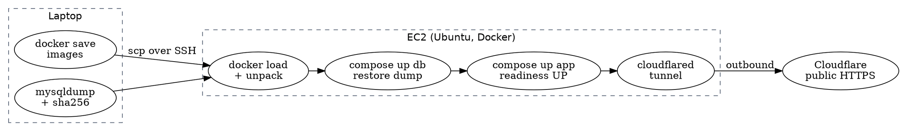
Nothing is compiled on the small server. The laptop ships finished images and a database dump; EC2 only loads, restores and runs them. The public URL comes from the tunnel and is written back into `PUBLIC_URL`.

### The server
| Setting | Value |
| --- | --- |
| Region | eu-north-1 (Stockholm) |
| Instance | `atelier-vps`, `t3.small`, 2 GiB RAM + 2 GiB swap |
| OS | Ubuntu 26.04.1 LTS amd64 |
| Disk | about 20 GiB |
| Login | user `ubuntu` with a private `.pem` SSH key |
| Firewall (Security Group) | SSH port 22 only, restricted to the workstation IPv4 /32 |
| Software | Docker 29.1.3, Docker Compose 2.40.3 |
| Release | Git commit `8b8d033`, image `smartsoft/atelier:mail-design-20261118` |

### Step by step
**Step 1: package on the laptop.** The image was already built and tested locally, so it was exported instead of rebuilt on a 2 GiB server.

```bash
git archive --format=tar.gz --output="$RELEASE/atelier-source.tar.gz" HEAD
sudo docker image save "$IMAGE" mysql:8.4.13 | gzip -1 > "$RELEASE/atelier-images.tar.gz"
install -m 600 deployment/.env.prod "$RELEASE/.env.prod"
```
Source was about 26 MB and images about 425 MB compressed. `docker save` exports images, not containers or data.

**Step 2: export the database.** A logical backup (SQL `CREATE` and `INSERT`) of the local audit database:

```bash
sudo docker exec atelier-audit-db sh -c 'MYSQL_PWD="$MYSQL_PASSWORD" exec mysqldump \
  -u"$MYSQL_USER" --single-transaction --no-tablespaces --set-gtid-purged=OFF \
  "$MYSQL_DATABASE"' | gzip -1 > "$RELEASE/atelier-audit-preliminary.sql.gz"
sha256sum atelier-*.tar.gz atelier-*.sql.gz > SHA256SUMS
```
`--single-transaction` gives a consistent InnoDB snapshot without locking. The dump held 7 artists, 30 artworks, 10 auctions, 13 bids, 6 exhibitions, 6 users, 3 roles, 6 user_roles and 3 Flyway history rows.

**Step 3: create the EC2 instance and connect over SSH.**

```bash
chmod 400 "$KEY"
ssh -i "$KEY" -o IdentitiesOnly=yes ubuntu@<EC2_PUBLIC_IP> 'hostname; free -h; df -h /'
```
Lesson learned: SSH first timed out because the Security Group allowed only an IPv6 range while the laptop used IPv4. Setting the rule to "My IP" (IPv4 /32) fixed it.

**Step 4: install Docker and swap on the server.**

```bash
sudo apt-get install -y docker.io docker-compose-v2
sudo systemctl enable --now docker
sudo fallocate -l 2G /swapfile && sudo chmod 600 /swapfile
sudo mkswap /swapfile && sudo swapon /swapfile
echo '/swapfile none swap sw 0 0' | sudo tee -a /etc/fstab
```
Swap protects against out-of-memory crashes during spikes on 2 GiB of RAM.

**Step 5: transfer the release securely.**

```bash
scp -i "$KEY" atelier-images.tar.gz atelier-source.tar.gz \
  atelier-audit-preliminary.sql.gz SHA256SUMS .env.prod "${SERVER}:atelier-stage/"
ssh -i "$KEY" "$SERVER" 'cd ~/atelier-stage && chmod 600 .env.prod && sha256sum -c SHA256SUMS'
```
Lesson learned: `"$SERVER:atelier-stage/"` was expanded wrongly by the shell; `"${SERVER}:atelier-stage/"` fixes the variable boundary. The checksum verifies nothing was corrupted.

**Step 6: unpack and load the images.**

```bash
sudo mkdir -p /opt/atelier && sudo chown ubuntu:ubuntu /opt/atelier
tar -xzf ~/atelier-stage/atelier-source.tar.gz -C /opt/atelier
install -m 600 ~/atelier-stage/.env.prod /opt/atelier/deployment/.env.prod
gzip -dc ~/atelier-stage/atelier-images.tar.gz | sudo docker image load
```

**Step 7: start MySQL first, then restore the dump.**

```bash
sudo docker compose -f deployment/compose.prod.yaml --env-file deployment/.env.prod \
  up -d --no-build --pull never --wait db
gzip -dc ~/atelier-stage/atelier-audit-preliminary.sql.gz | sudo docker compose \
  -f deployment/compose.prod.yaml --env-file deployment/.env.prod exec -T db \
  sh -c 'MYSQL_PWD="$MYSQL_ROOT_PASSWORD" exec mysql -uroot "$MYSQL_DATABASE"'
```
The first start of the MySQL container creates the database and user from the environment. The restore goes into that fresh database; a count check confirmed 30 artworks and 6 users. Because `flyway_schema_history` came with the dump, Flyway sees V1 to V3 as applied and does nothing.

**Step 8: start the application.**

```bash
sudo docker compose -f deployment/compose.prod.yaml --env-file deployment/.env.prod \
  up -d --no-build --pull never --wait app
curl -fsS http://127.0.0.1:8080/actuator/health/readiness   # {"status":"UP"}
```
`depends_on: condition: service_healthy` makes the app wait for MySQL's health check. The port is bound to the local interface only, and 3306 is never published.

**Step 9: publish with Cloudflare.**

```bash
sudo docker run -d --name atelier-cloudflare --restart unless-stopped \
  --network host cloudflare/cloudflared:latest \
  tunnel --no-autoupdate --url http://127.0.0.1:8080
sudo docker logs atelier-cloudflare --tail 60    # shows the public HTTPS URL
```
A first version protected access with an email one-time PIN (`--allowed-mail`); it was then replaced by an open Quick Tunnel for the public demo.

**Step 10: align `PUBLIC_URL`.** The tunnel URL feeds email links and CORS, so after each new tunnel URL:

```bash
sudo sed -i "s|^PUBLIC_URL=.*|PUBLIC_URL=$PUBLIC_URL|" deployment/.env.prod
sudo docker compose -f deployment/compose.prod.yaml --env-file deployment/.env.prod \
  up -d --no-build --pull never --force-recreate --wait app
```


### Production configuration (names only, no values)
| Group | Variables |
| --- | --- |
| Database | `MYSQL_DATABASE`, `MYSQL_USER`, `MYSQL_PASSWORD`, `MYSQL_ROOT_PASSWORD`, `DB_URL` |
| Identity | `JWT_SECRET`, `BOOTSTRAP_ADMIN_EMAIL`, `BOOTSTRAP_ADMIN_PASSWORD`, `ADMIN_EMAIL` |
| Release | `ATELIER_VERSION`, `APP_PORT`, `DEMO_DATA`, `PUBLIC_URL`, `CORS_ORIGINS` |
| Email | `MAIL_FROM`, `SMTP_HOST`, `SMTP_PORT`, `SMTP_USER`, `SMTP_PASSWORD`, `SMTP_AUTH`, `SMTP_TLS` |

`compose.prod.yaml` uses `${VAR:?Set VAR}` for required secrets, so Compose refuses to start if one is missing. `.env.prod` is `chmod 600` and never committed.

### Day-2 operations
| Task | Command (inside `/opt/atelier`) |
| --- | --- |
| Status | `sudo docker compose -f deployment/compose.prod.yaml --env-file deployment/.env.prod ps` |
| Health | `curl -fsS http://127.0.0.1:8080/actuator/health/readiness` |
| Logs | `sudo docker logs --tail 100 atelier-prod-app-1` (also `-db-1`, `atelier-cloudflare`) |
| System | `free -h && df -h / && sudo docker system df` |
| Restart app | the same Compose command with `restart app` |
| Backup DB | `mysqldump --single-transaction` piped to `gzip` into `~/atelier-backup-<date>.sql.gz` |

**New release:** test locally, tag the image (for example with the Git SHA), back up MySQL, `docker save`, `scp`, `docker image load`, change `ATELIER_VERSION` in `.env.prod`, recreate only `app`, then smoke-test. **Rollback** means putting back the previous `ATELIER_VERSION` and recreating.

**Never** run `docker compose down -v`: `-v` deletes the MySQL volume.

### Why a VPS and not Vercel or Render?
| Topic | AWS EC2 VPS | Render | Vercel |
| --- | --- | --- | --- |
| Unit deployed | Full VM with Compose, app and MySQL | Web service from Git or Docker | Frontend + serverless functions |
| Long-running Spring Boot | Natural fit | Natural fit | Not the model |
| MySQL | Self-hosted in a Docker volume | External MySQL needed (managed DB is PostgreSQL) | External DB needed |
| Live WebSocket auctions | Persistent server | Supported | Functions beta, time-limited |
| OS control | Full (SSH, apt) | Low | Very low |
| Responsibility | Highest (patches, backups) | Medium | Lowest |

The VPS runs the **same two images as on the laptop with no refactoring**, which keeps the WebSocket server and MySQL intact. The cost is that we own security, backups and uptime.

### Troubleshooting
| Symptom | Likely cause | First check |
| --- | --- | --- |
| SSH timeout | Security Group IP, wrong public IP | Inbound rule is My IP, IPv4 /32 |
| `Permission denied (publickey)` | Wrong key, user or permissions | `chmod 400 KEY`, user `ubuntu` |
| App unhealthy or 502 | JVM memory, DB not ready | `docker logs atelier-prod-app-1` |
| Public link changed | Quick Tunnel restarted | Tunnel logs, update `PUBLIC_URL` |
| Home works, a deep link fails | SPA fallback, guard, JS error, API path | Browser DevTools Console and Network |
| Emails not arriving | SMTP auth, egress, sender rights | App logs, test from the server |
| WebSocket disconnected | Origin, proxy, idle limits | Browser WS frames, server logs |

### Hardening roadmap
- Replace the Quick Tunnel by a named Cloudflare Tunnel on a stable domain.
- Keep SSH restricted; consider key rotation and AWS SSM Session Manager.
- Change imported demo and admin passwords before wider exposure (`DEMO_DATA=false` stops seeding but does not remove existing accounts).
- Daily encrypted backups off the instance, with tested restores.
- Memory, CPU and disk alerts, log retention, an OS update policy, AWS billing alarms.

# The tools, one by one

This chapter walks through every tool used in ATELIER, layer by layer. Each tool has the same four parts: what it is in general, how it works inside, how ATELIER uses it (with real file paths), and a typical oral-exam question. Versions were read from `backend/pom.xml`, `frontend/package.json`, `Dockerfile`, `compose.yaml` and the resolved Maven classpath. Spring Boot manages most backend versions, so those are the versions Boot 3.5.16 actually resolves.

### How to use this chapter
Read the summary table first, so you know the whole map. Then read one layer at a time. For each tool, make sure you can say the "typical question" answer without looking.

Two honest remarks before you start:
- Playwright is **not** a test tool in ATELIER. It appears only in `docs/build/package.json`, where it renders the PDF documents and captures screenshots. It is therefore not described as a testing tool below.
- Cloudflare Tunnel (`cloudflared`) is **not defined in the repository**. `docs/DEMO.md` says a cloudflared container runs on the EC2 server, but no file in `deployment/` creates it. What is described below about it is general knowledge plus what the docs state.

## Summary table

| Tool | Layer | Version | One-line role in ATELIER |
|---|---|---|---|
| Java | Backend | 17 (`java.version`) | Language and runtime of the API |
| Spring Boot | Backend | 3.5.16 (Spring Framework 6.2.19) | Wires and starts the whole server |
| Maven + wrapper | Backend | wrapper 3.3.4, Maven 3.9.11 | Builds `psm.jar`, runs tests |
| Spring MVC + Tomcat | Backend | MVC 6.2.19, Tomcat 10.1.55 | Receives HTTP, routes to controllers |
| Jackson | Backend | 2.21.4 | Java records to JSON and back |
| Bean Validation | Backend | Hibernate Validator 8.0.3 | Rejects bad request bodies (`@Valid`) |
| Spring Data JPA | Backend | 3.5.13 | Repositories with no SQL boilerplate |
| Hibernate | Backend | 6.6.53.Final | Maps entities to tables, builds SQL |
| HikariCP | Backend | 6.3.3 | Pool of reusable DB connections |
| MySQL Connector/J | Backend | 9.7.0 | JDBC driver for MySQL |
| Flyway | Backend | 11.7.2 | Versioned schema migrations V1 to V3 |
| Spring Security | Backend | 6.5.11 | Filter chain, role matrix, 401/403 |
| JJWT | Backend | 0.12.6 | Signs and verifies JWT access tokens |
| BCrypt | Backend | in spring-security-crypto | Password hashing |
| Spring WebSocket + STOMP | Backend | 6.2.19 | Live auction events on `/topic/auctions` |
| Spring Mail / Jakarta Mail | Backend | Jakarta Mail 2.0.5 | Sends HTML emails over SMTP |
| `@Async` executor | Backend | Spring 6.2.19 | Sends mail off the request thread |
| `@Scheduled` | Backend | Spring 6.2.19 | Opens and closes auctions on time |
| Actuator | Backend | 3.5.16 | `/actuator/health/readiness` for Docker and deploy |
| Lombok | Backend | 1.18.46 | `@Getter`/`@Setter` on entities |
| DevTools | Backend | 3.5.16 | Auto-restart in the dev Compose stack |
| MySQL | Database | 8.4.13 (image tag) | The only datastore |
| InnoDB | Database | engine of MySQL 8.4 | Transactions, row locks, foreign keys |
| utf8mb4 | Database | `utf8mb4_unicode_ci` | Full Unicode text |
| Angular | Frontend | 22.2 (`^22.2.0`, installed 22.2.6) | The single-page app |
| TypeScript | Frontend | 6.0 (`~6.0.2`, installed 6.0.3) | Typed language of the SPA |
| RxJS | Frontend | 7.8.2 | Streams for HTTP and WebSocket events |
| HttpClient + interceptor | Frontend | Angular 22.2 | Calls `/api`, adds the JWT |
| Angular Router + guards | Frontend | Angular 22.2 | Pages, lazy loading, role checks |
| @stomp/stompjs | Frontend | 7.5.0 | STOMP client for the auction room |
| GSAP + ScrollTrigger + Flip | Frontend | 3.15.1 | Scroll and image-transition animations |
| Tailwind CSS | Frontend | 4.3.5 | Utility-class styling |
| spartan/ui (hlm) | Frontend | brain 1.9.0, CLI 1.9.0 | Accessible UI components, copied into the repo |
| Chart.js | Frontend | 4.5.1 | Studio charts |
| Vitest | Frontend | 5.0 (`^5.0.0`, installed 5.1.0) | Frontend unit tests via `ng test` |
| JUnit 5 | Testing | 5.12.2 (Boot-managed) | Backend test engine |
| Spring Boot Test + MockMvc | Testing | 3.5.16 | Full-context HTTP tests without a network |
| Testcontainers | Testing | 1.21.4 | Real MySQL 8.4.13 in tests |
| Postman + Newman | Testing | collection of 103 requests | Scenario tests of the REST API |
| Git + GitHub | Delivery | n/a | Source control, pull requests |
| GitHub Actions | Delivery | `checkout@v4`, `setup-java@v4`, `setup-node@v4` | CI: tests, build, image |
| Docker (multi-stage) | Delivery | node 22.23.2, Temurin 17 | One production image |
| Docker Compose | Delivery | compose file spec | Dev stack and prod stack |
| Mailpit | Delivery | v1.34.0 | Fake SMTP server with a web inbox |
| AWS EC2 + Ubuntu | Infra | t3.small, Ubuntu | The production host |
| Cloudflare Tunnel | Infra | Quick Tunnel (`trycloudflare.com`) | HTTPS public address, no open inbound port |
| Node + frontend-maven-plugin | Delivery | Node 22.23.2, plugin 1.15.1 | Builds Angular inside Maven |

## Backend

> Spring Boot is a set of defaults: add a starter, and the matching piece (server, pool, ORM, mail) is created and wired for you.

### Java 17
**What it is (in general):** Java is a statically typed language that compiles to bytecode, which runs on the JVM. "17" is a long-term-support release. It gives records, text blocks, sealed classes and a mature garbage collector, so it suits long-running servers.

**How it works inside:**
- `javac` turns `.java` into `.class` bytecode; the JVM loads and just-in-time compiles hot code to machine code.
- The garbage collector frees objects that are no longer reachable; you never free memory by hand.
- Records (`record Foo(...)`) are immutable data carriers with generated `equals`, `hashCode` and accessors.
- The JDK compiles, the JRE only runs. That is why the Docker build uses a JDK stage and the runtime uses a JRE.

**In ATELIER:** `backend/pom.xml` sets `<java.version>17</java.version>`. The `Dockerfile` builds on `eclipse-temurin:17-jdk` and runs on `eclipse-temurin:17-jre`. Records are used for every DTO and for settings, for example `AtelierProperties` in `backend/src/main/java/com/sip/psm/config/AtelierProperties.java` and `AuthDtos.RegisterRequest`. Text blocks appear in JPQL queries in `AuctionRepository`.

**Typical question:** Why Java 17 and not 21? **Answer:** 17 is an LTS release that Spring Boot 3.5 supports and the course environment uses; nothing in the project needs a newer feature, and CI and Docker pin 17 so everybody builds the same bytecode.

### Spring Boot 3.5.16
**What it is (in general):** Spring Boot is a layer on top of the Spring Framework. Instead of writing XML or long configuration classes, you add "starters" (dependencies) and Boot configures what it finds on the classpath. It also packages everything into one runnable jar with an embedded web server.

**How it works inside:**
- `@SpringBootApplication` turns on component scanning and auto-configuration.
- Auto-configuration classes are conditional: for example "if `DataSource` and Hibernate are on the classpath and no bean of my own exists, create one".
- The Spring container creates beans (singletons) and injects dependencies, here through constructors.
- Settings come from `application.yml`, environment variables and command line, in a defined priority; `${DB_URL:default}` means "env var, else default".
- The Boot Maven plugin repackages the app as a "fat jar" (`BOOT-INF/classes`, `BOOT-INF/lib`) started by `java -jar`.

**In ATELIER:** the parent POM is `spring-boot-starter-parent` 3.5.16 in `backend/pom.xml`; the entry point is `AtelierApplication`. Typed settings live in `AtelierProperties` (prefix `atelier`, validated at startup). `finalName` is `psm`, so the build produces `target/psm.jar`. Startup order that matters: Flyway migrates, Hibernate validates, then `RoleAndAdminInitializer` (an `ApplicationRunner`) creates roles and the first admin.

```yaml
# backend/src/main/resources/application.yml (extract)
spring:
  datasource:
    url: ${DB_URL:jdbc:mysql://localhost:3306/atelier?serverTimezone=UTC&useUnicode=true&characterEncoding=utf8}
    username: ${DB_USER:atelier}
atelier:
  jwt:
    secret: ${JWT_SECRET:}
```

**Typical question:** What does Spring Boot do that plain Spring does not? **Answer:** It auto-configures beans from the classpath and from properties, embeds Tomcat, and packages one executable jar, so a working server needs only a few starters and an `application.yml`.

### Maven and the Maven wrapper
**What it is (in general):** Maven is a build tool for Java. A `pom.xml` lists dependencies and plugins; Maven downloads them from a repository and runs a fixed lifecycle (compile, test, package, verify). The wrapper (`mvnw`) is a script that downloads the exact Maven version, so nobody needs Maven installed.

**How it works inside:**
- Lifecycle phases run in order: `generate-resources`, `compile`, `test`, `package`, `integration-test`, `verify`. Plugins bind to phases.
- Dependencies are resolved transitively and cached in `~/.m2`.
- The parent POM supplies a "bill of materials": versions of hundreds of libraries that are known to work together.
- Surefire runs `*Test` classes in `test`; Failsafe runs `*IT` classes in `integration-test` and checks them in `verify`.

**In ATELIER:** `backend/mvnw` and `backend/.mvn/wrapper/maven-wrapper.properties` (wrapper 3.3.4, `apache-maven-3.9.11`). `pom.xml` configures `maven-failsafe-plugin`, which is why `./mvnw verify` also runs the `*IT` integration tests. The opt-in profile `with-frontend` builds Angular (see the frontend-maven-plugin entry). CI runs `./mvnw -B verify`; the Dockerfile runs `./mvnw -q -B -DskipTests package`.

**Typical question:** Why use `mvnw` and not `mvn`? **Answer:** The wrapper pins the Maven version in the repository, so a new machine, CI and Docker all build with Maven 3.9.11 without any installation.

### Spring Web (Spring MVC) and embedded Tomcat
**What it is (in general):** Spring MVC maps HTTP requests to controller methods. Tomcat is the servlet container that listens on a port, parses HTTP, and hands each request to a thread. "Embedded" means Tomcat runs inside your application, not as a separate server.

**How it works inside:**
- Tomcat accepts a connection and takes a worker thread from its pool (200 by default).
- The request passes through servlet filters (Spring Security is one), then the `DispatcherServlet`.
- `DispatcherServlet` finds the handler by URL and method (`@GetMapping`, `@PostMapping`), converts the body with Jackson, calls the method, converts the return value back.
- `@RestControllerAdvice` catches exceptions and builds the error response.

**In ATELIER:** controllers per feature, for example `auction/AuctionController`, `auction/StudioAuctionController`, `auth/AuthController`. Errors are normalised by `common/ApiExceptionHandler` into RFC 9457 `ProblemDetail` JSON with stable codes such as `validation_failed` and `not_found`. `web/SpaWebConfig` serves the Angular files from `classpath:/static/` and falls back to `index.html` for deep links like `/artworks/the-starry-night`, while refusing to do that for `api/` and `ws` paths. Port is `server.port: ${PORT:8080}`. `server.forward-headers-strategy: framework` makes the app trust `X-Forwarded-*` headers from a proxy; `server.compression` gzips JSON, HTML, CSS and JS.

**Typical question:** How does a refresh on `/artworks/some-slug` work in a single-page app? **Answer:** The browser asks the server for that path, which is not a real file; `SpaWebConfig` returns `index.html`, Angular boots and its router shows the right page.

### Jackson
**What it is (in general):** Jackson converts Java objects to JSON text (serialisation) and back (deserialisation). Spring MVC uses it for every `@RequestBody` and for every returned object.

**How it works inside:**
- It reads class structure by reflection (record components, getters) to decide JSON field names.
- Modules add types: the JavaTime module writes `Instant` as ISO-8601 text.
- Unknown or wrongly typed input raises an exception, which Spring turns into a 400.
- `default-property-inclusion: non_null` drops null fields from the output.

**In ATELIER:** configured under `spring.jackson` in `application.yml` (`non_null`, `write-dates-as-timestamps: false`). `ApiExceptionHandler` handles `HttpMessageNotReadableException` and `InvalidFormatException`, so a bad enum or date value gives a clean 400 problem response. Dates such as `endsAt` reach Angular as ISO strings (UTC).

**Typical question:** Why is `endsAt` a string like `2026-11-19T18:00:00Z` and not a number? **Answer:** `write-dates-as-timestamps: false` makes Jackson emit ISO-8601, which JavaScript can parse and which carries the UTC zone explicitly.

### Bean Validation (Jakarta Validation, Hibernate Validator)
**What it is (in general):** A standard way to declare rules as annotations (`@NotBlank`, `@Email`, `@Size`) on fields. A validator checks an object against them and reports every violated rule.

**How it works inside:**
- The annotation holds the rule; a validator class implements the check.
- Spring MVC runs validation when a parameter is annotated `@Valid`; violations raise `MethodArgumentNotValidException` before your method runs.
- `@Validated` on a `@ConfigurationProperties` class validates settings at startup.

**In ATELIER:** request records such as `AuthDtos.RegisterRequest` (`@NotBlank`, `@Email`, `@Size(min = 8, max = 72)` on the password; the 72 matches BCrypt's input limit). Controllers use `@Valid @RequestBody`. `ApiExceptionHandler.invalid` collects field errors into `{"code":"validation_failed","fields":{...}}`, and the Angular forms show those messages. `AtelierProperties` is `@Validated`, so a missing `ADMIN_EMAIL`-type setting stops the application at boot. There is also a custom constraint, `user/ValidRoleSelection`.

```java
public record LoginRequest(@NotBlank @Email String email, @NotBlank String password) {}
```

**Typical question:** Where are request bodies validated, and what does the client get on failure? **Answer:** In the controller via `@Valid`; on failure `ApiExceptionHandler` returns HTTP 400 with code `validation_failed` and a map of field name to message.

### Spring Data JPA
**What it is (in general):** Spring Data generates repository implementations from interfaces. You declare `findByEmailIgnoreCase(String)` and Spring builds the query from the method name; for harder cases you add `@Query`.

**How it works inside:**
- At startup Spring creates a proxy for each `extends JpaRepository<T, ID>` interface.
- Method names are parsed into JPQL; `@Query` gives explicit JPQL; `Pageable` adds `LIMIT`/`OFFSET` and a count query.
- `@Lock` adds a lock mode to the generated query; `@EntityGraph` says which associations to fetch in the same query (avoids N+1).
- Each repository call joins the current transaction if there is one.

**In ATELIER:** one repository per entity, for example `auction/AuctionRepository`. It shows three features: a pessimistic lock query, entity graphs, and a scheduler query.

```java
@Lock(LockModeType.PESSIMISTIC_WRITE)
@Query("select a from Auction a where a.id = :id")
Optional<Auction> findByIdForUpdate(@Param("id") Long id);
```

`@Transactional` lives on services such as `BidService` and `AuctionService`. `spring.jpa.open-in-view: false`, so lazy loading outside a service transaction fails instead of silently hitting the database from the view layer, which is why the repository uses `@EntityGraph`.

**Typical question:** What does `findByIdForUpdate` generate? **Answer:** A `SELECT ... FOR UPDATE` on the auction row, so a second transaction waits until the first commits.

### Hibernate (JPA implementation) 6.6
**What it is (in general):** Hibernate is an object-relational mapper. Annotated classes (`@Entity`) are mapped to tables; Hibernate generates the SQL and converts rows to objects and back.

**How it works inside:**
- The **persistence context** (first-level cache) lives inside a transaction. Loading the same row twice returns the same object.
- **Dirty checking:** at flush time Hibernate compares each managed entity with its loaded snapshot and issues `UPDATE` only for changed fields. That is why `auction.placeBid(...)` needs no explicit `save` on the auction.
- **Flush** sends pending SQL to the database (before a query, on `flush()`, and at commit). **Commit** makes it durable.
- `@Version` gives optimistic locking: `UPDATE ... WHERE id=? AND version=?`; zero rows updated means someone else changed it.
- Lazy associations load through proxies on first access.

**In ATELIER:** entities in each feature package (`Auction`, `Bid`, `Artwork`, `User`, `Role`...). Settings: `ddl-auto: validate`, so Hibernate never changes the schema, it only checks that entities match the tables Flyway created; `hibernate.jdbc.time_zone: UTC`. `Auction` has a `@Version long version` field and `BidService` takes a pessimistic lock on top: the lock serialises bids, the version is a second safety net and is exposed in `AuctionView`.

**Typical question:** What is dirty checking? **Answer:** Hibernate remembers the state of each loaded entity and, at flush, writes an `UPDATE` for any entity whose fields differ, so changing a field inside a transaction is enough to persist it.

### HikariCP 6.3.3
**What it is (in general):** Opening a database connection is slow (TCP, authentication). A connection pool opens a few connections once and lends them out. HikariCP is the fast default pool in Spring Boot.

**How it works inside:**
- On first use it opens up to `maximumPoolSize` connections (10 by default).
- A thread calls `getConnection()`: it borrows an idle connection; `close()` does not close it but returns it to the pool.
- If all are busy the caller waits up to a timeout (30 s by default), then fails.
- Idle and old connections are retired and replaced; a pool that is too small makes requests queue, one that is too big overloads MySQL.

**In ATELIER:** no `hikari` keys appear in `application.yml`, so the defaults apply. Boot creates the pool from `spring.datasource.*`. A `@Transactional` method borrows one connection for its whole duration, which is why `BidService.placeBid` keeps the row lock on a single connection until commit.

**Typical question:** Why a pool? **Answer:** Creating a connection per request is too slow; the pool reuses a bounded set of connections and protects MySQL from unlimited parallel connections.

### MySQL Connector/J 9.7.0
**What it is (in general):** The JDBC driver: the library that speaks the MySQL wire protocol so Java code can send SQL and read results through the standard `java.sql` API.

**How it works inside:**
- JDBC URL `jdbc:mysql://host:3306/db?...` chooses the driver, host and options.
- The driver opens a TCP socket, authenticates, sends statements, parses result sets.
- URL options set encoding and the session time zone.

**In ATELIER:** declared in `pom.xml` with `runtime` scope (code never imports it). URL comes from `DB_URL`. Local default: `jdbc:mysql://localhost:3306/atelier?serverTimezone=UTC&useUnicode=true&characterEncoding=utf8`. In Compose: `jdbc:mysql://db:3306/atelier?serverTimezone=UTC`, where `db` is the Compose service name.

**Typical question:** What does `runtime` scope mean for the driver? **Answer:** It is needed when the app runs but not to compile it, because our code only uses JPA/JDBC interfaces and never the driver's classes.

### Flyway 11.7.2
**What it is (in general):** A database migration tool. You write SQL scripts with version numbers; Flyway applies the ones the database has not seen yet, in order, so every environment reaches the same schema.

**How it works inside:**
- On startup it creates (if missing) the table `flyway_schema_history`.
- It scans `classpath:db/migration` for files named `V<version>__<description>.sql`.
- It compares each script's **checksum** with the recorded one. If an applied script was edited, startup fails: applied migrations are immutable.
- Pending scripts run in version order, each recorded with version, checksum, time and success flag.
- `flyway-mysql` adds MySQL-specific support (required for newer MySQL versions).

**In ATELIER:** `backend/src/main/resources/db/migration/`: `V1__core_schema.sql` (users, roles, user_roles, artists, exhibitions), `V2__artworks_auctions_bids.sql`, `V3__dynamic_roles.sql`. Config: `spring.flyway.enabled: true`, `locations: classpath:db/migration`. Flyway runs before Hibernate validation. `docs/DEPLOYMENT.md` states migrations are forward-only; to undo one you restore a backup. Tests run the real migrations on a Testcontainers MySQL, and `user/RoleMigrationIT` checks the V3 migration.

**Typical question:** Why not let Hibernate create the tables (`ddl-auto=update`)? **Answer:** It gives no history, no review, and can silently diverge between environments; Flyway makes the schema a reviewed, versioned part of the code and Hibernate only validates it.

### Spring Security 6.5.11
**What it is (in general):** A framework that protects a web app with a chain of servlet filters. They authenticate the request (who is it?) and authorise it (may it do this?), and they handle errors such as 401 and 403.

**How it works inside:**
- Every request goes through the `SecurityFilterChain`, a list of filters in a fixed order.
- A filter that authenticates puts an `Authentication` object into the `SecurityContextHolder` (thread-local for this request).
- `authorizeHttpRequests` rules are checked in order; first match wins.
- `STATELESS` session policy means no `HttpSession`; every request must carry its own proof (here, a token).
- Failures go to an `AuthenticationEntryPoint` (401) or `AccessDeniedHandler` (403).

**In ATELIER:** `config/SecurityConfig.java`. CSRF is disabled (no cookie session, the token is in a header, not sent automatically by the browser). `JwtAuthenticationFilter` runs before `UsernamePasswordAuthenticationFilter`. The matrix: public reads of artworks, artists, exhibitions and auctions; `POST /api/auctions/*/bids` only `BIDDER`; `/api/admin/**` and `/api/studio/auctions/**` only `ADMIN`; studio GET and POST for `ADMIN` and `COLLABORATEUR`; PUT and DELETE for `ADMIN`. `@EnableMethodSecurity` adds `@PreAuthorize` on some controllers (for example `StudioArtworkController`). 401 and 403 return problem JSON written by `writeProblem`.

```java
.requestMatchers(HttpMethod.POST, "/api/auctions/*/bids").hasRole(BIDDER)
.requestMatchers("/api/admin/**", "/api/studio/auctions/**").hasRole(ADMIN)
.requestMatchers(HttpMethod.PUT, "/api/studio/**").hasRole(ADMIN)
```

**Typical question:** Why is CSRF protection disabled? **Answer:** CSRF abuses credentials the browser sends automatically (cookies). ATELIER sends its JWT in an `Authorization` header from JavaScript, which a foreign site cannot make the browser add, so the attack does not apply.

### JJWT 0.12.6 (JSON Web Tokens)
**What it is (in general):** A JWT is a compact signed string `header.payload.signature`, each part base64url-encoded. The header names the algorithm, the payload holds claims (subject, issued-at, expiry), the signature proves nobody changed them. With HS256 the signature is an HMAC-SHA256 over `header.payload` using a secret key that only the server knows.

**How it works inside:**
- Issue: build claims, sign with the key, produce the string.
- Verify: split the string, recompute the HMAC with the secret, compare with the signature, then check `exp`.
- The payload is **not encrypted**; anyone can read it. The signature only guarantees integrity.
- JJWT chooses the HMAC variant from the key length (a 32-byte key gives HS256, longer keys give HS384/HS512).
- Server stays stateless: no session store, the token itself is the proof.

**In ATELIER:** `security/JwtService.java`. The constructor refuses to start if `JWT_SECRET` has fewer than 32 bytes. The token carries only the subject (the email), issued-at and expiry (`JWT_EXPIRATION`, default `PT12H`); roles are **not** in the token, `TokenAuthenticator` loads the user and roles from the database on each request and rejects disabled users. `JwtAuthenticationFilter` handles `/api/**`; the STOMP interceptor reuses the same `TokenAuthenticator`. The `jjwt-api` is compile scope, `jjwt-impl` and `jjwt-jackson` are runtime.

```java
String token = Jwts.builder()
        .subject(email)
        .issuedAt(Date.from(now))
        .expiration(Date.from(expiresAt))
        .signWith(key)
        .compact();
```

**Typical question:** Can a user change their role by editing the token? **Answer:** No: roles are not in it, and changing any part of the payload invalidates the HMAC signature, which only the server can compute.

### BCrypt
**What it is (in general):** A password hashing function. It is deliberately slow and adds a random salt, so two identical passwords give different hashes and brute force is expensive.

**How it works inside:**
- A random 16-byte **salt** is generated per password and stored inside the hash string (`$2a$10$<salt><hash>`).
- The **cost factor** (log2 of rounds; default 10 means 1024 rounds of the expensive key setup) can be raised as hardware gets faster.
- Verification re-hashes the candidate with the stored salt and cost and compares.
- Only the first 72 bytes of the password are used, hence `@Size(max = 72)`.

**In ATELIER:** `SecurityConfig` exposes `new BCryptPasswordEncoder()` (default strength 10) as the `PasswordEncoder` bean. The `users.password` column is `VARCHAR(100)` and the `User` entity comment says "BCrypt hash, never the raw password". `RoleAndAdminInitializer` encodes the bootstrap admin password; tests use `TestFixtures` with the same encoder.

**Typical question:** Why not store SHA-256 of the password? **Answer:** SHA-256 is fast and unsalted by default, so attackers can test billions of guesses per second; BCrypt is slow by design and uses a per-password salt.

### Spring WebSocket + STOMP + simple broker
**What it is (in general):** A WebSocket is a long-lived two-way connection started by an HTTP request with `Upgrade: websocket`. STOMP is a small text protocol on top of it with frames: `CONNECT`, `SUBSCRIBE`, `SEND`, `MESSAGE`, `DISCONNECT`. A broker routes messages from publishers to subscribers by destination name. The "simple broker" is an in-memory broker inside Spring.

**How it works inside:**
- Browser opens `ws://host/ws`; the server answers `101 Switching Protocols`; the connection stays open.
- Client sends a `CONNECT` frame (optional headers), the server answers `CONNECTED`.
- Client sends `SUBSCRIBE destination:/topic/auctions/7`. Server code calls `convertAndSend("/topic/auctions/7", payload)`; every subscriber receives a `MESSAGE` frame.
- Heartbeats keep the connection alive and detect dead peers.
- Messages pass through a "client inbound channel" where a `ChannelInterceptor` can inspect or reject them.
- In-memory broker means: one server instance, subscriptions are lost on restart (the client reconnects and subscribes again).

**In ATELIER:** `config/WebSocketConfig.java`: endpoint `/ws` (native WebSocket, no SockJS), `enableSimpleBroker("/topic")`, application prefix `/app` (not used by clients). Allowed origins come from `CORS_ORIGINS`. `security/StompAuthChannelInterceptor`: `CONNECT` with a bad token is rejected, with no token the connection is anonymous read-only; `SUBSCRIBE` is allowed only for `/topic/auctions...`; every client `SEND` is refused, so bids can only go through the validated REST endpoint. `auction/AuctionBroadcaster` publishes on `/topic/auctions/{id}` and `/topic/auctions` only after the transaction commits.

```java
@TransactionalEventListener(phase = TransactionPhase.AFTER_COMMIT)
public void onAuctionEvent(AuctionEvent event) {
    messaging.convertAndSend(TOPIC + "/" + event.auction().id(), event);
    messaging.convertAndSend(TOPIC, event);
}
```

**Typical question:** Why do bids go through REST and not through the WebSocket? **Answer:** REST gives validation, security rules, transactions and a clear response in one place; the WebSocket is a one-way broadcast channel from server to browsers, and the interceptor refuses client `SEND` frames.

### Spring Mail / Jakarta Mail
**What it is (in general):** Spring's `JavaMailSender` wraps Jakarta Mail to build MIME messages (text, HTML, inline images) and send them to an SMTP server, which relays them to recipients.

**How it works inside:**
- Build a `MimeMessage` (headers, multipart body); `MimeMessageHelper` makes this easier.
- Open a TCP connection to the SMTP host and port, optionally upgrade with STARTTLS, optionally authenticate.
- Send the commands `MAIL FROM`, `RCPT TO`, `DATA`; the server queues the message.
- Timeouts prevent a dead SMTP server from blocking a thread forever.

**In ATELIER:** `mail/GalleryMailSender` builds a multipart message with plain text and HTML alternatives and an inline image (`mail/oleanders.jpg`, `cid:`). `mail/GalleryMailTemplate` renders the HTML from `resources/mail/gallery.html`. Settings in `application.yml`: `SMTP_HOST`, `SMTP_PORT`, `SMTP_USER`, `SMTP_PASSWORD`, `SMTP_AUTH`, `SMTP_TLS`, and timeouts of 5 s connect, 10 s read and write. Failures are caught and logged without the address, so a mail problem never undoes a bid or a registration. Mail health check is off (`management.health.mail.enabled: false`) so a down SMTP server does not make the app "not ready".

**Typical question:** What happens if the SMTP server is down when someone registers? **Answer:** The account is already committed; the mail sender catches the exception, logs a warning, and the user is not affected.

### The `@Async` executor
**What it is (in general):** `@Async` makes a method run on another thread, so the caller does not wait. Spring runs it on a thread pool (an executor).

**How it works inside:**
- `@EnableAsync` makes Spring wrap beans in a proxy; calling an `@Async` method from outside puts the call into the pool's queue.
- A pool has core threads, a maximum, and a queue; when the queue is full, new tasks are rejected.
- Combined with `@TransactionalEventListener`, the listener runs only after the transaction commits, then in the other thread.

**In ATELIER:** `config/AsyncConfig` defines `galleryMailExecutor`: core 2, max 4, queue 200, thread prefix `gallery-mail-`, waits up to 20 s for tasks at shutdown. Listeners `mail/GalleryActivityMailListener` and `auth/RegistrationMailListener` use both annotations. Events carry immutable snapshots (records), not managed entities, because the original transaction is gone when the mail thread runs.

```java
@Async("galleryMailExecutor")
@TransactionalEventListener
public void onBidAccepted(BidAcceptedEvent event) { ... }
```

**Typical question:** Why must the event not carry a JPA entity? **Answer:** The listener runs after commit, on another thread, with no persistence context; touching a lazy field would fail, so we pass plain data copies.

### `@Scheduled`
**What it is (in general):** A way to run a method repeatedly on a timer without writing thread code. `@EnableScheduling` starts a scheduler thread that triggers annotated methods.

**How it works inside:**
- `fixedDelay` waits a fixed time after the previous run finishes; `fixedRate` fires on a fixed clock regardless; `cron` uses a calendar expression.
- By default there is one scheduler thread, so runs of the same method do not overlap.
- Exceptions must be caught, otherwise that execution is lost (the next one still runs).

**In ATELIER:** `auction/AuctionLifecycleScheduler.advance()` runs with `fixedDelayString = "${atelier.auction.lifecycle-interval}"` (env `AUCTION_LIFECYCLE_INTERVAL`, default 5 s). It asks `AuctionRepository.findIdsDueForTransition(now)` for auctions that should open or close, and calls `AuctionService.synchronize(id)` for each, in its own locked transaction, catching and logging errors per auction. The test profile sets the interval to `PT1H` so the scheduler does not interfere with tests. The clock is an injectable `Clock` bean (`config/TimeConfig`).

**Typical question:** What is the difference between `fixedRate` and `fixedDelay`? **Answer:** `fixedRate` starts every N ms from the previous start; `fixedDelay` waits N ms after the previous run ended, which avoids overlaps. We use `fixedDelay`.

### Spring Boot Actuator
**What it is (in general):** Production endpoints that report on a running application: health, info, metrics. They are what orchestrators and load balancers call to know whether to send traffic.

**How it works inside:**
- Each endpoint is a bean; `management.endpoints.web.exposure.include` selects which are exposed over HTTP.
- Health aggregates "indicators" (database, disk, mail...). Status `UP` or `DOWN`.
- Probes: `/actuator/health/liveness` (is the process alive?) and `/readiness` (can it serve traffic?).

**In ATELIER:** only `health` and `info` are exposed; `health.probes.enabled: true`. The `Dockerfile` `HEALTHCHECK` calls `wget -qO- http://localhost:8080/actuator/health/readiness`; `deployment/deploy.sh` waits for the same URL; the smoke checks in that script use `/api` and the Angular shell. The `/actuator/**` path is not under `/api`, so `SecurityConfig` ends with `anyRequest().permitAll()` for it.

**Typical question:** Why check readiness, not just that the port is open? **Answer:** The port opens before Flyway and the database connection are done; readiness turns `UP` only when the application can really serve requests.

### Lombok 1.18.46
**What it is (in general):** An annotation processor that generates boilerplate (getters, setters, constructors) at compile time.

**How it works inside:**
- During compilation the processor edits the syntax tree, adding methods to the `.class`. The source stays short.
- It is only needed at compile time, so it is `optional` and excluded from the final jar.

**In ATELIER:** `@Getter @Setter` on JPA entities such as `Auction` and `User`. Declared `optional` in `pom.xml`, listed under `annotationProcessorPaths` of `maven-compiler-plugin`, and excluded in `spring-boot-maven-plugin`'s repackage `excludes`. DTOs are records, so they do not need Lombok.

**Typical question:** Why are DTOs records but entities use Lombok? **Answer:** Records are immutable, which JPA entities cannot be (Hibernate needs a no-argument constructor and mutable fields), so entities use generated getters and setters.

### Spring Boot DevTools
**What it is (in general):** A development helper that restarts the application automatically when classes change, using two class loaders to make restarts fast.

**How it works inside:**
- Your classes load in a restartable class loader, libraries in a base one; on change only the first is recreated.
- It is disabled automatically when the app runs from a packaged jar.

**In ATELIER:** declared `runtime` and `optional` in `pom.xml`. The dev Compose `backend` service runs `./mvnw -B spring-boot:run` with the sources mounted, so DevTools restarts it when you recompile. It is not part of `psm.jar` (the repackage step leaves it out by default).

**Typical question:** Is DevTools in production? **Answer:** No: it is optional, and Spring Boot's packaging excludes it from the executable jar.

## Database

> The application owns no schema logic at runtime: Flyway builds the tables, MySQL enforces the constraints, Hibernate only validates.

### MySQL 8.4
**What it is (in general):** A relational database server. Data lives in tables with typed columns; SQL queries and transactions read and write them; constraints keep data consistent. It listens on TCP port 3306.

**How it works inside:**
- Client connects, authenticates, sends SQL; the optimiser picks a plan using indexes.
- Transactions group statements; `COMMIT` makes them durable (redo log), `ROLLBACK` undoes them.
- Isolation level `REPEATABLE READ` is the InnoDB default.
- Data files live in a data directory; in Docker this is a volume so data survives container replacement.

**In ATELIER:** image `mysql:8.4.13` in both `compose.yaml` and `deployment/compose.prod.yaml`, and in the Testcontainers class `backend/src/test/java/com/sip/psm/support/MySqlTestContainer.java` (same version everywhere). Credentials come from `MYSQL_*` variables. Data is in the named volume `mysql_data` (`atelier-prod_mysql_data` in production). The `healthcheck` runs `mysqladmin ping`, and the app waits for it with `depends_on: condition: service_healthy`. In dev, port 3306 is published; in production it is **not** published at all, only the app reaches it over the Compose network.

**Typical question:** Why is MySQL not exposed in production? **Answer:** Only the app needs it; with no published port, nothing outside the Docker network can connect, which removes a whole attack surface.

### InnoDB
**What it is (in general):** The default storage engine of MySQL. It supports ACID transactions, row-level locking and foreign keys.

**How it works inside:**
- Row locks: `SELECT ... FOR UPDATE` locks the matching rows until the transaction ends; others wait.
- MVCC: plain reads see a consistent snapshot without blocking writers.
- Foreign keys are checked on write; `ON DELETE CASCADE` or `SET NULL` define what happens to children.

**In ATELIER:** every table in the Flyway scripts ends with `ENGINE = InnoDB`. Foreign keys express the required relationships (for example `exhibitions.artist_id`, `user_roles`). The bidding rule depends on InnoDB row locks: `findByIdForUpdate` locks one auction row, so 20 simultaneous bids on it run one after another (`ConcurrentBiddingIT`).

**Typical question:** How do you prevent two people from winning the same auction at the same price? **Answer:** `BidService.placeBid` locks the auction row with `SELECT ... FOR UPDATE`, so bids are validated one by one against the latest committed price.

### utf8mb4
**What it is (in general):** MySQL's real UTF-8 character set (up to 4 bytes per character). The older `utf8` alias is only 3 bytes and cannot store some characters such as emoji. A collation defines comparison and sorting rules.

**How it works inside:**
- Server, database, table and connection each have a character set; they must agree or text is corrupted.
- `utf8mb4_unicode_ci` compares case-insensitively following Unicode rules (so `Émile` and `emile` sort close).

**In ATELIER:** both Compose files start MySQL with `--character-set-server=utf8mb4 --collation-server=utf8mb4_unicode_ci`. Artist names and biographies contain accents, so this matters. Note the default local JDBC URL adds `useUnicode=true&characterEncoding=utf8` for the connection side.

**Typical question:** Why `utf8mb4` and not `utf8`? **Answer:** MySQL's `utf8` is limited to three bytes and cannot represent all Unicode characters; `utf8mb4` is full UTF-8.

## Frontend

> The browser app is a client of the REST API: it holds the session as signals, talks HTTP through one interceptor, and listens to one WebSocket.

### Angular 22 (standalone components, signals, zoneless)
**What it is (in general):** A framework for single-page applications: components (class + template + style), dependency injection, a router, forms and an HTTP client. "Standalone" components import what they use directly, with no `NgModule`. "Signals" are reactive values. "Zoneless" means Angular no longer needs `zone.js` to detect changes.

**How it works inside:**
- A signal holds a value: `count = signal(0)`, read as `count()`, written with `set`/`update`.
- `computed(() => ...)` derives a value and recalculates only when its inputs change.
- `effect(() => ...)` runs side effects when the signals it read change.
- Angular records which signals a template reads; when one changes, only that component is refreshed. No `zone.js` patching of timers and events is needed.
- The build (`@angular/build:application`, esbuild-based) compiles templates ahead of time and produces hashed bundles.

**In ATELIER:** `frontend/package.json` has `@angular/*` `^22.2.0` (installed 22.2.6). No `zone.js` dependency and no `provideZoneChangeDetection` in `frontend/src/app/app.config.ts`, so the app runs zoneless. Components are standalone and `ChangeDetectionStrategy.OnPush` (for example `features/auctions/auction-room-page.ts`). Inputs use signal inputs (`input.required<string>()`; the router binds `:id` through `withComponentInputBinding()`). The session is a signal store: `core/auth/auth.store.ts` with `signal`, `computed` (`isAuthenticated`, `isStaff`, `isBidder`...). `effect` appears, for example, in `studio/shared/chart-canvas.ts` to update a chart when its config changes. `angular.json` defines production budgets (initial 900 kB warning, 1.5 MB error) and `outputHashing: all`.

```ts
// frontend/src/app/core/auth/auth.store.ts (extract)
private readonly session = signal<Session | null>(readStoredSession());
readonly token = computed(() => this.session()?.token ?? null);
readonly isStaff = computed(() => this.hasRole('ADMIN', 'COLLABORATEUR'));
```

**Typical question:** What is the difference between `computed` and `effect`? **Answer:** `computed` produces a value derived from other signals (pure, lazy, cached); `effect` runs side effects, such as updating a chart or calling an API, when its signals change.

### TypeScript 6
**What it is (in general):** JavaScript plus static types, checked at build time and removed afterwards. It catches mistakes such as wrong property names before the code runs.

**How it works inside:**
- The compiler checks types, then emits plain JavaScript (target ES2022 here).
- Interfaces describe shapes of data; generics describe reusable types; `strict` flags tighten checks.
- Types do not exist at runtime: JSON from the server is not validated by TypeScript.

**In ATELIER:** `typescript ~6.0.2` (installed 6.0.3). `frontend/tsconfig.json` enables `noImplicitOverride`, `noImplicitReturns`, `noPropertyAccessFromIndexSignature` and defines path aliases `@app/*` and `@spartan-ng/helm/*`. API shapes are in `core/models/api.models.ts`, mirroring the backend DTOs.

**Typical question:** If the API returns a wrong shape, will TypeScript catch it? **Answer:** No: types are erased at runtime; TypeScript only checks our code against the declared interface, so the backend contract and tests still matter.

### RxJS 7.8
**What it is (in general):** A library for streams of values over time (`Observable`). You compose them with operators (`map`, `switchMap`, `catchError`). Angular's HTTP client returns observables.

**How it works inside:**
- An Observable is lazy: nothing happens until someone subscribes.
- Subscribing returns a subscription; unsubscribing runs the teardown logic (close a request, remove a listener).
- `Subject` is both a source and an observer: you push values with `next`.
- Operators create new observables; `switchMap` cancels the previous inner stream when a new value arrives.

**In ATELIER:** `HttpClient` calls in `core/api/*.api.ts` return observables; `AuthStore.login` uses `tap` to store the session. `core/realtime/auction-socket.service.ts` exposes each STOMP topic as an `Observable<AuctionEvent>` built on `Subject`s, with a reference count so the connection closes when the last subscriber leaves. Bridges between worlds: `toSignal`, `toObservable`, `takeUntilDestroyed` (for example in `studio/roles/studio-roles-page.ts`).

**Typical question:** Why is nothing sent until you `subscribe` to an `HttpClient` call? **Answer:** Observables are lazy; the request is created per subscription, which also means each subscription sends a separate request.

### HttpClient and the interceptor
**What it is (in general):** Angular's HTTP service. An interceptor is a function that sees every request and response, so cross-cutting work (adding a header, handling a 401) is written once.

**How it works inside:**
- `provideHttpClient(withInterceptors([fn]))` registers a chain.
- An interceptor receives `(request, next)`. Requests are immutable: `request.clone({...})` makes a modified copy; `next(copy)` passes it on.
- The response flows back through the same chain; `catchError` can react to failures.
- `withFetch()` uses the browser Fetch API instead of XMLHttpRequest.

**In ATELIER:** `core/auth/auth.interceptor.ts`, registered in `app/app.config.ts` with `provideHttpClient(withFetch(), withInterceptors([authInterceptor]))`. It adds `Authorization: Bearer <token>` only to URLs beginning with `/api/`, and on a 401 (except for login and register calls) calls `auth.logout(router.url)`, which clears the session and redirects to `/login?returnUrl=...`. It has unit tests in `auth.interceptor.spec.ts`.

```ts
const authorized =
  token && isApi ? request.clone({ setHeaders: { Authorization: `Bearer ${token}` } }) : request;
```

**Typical question:** Why does the interceptor only touch `/api/` URLs? **Answer:** So the token is never sent to other hosts or to static files, which would leak it.

### Angular Router and guards
**What it is (in general):** The router maps URLs to components without reloading the page, supports lazy loading (download a feature's code only when visited), and runs guards before activating a route.

**How it works inside:**
- A route table lists `path` and `component` or `loadComponent`.
- Guards (`CanActivateFn`) return `true`, `false` or a `UrlTree` to redirect.
- Lazy routes use dynamic `import()`, producing separate JavaScript chunks.
- The router uses the History API, so URLs look like normal paths, hence the server fallback to `index.html`.

**In ATELIER:** `app/app.routes.ts` has two shells (public layout and studio). Pages use `loadComponent: () => import(...)`. `core/auth/guards.ts` defines `authGuard`, `roleGuard(...roles)` and `guestGuard`; `features/studio/studio.routes.ts` applies role guards. The guards are only user-experience: the comment in `guards.ts` says "the backend remains the real security boundary".

**Typical question:** If a guard hides the Studio from a bidder, is the data safe? **Answer:** The guard is only for convenience; the real protection is `SecurityConfig` on the server, which answers 403 to the API calls whatever the browser does.

### @stomp/stompjs 7.5.0
**What it is (in general):** A JavaScript STOMP client for browsers and Node. It opens the WebSocket, sends STOMP frames, handles heartbeats and reconnection.

**How it works inside:**
- `new Client({ brokerURL, connectHeaders, reconnectDelay, ... })` then `client.activate()`.
- On connect it calls `onConnect`; there you `subscribe(destination, callback)`.
- If the socket closes, it waits `reconnectDelay` ms and reconnects; subscriptions must be re-created.
- Heartbeats (`heartbeatIncoming`/`Outgoing`) detect silent connections.

**In ATELIER:** `core/realtime/auction-socket.service.ts` (`AuctionSocket`). One shared connection, opened by the first subscriber, closed with the last. It chooses `wss` when the page is HTTPS (which is the case behind the tunnel), sends the JWT in the `CONNECT` headers when logged in, reconnects every 3000 ms with 10 s heartbeats, and exposes a `state` signal (`idle`, `connecting`, `live`, `reconnecting`) for the UI.

```ts
const scheme = location.protocol === 'https:' ? 'wss' : 'ws';
const client = new Client({
  brokerURL: `${scheme}://${location.host}/ws`,
  connectHeaders: token ? { Authorization: `Bearer ${token}` } : {},
  reconnectDelay: 3000,
});
```

**Typical question:** Why does the URL use `location.host` instead of a fixed address? **Answer:** The same build works on localhost (through the dev proxy), on Compose and behind the tunnel, because the socket always goes back to the origin that served the page.

### GSAP, ScrollTrigger and Flip 3.15.1
**What it is (in general):** GSAP is a JavaScript animation engine. A **tween** animates properties from one value to another over time; a **timeline** sequences tweens; **ScrollTrigger** ties animation to scroll position; **Flip** animates an element between two layouts.

**How it works inside:**
- GSAP updates values each animation frame and writes inline styles (mainly `transform` and `opacity`, which are cheap for the browser).
- `scrub: true` in ScrollTrigger links animation progress to scroll position instead of time.
- Flip records First and Last positions, applies the Invert transform, then Plays the animation to the final state ("FLIP").
- Plugins must be registered once with `gsap.registerPlugin`.

**In ATELIER:** `shared/animations/motion.ts` registers `ScrollTrigger` and `Flip` once and exports `gsap` and a `prefersReducedMotion()` helper. `shared/animations/flip-transition.service.ts` makes an artwork image grow from its card into the detail page (using `gsap.fromTo`; it skips the animation when reduced motion is requested). `shared/animations/riffle-deck.ts` (the home-page card deck) builds a `gsap.timeline` driven by a ScrollTrigger with `scrub: 1`, so scrolling plays the animation. `features/auctions/auction-room-page.ts` tweens the displayed price with `gsap.to`, `bid-history.ts` slides new bid rows in with `gsap.from`, and `artwork-detail-page.ts` reveals the detail blocks with a staggered `gsap.from`.

**Typical question:** What does the FLIP technique do? **Answer:** It measures an element's first and last positions, then animates a transform from the old position to the new one, which looks like a move but costs only a cheap transform.

### Tailwind CSS 4.3.5
**What it is (in general):** A utility-first CSS framework: you style with small classes like `px-4 text-sm` directly in the markup, instead of writing CSS files per component.

**How it works inside:**
- At build time Tailwind scans source files for class names and generates only the CSS that is used.
- Design tokens (colours, fonts) are declared once in an `@theme` block and become classes such as `bg-midnight`.
- Version 4 is configured in CSS; PostCSS runs it (`@tailwindcss/postcss`).

**In ATELIER:** `frontend/src/styles.css` imports Tailwind layers and defines the "Van Gogh" palette in `@theme` (`--color-midnight`, `--color-cobalt`, `--color-sunflower`, `--color-ivory`...) and fonts (Cormorant Garamond, Manrope, JetBrains Mono). Components use classes in templates. Packages: `tailwindcss`, `@tailwindcss/postcss`, plus `tailwind-merge`, `clsx`, `class-variance-authority` and `tw-animate-css` for the component library.

```css
@theme {
  --color-midnight: #101d35;
  --color-sunflower: #e7b84b;
}
```

**Typical question:** Does Tailwind ship all its classes to the browser? **Answer:** No: it scans the sources at build time and emits only the used utilities, so the final CSS stays small.

### spartan/ui (hlm components)
**What it is (in general):** spartan/ui is a component set for Angular in the style of shadcn/ui: unstyled accessible "brain" primitives plus styled "helm" components that you copy into your own repository and may edit. Selectors start with `hlm`.

**How it works inside:**
- `@spartan-ng/brain` supplies behaviour and accessibility (keyboard handling, ARIA, dialogs, selects).
- The helm layer is source code generated by `@spartan-ng/cli` into your project, styled with Tailwind.
- Because the code is yours, there is no runtime dependency on a styling package.

**In ATELIER:** `frontend/src/app/shared/ui/*` (button, card, dialog, dropdown-menu, input, label, select, sheet, skeleton, sonner, table, tabs, badge). TypeScript path aliases `@spartan-ng/helm/button` and the others point to those folders (see `tsconfig.json`). Used for example as `HlmButton` in `features/studio/studio-layout.ts` and `<hlm-skeleton>` in templates; toasts come from `@spartan-ng/brain/sonner`. `components.json` is the CLI configuration. `@angular/cdk` supports overlays.

**Typical question:** Why copy component code into the repo? **Answer:** You own and can restyle it, and the app depends only on the small headless "brain" package for behaviour.

### Chart.js 4.5.1
**What it is (in general):** A library that draws charts on an HTML `<canvas>` from a configuration object (type, data, options).

**How it works inside:**
- `new Chart(canvas, config)` draws immediately; `chart.update()` redraws after the data changes.
- Only the controllers, scales and elements you register are bundled (tree-shaking).
- It must be destroyed when the component is removed, otherwise the canvas leaks.

**In ATELIER:** `features/studio/shared/chart-canvas.ts` is a small wrapper component: it creates the chart after the first render (`afterNextRender`), updates it with an `effect` when the `config` input changes, disables animation under reduced motion and destroys it on `DestroyRef.onDestroy`. Configurations are built in `studio/overview/overview-metrics.ts` for the Studio dashboard.

**Typical question:** Why is the chart created in `afterNextRender`? **Answer:** It needs a real canvas element in the DOM, which exists only after the component has rendered, and the code must not run on a server.

### Vitest 5 (frontend unit tests)
**What it is (in general):** A fast JavaScript test runner with a Jest-like API (`describe`, `it`, `expect`). It runs tests in Node with a simulated browser (jsdom).

**How it works inside:**
- Finds `*.spec.ts` files, runs each test, reports failures.
- jsdom provides `document`, `localStorage` and similar APIs without a real browser.
- Angular's `TestBed` builds a small injector for the code under test; `HttpTestingController` fakes HTTP.

**In ATELIER:** `angular.json` uses the builder `@angular/build:unit-test`; `npm test` is `ng test --watch=false`; devDependencies include `vitest` and `jsdom`. There are 10 spec files with 64 test cases, for example `core/auth/auth.interceptor.spec.ts`, `auth.store.spec.ts`, `guards.spec.ts`, `core/util/format.spec.ts`, `shared/animations/riffle-formations.spec.ts`. CI runs `npm test` then `npm run build`.

```ts
import { beforeEach, describe, expect, it } from 'vitest';
```

**Typical question:** How do you test the interceptor without a server? **Answer:** `provideHttpClientTesting` and `HttpTestingController` intercept the request in memory, so the test can assert the `Authorization` header and answer with a fake 401.

## Testing

> Unit tests check rules in isolation; integration tests run the real application on a real MySQL; Postman checks the API from outside.

### JUnit 5
**What it is (in general):** The standard Java test framework. Methods annotated `@Test` are discovered and run; assertions check results.

**How it works inside:**
- The JUnit Platform discovers classes and runs them with the "Jupiter" engine.
- Lifecycle annotations (`@BeforeEach`) prepare state; extensions add features (Spring's extension builds the application context).
- Maven Surefire runs unit tests named `*Test`; Failsafe runs `*IT`.

**In ATELIER:** 88 `@Test` methods in `backend/src/test/java/com/sip/psm/**`. Pure unit tests: `AuctionTest`, `BidNotificationEventTest`, `GalleryMailTemplateTest`, `ArtistNotificationEventTest`. Integration tests end with `IT`: `AuthIT`, `SecurityMatrixIT`, `AuctionFlowIT`, `ConcurrentBiddingIT`, `CatalogFlowIT`, `DatabaseRelationshipsIT`, `GalleryMailIT`, `DemoDataIT`, `StudioOverviewIT`, `ProfileIT`, `AdminUserIT`, `AdminRoleIT`, `RoleMigrationIT`, `AuctionResultEventIT`.

**Typical question:** Why are some tests named `*IT`? **Answer:** It is the convention that makes Maven Failsafe pick them up in `integration-test`, separate from fast unit tests run by Surefire.

### Spring Boot Test and MockMvc
**What it is (in general):** `@SpringBootTest` starts the real application context inside the test. `MockMvc` sends fake HTTP requests straight into the Spring MVC stack without opening a network port.

**How it works inside:**
- The test context is cached between test classes with the same configuration, so startup cost is paid once.
- MockMvc builds a request, runs it through the filter chain (including Spring Security), the controller and the exception handler, and returns the response for assertions.
- `spring-security-test` helps with authenticated requests.

**In ATELIER:** a composed annotation `support/IntegrationTest` bundles `@SpringBootTest`, `@AutoConfigureMockMvc`, `@ActiveProfiles("test")` and imports the container and fixtures. `support/TestFixtures` creates users and artworks with unique values and issues real JWTs through `JwtService`, so tests send `Authorization: Bearer ...`. The `test` profile (`src/test/resources/application-test.yml`) sets a test JWT secret, `lifecycle-interval: PT1H` and a dummy SMTP port. `SecurityMatrixIT` checks the role matrix; `ConcurrentBiddingIT` fires 20 simultaneous bids.

```java
@SpringBootTest
@AutoConfigureMockMvc
@ActiveProfiles("test")
@Import({MySqlTestContainer.class, TestFixtures.class})
public @interface IntegrationTest {}
```

**Typical question:** What is the difference between MockMvc and a real HTTP call? **Answer:** MockMvc skips the network and Tomcat but still runs filters, security, controllers and JSON conversion, so it tests behaviour quickly; a real call (Postman) also tests the server and the network path.

### Testcontainers 1.21.4
**What it is (in general):** A library that starts Docker containers from tests (a database, a broker) and removes them afterwards, so tests use the real thing instead of an in-memory imitation.

**How it works inside:**
- It talks to the local Docker daemon, pulls the image, starts a container on a random free port and waits until it is ready.
- Spring Boot's `@ServiceConnection` reads the container's address and credentials and sets the datasource automatically.
- The container is destroyed when the test run ends.

**In ATELIER:** `support/MySqlTestContainer` creates `new MySQLContainer<>("mysql:8.4.13")` with `@ServiceConnection`. Flyway runs V1 to V3 on it, so migrations, constraints and row locks are tested exactly as in production. This is why CI's backend job works on a plain `ubuntu-latest` runner (Docker is available there) and why a local `./mvnw verify` needs Docker running.

**Typical question:** Why not H2, the in-memory database? **Answer:** H2 differs from MySQL in SQL dialect, locking and constraints; our concurrent bidding rule relies on MySQL's `SELECT ... FOR UPDATE`, so we test against real MySQL 8.4.

### Postman and Newman
**What it is (in general):** Postman is a tool to send HTTP requests and write assertions in JavaScript on the responses. A "collection" groups requests. Newman is its command-line runner, so the same collection runs in a terminal or in CI.

**How it works inside:**
- Each request has a URL (with variables like `{{baseUrl}}`), headers and body, and "tests" scripts that check status and body.
- Collection variables carry data between requests (for example the token from a login, or an id created earlier).
- Newman runs requests in order and exits with a failure code if an assertion fails.

**In ATELIER:** `postman/ATELIER.postman_collection.json`, 103 requests in numbered folders: `0 · Auth`, `1 · Clients — Artists`, `2 · Projets — Exhibitions`, `3 · Artworks`, `4 · Auctions` and more. It follows the course specification (Clients, Projets) and checks forbidden cases (a collaborateur gets 403 on update or delete) and conflicts (409). The default `baseUrl` is `http://localhost:8080`. Command from `docs/TEST_PLAN.md`: `npx newman run postman/ATELIER.postman_collection.json --env-var baseUrl=http://localhost:8080`. CI does **not** run Newman; it is a manual and evidence step.

**Typical question:** Why Postman if there are JUnit integration tests? **Answer:** Postman tests the running application from outside, as a client would, over real HTTP and against any environment (including the live URL), and its collection is the specification's API demo.

## Delivery and infrastructure

> One image carries the whole application; the same Compose idea builds the dev stack and the production stack.

### Git and GitHub
**What it is (in general):** Git records the history of a project as commits (snapshots) and supports branches. GitHub hosts repositories and adds pull requests (reviewed merges) and automation.

**How it works inside:**
- A commit is a snapshot identified by a hash; a branch is a movable pointer to a commit.
- A pull request proposes merging one branch into another and shows the diff and check results.
- `.gitignore` and `.dockerignore` keep generated files and secrets out.

**In ATELIER:** the repository root contains `backend/`, `frontend/`, `docs/`, `deployment/`, `postman/`, `.github/`. `.gitignore` keeps `deployment/.env.prod` out of history. The `main` branch triggers CI on push, and every pull request triggers it too (`.github/workflows/ci.yml`).

**Typical question:** Why are `.env` files not committed? **Answer:** They contain secrets (database and JWT keys); the repository holds only `.env.example` templates.

### GitHub Actions
**What it is (in general):** GitHub's built-in CI/CD. A **workflow** is a YAML file triggered by events; it contains **jobs**, each running on a **runner** (a fresh virtual machine), and each job has **steps** (shell commands or reusable "actions").

**How it works inside:**
- Trigger (`on: push`, `pull_request`, `workflow_dispatch`) starts the workflow.
- Jobs run in parallel unless `needs:` creates an order.
- Each job gets a clean machine; files move between jobs only as artifacts or caches.
- `concurrency` cancels outdated runs of the same branch.

**In ATELIER:** `.github/workflows/ci.yml` has three jobs on `ubuntu-latest`: `backend` (setup-java 17 Temurin, Maven cache, `./mvnw -B verify` which runs unit and Testcontainers tests), `frontend` (setup-node from the root `.nvmrc`, which holds 22.23.2, `npm ci`, `npm test`, `npm run build`) and `image` with `needs: [backend, frontend]` (Buildx, `docker/build-push-action` with GitHub Actions cache, no push, then it copies `/app/psm.jar` out of the image, writes a SHA-256 and uploads it as the artifact `atelier-psm-jar`, kept 30 days). `package.yml` is a manual (`workflow_dispatch`) workflow that builds the same jar. There is no automatic deployment step in CI.

```yaml
  image:
    needs: [backend, frontend]
    runs-on: ubuntu-latest
```

**Typical question:** What does `needs: [backend, frontend]` do? **Answer:** The image job starts only after both test jobs succeed, so no image is built from code that fails its tests.

### Docker multi-stage build
**What it is (in general):** Docker packages an application with its runtime into an **image** (read-only, built from stacked **layers**). A **container** is a running instance. Multi-stage builds use several `FROM` stages; only the last becomes the final image, so build tools do not ship.

**How it works inside:**
- Each instruction (`RUN`, `COPY`) creates a layer; layers are cached and reused when their inputs are unchanged. Copying `package.json` before the source keeps the `npm ci` layer cached.
- `COPY --from=<stage>` takes files from an earlier stage.
- Containers add a writable layer; data that must survive goes in **volumes**.
- `HEALTHCHECK` lets Docker mark a container healthy or unhealthy.

**In ATELIER:** root `Dockerfile`, three stages. (1) `frontend`: `node:22.23.2-alpine`, `npm ci`, `npm run build -- --configuration production`. (2) `backend`: `eclipse-temurin:17-jdk`, `./mvnw dependency:go-offline`, then copies the Angular output into `src/main/resources/static/` and runs `./mvnw -DskipTests package`, producing `psm.jar`. (3) `runtime`: `eclipse-temurin:17-jre`, a non-root user `atelier`, copies only `psm.jar`, `EXPOSE 8080`, a `HEALTHCHECK` on `/actuator/health/readiness`, and `ENTRYPOINT` with `JAVA_OPTS=-XX:MaxRAMPercentage=75`. BuildKit cache mounts keep `~/.npm` and `~/.m2` between builds.

```dockerfile
COPY --from=frontend /build/frontend/dist/atelier/browser/ src/main/resources/static/
RUN --mount=type=cache,target=/root/.m2 ./mvnw -q -B -DskipTests package
```

**Typical question:** Why three stages? **Answer:** Node, the JDK and Maven are needed to build but not to run; the last stage keeps only a JRE and one jar, so the image is smaller and has less to attack.

### Docker Compose
**What it is (in general):** A tool that describes several containers in one YAML file (`services`) and starts them together with one command, on a shared virtual network.

**How it works inside:**
- Each service becomes one or more containers; Compose creates a network where **service names are DNS names** (`db` resolves to the MySQL container).
- `ports: "8080:8080"` publishes a container port to the host; without it the port is reachable only inside the network.
- `volumes` persist data; `environment` passes configuration; `${VAR:-default}` reads host or `.env` values.
- `depends_on` with `condition: service_healthy` waits for a healthcheck, not just for a container to start.

**In ATELIER:** two stacks.
- `compose.yaml` (development): `db` (MySQL 8.4.13), `mailpit`, `backend` (`eclipse-temurin:17-jdk` running `./mvnw spring-boot:run` on mounted sources, `DB_URL` uses host `db`), `frontend` (`node:22.23.2-alpine` running `ng serve --host 0.0.0.0 --proxy-config proxy.docker.json`, port 4200). The backend waits for `db` to be healthy.
- `deployment/compose.prod.yaml` (production, project `atelier-prod`): `app` (built from the root `Dockerfile`, image `smartsoft/atelier:${ATELIER_VERSION:-latest}`, `restart: unless-stopped`, port bound to `127.0.0.1:${APP_PORT:-8080}`), `db` (not published), and an optional `mailpit` under the profile `mailpit` (UI on `127.0.0.1:8025`). Required variables use `${VAR:?message}`, so Compose refuses to start when `JWT_SECRET` or another one is missing.

```yaml
    ports:
      - "127.0.0.1:${APP_PORT:-8080}:8080"
    depends_on:
      db:
        condition: service_healthy
```

**Typical question:** How does the app find the database in Compose? **Answer:** By the service name: `DB_URL` is `jdbc:mysql://db:3306/...`, and Compose's internal DNS resolves `db` to the MySQL container.

### Mailpit v1.34.0
**What it is (in general):** A small SMTP server for development: it accepts every email and shows it in a web inbox instead of delivering it, so you can test mail safely.

**How it works inside:**
- Listens for SMTP on port 1025 (no authentication, no TLS here) and serves a web UI on 8025.
- Stores messages in memory or a small database; shows HTML, text, headers and attachments.

**In ATELIER:** service `mailpit` in `compose.yaml` (ports 1025 and 8025) and an optional profile in `deployment/compose.prod.yaml`. Defaults: `SMTP_HOST=mailpit`, `SMTP_PORT=1025`, `SMTP_AUTH=false`, `SMTP_TLS=false`. Open `http://localhost:8025` to see the registration, bid, outbid and result emails. For real delivery you set an SMTP provider through the same variables (`docs/EMAIL.md`).

**Typical question:** How do you test emails without sending real ones? **Answer:** Point `SMTP_HOST` and `SMTP_PORT` to Mailpit; the application sends real SMTP to it and the message appears in its web inbox.

### AWS EC2 and Ubuntu
**What it is (in general):** EC2 is Amazon's service for renting virtual machines. You choose a size, an operating system image and a firewall (security group), and you get a server you administer yourself. Ubuntu is a popular Linux distribution.

**How it works inside:**
- An instance has a public or private network interface protected by a security group (allowed inbound ports).
- You connect with SSH keys, install software with `apt`, run services with Docker.
- You pay while it runs; a small type like `t3.small` has 2 vCPUs and 2 GiB of memory.

**In ATELIER:** per `docs/CDC_AUDIT.md` (CDC step 12) the app runs on an AWS EC2 `t3.small` with Ubuntu, using Docker Compose with the application and MySQL containers, deployed on 18 and 19 November 2026. Remote checks are saved in `docs/evidence/vps-smoke.json` (10 of 10 passed). The generic VPS procedure is in `docs/DEPLOYMENT.md` and `deployment/deploy.sh` (rsync sources, build on the server with Compose, wait for readiness, smoke checks).

**Typical question:** Why build the image on the server in `deploy.sh`? **Answer:** There is no image registry in the project; syncing the source and running `docker compose up -d --build` on the host is the simplest way to get the same Dockerfile result there.

### Cloudflare Tunnel (cloudflared) and the Quick Tunnel
**What it is (in general):** Normally a server must open an inbound port and have a public address. With a tunnel, a small program on the server (`cloudflared`) opens an **outbound** connection to Cloudflare. Visitors talk to Cloudflare, which forwards their requests through that existing connection to a local address on the server. A "Quick Tunnel" needs no account and gives a random `*.trycloudflare.com` address.

**How it works inside:**
- `cloudflared` dials out to Cloudflare's edge and keeps connections open; no inbound firewall rule is needed.
- Cloudflare terminates HTTPS with its own certificate, then sends the request through the tunnel as ordinary requests to the configured local service (for example `http://localhost:8080`).
- WebSocket upgrades are supported through the tunnel.
- A Quick Tunnel address is temporary: it changes when the tunnel process restarts.

**In ATELIER:** `docs/DEMO.md` and `docs/CDC_AUDIT.md` state that the live site is reached over HTTPS through a Cloudflare Quick Tunnel, with a `cloudflared` container on the server whose logs show the current `trycloudflare.com` address. The repository does not define that container, so its exact command is not versioned. Because `compose.prod.yaml` binds the app to `127.0.0.1:8080` and publishes no database port, the only entry from the Internet is the tunnel. The app needs `PUBLIC_URL` to equal the tunnel address (it feeds `CORS_ORIGINS`, WebSocket origins and email links), and `forward-headers-strategy: framework` lets Spring understand the proxy's `X-Forwarded-*` headers. The audit lists the temporary address as a known limit: "a named tunnel or domain is the next step".

**Typical question:** Why is no port 80 or 443 open on the EC2 instance? **Answer:** The tunnel connects outward from the server to Cloudflare, so traffic arrives through that outbound connection and HTTPS ends at Cloudflare; nothing needs to listen on the Internet.

### Node and the frontend-maven-plugin
**What it is (in general):** Node.js runs JavaScript outside a browser and hosts the Angular build tools (npm, the Angular CLI). `frontend-maven-plugin` (by eirslett) downloads a private Node and npm and runs `npm` commands as Maven steps, so a Java build can also build the front end.

**How it works inside:**
- The plugin installs the chosen Node into a folder (not the system), then runs `npm ci` (exact versions from `package-lock.json`) and `npm run build`.
- Maven's resources plugin then copies the build output into the jar's `static/` folder.
- `npm ci` is stricter and faster than `npm install` because it never changes the lockfile.

**In ATELIER:** `backend/pom.xml`, profile `with-frontend` (opt-in): plugin 1.15.1, Node `v22.23.2` installed to `target/node-install`, executions `npm ci` and `npm run build` in `../frontend`, then `maven-resources-plugin` copies `../frontend/dist/atelier/browser` into `target/classes/static`. The repository-root `.nvmrc` and the Dockerfile `NODE_VERSION` use the same `22.23.2`; `frontend/package.json` declares `engines.node`. The normal production path does not use this profile: the Dockerfile builds Angular in its own stage and copies the output.

```bash
cd backend
./mvnw -Pwith-frontend -DskipTests package   # psm.jar with Angular inside
```

**Typical question:** How does the Angular app end up inside `psm.jar`? **Answer:** The build output (`dist/atelier/browser`) is copied to `static/` in the classpath, and Spring serves it as static resources; in Docker this copy is done by a `COPY --from=frontend` line, with Maven it is done by the `with-frontend` profile.

# How every piece is connected

The first chapter described each tool alone. This chapter shows the wires between them. For every connection you should be able to say six things: the protocol and port, the data format, who starts it, how it is secured, what happens when it fails, and which setting defines it.

> Every arrow in ATELIER is started by exactly one side, so for any connection ask "who dials whom?" first.

## The big picture

The diagram shows the production runtime. Solid arrows are runtime traffic. Read it from the top: the visitor's browser, Cloudflare, the EC2 host, the Spring Boot process (filters, controllers, services, repositories), and MySQL.

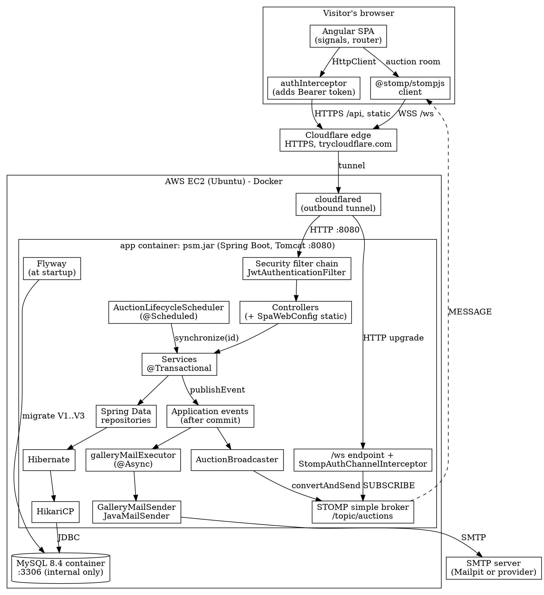

Reading guide:
- **Left to right in time for a normal click:** interceptor, Cloudflare, tunnel, security filter, controller, service, repository, Hibernate, Hikari, MySQL, and the answer travels back the same way.
- **After a write:** the service publishes an event. Two listeners react only after the commit: the broadcaster (live update) and the mail listeners (email).
- **Not on the request path:** the scheduler starts by itself every 5 seconds, and Flyway runs once at startup.

## Startup order inside the backend

Before any request arrives, the JVM does this, in order. A failure at any step stops the application, which is the safe outcome.

1. Spring Boot binds `application.yml` and environment variables. `AtelierProperties` is validated; `JwtService` refuses a `JWT_SECRET` shorter than 32 bytes.
2. HikariCP opens connections to MySQL using `DB_URL`, `DB_USER`, `DB_PASSWORD`.
3. Flyway applies pending `V*__*.sql` migrations (table `flyway_schema_history`).
4. Hibernate starts and **validates** the entities against the tables (`ddl-auto: validate`).
5. `RoleAndAdminInitializer` (an `ApplicationRunner`, order 1) creates the roles and, if `BOOTSTRAP_ADMIN_EMAIL` is set and unknown, the first admin.
6. When `DEMO_DATA=true`, `DemoDataInitializer` loads `demo/catalog.json` if the catalogue is empty.
7. Tomcat starts on `PORT` (8080), the scheduler begins, and `/actuator/health/readiness` becomes `UP`.

## Browser to Cloudflare to EC2

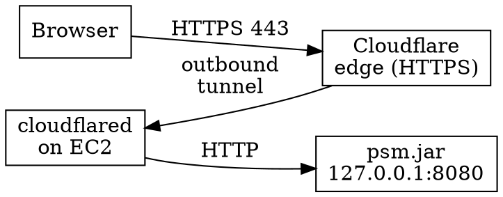

| Aspect | Detail |
|---|---|
| Protocol and port | Browser to Cloudflare: HTTPS on 443 (and `wss` for WebSocket on the same port). `cloudflared` to Cloudflare: an outbound connection started from the server. `cloudflared` to the app: plain HTTP to the app's port 8080 on the host (the exact target is configured on the server, not in the repo; the loopback binding implies it runs on the host or shares its network). |
| Format | HTTP requests with HTML, JSON, JavaScript, images; WebSocket frames for `/ws`. |
| Who starts it | The visitor starts the request. The tunnel itself was started by `cloudflared` on the server, outward. |
| Security | Cloudflare terminates TLS with its certificate. The hop `cloudflared` to the app is inside the machine. The app is bound to loopback (`127.0.0.1:${APP_PORT:-8080}` in `deployment/compose.prod.yaml`) and MySQL publishes no port, so the Internet can reach only what the tunnel forwards. |
| If it fails | Tunnel down: the site is unreachable but the app and data are fine. Tunnel restarted: the Quick Tunnel address changes (`docs/DEMO.md`), so old links die and `PUBLIC_URL` no longer matches. |
| Defined by | `PUBLIC_URL` and `APP_PORT` in `deployment/.env.prod`; `server.forward-headers-strategy: framework` in `application.yml`. The `cloudflared` container itself is not in the repository; `docker ps` on the server shows it. |

Things to be able to explain:
- **Why no inbound port?** The tunnel is an outbound connection. Cloudflare forwards visitors' requests down that already open connection. The EC2 security group does not need to allow 80 or 443 for the site.
- **Why `forward-headers-strategy: framework`?** The app sees plain HTTP from `cloudflared`; the original scheme and host arrive in `X-Forwarded-*` headers. With this setting Spring uses them, so generated redirects and URLs are correct.
- **Why `PUBLIC_URL` matters:** it becomes `CORS_ORIGINS` in `compose.prod.yaml` and also the allowed origin for the WebSocket handshake, and it builds the links in emails. After a tunnel restart you must put the new address into `.env.prod` and restart the app, or the browser's `Origin` check will fail.
- The repository's `deployment/nginx/atelier.conf` describes the alternative path (host Nginx with certbot); the EC2 deployment documented in `docs/DEMO.md` uses the tunnel instead.

## Angular to Spring over REST

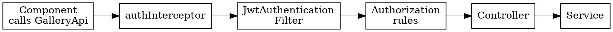

| Aspect | Detail |
|---|---|
| Protocol and port | HTTP/1.1 or HTTP/2 to the origin that served the page; paths under `/api/`. Port 8080 behind the tunnel; 4200 in development (the dev server proxies to 8080). |
| Format | JSON bodies (Jackson); dates as ISO-8601 strings; errors as RFC 9457 problem JSON (`status`, `code`, `detail`, optional `fields`). |
| Who starts it | The browser, through `HttpClient`. |
| Security | `Authorization: Bearer <jwt>` added by `core/auth/auth.interceptor.ts` for `/api/` URLs only. On the server `JwtAuthenticationFilter` (only for `/api/`) asks `TokenAuthenticator` to verify the token with `JwtService` and load the user and roles from MySQL. `SecurityConfig` rules then return 401 or 403. Passwords are BCrypt hashes. CORS allows only `CORS_ORIGINS` for `/api/**`. |
| If it fails | 400 `validation_failed` (field messages shown in forms), 401 (the interceptor logs out and redirects to `/login?returnUrl=...`), 403 (access denied), 404 `not_found`, 409 business rule (for example bid too low, artist with exhibitions cannot be deleted), 5xx unexpected. |
| Defined by | `frontend/proxy.conf.json` (dev), `atelier.cors.allowed-origins` / `CORS_ORIGINS`, `atelier.jwt.*` / `JWT_SECRET`, `JWT_EXPIRATION`, `SecurityConfig`. |

The path of one authenticated request, step by step (placing a bid, `POST /api/auctions/7/bids`):
1. Angular `BidPanel` calls the API; `authInterceptor` clones the request with the Bearer header.
2. The request reaches Tomcat; the Spring Security filter chain runs; `JwtAuthenticationFilter` verifies the signature and expiry, loads the user and sets the `Authentication`.
3. The rule `POST /api/auctions/*/bids` requires `BIDDER`; otherwise 403.
4. `@Valid` checks the body; `AuctionController` calls `BidService.placeBid` in a transaction.
5. `findByIdForUpdate` locks the auction row; `Auction.placeBid` applies the rules (minimum increment, open status, soft close).
6. The service publishes `AuctionEvent` and `BidAcceptedEvent`, flushes, and the transaction commits.
7. After commit, the broadcaster pushes to subscribers and the async mail listener queues emails. The HTTP response with the new auction state goes back to the bidder.

Failure to remember: a bid below the minimum is a business rule violation, not a validation error; it returns 409 with a specific `code`, so the UI can display the exact reason.

## Angular to Spring over WebSocket

| Aspect | Detail |
|---|---|
| Protocol and port | WebSocket (`ws`, or `wss` on HTTPS pages) with STOMP frames, on the same host and port as the site, path `/ws`. Native WebSocket; no SockJS fallback. |
| Format | STOMP text frames; the body of a `MESSAGE` is JSON of `AuctionEvent` (type, auction view, optional bid). |
| Who starts it | The browser: `AuctionSocket` opens it when the first component subscribes. |
| Security | The handshake `Origin` must match the allowed origins (`CORS_ORIGINS`). `CONNECT` may carry `Authorization: Bearer ...`; an invalid token is rejected, none means anonymous. `SUBSCRIBE` is allowed only under `/topic/auctions`. Any client `SEND` is refused. Because the data is public auction state, anonymous subscribers are allowed. |
| If it fails | The client's `state` signal becomes `reconnecting`; it retries every 3 s and re-subscribes all active topics. The REST page still works. Missing proxy upgrade support makes the room never turn "live" (`docs/DEPLOYMENT.md` troubleshooting). |
| Defined by | `config/WebSocketConfig`, `security/StompAuthChannelInterceptor`, `core/realtime/auction-socket.service.ts`, `frontend/proxy.conf.json` (`"ws": true`), `CORS_ORIGINS`. |

```
CONNECT  Authorization:Bearer eyJ...      (browser -> server)
CONNECTED                                 (server -> browser)
SUBSCRIBE id:sub-0 destination:/topic/auctions/7
MESSAGE  destination:/topic/auctions/7    (server -> every subscriber)
{"type":"BID_PLACED","auction":{...},"bid":{...}}
```

Points that examiners like:
- **One direction of data:** bids are sent by REST; the WebSocket only delivers results. This keeps all rules in one validated, transactional place.
- **After commit only:** `AuctionBroadcaster` uses `TransactionPhase.AFTER_COMMIT`, so no client ever sees a price that was rolled back.
- **Single instance:** the broker is in memory. Two server instances would not share subscriptions. For this project there is one app container, so it is enough.
- **Heartbeats** of 10 seconds on both sides detect a dead connection; they also keep an idle connection visibly alive for intermediaries such as the tunnel.

## Spring to MySQL

| Aspect | Detail |
|---|---|
| Protocol and port | MySQL protocol over TCP, port 3306, via JDBC (Connector/J 9.7.0). In production the hostname is the Compose service name `db`. |
| Format | SQL statements and result sets; text is utf8mb4; timestamps are handled in UTC (`serverTimezone=UTC`, `hibernate.jdbc.time_zone: UTC`). |
| Who starts it | The app (HikariCP opens connections, Flyway and Hibernate use them). |
| Security | Application user with a password (`DB_USER`, `DB_PASSWORD`), not the root account. In production port 3306 is not published, so only containers on the Compose network can connect. |
| If it fails | At startup: the app does not start (pool, Flyway or validation error); Docker restarts it (`restart: unless-stopped`) and the `depends_on` healthcheck makes `app` wait for MySQL. At runtime: requests fail with 5xx, and readiness reports `DOWN`. A lost bid transaction is rolled back, never half applied. |
| Defined by | `spring.datasource.*` ← `DB_URL`, `DB_USER`, `DB_PASSWORD`; `MYSQL_*` variables for the container; `spring.flyway.*`; `spring.jpa.*`. |

Layers on this path:
- **Service** opens a transaction (`@Transactional`) and borrows one connection for its duration.
- **Repository** methods run JPQL; **Hibernate** translates it to SQL, tracks entities, flushes changes.
- **HikariCP** lends the connection (default maximum 10).
- **Flyway** is the only writer of the schema, **Hibernate** only validates.

## Spring to SMTP

| Aspect | Detail |
|---|---|
| Protocol and port | SMTP. Dev: Mailpit on port 1025 without TLS or login. A real provider commonly uses 587 with STARTTLS and authentication. |
| Format | MIME multipart: plain text, HTML, and an inline image attached by `cid:`. |
| Who starts it | The app, from a worker thread of `galleryMailExecutor`, after the database transaction has committed. |
| Security | `SMTP_AUTH` and `SMTP_TLS` switch authentication and STARTTLS. Credentials come from env vars (`SMTP_USER`, `SMTP_PASSWORD`) and are never logged. Mail headers are sanitised (line breaks removed from the subject). |
| If it fails | The sender catches `MailException`, logs a warning with only the exception class and the action path, and the business operation stays committed. Timeouts are 5 s (connect) and 10 s (read, write) so a dead server cannot hold threads. |
| Defined by | `spring.mail.*` ← `SMTP_HOST`, `SMTP_PORT`, `SMTP_USER`, `SMTP_PASSWORD`, `SMTP_AUTH`, `SMTP_TLS`; `atelier.mail.admin-address` ← `ADMIN_EMAIL`; `MAIL_FROM`; `PUBLIC_URL` for links. |

The trigger chain: service publishes a record event, `@TransactionalEventListener` waits for the commit, `@Async("galleryMailExecutor")` moves the work off the request thread, `GalleryMailSender` renders the template and talks to SMTP. Events exist for registration (`UserRegisteredEvent`), bids (`BidAcceptedEvent`), auction results (`AuctionResultEvent`) and new artist contacts (`ArtistContactCreatedEvent`).

## Scheduler, database and WebSocket together


| Aspect | Detail |
|---|---|
| Protocol and port | In-process method calls, then JDBC to MySQL, then in-process STOMP broker. No network hop of its own. |
| Format | Java objects; events are immutable records; the WebSocket payload is JSON. |
| Who starts it | The `@Scheduled` timer itself, not a user. |
| Security | No external input. Each auction is changed in its own transaction under a row lock, so a bid arriving at the same moment cannot be lost. |
| If it fails | An exception for one auction is caught and logged (`Could not advance auction ...`); the loop continues with the next and runs again 5 seconds later. If the application is down, due auctions are handled on the next run after restart. |
| Defined by | `atelier.auction.lifecycle-interval` ← `AUCTION_LIFECYCLE_INTERVAL` (default `PT5S`); `atelier.auction.soft-close` ← `AUCTION_SOFT_CLOSE` (default `PT60S`); `@EnableScheduling` in `config/AsyncConfig`; the `Clock` bean in `config/TimeConfig`. |

Why it matters: a closing auction produces the same kind of result as a bid: a database change, then an after-commit broadcast and mails (`AuctionResultEvent`). The browser's countdown is only a display; the server decides when an auction is over.

## Build-time connections

### Angular build to `static/` in the jar

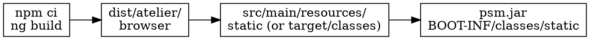

| Aspect | Detail |
|---|---|
| What connects | The Angular output folder `frontend/dist/atelier/browser` becomes the classpath folder `static/` of the Spring Boot jar. |
| Docker path | Stage 1 builds Angular; stage 2 does `COPY --from=frontend /build/frontend/dist/atelier/browser/ src/main/resources/static/` then `./mvnw package`. |
| Maven path | `./mvnw -Pwith-frontend package`: `frontend-maven-plugin` installs Node 22.23.2, runs `npm ci` and `npm run build`, and `maven-resources-plugin` copies the output into `target/classes/static`. |
| Runtime result | `SpaWebConfig` serves these files from `classpath:/static/` and falls back to `index.html`. Hashed file names (`outputHashing: all`) make long caching safe (`spring.web.resources.cache.cachecontrol.max-age: 7d`). |
| If it fails | A broken Angular build fails the Docker stage, so no image is produced. A jar without `static/` still starts but serves no pages. |
| Defined by | `Dockerfile`, `backend/pom.xml` profile `with-frontend`, `frontend/angular.json`. |

### CI to tests to image

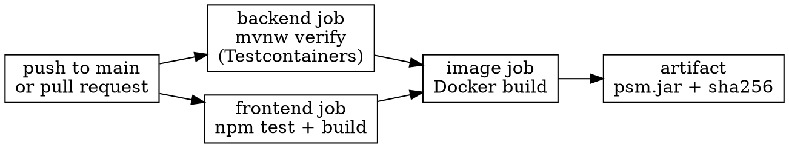

| Aspect | Detail |
|---|---|
| Trigger | Push to `main` or any pull request (`.github/workflows/ci.yml`). `concurrency` cancels superseded runs of the same ref. |
| Jobs | `backend` (Java 17, `./mvnw -B verify`: unit tests and 14 `*IT` classes against a Testcontainers MySQL 8.4.13) and `frontend` (Node from `.nvmrc`, `npm ci`, `npm test`, `npm run build`) run in parallel. `image` has `needs: [backend, frontend]`. |
| Output | The image job builds the production Dockerfile (nothing is pushed), copies `psm.jar` out, writes `psm.jar.sha256` and uploads artifact `atelier-psm-jar` for 30 days. `package.yml` does the same on demand. |
| Security | `package.yml` sets `permissions: contents: read`. No secrets are needed because nothing is deployed from CI. |
| If it fails | The pull request check turns red; the image job is skipped. |
| Not in CI | Newman/Postman, deployment to EC2 (done by hand with `deployment/deploy.sh`). |

## Dev-time connections

### `ng serve` proxy to port 8080

| Aspect | Detail |
|---|---|
| Why | The browser must see one origin. The dev server serves Angular on 4200 and forwards `/api` and `/ws` to Spring, so the same relative URLs and `location.host` WebSocket address work as in production. |
| Config | `frontend/proxy.conf.json` (used by `angular.json` `serve.options.proxyConfig`): `/api` to `http://localhost:8080`, `/ws` to `ws://localhost:8080` with `"ws": true`. |
| Format and who starts it | HTTP and WebSocket, started by the browser; the Angular dev server relays them. |
| Security | None needed locally; CORS default is `http://localhost:4200` (`CORS_ORIGINS`) if the app is called directly. |
| If it fails | Backend not running: the proxy returns errors (connection refused) for `/api`; pages load but data does not. |

### Docker Compose DNS

| Aspect | Detail |
|---|---|
| Why | Containers on one Compose network resolve each other by **service name**. |
| Config | `compose.yaml`: backend `DB_URL=jdbc:mysql://db:3306/...`, `SMTP_HOST=mailpit`; frontend `proxy.docker.json` points to `http://backend:8080` and `ws://backend:8080`. |
| Startup order | `backend` waits for `db` (`service_healthy`) and `mailpit` (`service_started`); `frontend` waits for `backend` to start. |
| Host access | Published ports let you reach the containers from the host browser: 4200, 8080, 3306, 1025, 8025. |
| If it fails | A wrong service name gives "unknown host" in the app log; a MySQL that is not yet healthy keeps the backend from starting. |

Mental picture of the dev stack: browser on the host talks to `localhost:4200`; that container proxies to `backend:8080` over the Compose network; the backend talks to `db:3306` and `mailpit:1025`.

## Configuration map: where each connection is defined

| Connection | Setting (env var) | File |
|---|---|---|
| Database | `DB_URL`, `DB_USER`, `DB_PASSWORD` | `application.yml`, `compose*.yaml` |
| DB container | `MYSQL_DATABASE`, `MYSQL_USER`, `MYSQL_PASSWORD`, `MYSQL_ROOT_PASSWORD` | `compose*.yaml`, `deployment/.env.prod` |
| JWT | `JWT_SECRET` (32+ bytes), `JWT_EXPIRATION` (`PT12H`) | `application.yml` → `atelier.jwt` |
| CORS / WebSocket origin | `CORS_ORIGINS` (set from `PUBLIC_URL` in production) | `SecurityConfig`, `WebSocketConfig` |
| Email links | `PUBLIC_URL` | `AtelierProperties.Mail` |
| SMTP | `SMTP_HOST`, `SMTP_PORT`, `SMTP_USER`, `SMTP_PASSWORD`, `SMTP_AUTH`, `SMTP_TLS`, `MAIL_FROM`, `ADMIN_EMAIL` | `application.yml` → `spring.mail`, `atelier.mail` |
| First admin | `BOOTSTRAP_ADMIN_EMAIL`, `BOOTSTRAP_ADMIN_PASSWORD` | `RoleAndAdminInitializer` |
| Auction timing | `AUCTION_SOFT_CLOSE`, `AUCTION_LIFECYCLE_INTERVAL` | `application.yml` → `atelier.auction` |
| Demo data | `DEMO_DATA` | `DemoDataInitializer` |
| HTTP port | `PORT` (app), `APP_PORT` (host side in production) | `application.yml`, `compose.prod.yaml` |
| Image version | `ATELIER_VERSION` | `compose.prod.yaml` |

## Port and URL map

### Development

| Component | Address | Protocol | Notes |
|---|---|---|---|
| Angular dev server | `http://localhost:4200` | HTTP | `ng serve`; proxies `/api` and `/ws` |
| Spring Boot API | `http://localhost:8080` | HTTP | `/api/**`, `/actuator/health`, `/ws` |
| STOMP endpoint | `ws://localhost:8080/ws` (through the proxy: `ws://localhost:4200/ws`) | WebSocket | topics `/topic/auctions`, `/topic/auctions/{id}` |
| MySQL | `localhost:3306` | MySQL | published by `compose.yaml` |
| Mailpit SMTP | `localhost:1025` | SMTP | no auth, no TLS |
| Mailpit web inbox | `http://localhost:8025` | HTTP | read the sent emails |
| Inside Compose | `db:3306`, `mailpit:1025`, `backend:8080` | various | service-name DNS |

### Production (AWS EC2)

| Component | Address | Protocol | Notes |
|---|---|---|---|
| Public site | `https://<random>.trycloudflare.com` (Quick Tunnel; changes on restart) | HTTPS, WSS | the only public entry |
| Cloudflare tunnel | outbound from EC2 to Cloudflare | tunnel | `cloudflared` container, not defined in the repo |
| Application | `127.0.0.1:8080` on the host (`APP_PORT`) | HTTP | `psm.jar`: API, WebSocket and the Angular files |
| Health | `http://127.0.0.1:8080/actuator/health/readiness` | HTTP | used by Docker `HEALTHCHECK` and `deploy.sh` |
| MySQL | `db:3306` on the Compose network | MySQL | not published to the host |
| Mailpit (optional profile) | `127.0.0.1:8025` | HTTP | reach it through an SSH tunnel |
| SSH | EC2 port 22 | SSH | administration and `deployment/deploy.sh` |

Memory aid: in development the browser meets Angular first and Angular proxies to Spring; in production the browser meets Cloudflare first, the tunnel reaches Spring directly, and Spring serves Angular itself.

# How it matches the CDC
All 12 numbered CDC steps ("Projects Manager", course *Formation FullStack Spring Boot and Angular*) are implemented, with two declared adaptations: **Client becomes Artist** and **Projet becomes Exhibition**, and an Argon-inspired UI rebuilt for Angular 22. The art gallery and auctions are extensions on top.

### Vocabulary map
| CDC term | ATELIER | UI label |
| --- | --- | --- |
| PSM / Projects Manager | The Studio; artifact `psm.jar` | Studio |
| Client | `Artist` | Artists (caption "Clients") |
| Projet | `Exhibition` | Exhibitions (caption "Projets") |
| libellé (projet) | `title` | Title |
| durée | `durationDays` | Duration (days) |
| idClient | `artist_id` / `artistId` | Artist |
| nom, prénom, tel, adresse | `lastName`, `firstName`, `phone`, `address` | Last name, First name, Phone, Address |
| Admin, Collaborateur | `ADMIN`, `COLLABORATEUR` | Admin, Collaborator |

### Entities and relations
| CDC requirement | Implementation |
| --- | --- |
| User (id, email, password, tel, nom, prénom) | `users` table + `User` entity; password stored as BCrypt hash |
| Role (id, libellé) | `roles` table + `Role` entity with editable `libelle` and fixed `profile`; full admin CRUD |
| User *..* Role (Many-to-Many) | `@ManyToMany` + join table `user_roles` (composite PK) |
| Client (id, nom, tel, email, adresse) | `artists` table + `Artist` entity (plus country, biography, photo, active) |
| Projet (id, libellé, budget, durée, description, idClient) | `exhibitions` table + `Exhibition` entity (plus start date, venue, cover) |
| Client 1..* Projet (One-to-Many) | `Exhibition.artist` `@ManyToOne(optional=false)` + `Artist.exhibitions` `@OneToMany(mappedBy)`; FK `artist_id NOT NULL` |

### Step-by-step traceability
| # | CDC step | How ATELIER does it | Proof |
| --- | --- | --- | --- |
| 1 | Spring Boot project with Web, Data JPA, DevTools, MySQL Driver | Spring Boot 3.5.16, all four dependencies plus Security, Validation, Mail, WebSocket, Actuator, Flyway, JJWT | `backend/pom.xml` |
| 2 | CRUD for entities | Controller, Service, Repository per feature; full CRUD for artists, exhibitions, users, roles | `StudioArtistController`, `StudioExhibitionController`, `AdminUserController`, `AdminRoleController` |
| 3 | Test APIs with Postman | Collection covering every endpoint and role; Newman: 103 requests, 175 assertions, 0 failures | `postman/ATELIER.postman_collection.json` |
| 4 | Security layer + JWT | Stateless Spring Security, `JwtAuthenticationFilter`, `JwtService` (HS256, 12 h), BCrypt | `SecurityConfig`, `security/` package, `AuthIT`, `SecurityMatrixIT` |
| 5 | Email the admin after registration | `UserRegisteredEvent`, then `RegistrationMailListener` (async, after commit), admin and user emails | `AuthIT`, Mailpit and Gmail checks |
| 6 | Test login and registration | 10 `AuthIT` tests + Postman | `AuthIT.java` |
| 7 | Test Client and Projet under security | 84-case role matrix test | `SecurityMatrixIT`, `CatalogFlowIT` |
| 8 | Angular components and menu for Clients, Projets, Users (Argon mockup) | Studio sidebar: Artists (Clients), Exhibitions (Projets), Artworks, Auctions, Users, Roles; Argon-style dashboard rebuilt in Tailwind | `features/studio/` |
| 9 | Guard + interceptor | `authGuard`, `roleGuard`, `guestGuard`; `authInterceptor` adds the Bearer token and handles 401 | `core/auth/`, Vitest specs |
| 10 | Respect roles in the app | `AuthStore.isAdmin()` and `isStaff()` hide menu entries and edit and delete buttons; the backend enforces the same | Studio templates + `SecurityConfig` |
| 11 | Build `psm.jar` with Angular in `static/` | Multi-stage `Dockerfile` or `mvnw -Pwith-frontend package`; `SpaWebConfig` handles deep links | `Dockerfile`, `pom.xml`, `SpaWebConfig` |
| 12 | Deploy to a VPS | AWS EC2 `t3.small`, Docker Compose, MySQL volume, Cloudflare HTTPS tunnel; readiness `UP` and 10 of 10 remote checks | chapter 14, `docs/evidence/vps-smoke.json` |

### Role permissions versus the CDC
The CDC says: Admin does every CRUD on clients and projects; Collaborateur may only view and add.

| Operation on Client or Projet | ADMIN | COLLABORATEUR |
| --- | --- | --- |
| Consult | yes | yes |
| Add | yes | yes |
| Modify | yes | no (403) |
| Delete | yes | no (403) |

### Adaptations to state clearly at the defence
1. **Vocabulary:** Client is Artist, Projet is Exhibition. Every CDC field exists under its new name.
2. **Argon dashboard:** the original targets Angular 14, Bootstrap 4 and ng-bootstrap 12, which does not compile on Angular 22. The layout (gradient header, KPI cards, charts, tables, profile) was rebuilt with Tailwind and spartan/ui; no template code is copied.
3. **Extra role `BIDDER`:** added for collectors; it does not replace Admin or Collaborateur.
4. **Deployment scope:** the 10 remote checks cover the Angular page and a deep link, the readiness probe, the public APIs, and refused calls (Studio and admin without a token, a wrong password). They do not include a live bid over the tunnel or a registration email with the final URL, which stay as manual demos.

### Extensions beyond the CDC
Artworks with statuses and slugs; live auctions with a lifecycle scheduler; real-time bidding over STOMP; pessimistic locking and soft close; collector account area; GSAP riffle homepage; Studio KPIs and charts; Flyway migrations; RFC 9457 errors; demo data; Testcontainers; GitHub Actions CI; Vitest; branded HTML emails for 8 business events.

| CDC part | Architectural piece |
| --- | --- |
| Part 1 Spring: entities, CRUD, Postman, JWT, email, tests | Backend layers, `security/`, `mail/`, Flyway schema, Postman collection, integration tests |
| Part 2 Angular: components, menu, guard, interceptor, roles | `features/studio/`, `StudioLayout` menu, `core/auth/` |
| Part 3 Deployment: `psm.jar` with Angular in `static/`, VPS | Multi-stage Dockerfile or Maven profile, `SpaWebConfig`, EC2 + Compose + tunnel |

# Trace one action: place a bid, end to end
This chapter replays everything on one concrete action: a collector with the role `BIDDER` places a bid on an open auction. Follow the files in order.

### The path in twelve steps
| # | Where | File | What happens |
| --- | --- | --- | --- |
| 1 | Browser | `features/auctions/bid-panel.ts` | The form asks for confirmation ("Confirm your bid"), then calls the API |
| 2 | Angular service | `core/api/gallery.api.ts` | `placeBid(id, amount)` sends `POST /api/auctions/{id}/bids` with `{ amount }` |
| 3 | Interceptor | `core/auth/auth.interceptor.ts` | Adds `Authorization: Bearer <token>` because the URL starts with `/api/` |
| 4 | Same origin | `SpaWebConfig` | In production no proxy: the request reaches the jar directly; the SPA fallback skips `/api/` |
| 5 | Filter | `JwtAuthenticationFilter`, `TokenAuthenticator` | Token verified, user loaded from MySQL, roles turned into `ROLE_BIDDER` |
| 6 | URL rule | `SecurityConfig` | `POST /api/auctions/*/bids` needs `hasRole("BIDDER")` (an admin gets 403) |
| 7 | Controller | `AuctionController.placeBid` | Jackson builds `PlaceBidRequest`, `@Valid` checks it, `Principal` gives the email |
| 8 | Service | `BidService.placeBid` (`@Transactional`) | `findByIdForUpdate` takes the row lock |
| 9 | Entity | `Auction.placeBid` | Status OPEN? Not already leading? Amount at least the minimum? Soft close |
| 10 | Persistence | `bids.save`, `auctions.flush` | `INSERT` into `bids`; the auction changes are written (dirty checking); two events are published and parked |
| 11 | Commit | Spring transaction | `COMMIT` releases the lock; the unique `(auction_id, amount)` is the last safety net |
| 12 | After commit | `AuctionBroadcaster`, mail listener | WebSocket push to every viewer; async emails to the bidder and to the previous leader; the bidder receives `201` |

### What the code looks like at the centre
```java
@Transactional
public AuctionEvent placeBid(Long auctionId, BigDecimal amount, String bidderEmail) {
    User bidder = users.requireByEmail(bidderEmail);
    Auction auction = auctions.findByIdForUpdate(auctionId)
            .orElseThrow(() -> new NotFoundException("Auction", auctionId));
    Instant now = clock.instant();
    BidAcceptedEvent.Recipient previousLeader = recipient(auction.getLeadingBidder());
    Bid bid = bids.save(auction.placeBid(bidder, amount, now, softClose));
    auctions.flush();
    AuctionEvent event = new AuctionEvent(AuctionEventType.BID_PLACED, AuctionView.from(auction),
            BidView.from(bid), now);
    events.publishEvent(event);
    events.publishEvent(new BidAcceptedEvent(...));
    return event;
}
```

### What can go wrong, and what the user sees
| Situation | Raised by | Response | What Angular shows |
| --- | --- | --- | --- |
| No token or expired token | Security entry point | 401 `authentication_required` | The interceptor logs out and goes to `/login?returnUrl=...` |
| Staff account tries to bid | URL rule | 403 `forbidden` | "Staff accounts cannot bid" (the panel hides the form) |
| Amount below the minimum | `Auction.placeBid` | 409 `bid_too_low` | "The minimum bid is now ..." |
| Already the highest bidder | `Auction.placeBid` | 409 `already_leading` | "You already hold the highest bid" |
| Auction not open (ended) | `Auction.placeBid` after `synchronize` | 409 `auction_not_open` | The room reloads and shows the final status |
| Invalid JSON amount | `@Valid` | 400 `validation_failed` | Field error |
| MySQL fails after the lock | Rollback | 500, nothing saved | No event, no email, no price change |

### What every other viewer sees
The socket is separate from the HTTP call. After the commit, `AuctionBroadcaster` sends the `AuctionEvent` to `/topic/auctions/{id}` and to `/topic/auctions`. The Angular `AuctionSocket` delivers it to `AuctionRoomPage`, which updates the `auction` and `bids` signals; the price animates and the history gains a row. If the bid fell in the last 60 seconds, the new `endsAt` is highlighted.

> A bid is one REST call, one locked transaction and one commit. Everything the others see or receive happens after that commit.

# Questions you may be asked
Short answers to say aloud. Each answer is one to four sentences; the code reference in backticks is there to point at if the jury asks to see it.

## The idea and the CDC

**Q:** What is ATELIER in one sentence?
**A:** ATELIER is a digital art gallery with live auctions: a public site for visitors and bidders, and a private back-office called the Studio that is the CDC's PSM (Projects Manager) application. It is one Spring Boot backend and one Angular frontend delivered as a single jar.

**Q:** How do you map the CDC vocabulary to your project?
**A:** The CDC Client is the `Artist`, the Projet is the `Exhibition`, Admin is `ADMIN` and Collaborateur is `COLLABORATEUR`. The UI keeps the captions "Clients" and "Projets" under the Artists and Exhibitions menu entries.

**Q:** Which CDC entities and relations are implemented?
**A:** `User` and `Role` with a Many-to-Many through `user_roles`, and `Client` (Artist) to `Projet` (Exhibition) as a One-to-Many. Both are mapped in JPA and enforced by foreign keys in Flyway migration `V1__core_schema.sql`.

**Q:** What did you add beyond the CDC?
**A:** Artworks, live auctions with bids, a `BIDDER` role with public registration, real-time updates over STOMP, a soft close, a collector area, a dashboard with KPIs and charts, Flyway, Testcontainers tests and CI. The list is in `docs/CDC_EQUIVALENCE.md`, section 7.

**Q:** Is the CDC permission rule respected?
**A:** Yes. Admin does every CRUD operation; Collaborateur can only read and create (`GET` and `POST /api/studio/**`), while `PUT` and `DELETE` are ADMIN only. `SecurityMatrixIT` tests it for anonymous, bidder, collaborateur and admin.

**Q:** Did you copy the Argon template?
**A:** No. Argon Dashboard Angular targets Angular 14 and Bootstrap 4, so I rebuilt its structure (gradient header, KPI cards, charts, tables, profile) in Tailwind CSS 4 on Angular 22. No template code is copied.

**Q:** Which CDC step needed an adaptation you should state clearly?
**A:** The deployment: the CDC says VPS, and I used an AWS EC2 instance with Docker Compose, exposed through a temporary Cloudflare Quick Tunnel rather than a domain with a fixed certificate. The Argon dashboard is also a rebuild, not the original template.

**Q:** How can you prove the work is complete?
**A:** With numbers and a trace: 19 unit and 151 integration tests on the backend, 64 frontend tests, a Postman run of 103 requests and 175 assertions with 0 failures, and `docs/CDC_EQUIVALENCE.md` which maps each CDC step to a file.

**Q:** Who are the actors of the application?
**A:** The visitor (anonymous, reads the gallery), the bidder (registered collector who bids), the collaborateur (staff who views and adds catalogue data) and the admin (full control, users, roles, auctions).

## Architecture

**Q:** Describe the architecture in one minute.
**A:** A browser runs an Angular single-page app. It talks to one Spring Boot process over REST for actions and STOMP over WebSocket for live updates. The backend is organised by feature and by layer, secured by a JWT filter, and stores data in MySQL through Hibernate with a Flyway-owned schema. In production everything ships as one jar inside a Docker image.

**Q:** Is it a monolith or microservices? Why?
**A:** A monolith: one deployable jar. For a team of this size and a CDC that asks for a single `psm.jar`, it is simpler to build, test and deploy, and a transaction can span all features. The cost is that it scales as one unit.

**Q:** What are the three ways the browser talks to the server?
**A:** Static files (the Angular build, over HTTP GET), the REST API under `/api/**` with JSON, and a STOMP WebSocket at `/ws` for pushed auction events. Every write goes through REST; the WebSocket only broadcasts what REST already committed.

**Q:** What does "package by feature" mean?
**A:** Each feature folder (`auction`, `artist`, `user`...) owns its entity, repository, service, controller and DTOs, instead of having one big `controllers` folder. It is easier to navigate and to remove or extend a feature.

**Q:** What are the layers inside a feature?
**A:** Controller (HTTP in and out), service (business rules and transactions), repository (database access), entity (the persisted state and its own rules) and DTO records (what crosses the API). A controller never touches a repository directly.

**Q:** Where do the business rules live?
**A:** Mostly in the entity. `Auction.placeBid` checks status, the current leader and the minimum, and applies the soft close. The REST path and the scheduler therefore share one source of truth, and `AuctionTest` tests it with no Spring.

**Q:** What is event-driven here?
**A:** Services publish events (`UserRegisteredEvent`, `AuctionEvent`, `BidAcceptedEvent`). Listeners react only after the transaction commits: one broadcasts over WebSocket, others send emails asynchronously. The core transaction does not wait for them.

**Q:** What is the lifecycle of an auction?
**A:** `SCHEDULED`, then `OPEN` at `startsAt`, then `CLOSED` at `endsAt` with the winner set to the leading bidder. An admin can cancel a scheduled or open auction, giving `CANCELLED`.

## Spring Boot basics

**Q:** What is Spring Boot and what does it add to Spring?
**A:** Spring is the framework with dependency injection, web, data and security modules. Spring Boot adds starters, auto-configuration and an embedded Tomcat so you run `java -jar` with almost no XML or manual setup.

**Q:** What happens when the application starts?
**A:** The launcher calls `main`, Spring creates the context, scans components, auto-configures from the libraries present, binds and validates settings, builds beans, runs Flyway, then Hibernate validates the schema. Runners such as `RoleAndAdminInitializer` run, then Tomcat opens port 8080.

**Q:** What is inversion of control and dependency injection?
**A:** Instead of a class creating its dependencies with `new`, the Spring container creates them and passes them in. I use constructor injection, so a class such as `BidService` declares what it needs and Spring supplies it.

**Q:** Why constructor injection rather than `@Autowired` fields?
**A:** The dependencies are explicit, can be `final`, and the class can be built in a unit test with plain `new`. The container also fails at startup if a dependency is missing.

**Q:** What is auto-configuration?
**A:** Spring Boot looks at the libraries on the classpath and the properties, and creates the matching beans. With the MySQL driver and JPA present it builds a `DataSource` and the Hibernate setup for me.

**Q:** Where is the configuration and how do you change it per environment?
**A:** In `application.yml`, using placeholders with defaults such as `${DB_URL:...}`. Environment variables override them, so the same jar runs in development and production. `AtelierProperties` binds the `atelier.*` keys into a typed record.

**Q:** What does "fail fast" mean for the configuration?
**A:** A bad setting stops the application at startup instead of failing later. For example `JwtService` throws if `JWT_SECRET` has fewer than 32 bytes.

**Q:** What is a Java record and why use it for DTOs?
**A:** A compact immutable class that declares its fields in the header. It is ideal for DTOs because the request and response shapes are short, immutable and map directly to JSON and to the TypeScript interfaces.

**Q:** What are `@Scheduled` and `@Async`?
**A:** `@Scheduled` runs a method periodically; `AuctionLifecycleScheduler.advance()` runs every 5 seconds (`AUCTION_LIFECYCLE_INTERVAL`). `@Async("galleryMailExecutor")` runs a method on another thread so emails do not block the request. Both are enabled in `AsyncConfig`.

**Q:** What is an `ApplicationRunner`?
**A:** A bean whose `run` method executes once after startup. `RoleAndAdminInitializer` uses it to create the three system roles and the first admin if they are missing; `DemoDataInitializer` loads demo data when `DEMO_DATA=true`.

## Backend layers and REST

**Q:** Walk me through one HTTP request.
**A:** Tomcat receives it, the Spring Security filter chain runs (the JWT filter authenticates), the `DispatcherServlet` finds the controller method, Jackson converts the JSON to a DTO and Bean Validation checks it. The controller calls the service, which runs in a transaction and uses repositories, then the response is serialised back to JSON.

**Q:** What is the difference between `@PathVariable`, `@RequestParam` and `@RequestBody`?
**A:** `@PathVariable` reads a value in the URL path (`/artists/{id}`), `@RequestParam` reads a query parameter (`?q=...`), and `@RequestBody` reads the JSON body into a DTO.

**Q:** Why DTOs and not returning entities directly?
**A:** Entities carry the persistence model and sensitive fields, such as the password hash, the artist's phone or the exhibition budget. DTOs expose only what each audience needs, and the public artist and exhibition projections hide contact details and budget.

**Q:** Why separate public and Studio controllers?
**A:** They serve different audiences with different shapes and rules: `/api/artists` is public with a reduced projection, `/api/studio/artists` is for staff with the full record. The security matrix is then a simple URL pattern.

**Q:** How does validation work?
**A:** Annotations such as `@NotBlank`, `@Email` and `@Size` on the request records, triggered by `@Valid` on the controller parameter. A failure raises `MethodArgumentNotValidException`, which `ApiExceptionHandler` turns into a 400 `validation_failed` with a `fields` map.

**Q:** How are errors returned?
**A:** As RFC 9457 `application/problem+json` with a stable `code`, produced by `@RestControllerAdvice` in `ApiExceptionHandler`. The frontend reads the `code` and `fields` to show a clear message.

**Q:** Which exceptions map to which HTTP status?
**A:** `NotFoundException` gives 404, `BusinessRuleException` gives 409 with its own code, validation errors give 400, bad credentials give 401, `AccessDeniedException` gives 403, an optimistic lock failure gives 409 `stale_update`, and a database integrity error gives 409 `integrity_violation`.

**Q:** Why does the API use 409 so often?
**A:** 409 Conflict means the request is valid but conflicts with the current state: price too low, artist still referenced, record changed by someone else. It lets the client tell this apart from 400 (malformed) and 403 (not allowed).

**Q:** How do you hide contact data from visitors?
**A:** The public artist endpoint returns `ArtistSummary` (name, country, biography, photo) and the public exhibition endpoint hides the budget. The Studio endpoints return the full records. `CatalogFlowIT` checks that no email, phone, address or budget leaks.

## JPA, Hibernate and transactions

**Q:** What is JPA and what is Hibernate?
**A:** JPA is the Java standard (annotations and an API) for mapping objects to relational tables. Hibernate is the implementation Spring Boot uses behind it. Spring Data JPA adds repository interfaces on top.

**Q:** What is an ORM and why use one?
**A:** An Object-Relational Mapper maps classes to tables and objects to rows, so I write Java instead of most SQL. The trade-off is that I must understand what it generates (lazy loading, flushes) to avoid surprises.

**Q:** What is lazy versus eager fetching?
**A:** Lazy loads a relation only when it is accessed; eager loads it immediately. My `@ManyToOne` relations are `LAZY` to avoid unnecessary joins, and `User.roles` is `EAGER` because roles are needed on every authenticated request.

**Q:** What does `@Transactional` do?
**A:** Spring wraps the bean in a proxy that opens a transaction before the method and commits afterwards, or rolls back on a runtime exception. `BidService.placeBid` is `@Transactional`, so the lock, the insert and the update are atomic.

**Q:** Why does `@Transactional` sometimes do nothing?
**A:** When a method calls another method of the same class, the call does not pass through the Spring proxy, so no transaction starts. The annotation also needs a public method on a Spring bean.

**Q:** Which exceptions cause a rollback?
**A:** By default runtime (unchecked) exceptions. `BusinessRuleException` is a runtime exception, so a rejected bid rolls back everything and no event is broadcast.

**Q:** What is optimistic locking?
**A:** A `@Version` column is incremented on each update, and Hibernate adds `WHERE version = ?` to the UPDATE. If someone else changed the row first, nothing is updated and the app raises `ObjectOptimisticLockingFailureException`, returned as 409 `stale_update`.

**Q:** What is pessimistic locking?
**A:** The row is locked in the database when read, with `SELECT ... FOR UPDATE`, so other transactions wait. `AuctionRepository.findByIdForUpdate` uses `@Lock(LockModeType.PESSIMISTIC_WRITE)`.

**Q:** Why `BigDecimal` for money?
**A:** `double` cannot represent many decimals exactly. `BigDecimal` in Java and `DECIMAL(14,2)` in MySQL are exact, so 550.00 stays 550.00.

## Database and relations

**Q:** How many tables are there?
**A:** Eight business tables: `users`, `roles`, `user_roles`, `artists`, `exhibitions`, `artworks`, `auctions`, `bids`. Flyway adds its own `flyway_schema_history` table.

**Q:** How many foreign keys and what are their delete rules?
**A:** Thirteen: 2 `CASCADE`, 4 `SET NULL` and 7 `RESTRICT` (the default). For example `bids` cascade with their auction, `created_by` columns become NULL when a user disappears, and an artist with exhibitions cannot be deleted.

**Q:** When do you use CASCADE, SET NULL and RESTRICT?
**A:** CASCADE when the child means nothing alone (bids of a deleted auction, `user_roles` of a deleted user). SET NULL when the child should survive with an optional link (`created_by`, an artwork's exhibition). RESTRICT when deleting would lose important data.

**Q:** How is the Many-to-Many User and Role implemented?
**A:** `@ManyToMany` on `User.roles` with `@JoinTable(name = "user_roles")`. The link table has the composite primary key `(user_id, role_id)`, and both columns are foreign keys.

**Q:** How is the One-to-Many Artist and Exhibition implemented?
**A:** `Exhibition` owns the foreign key with `@ManyToOne(optional = false) @JoinColumn(name = "artist_id")`. `Artist` has `@OneToMany(mappedBy = "artist")`, a read-only mirror.

**Q:** What is the owning side of a relation?
**A:** The side that writes the foreign key, the one with `@JoinColumn` (or `@JoinTable`). The `mappedBy` side only reads; changing the mirror collection alone does not update the database.

**Q:** What happens if you delete an artist who has exhibitions?
**A:** The foreign key is RESTRICT, MySQL refuses, Spring raises `DataIntegrityViolationException` and `ApiExceptionHandler` returns 409 `integrity_violation`. The Angular page shows a clear conflict message.

**Q:** Which constraints protect the data besides foreign keys?
**A:** Unique constraints on `users.email`, `roles.libelle`, `roles.system_key`, `artworks.slug` and `bids(auction_id, amount)`, plus `NOT NULL` columns. They hold even if the Java code has a bug.

**Q:** What is Flyway?
**A:** A migration tool that applies versioned SQL scripts (`V1__core_schema.sql`, `V2__...`, `V3__dynamic_roles.sql`) once each, and records them in `flyway_schema_history`. It runs at startup, before Hibernate.

**Q:** Why can a user with activity not be deleted?
**A:** Bids, wins and created records reference the user with RESTRICT or SET NULL rules, and deleting would damage history. The service refuses with `user_has_activity`; the admin disables the account instead.

**Q:** How do you stop two live auctions for one artwork?
**A:** The service checks and returns 409 `auction_overlap` when an artwork already has a scheduled or open auction. Only `PUBLISHED` artworks can be auctioned (`artwork_not_published`).

## Security and JWT

**Q:** What is the difference between authentication and authorization?
**A:** Authentication answers "who are you?" (login and token). Authorization answers "what may you do?" (role rules in `SecurityConfig` and `@PreAuthorize`).

**Q:** What is a JWT?
**A:** A signed string with three Base64URL parts: header, payload and signature. My payload holds `sub` (the email), `iat` and `exp`. The signature proves the server issued it and the content was not changed.

**Q:** Which algorithm and secret do you use?
**A:** HMAC-SHA256 (HS256) with a secret from `JWT_SECRET` of at least 32 bytes, built with JJWT 0.12 (`Keys.hmacShaKeyFor`). The application refuses to start with a shorter secret.

**Q:** Describe the JWT flow.
**A:** The client posts the credentials to `/api/auth/login`; the server checks the BCrypt hash and returns `{token, expiresAt, user}`. The client stores it and sends `Authorization: Bearer <token>` on each call. `JwtAuthenticationFilter` verifies it, loads the user from the database and sets the security context.

**Q:** Are the roles stored in the token?
**A:** No. The token holds the email only; `TokenAuthenticator` loads the user and roles from MySQL on every request. A role change or a disabled account therefore takes effect immediately.

**Q:** What happens if someone modifies the token payload?
**A:** The HMAC signature no longer matches, `JwtService.verify` returns empty, and the request is anonymous, so a protected URL answers 401.

**Q:** What is the difference between 401 and 403?
**A:** 401: no valid identity on a protected URL (missing, invalid or expired token). 403: the identity is valid but the role is not allowed. Both are returned as problem JSON with `authentication_required` or `forbidden`.

**Q:** Why does login give the same error for a wrong email and a wrong password?
**A:** So an attacker cannot discover which emails have an account. Both, and a disabled account, return 401 `invalid_credentials`.

**Q:** How are passwords stored?
**A:** Hashed with BCrypt (`BCryptPasswordEncoder`), which is salted and deliberately slow. The password is never stored or returned. The 72-character maximum comes from BCrypt's input limit.

**Q:** Why is CSRF disabled?
**A:** CSRF exploits credentials that the browser attaches automatically, such as cookies. ATELIER authenticates with an `Authorization` header that the browser never adds by itself, and sessions are `STATELESS`.

**Q:** What is CORS and how is it configured?
**A:** A browser rule that blocks cross-origin requests unless the server allows the origin. `SecurityConfig` allows the origins in `CORS_ORIGINS` on `/api/**`. In production Angular and the API share an origin, so it mostly matters in development.

**Q:** Where does Angular store the token?
**A:** In `localStorage` under `atelier.session`, with its expiry. At startup an expired session is ignored, and a 401 clears it.

**Q:** Are the Angular guards enough for security?
**A:** No. They only improve the user experience. The real boundary is the backend: `SecurityConfig` rules and `@PreAuthorize`, tested by `SecurityMatrixIT`.

**Q:** How is the WebSocket secured?
**A:** `StompAuthChannelInterceptor` checks the token on `CONNECT` (an invalid one is rejected, none means a read-only anonymous connection), allows `SUBSCRIBE` only on `/topic/auctions...` and refuses every `SEND`.

## Roles and permissions

**Q:** What are the roles?
**A:** `ADMIN`, `COLLABORATEUR` (both from the CDC) and `BIDDER` (my extension for registered collectors). A user can hold several roles through `user_roles`.

**Q:** What can each role do?
**A:** Anonymous reads the public gallery and auctions. `BIDDER` can bid and manage its account. `COLLABORATEUR` can view and create artists, exhibitions and artworks in the Studio. `ADMIN` can also update, delete, manage auctions, users and roles.

**Q:** What is the difference between a role label and a profile?
**A:** `Role.libelle` is an editable display name; `Role.profile` is one of the three permission profiles and decides the authority. Renaming a role never changes what its users can do.

**Q:** How do you protect against locking everyone out?
**A:** The service refuses to remove your own admin role or disable yourself (`self_demotion`, `self_disable`), to delete yourself (`cannot_delete_self`), or to leave no enabled admin (`last_admin`).

**Q:** How does the first admin exist?
**A:** `RoleAndAdminInitializer` creates the system roles and an admin from `BOOTSTRAP_ADMIN_EMAIL` and `BOOTSTRAP_ADMIN_PASSWORD` only if that email does not exist. Changing the variables later does not reset the password.

## Auctions, concurrency and real time

**Q:** What are the rules of a bid?
**A:** The auction must be `OPEN`, the bidder must not already lead, and the amount must be at least the minimum next bid (current price plus the increment; the first bid may equal the starting price). Otherwise: 409 `auction_not_open`, `already_leading` or `bid_too_low`.

**Q:** Two people bid at the same time: what happens?
**A:** `findByIdForUpdate` runs `SELECT ... FOR UPDATE`, so the second transaction waits for the first to commit, then is validated against the new price. If its amount is now too low it gets 409 `bid_too_low`. The unique `(auction_id, amount)` constraint is a last safety net, and `ConcurrentBiddingIT` proves one 201 and the others 409.

**Q:** Why a pessimistic lock for bids and an optimistic one for Studio edits?
**A:** Bids on a hot auction conflict often and each takes milliseconds, so waiting is cheap and retries would be wasteful. Studio edits conflict rarely and take minutes, so holding a lock is wrong; a version check catches the rare clash.

**Q:** What is soft close?
**A:** A bid in the last 60 seconds (`AUCTION_SOFT_CLOSE=PT60S`) moves `endsAt` to now plus 60 seconds. It makes last-second sniping pointless and gives others time to answer.

**Q:** What does the scheduler do?
**A:** `AuctionLifecycleScheduler.advance()` runs every 5 seconds, finds auctions due for a change, and calls `AuctionService.synchronize(id)` for each in its own locked transaction. It opens scheduled auctions, closes ended ones and records the winner.

**Q:** What if the scheduler is late and a bid arrives after `endsAt`?
**A:** `Auction.placeBid` calls `synchronize(now)` first, so the auction is closed in memory and the bid is refused with `auction_not_open` even if the scheduler has not run yet.

**Q:** Why broadcast after commit?
**A:** So no browser ever sees a price that was rolled back. `AuctionBroadcaster` uses `@TransactionalEventListener(phase = AFTER_COMMIT)`.

**Q:** What is WebSocket and what is STOMP?
**A:** WebSocket is a persistent two-way connection over one TCP socket. STOMP is a simple messaging protocol on top, with destinations and subscriptions (`/topic/auctions/12`), so I do not write a custom protocol.

**Q:** REST versus WebSocket, when to use which?
**A:** REST for request and response actions (place a bid, edit a record), stateless and easy to secure and test. WebSocket for server push (price changes), where polling would be wasteful. Here the socket only receives.

**Q:** Why can clients not send bids through the WebSocket?
**A:** The STOMP interceptor refuses every `SEND`. Bids must pass REST validation, security, the lock and the transaction, so there is one single write path.

**Q:** How does the Angular room update live?
**A:** `AuctionSocket` keeps one shared STOMP connection, opened by the first subscriber and closed by the last, and re-subscribes after a reconnect. The room page subscribes to `auction(id)` and updates its signals when events arrive.

## Email and SMTP

**Q:** What is SMTP?
**A:** The Simple Mail Transfer Protocol used to send email from a client to a mail server. Spring's `JavaMailSender` talks to the SMTP server configured by `SMTP_HOST`, `SMTP_PORT`, user and password.

**Q:** How does the CDC email step work?
**A:** `AuthService.register` saves the user and publishes `UserRegisteredEvent`. After commit, `RegistrationMailListener` sends a welcome to the user and a notification to `ADMIN_EMAIL`, on a separate thread.

**Q:** Why send the email after commit and asynchronously?
**A:** After commit, so an email is never sent for a registration that was rolled back. Asynchronously (`@Async("galleryMailExecutor")`), so a slow SMTP server does not slow the HTTP response.

**Q:** What if the SMTP server is down during registration?
**A:** The account is still created and the API answers 201. The failure is logged and not rolled back, and there is no retry queue. `AuthIT` tests this case.

**Q:** How do you configure a real SMTP server?
**A:** With environment variables: `SMTP_HOST`, `SMTP_PORT=587`, `SMTP_USER`, `SMTP_PASSWORD`, `SMTP_AUTH=true`, `SMTP_TLS=true` (STARTTLS), plus `MAIL_FROM` and `ADMIN_EMAIL`. For Gmail an app password is used, never the normal one.

## Angular fundamentals

**Q:** What is Angular and what is a single-page application?
**A:** Angular is a TypeScript framework for building the browser UI. In a single-page app the browser loads one HTML page and JavaScript, then the router swaps views and the app calls the API for data, with no full page reloads.

**Q:** Which Angular version and style do you use?
**A:** Angular 22 with standalone components (no NgModules), signals, `OnPush` change detection and lazy-loaded routes. `app.config.ts` registers the HTTP client, the interceptor and the router.

**Q:** What is a signal?
**A:** A reactive value, `signal(0)`, read as `count()`. Computed signals and effects update automatically when the signals they read change. `AuthStore` exposes `isAdmin = computed(...)`.

**Q:** Signals or RxJS?
**A:** Signals for state in components and stores; RxJS observables for streams and HTTP (`HttpClient`, the WebSocket events). `toObservable` and `takeUntilDestroyed` connect the two.

**Q:** What is dependency injection in Angular?
**A:** The same idea as Spring: a service declares `inject(AuthStore)` and Angular provides the singleton. With `providedIn: 'root'`, one instance is shared by the whole app.

**Q:** What does `OnPush` change detection do?
**A:** A component is re-checked only when its inputs change, an event happens in it, or a signal it reads changes. It reduces needless work.

**Q:** What is lazy loading?
**A:** The router loads a feature's code only when its route is visited (`loadComponent: () => import(...)`). The first load is smaller, and the Studio code is not downloaded by plain visitors.

**Q:** How do you call the API from Angular?
**A:** With `HttpClient` through `gallery.api.ts` and `studio.api.ts`, using relative URLs such as `/api/artworks`. The models in `api.models.ts` mirror the backend DTO records.

**Q:** Why relative URLs?
**A:** The same build works everywhere: the dev proxy forwards `/api` to Spring, and in production the jar serves both from one origin.

**Q:** What is the `core`, `shared` and `features` split?
**A:** `core` holds singletons without UI (auth, api, models, realtime). `shared` holds reusable pieces (layout, components, animations, UI primitives). `features` holds one folder per screen group (home, gallery, auctions, studio).

**Q:** What are the two shells?
**A:** `PublicLayout` for the cinematic public site and `StudioLayout` for the clear Argon-inspired back-office under `/studio`, each a parent route with child pages.

**Q:** What is the Studio CRUD building block?
**A:** `crud-page`, `crud-table`, `form-sheet`, `form-field`, `confirm-dialog` and `pagination` in `features/studio/shared/`. Artists, exhibitions, artworks, auctions, users and roles all reuse them, so the pages stay consistent.

## Angular routing, guards, interceptor

**Q:** What is the router?
**A:** It maps URLs to components. `app.routes.ts` defines the routes: a public shell with home, gallery, auctions, login, register and account, a `/studio` branch, and a `**` not-found route.

**Q:** What is a guard?
**A:** A function that decides if a route may be entered. `canActivate` returns true, or a `UrlTree` to redirect. Mine are in `core/auth/guards.ts`.

**Q:** Describe your three guards.
**A:** `authGuard` requires a signed-in user and redirects to `/login` with a `returnUrl`. `roleGuard(...roles)` also checks roles and redirects to `/forbidden`. `guestGuard` keeps signed-in users away from login and register.

**Q:** Which routes are protected?
**A:** `/account` needs sign-in; `/studio` needs `ADMIN` or `COLLABORATEUR`; Auctions, Users and Roles inside the Studio need `ADMIN`. The matching API rules exist on the server.

**Q:** What is an HTTP interceptor?
**A:** A function that sees every HTTP request and response of `HttpClient`. `authInterceptor` adds `Authorization: Bearer <token>` to `/api/` calls and logs the user out on a 401, except for the login and register calls.

**Q:** How do deep links like `/studio/users` survive a refresh?
**A:** The browser asks the server for that path. `SpaWebConfig` in Spring returns `index.html` for any non-API, non-file path, and the Angular router then shows the page.

## Animations and UI

**Q:** Which animation library do you use and why?
**A:** GSAP with the `ScrollTrigger` and `Flip` plugins, for the scroll-driven homepage and the card-to-detail transition. It is registered once in `shared/animations/motion.ts`.

**Q:** What is the Riffle homepage?
**A:** A scroll-driven sequence where paintings arrive as a pile, riffle into a ring, gather again, stretch into a corridor and bring one painting forward. The poses are pure functions in `riffle-formations.ts`, unit-tested.

## Testing and Postman

**Q:** How many tests do you have?
**A:** 19 backend unit tests, 151 backend integration tests, 64 frontend Vitest tests, and a Postman collection of 103 requests with 175 assertions and 0 failures.

**Q:** What is the difference between unit and integration tests?
**A:** A unit test checks one class without Spring (`AuctionTest` for the auction rules). An integration test starts the Spring context against real MySQL and calls the endpoints (`AuthIT`, `SecurityMatrixIT`).

**Q:** What is Testcontainers and why use it?
**A:** A library that starts a real MySQL 8.4 container for the tests. Migrations, constraints and row locks then behave as in production, which an in-memory database such as H2 would not guarantee.

**Q:** What is `SecurityMatrixIT`?
**A:** A parameterized test of every endpoint group against anonymous, bidder, collaborateur and admin, checking 200, 401 or 403. It protects the authorization matrix from regressions.

**Q:** What do the frontend tests cover?
**A:** The guards, the interceptor, the auth store, problem parsing, query building, formatting, dashboard metrics, the user form and the riffle formations. They run with Vitest through `ng test`.

**Q:** What is Postman and what is Newman?
**A:** Postman is a client to send HTTP requests and write assertions with `pm.test`. Newman is its command-line runner: `npx newman run postman/ATELIER.postman_collection.json`.

**Q:** What does the CI do?
**A:** GitHub Actions (`.github/workflows/ci.yml`) runs on every push to `main` and pull request: `./mvnw verify` for the backend, `npm test` and `npm run build` for the frontend, then builds the Docker image without pushing.

## Build and psm.jar

**Q:** What is Maven?
**A:** A build and dependency tool for Java. `pom.xml` lists the dependencies and plugins, and `./mvnw package` compiles, tests and builds the jar. `mvnw` is the wrapper that downloads the right Maven version.

**Q:** What is a jar and what is a Spring Boot "fat jar"?
**A:** A jar is a zip of classes and resources. A Spring Boot jar also contains all dependencies (`BOOT-INF/lib`) and a launcher, so `java -jar psm.jar` runs the whole application.

**Q:** What is inside `psm.jar`?
**A:** Your classes in `BOOT-INF/classes`, the dependency jars in `BOOT-INF/lib`, and the Angular build in `BOOT-INF/classes/static`. It weighs about 68 MB.

**Q:** How does Spring serve the Angular files from the jar?
**A:** Anything in `classpath:/static/` is a static resource. `SpaWebConfig` returns the file if it exists, and `index.html` for other non-API paths so Angular routing works.

**Q:** How do you build the jar with Angular inside?
**A:** With the Docker multi-stage build (Node builds Angular, the output is copied to `src/main/resources/static/`, Maven packages), or with Maven alone: `./mvnw -Pwith-frontend -DskipTests package`.

## Docker and deployment

**Q:** Describe the deployment.
**A:** An AWS EC2 t3.small running Ubuntu, with Docker Compose starting the app container (psm.jar on a Java 17 JRE) and a MySQL 8.4 container with a volume. A Cloudflare Quick Tunnel gives it a public HTTPS address.

**Q:** What is Docker?
**A:** A tool that packages an application with its dependencies in an image and runs it as an isolated container sharing the host kernel. The same image runs on my laptop and on the server.

**Q:** What is Docker Compose?
**A:** A tool that describes several containers in one YAML file (`deployment/compose.prod.yaml`) and starts them together with networks and volumes: `docker compose up -d`.

**Q:** Explain your Dockerfile.
**A:** A multi-stage build: a Node image builds Angular, a JDK image copies the build into `static/` and runs Maven to produce `psm.jar`, and a small JRE image copies only the jar, runs as a non-root user and defines a `HEALTHCHECK` on the readiness endpoint.

**Q:** How does the app find MySQL in Compose?
**A:** By the service name: `DB_URL=jdbc:mysql://db:3306/...`. Compose's internal network resolves `db`, and `depends_on` with a health check waits for MySQL to be ready.

**Q:** Why is port 8080 bound to `127.0.0.1`?
**A:** `ports: "127.0.0.1:8080:8080"` makes the app reachable only from the server itself, where the tunnel connects. Nothing is exposed directly, and MySQL's 3306 is never published.

**Q:** What is a Cloudflare Quick Tunnel?
**A:** A free `cloudflared` tunnel that opens an outbound connection from the server to Cloudflare and gives a random `trycloudflare.com` HTTPS address. No inbound port, domain or certificate is needed.

**Q:** Which environment variables matter in production?
**A:** `JWT_SECRET`, `MYSQL_*`, `BOOTSTRAP_ADMIN_EMAIL` and `_PASSWORD`, `ADMIN_EMAIL`, `MAIL_FROM`, `SMTP_*`, `PUBLIC_URL` and `DEMO_DATA`. They live in `deployment/.env.prod`, which is never committed.

**Q:** How do you check that the deployment works?
**A:** The readiness endpoint, then smoke checks: the Angular index and a deep link load, public APIs return JSON, and protected APIs return 401. The recorded run in `docs/evidence/vps-smoke.json` shows 10 of 10 passed.

**Q:** Why EC2 and Docker instead of Vercel or Render?
**A:** The app is a long-running Java server with WebSockets, a scheduler and MySQL, which a static or serverless platform does not suit. A VPS runs the same images as the laptop with no refactoring, and the CDC asks for a VPS.

**Q:** How do you update the application?
**A:** Check out the revision, run `deployment/deploy.sh user@host`: it syncs the sources, rebuilds, restarts with `docker compose up -d --build` and runs smoke checks. Flyway applies new migrations at startup and the volume is kept.

**Q:** How do you back up the database?
**A:** `deployment/database.sh backup` streams a logical `mysqldump`; restore pipes it back. Copies should be kept off the server.

## Tools in general

**Q:** What is REST?
**A:** An architectural style for web APIs: resources identified by URLs, manipulated with HTTP verbs (GET, POST, PUT, DELETE), stateless requests and standard status codes. ATELIER's `/api/**` follows it with JSON.

**Q:** REST versus WebSocket?
**A:** REST is request and response, started by the client, one exchange at a time. WebSocket keeps a connection open so the server can push data at any time. I use REST for actions and WebSocket (STOMP) for live notifications.

**Q:** Stateless versus session authentication?
**A:** With sessions the server remembers the user in memory or a store and gives a cookie. With a stateless token, the client carries the proof (a signed JWT) and any instance can verify it with the secret. It scales without shared storage, but a token cannot be revoked before expiry.

**Q:** Why JWT and not sessions?
**A:** The server stays stateless, there is no session store, it works identically for REST and WebSocket, and the Angular client sends the header explicitly. It also fits the CDC, which asks for JWT.

**Q:** What is Docker versus a virtual machine?
**A:** A VM virtualises hardware and runs a full operating system, so it is heavy and slow to start. A container shares the host kernel and isolates only the process and its files, so it is light and starts in seconds. Docker is not a security boundary as strong as a VM.

**Q:** What is an image versus a container?
**A:** An image is the read-only template (layers, built from the Dockerfile). A container is a running instance of an image with its own writable layer.

**Q:** What is CI?
**A:** Continuous Integration: every push and pull request is built and tested automatically, so a broken change is detected before merging. Mine is GitHub Actions with backend, frontend and image jobs.

**Q:** What is CD, and do you have it?
**A:** Continuous Delivery or Deployment automates shipping to an environment. I do not: deployment is a deliberate `deployment/deploy.sh` run. Automating it is a possible improvement.

**Q:** What is MySQL and why this database?
**A:** A mature open-source relational database. The data is relational (users, roles, artists, exhibitions, bids), needs transactions, foreign keys and row locks, and the CDC names MySQL.

## Limits and improvements

**Q:** What are the main limits of the project?
**A:** A temporary tunnel URL, in-memory STOMP broker (one instance only), email without retry, no token revocation, no automated backups or monitoring, and no payment: a winning email confirms a result, not a purchase.

**Q:** What would you improve in security?
**A:** Refresh tokens with a short access token, an httpOnly cookie with CSRF protection, rate limiting on login, audit logs, and a security header review.

## "Tricky" questions

**Q:** Why Spring Boot and Angular and not a single framework?
**A:** The CDC specifies both. They also separate concerns: a typed REST backend that any client could use, and a rich browser UI. The price is two codebases, bridged by the DTO and TypeScript model contract.

**Q:** What happens when two bids arrive at exactly the same time with the same amount?
**A:** One transaction gets the row lock first and commits. The second waits, then sees the new price and the same amount is below the new minimum: 409 `bid_too_low`. If both somehow passed, `uk_bids_auction_amount` would reject the duplicate with `integrity_violation`.

**Q:** What if the same bidder double-clicks?
**A:** The first bid makes them the leader, so the second is refused with `already_leading`, and the UI uses a confirmation dialog.

**Q:** What if the database is down?
**A:** Requests that need it fail with a 500, the readiness check turns down, Docker marks the app unhealthy, and the app recovers once MySQL returns because Hikari reconnects. Static pages still load.

**Q:** What if the app crashes in the middle of a bid?
**A:** The transaction is rolled back by MySQL, so nothing is half-written, and no WebSocket event was sent because events leave after commit. The client sees an error and can retry.

**Q:** What if the WebSocket broadcast fails after the commit?
**A:** The bid is already saved, so data is correct. Clients that missed the event see it after a reconnect or reload through REST. The broadcast is a notification, not the source of truth.

**Q:** What if the token is stolen?
**A:** It is valid until expiry (12 h), as there is no revocation list. An admin can disable the account, which is checked on every request, and rotating `JWT_SECRET` invalidates all tokens. This is a known limit of stateless tokens.

**Q:** Why Flyway and not `ddl-auto=update`?
**A:** `update` changes the schema silently, cannot do safe renames or data fixes, and differs between machines. Flyway versions every change as reviewed SQL, and `validate` stops the app if the entities and tables disagree.

**Q:** Why one jar for Angular and Spring?
**A:** The CDC step 11 asks for it, and it simplifies everything: one artifact, one port, one origin with no CORS, and the same package is tested and deployed. The disadvantage is that the front and back are released together.

**Q:** Why a Quick Tunnel and not a domain with Nginx?
**A:** It gave HTTPS in minutes with no domain, no open inbound port and no certificate handling. It is temporary by design, and the audit lists a named tunnel or domain as the next step. The Nginx configuration is kept in the repository for that case.

**Q:** Why not store the roles in the JWT?
**A:** They would stay stale until expiry: a demoted or disabled user would keep their rights for hours. Reading them from the database on each request costs one indexed lookup and gives immediate effect.

**Q:** Why not let the client compute the price on the WebSocket?
**A:** The client is untrusted. The server decides the price and validity inside a transaction, and clients only display what the server committed.

**Q:** Why is an artist with exhibitions not deleted in cascade?
**A:** Deleting all its exhibitions silently would lose important data. RESTRICT forces an explicit decision and returns a clear 409.

**Q:** What if the Flyway migration fails at startup?
**A:** The application stops and does not serve requests. The failed migration is recorded as failed in `flyway_schema_history` and must be repaired; this is why a dump is taken before a release with a migration.

**Q:** What if the secret `JWT_SECRET` is lost or changed?
**A:** Existing tokens become invalid and users must sign in again. Passwords are unaffected because they use BCrypt, not the JWT secret.

**Q:** What if the EC2 instance is lost?
**A:** The code is in Git and the image can be rebuilt; the data is only in the MySQL volume, so without an off-server backup it would be lost. That is why backups copied elsewhere are listed as essential.

**Q:** What if the tunnel process stops?
**A:** The site becomes unreachable from outside, while the app and database keep running. Restarting the tunnel gives a new URL, which must be shared again.

**Q:** Is `localStorage` a problem for a bidding site?
**A:** It is acceptable because the token only lives 12 hours and Angular sanitises templates, but a successful XSS could read it. That is why I mention an httpOnly cookie plus CSRF protection as an improvement.

**Q:** How do you know the permission matrix is really enforced?
**A:** `SecurityMatrixIT` hits each URL pattern as each role against the real security chain, and the Postman folder "Security checks" repeats this from outside. Both would fail if a rule changed.

# Quick revision sheet
One-page-style tables to read just before the defence.

## Key numbers

| What | Value |
|---|---|
| Backend tests | 19 unit (`*Test`) + 151 integration (`*IT`, Testcontainers MySQL 8.4) |
| Frontend tests | 64 (Vitest) |
| Postman / Newman | 103 requests, 175 assertions, 0 failures |
| Database | 8 tables (`users`, `roles`, `user_roles`, `artists`, `exhibitions`, `artworks`, `auctions`, `bids`) + `flyway_schema_history` |
| Foreign keys | 13: 2 `CASCADE`, 4 `SET NULL`, 7 `RESTRICT` |
| Migrations | `V1__core_schema`, `V2__artworks_auctions_bids`, `V3__dynamic_roles` |
| JWT | HS256, 12 h (`JWT_EXPIRATION=PT12H`), secret at least 32 bytes |
| Soft close | 60 s (`AUCTION_SOFT_CLOSE=PT60S`) |
| Scheduler | every 5 s (`AUCTION_LIFECYCLE_INTERVAL=PT5S`) |
| Stack | Spring Boot 3.5, Java 17, Angular 22, MySQL 8.4, Tailwind CSS 4 |
| `psm.jar` | about 68 MB, Angular in `BOOT-INF/classes/static` |
| Deployment | AWS EC2 t3.small, Ubuntu, Docker Compose (app + MySQL), Cloudflare Quick Tunnel |
| Remote smoke checks | 10 of 10 passed (`docs/evidence/vps-smoke.json`) |
| Mail pool | `galleryMailExecutor`, 2 to 4 threads |

## Key backend classes and their role

Base package `com.sip.psm`.

| Class | Role |
|---|---|
| `AtelierApplication` | `@SpringBootApplication` entry point |
| `config/SecurityConfig` | Stateless filter chain, authorization matrix, CORS, BCrypt bean |
| `config/WebSocketConfig` | STOMP endpoint `/ws`, simple broker `/topic`, interceptor |
| `config/AtelierProperties` | Typed `atelier.*` settings (JWT, CORS, mail, auction, bootstrap) |
| `config/AsyncConfig` | `@EnableAsync`, `@EnableScheduling`, mail executor |
| `config/RoleAndAdminInitializer` | Creates the 3 system roles and the first admin at startup |
| `security/JwtService` | Issues and verifies the HS256 token; fails fast on a short secret |
| `security/JwtAuthenticationFilter` | Reads the Bearer header on `/api/**`, fills the security context |
| `security/TokenAuthenticator` | Token to user (enabled, roles from the database) |
| `security/StompAuthChannelInterceptor` | CONNECT token check, SUBSCRIBE only `/topic/auctions`, SEND refused |
| `auth/AuthService` | Register and login; publishes `UserRegisteredEvent` |
| `auth/RegistrationMailListener` | Async after-commit welcome and admin notice |
| `mail/GalleryMailSender`, `GalleryActivityMailListener` | HTML and text emails for bids, results, contacts |
| `user/User`, `Role`, `RoleName` | Many-to-Many through `user_roles`; label versus profile |
| `user/AdminUserController`, `AdminRoleController` | ADMIN user and role CRUD |
| `artist/Artist`, `StudioArtistController` | CDC Client; public and Studio views |
| `exhibition/Exhibition` | CDC Projet; owns the FK to `Artist` |
| `artwork/Artwork` | Catalogue item, slug, status `DRAFT`, `PUBLISHED`, `ARCHIVED` |
| `auction/Auction` | Rules: status, minimum bid, soft close, winner; `@Version` |
| `auction/BidService` | `placeBid` in one transaction under `SELECT ... FOR UPDATE` |
| `auction/AuctionBroadcaster` | After-commit STOMP push to `/topic/auctions` and `/topic/auctions/{id}` |
| `auction/AuctionLifecycleScheduler` | Opens and closes auctions every 5 s |
| `studio/StudioOverviewService` | Dashboard aggregates |
| `common/ApiExceptionHandler` | Exceptions to problem JSON with `code` |
| `common/BusinessRuleException` | Domain rule violation, becomes 409 with a code |
| `web/SpaWebConfig` | Serves Angular, falls back to `index.html` |
| `demo/DemoDataInitializer` | Demo gallery when `DEMO_DATA=true` |

## Key Angular files and their role

Under `frontend/src/app/`.

| File | Role |
|---|---|
| `app.config.ts` | Providers: HTTP client, `authInterceptor`, router |
| `app.routes.ts` | Routes, two shells, lazy loading, guards, `**` not found |
| `core/auth/auth.store.ts` | Session signals, `localStorage` key `atelier.session`, `hasRole` |
| `core/auth/guards.ts` | `authGuard`, `roleGuard`, `guestGuard` |
| `core/auth/auth.interceptor.ts` | Adds Bearer on `/api/`, logout on 401 |
| `core/api/gallery.api.ts`, `studio.api.ts` | Typed HTTP calls |
| `core/api/problem.ts` | Reads `code`, `detail`, `fields` from errors |
| `core/models/api.models.ts` | TypeScript mirror of the backend DTOs |
| `core/realtime/auction-socket.service.ts` | Shared STOMP client, auto re-subscribe, `state` signal |
| `shared/layout/public-layout` | Public shell |
| `features/studio/studio-layout.ts`, `studio.routes.ts` | Studio shell, menu, ADMIN-only routes |
| `features/studio/shared/*` | CRUD page, table, form sheet, confirm dialog, pagination, chart canvas |
| `features/auctions/auction-room-page.ts`, `bid-panel.ts` | Live room and bid form |
| `shared/animations/motion.ts` | GSAP setup and reduced-motion check |
| `shared/animations/riffle-formations.ts` | Pure pose functions for the home sequence |

## Key configuration and environment variables

| Variable | Default | Meaning |
|---|---|---|
| `DB_URL`, `DB_USER`, `DB_PASSWORD` | local MySQL, `atelier` | Database connection |
| `JWT_SECRET` | none (required) | HS256 key, at least 32 bytes |
| `JWT_EXPIRATION` | `PT12H` | Token lifetime |
| `CORS_ORIGINS` | `http://localhost:4200` | Allowed origins (REST and WebSocket) |
| `PUBLIC_URL` | `http://localhost:4200` | Links in emails; becomes CORS origin in production Compose |
| `ADMIN_EMAIL`, `MAIL_FROM` | local defaults | Admin recipient and sender |
| `SMTP_HOST`, `SMTP_PORT`, `SMTP_USER`, `SMTP_PASSWORD`, `SMTP_AUTH`, `SMTP_TLS` | `localhost`, `1025`, empty, empty, `false`, `false` | SMTP (587 + STARTTLS for Gmail) |
| `BOOTSTRAP_ADMIN_EMAIL`, `BOOTSTRAP_ADMIN_PASSWORD` | empty | First admin, created only if absent |
| `AUCTION_SOFT_CLOSE` | `PT60S` | Soft-close window |
| `AUCTION_LIFECYCLE_INTERVAL` | `PT5S` | Scheduler delay |
| `DEMO_DATA` | `false` (prod Compose default `true`) | Load the demo gallery |
| `PORT` | `8080` | HTTP port |
| `MYSQL_DATABASE`, `MYSQL_USER`, `MYSQL_PASSWORD`, `MYSQL_ROOT_PASSWORD` | none | MySQL container (production) |
| `ddl-auto` | `validate` | Hibernate checks, Flyway owns the schema |

## HTTP codes and error codes

| Status | `code` | When |
|---|---|---|
| 200, 201, 204 | - | OK, created, deleted with no body |
| 400 | `validation_failed` (with `fields`), `bad_request` | Invalid body or parameter |
| 401 | `authentication_required` | No, bad or expired token |
| 401 | `invalid_credentials` | Wrong email or password, or disabled account |
| 403 | `forbidden` | Valid user, role not allowed (for example staff placing a bid) |
| 404 | `not_found` | Unknown id, or a draft artwork on the public side |
| 409 | `bid_too_low` | Amount below the minimum next bid |
| 409 | `auction_not_open`, `already_leading` | Wrong state, or the leader bids again |
| 409 | `stale_update` | Optimistic lock: reload and retry |
| 409 | `integrity_violation` | Row still referenced (artist with exhibitions) or unique constraint hit |
| 409 | `email_taken`, `wrong_password`, `password_too_short` | Account rules |
| 409 | `self_demotion`, `self_disable`, `cannot_delete_self`, `last_admin`, `user_has_activity` | Admin safety rules |
| 409 | `exhibition_artist_mismatch`, `artwork_not_published`, `auction_overlap`, `invalid_window`, `auction_locked`, `artwork_change`, `auction_finished`, `auction_has_bids` | Catalogue and auction rules |
| 409 | `role_name_taken`, `system_role`, `role_in_use`, `unknown_role` | Role catalogue rules |

## The 12 CDC steps and the proof

| # | CDC step | One-line proof |
|---|---|---|
| 1 | Spring Boot project (Web, Data JPA, DevTools, MySQL) | `backend/pom.xml` starters and `mysql-connector-j` |
| 2 | CRUD without security | `StudioArtistController`, `StudioExhibitionController`, `AdminUserController` |
| 3 | Test the APIs in Postman | `postman/ATELIER.postman_collection.json`: 103 requests, 175 assertions, 0 failures |
| 4 | Security layer and JWT | `SecurityConfig`, `JwtService` (HS256, 12 h), `JwtAuthenticationFilter`, BCrypt |
| 5 | Email to the admin after registration | `UserRegisteredEvent` then `RegistrationMailListener` to `ADMIN_EMAIL`, async after commit |
| 6 | Test login and registration | `AuthIT` and Postman folder `0 · Auth` |
| 7 | Test Client and Projet under security | `SecurityMatrixIT` and `CatalogFlowIT` |
| 8 | Angular components and menu (Argon-style) | `studio-layout`, `studio.routes.ts`, Artists, Exhibitions, Users pages |
| 9 | Guards and interceptor | `guards.ts` and `auth.interceptor.ts`, covered by Vitest specs |
| 10 | Application takes roles into account | `AuthStore.isAdmin/isStaff/hasRole`, hidden actions, server rules behind |
| 11 | `psm.jar` with Angular in `static/` | `Dockerfile` or `./mvnw -Pwith-frontend package`, `SpaWebConfig`, about 68 MB |
| 12 | Deploy to the VPS | AWS EC2 t3.small, Docker Compose, Cloudflare Quick Tunnel, 10/10 remote checks |

## Explain it in 30 seconds

**The project.** ATELIER is a digital art gallery with live auctions. Visitors browse artworks, collectors register and bid, and staff manage artists, exhibitions and auctions in a back-office called the Studio, which is the CDC's PSM application: Clients are Artists, Projets are Exhibitions. It is a Spring Boot REST backend with an Angular frontend, delivered as one jar.

**The architecture.** The browser runs an Angular single-page app. It uses REST under `/api` for every action and a STOMP WebSocket at `/ws` only to receive live updates. Spring Boot is organised by feature (controller, service, repository, DTO) and secured by a JWT filter. MySQL holds the data, with a schema owned by Flyway and checked by Hibernate. Emails and broadcasts run after the transaction commits.

**The JWT flow.** The client posts email and password to `/api/auth/login`. The server checks the BCrypt hash and returns a token signed with HS256, valid 12 hours, containing the email, issue and expiry dates. Angular stores it and an interceptor adds `Authorization: Bearer` to each `/api/` call. The filter verifies the signature, loads the user and roles from the database, and Spring applies the matrix: 401 if no identity, 403 if the role is wrong.

**A bid.** The bidder posts the amount to `/api/auctions/{id}/bids`. `BidService` opens a transaction and locks the auction row with `SELECT ... FOR UPDATE`, so simultaneous bids queue. `Auction.placeBid` checks it is open, the bidder is not leading, and the amount reaches the minimum; a bid in the last 60 seconds extends the end. If a rule fails the transaction rolls back with a 409. If it passes, the bid is saved, and after commit the server broadcasts the event to every viewer and sends the confirmation and outbid emails asynchronously.

**The deployment.** A multi-stage Dockerfile builds Angular, packages it into `psm.jar` and runs it on a Java 17 JRE as a non-root user. On an AWS EC2 t3.small running Ubuntu, Docker Compose starts the app and a MySQL 8.4 container with a persistent volume. The app listens only on `127.0.0.1:8080`, and a Cloudflare Quick Tunnel exposes it over HTTPS with no open inbound port. The address is temporary; a named tunnel or domain is the next step.

# A focused study order
### Study checklist
Tick each item once you can explain it out loud without notes.

- [ ] Draw the architecture: browser, Cloudflare, EC2, Spring Boot (static, REST, WS), MySQL, SMTP out
- [ ] Explain IoC, DI and constructor injection with `AuthService`
- [ ] Follow a request through Controller, Service, Repository, Entity
- [ ] Explain what a proxy does for `@Transactional`, and the same-class trap
- [ ] Draw the 8 tables and their 13 foreign keys from memory
- [ ] Explain Many-to-Many (User and Role) and One-to-Many (Artist and Exhibition) in SQL and in JPA
- [ ] Explain owning side versus `mappedBy`, LAZY versus EAGER, and the N+1 problem
- [ ] Explain the JWT structure and the login and filter flow
- [ ] Read the `SecurityConfig` rules and say who can call what
- [ ] Explain 401 versus 403
- [ ] Explain why bids use a pessimistic lock and why the event is sent after commit
- [ ] Explain the registration email path (event, after commit, async, SMTP)
- [ ] Explain guards, interceptor and `AuthStore` signals
- [ ] Explain how the riffle animation uses ScrollTrigger pinning and scrubbing
- [ ] Explain how `psm.jar` contains Angular and how `SpaWebConfig` handles deep links
- [ ] Walk through the 10 deployment steps
- [ ] For each tool, say what it is in general and where ATELIER uses it
- [ ] Name every connection: protocol, port, who starts it, what happens if it fails
- [ ] Map all 12 CDC steps to code

### Suggested order
| Step | Read | Time | Goal |
| --- | --- | --- | --- |
| 1 | Chapters 1 and 2 | 20 min | Say what ATELIER is and draw the architecture |
| 2 | Chapter 3 | 30 min | Explain beans, DI, layers, transactions, events |
| 3 | Chapter 4, then 18 | 40 min | Follow one request and one bid through the code |
| 4 | Chapter 6 | 40 min | Draw the schema and explain the two CDC relations |
| 5 | Chapter 7 | 40 min | Explain JWT, the filter and the role matrix |
| 6 | Chapter 8 | 30 min | Explain the lock, the events and the live room |
| 7 | Chapters 5, 9, 10 | 40 min | Explain the connections, email and Angular |
| 8 | Chapters 12, 13, 14 | 40 min | Explain the jar, the tests and the deployment |
| 9 | Chapters 15 and 16 | 60 min | Know every tool in general and in ATELIER, and how each piece connects |
| 10 | Chapters 17, 19 and 20 | 60 min | Map the CDC, rehearse the questions, read the revision sheet |

### If time is short
Learn these five sentences first.
1. One Spring Boot process serves Angular, the REST API and the WebSocket; MySQL stores the data; the jar holds everything.
2. Roles come from the database on every request; the JWT only proves who you are.
3. The filter identifies, the URL rules decide: 401 means unknown, 403 means not allowed.
4. A bid locks the auction row, applies the rules in the entity, commits, and only then pushes and emails.
5. Flyway owns the schema, Hibernate only validates it, and 13 foreign keys protect the data.
