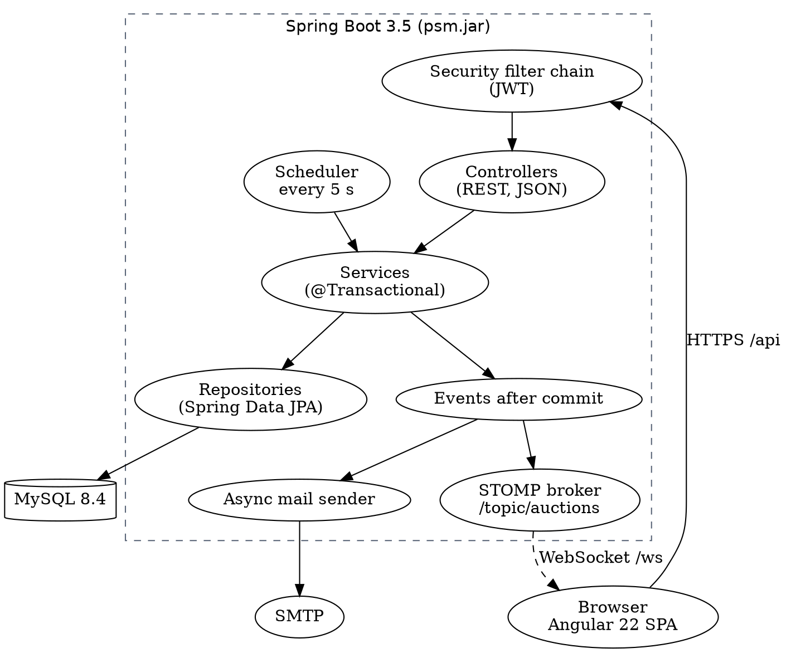
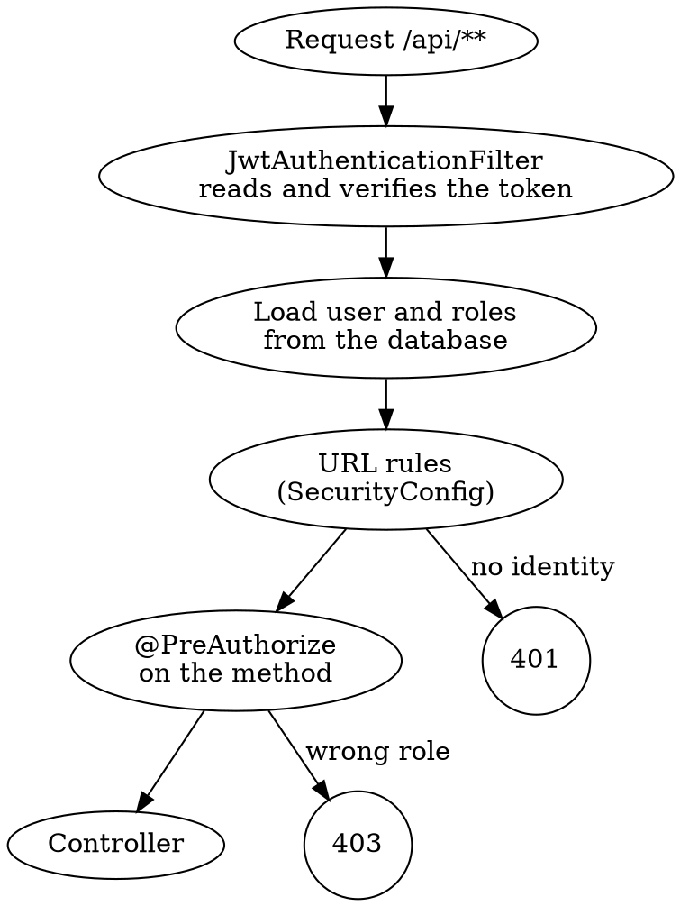
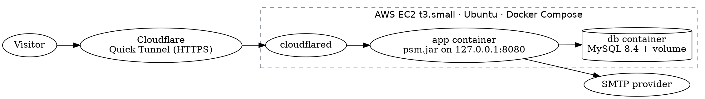

This report presents the work done on ATELIER between 16 and 19 November 2026. It follows the order of the course specification (Spring, Angular, deployment), then gives the results, the evidence and the limits. Figures come from recorded runs kept in `docs/evidence/`.

# Objectives
### The assignment
The course specification "CDC: Projects Manager" asks for a full-stack application that manages **clients**, their **projects**, **users** and **roles**, in three parts:

1. **Spring:** entities, CRUD, Postman tests, JWT security, email after registration, security tests.
2. **Angular:** components and menu following the Argon dashboard, guards, interceptor, role-aware interface.
3. **Deployment:** an executable `psm.jar` with Angular inside, deployed on a VPS.

### The chosen application
The specification is applied to an art gallery run by SmartSoft Solutions' client. A **Client** is an artist represented by the gallery, a **Projet** is one of that artist's exhibitions. To give the application a real use beyond the required CRUD, three features were added: a public catalogue of artworks, live online auctions with a third role (BIDDER), and email notifications for bids and results.

### Success criteria
- Every course step is implemented and can be shown.
- The required relations (User *..* Role, Client 1..* Projet) exist in the database and are tested.
- The API collection runs with zero failures.
- The application is reachable on a VPS.

# Work done by phase
### Timeline
| Date | Phase | Main results |
| --- | --- | --- |
| 16 Nov | Baseline | Course PSM baseline imported and tagged `psm-baseline` |
| 17 Nov | Backend and frontend | Entities and migrations, CRUD, JWT security, auctions, WebSocket, Studio, public site, tests, CI |
| 18 Nov | Completion | Role administration, branded emails, documentation, production image, backup and restore checks |
| 18–19 Nov | Deployment | AWS EC2 instance, Docker Compose, database restore, Cloudflare tunnel, remote checks |

```chart
{"title":"Commits per day on main","labels":["16 Nov","17 Nov","18 Nov"],"values":[1,24,8]}
```

### Method
Work was done on feature branches merged into `main` through pull requests. A GitHub Actions pipeline builds and tests the backend, the frontend and the Docker image on every push. The development stack is defined in `compose.yaml`, so every machine uses the same MySQL, Java and Node versions.

# Architecture
### Overview
ATELIER is a three-tier web application. An Angular single-page application runs in the browser. One Spring Boot process holds the API, security, the auction engine, the email sender and the scheduler. MySQL stores the data.



### Backend organisation
The code is split by feature (`auth`, `user`, `artist`, `exhibition`, `artwork`, `auction`, `account`, `studio`) and, inside each feature, by layer: controller, service, repository, entity, DTO records. Cross-cutting concerns sit in `config`, `security`, `common` (errors, pagination) and `mail`.

### Frontend organisation
| Folder | Content |
| --- | --- |
| `core/` | API clients, authentication store, interceptor, guards, models, WebSocket client |
| `shared/` | Reusable components, layouts, animation helpers |
| `features/` | One folder per page, lazy loaded; `features/studio/` holds the back-office |

The public site and the Studio use two different layouts. Global state (the signed-in user) is held in signals in `AuthStore`.

# Database
### Tables and relations
Flyway creates the schema from three versioned scripts. Hibernate only validates that the Java entities match it.

```stats
[{"value":"8","label":"Application tables"},{"value":"13","label":"Foreign keys"},{"value":"3","label":"Flyway migrations"},{"value":"2","label":"Locking strategies"}]
```


The two relations required by the specification are implemented as follows:
- **User *..* Role:** join table `user_roles` with a composite primary key; deleting a user removes its links (CASCADE), a role in use cannot be deleted.
- **Artist 1..* Exhibition:** column `exhibitions.artist_id`, not null, with a foreign key; an artist with exhibitions cannot be deleted.

```chart
{"title":"Foreign keys by delete rule","labels":["RESTRICT","SET NULL","CASCADE"],"values":[7,4,2]}
```

### Transactions and concurrency
Every write runs in a transaction. Two concurrency mechanisms are used:
- **Optimistic locking** (`@Version`) on Studio records: a save based on an outdated version updates zero rows and the user gets a `stale_update` message.
- **Pessimistic locking** (`SELECT … FOR UPDATE`) on auctions while a bid is placed: a second bid on the same auction waits until the first transaction ends.


The full description is in the database reference (`docs/database.pdf`).

# Security
### Authentication
A user logs in with email and password. The server checks the BCrypt hash and returns a JWT signed with HS256, valid 12 hours by default. The Angular interceptor adds `Authorization: Bearer <token>` to each API call.



### Authorisation
Rights are checked twice on the server: by URL and HTTP method in `SecurityConfig`, and by annotation on controller methods. The interface hides what a role cannot do, but this is only for comfort. The permission matrix is covered by `SecurityMatrixIT` (84 tests) and by the "Security checks" folder of the Postman collection.


# Application screens
### Public gallery


```cols

---

```

### Authentication
```cols

---

```

### Studio


### Live auctions
```cols

---

```


### Phone layout
```cols

---

```

# Email notifications
### What is sent
| Event | Recipients |
| --- | --- |
| Registration, or account created in the Studio | Admin (course step 5) and the new user |
| Artist (client) created, or its email changed | The artist contact and the admin |
| Bid accepted | The bidder; the previous leader receives an "outbid" notice |
| Auction closed | The winner and the admin, or the admin only when there were no bids |
| Auction cancelled | The current leader, if any, and the admin |

Emails are prepared after the transaction commits and sent by a separate thread pool, so a slow mail server does not slow down the request. In development they are caught by Mailpit; in production they go through an SMTP provider.


# Testing
### Test levels
| Level | Tool | Tests | Failures |
| --- | --- | --- | --- |
| Backend unit | JUnit 5 | 19 | 0 |
| Backend integration (real MySQL in Testcontainers) | JUnit 5, MockMvc | 151 | 0 |
| Frontend unit | Vitest | 64 | 0 |
| API scenarios | Postman collection, Newman | 103 requests, 175 assertions | 0 |
| Browser scenarios | Playwright | 14 | 0 |

```chart
{"title":"Automated checks by level","labels":["Backend unit","Backend IT","Frontend","Postman assertions","Browser"],"values":[19,151,64,175,14]}
```

### Postman collection
The collection is organised in ten folders. Requests are chained: the login requests save the tokens, and the create requests save the new IDs for the following requests. Each request has at least one assertion on the status code and, where useful, on the body.

```chart
{"title":"Postman assertions per folder","labels":["Auth","Clients","Projets","Artworks","Auctions","Account","Users","Public","Security","Roles"],"values":[14,13,13,15,20,10,28,14,9,39]}
```


```cols

---

```


# Packaging and deployment
### The jar (course step 11)
The Angular build is copied into `src/main/resources/static/` and Maven packages everything into `backend/target/psm.jar`. Spring Boot serves the Angular files and the API on the same port, and `SpaWebConfig` returns `index.html` for application routes such as `/studio/artists`. The jar is built either by Maven with the `with-frontend` profile or by the multi-stage Dockerfile (Node, then JDK, then a JRE runtime image).

### The VPS (course step 12)


Deployment steps, in order: create the EC2 instance and allow SSH only from the administrator's address; install Docker and Compose; copy the image, the Compose file and the private environment file; start MySQL and restore the database dump; start the application and wait for the readiness check; start the tunnel and set `PUBLIC_URL` to the tunnel address.

### Remote checks (19 November 2026)
| Check | Result |
| --- | --- |
| Angular page and deep link `/studio/artists` | 200, Angular served |
| Readiness probe | UP |
| Public artworks, artists, exhibitions, auctions | 200 |
| Studio and admin APIs without token | 401 |
| Login with a wrong password | 401 |

All ten checks passed (`docs/evidence/vps-smoke.json`). The tunnel address is temporary and changes when the tunnel restarts.

# Results against the specification
| Step | Requirement | Result |
| --- | --- | --- |
| 1 | Spring Boot project with Web, JPA, DevTools, MySQL | Done |
| 2 | CRUD for the entities | Done: clients, projects, users, roles, plus artworks and auctions |
| 3 | Postman tests | Done: 103 requests, 175 assertions, 0 failures |
| 4 | Security and JWT | Done |
| 5 | Email to the admin after registration | Done, after commit and asynchronous |
| 6 | Test login and registration | Done (Postman and integration tests) |
| 7 | Test clients and projects under security | Done (84 matrix tests) |
| 8 | Components and menu following Argon | Done, as an Argon-inspired rebuild for Angular 22 |
| 9 | Guards and interceptor | Done |
| 10 | Roles taken into account in the interface | Done |
| 11 | `psm.jar` with Angular in `static/` | Done |
| 12 | Deployment on a VPS | Done on AWS EC2 |

### Adaptations to state clearly
- Client and Projet are named Artist and Exhibition; the mapping is listed in `docs/CDC_EQUIVALENCE.md`.
- The Studio follows the structure of the Argon dashboard but was rebuilt with current Angular components instead of copying the template.
- A third role, BIDDER, and the auction features are additions to the specification.

# Limits and next steps
### Known limits
- **Temporary address.** The Quick Tunnel URL changes when the tunnel restarts. A named tunnel or a domain is needed for a stable address.
- **Single instance.** The live message broker runs in memory, so the application cannot be scaled to several servers without an external broker.
- **Token revocation.** A JWT stays valid until it expires. Roles and the account's enabled flag are re-read from the database on each request, which limits the impact.
- **Email delivery.** Emails are sent once, without a retry queue.
- **No payment.** The auction records a winner; payment and delivery are handled outside the application.

### Next steps
1. Named Cloudflare tunnel or domain with a fixed address.
2. Automated daily database backup on the server, copied off the machine.
3. Deployment from the CI pipeline instead of copying the image by hand.
4. An external broker (for example RabbitMQ) if more than one application instance is needed.

> ATELIER covers the twelve steps of the specification and adds a working auction use case. The main open item is a permanent public address.
